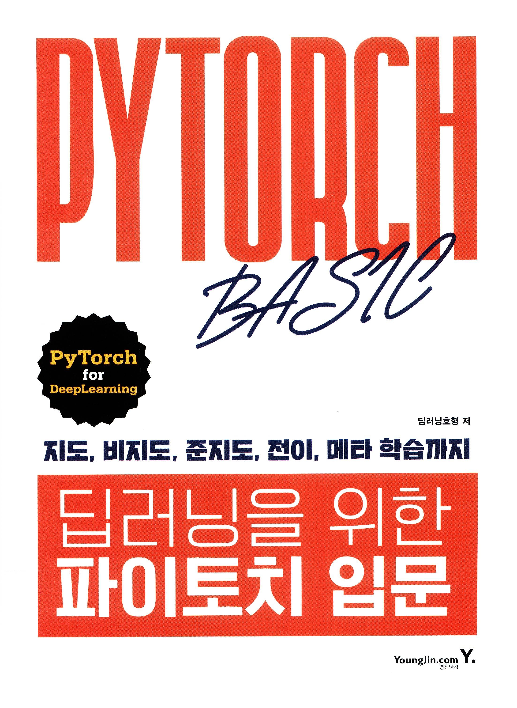

# PYTORCH BASIC

### 지도, 비지도, 준지도, 전이, 메타 학습까지
# 딥러닝을 위한 파이토치 입문

**딥러닝호형 저**

**Youngjin.com 영진닷컴**

# 저자

### 딥러닝호형

22명의 노벨상 수상자를 배출한 독일 막스플랑크 연구소에서 수치해석과 머신러닝을 연구하고 있다. 주요 연구 분야는 오토파일럿과 같은 비선형 시스템에 대한 효율적인 제어 방법이다. 수학과 데이터 분석을 전공했으며 한국에서는 리서치 엔지니어로서 신제품 개발과 다수의 성능 개선 프로젝트를 완수했다. 8년 전 머신러닝에 입문하여 지금까지 데이터 처리 기법, 성능 예측, 이미지 분류, 비지도 객체 인식, 정규화 방법 개발, 트위터 메시지 분석, 유체 예측 등 다양한 기술을 다뤘다. 이를 바탕으로 2019년부터 유튜브 영상과 온라인 강의를 제작하고 있으며 대학 기술 자문 및 공동 연구도 진행하고 있다.

- **이메일**: deeplearningbro@gmail.com
- **유튜브**: 딥러닝호형 DL bro

---

- 영진닷컴 블로그: https://blog.naver.com/ydot
- 영진닷컴 페이스북: https://www.facebook.com/ydot2.page/
- 영진닷컴 트위터: https://twitter.com/ydot2
- 영진닷컴 인스타그램: https://www.instagram.com/ydot2/

# PYTORCH BASIC

### 지도, 비지도, 준지도, 전이, 메타 학습까지
# 딥러닝을 위한 파이토치 입문

**딥러닝호형 저**

**Youngjin.com 영진닷컴**

# 딥러닝을 위한 파이토치 입문 (도서 정보)

Copyright © 2022 by Youngjin.com Inc.
#401, STX-V Tower, 128, Gasan digital 1-ro, Geumcheon-gu, Seoul, Republic of Korea
All rights reserved. No part of this book may be reproduced or transmitted in any form or by any means, electronic or mechanical, including photocopying, recording or by any information storage retrieval system, without permission from Youngjin.com Inc.

ISBN : 978-89-314-6591-4

### 독자님의 의견을 받습니다.
이 책을 구입한 독자님은 영진닷컴의 가장 중요한 비평가이자 조언가입니다. 저희 책의 장점과 문제점이 무엇인지, 어떤 책이 출판되기를 바라는지, 책을 더욱 알차게 꾸밀 수 있는 아이디어가 있으면 이메일 또는 우편으로 연락주시기 바랍니다. 의견을 주실 때에는 책 제목 및 독자님의 성함과 연락처(전화번호나 이메일)를 꼭 남겨 주시기 바랍니다. 독자님의 의견에 대해 바로 답변을 드리고, 또 독자님의 의견을 다음 책에 충분히 반영하도록 늘 노력하겠습니다.

- 이메일: support@youngjin.com
- 주소: (우)08507 서울시 금천구 가산디지털1로 128 STX-V타워 4층 영진닷컴 기획1팀
- 등록: 2007. 4. 27. 제16-4189호

### STAFF
- **저자**: 딥러닝호형
- **책임**: 김태경
- **진행**: 김연희
- **표지디자인**: 임정원
- **내지디자인·편집**: 이주은
- **영업**: 박준용, 임용수, 김도현
- **마케팅**: 이승희, 김근주, 소민영, 채승희, 김민지, 임해나, 김노연, 이다은
- **제작**: 황상협
- **인쇄**: SJ P&B

# 머리말

안녕하세요, 딥러닝호형입니다. 만나서 반갑습니다! 수학/데이터 분석 전공 지식과 다수의 딥러닝 프로젝트 경험을 바탕으로 반드시 공부하셔야 할 내용을 짚어 드립니다. 이 책은 파이썬 기초부터 파이토치를 이용하여 인공 신경망을 구축하는 방법까지의 내용을 다루는 딥러닝 입문서입니다.

인공 신경망은 제조, 자율 주행차, 의료, 생명공학, 로보틱스 등 광범위한 분야에서 이미 적용되고 있는 강력한 인공지능 기술이라고 할 수 있습니다. 실제로 논문 투고 수가 매년 증가하고 있으며, 전 세계적으로 많은 대학들이 관련 학과를 개설하고 업계에서는 많은 투자를 하고 있는 추세입니다. 우리나라도 마찬가지로 대학들이 잇달아 인공지능 관련 학과를 개설하고 있습니다. 이런 흐름에 맞춰 딥러닝 공부를 제대로 시작하고 싶은 분들을 위해 책을 만들었습니다. 이 책의 특징은 인공 신경망에서 쓰이는 기초 개념들과 응용 방법들이 어떻게 작동이 되는지를 코드 라인 별로 자세히 설명한다는 점입니다.

지금까지 강의와 유튜브를 통해 많은 학생들과 이야기를 하면서 생각보다 “인공지능 = 지도 학습”이라는 인식이 많이 깔려있다는 것을 알았습니다. 하지만 인공지능을 학습하는 방법과 응용 분야는 매우 다양합니다. 따라서 고민 끝에 책의 범위를 독자들의 견해를 넓혀 드릴 수 있도록 설정하였습니다. 이 책을 통해 지도 학습, 비지도 학습, 준지도 학습, 메타 학습, 과학적 계산 등의 포괄적인 내용을 쉽게 배우게 될 것입니다. 책의 내용은 관련 논문과 파이토치 공식 사이트 내용을 참고하여 작성되었습니다. 딥러닝 기본 지식이 있는 상태에서 보시는 것을 추천드리며, 그렇지 않은 경우 개념 공부를 병행하면서 보신다면 보다 효율적인 공부를 하실 수 있습니다. 실습 관련 코드는 영진닷컴 홈페이지(www.youngjin.com) 부록 CD 다운로드에서 다운로드하실 수 있습니다.

마지막으로 이 책을 선택하신 독자분들께 감사 말씀 드립니다.

**딥러닝호형 드림**

# 목차

### CHAPTER 1 딥러닝 시작 009
- 1.1 딥러닝이란 010
- 1.2 파이썬과 파이토치 013

### CHAPTER 2 파이썬 023
- 2.1 변수, 출력문, 라이브러리 024
- 2.2 리스트, 튜플, 딕셔너리 034
- 2.3 넘파이 041
- 2.4 조건문과 반복문 049
- 2.5 함수와 모듈 054
- 2.6 클래스 056
- 2.7 그래프 그리기 059
- 2.8 폴더 및 파일 관리 062
- 2.9 터미널에서 파이썬 실행하기 064

### CHAPTER 3 지도 학습 067
- 3.1 지도 학습이란 068
- 3.2 지도 학습의 종류 071
- 3.3 데이터 세트 분할 072

### CHAPTER 4 파이토치 기본 075
- 4.1 텐서 076
- 4.2 역전파 081
- 4.3 데이터 불러오기 086

### CHAPTER 5 인공 신경망 097
- 5.1 다층 퍼셉트론 098
- 5.2 활성화 함수 108
- 5.3 손실 함수 112
- 5.4 최적화 기법 113
- 5.5 교차 검증 117
- 5.6 모델 구조 및 가중치 확인 123

### CHAPTER 6 합성곱 신경망 127
- 6.1 합성곱 연산과 풀링 연산 128
- 6.2 ALEXNET 131
- 6.3 RESNET 137
- 6.4 다양한 합성곱 신경망 142

### CHAPTER 7 순환 신경망 145
- 7.1 기본 순환 신경망 146
- 7.2 LSTM과 GRU 156
- 7.3 BI-LSTM 160

### CHAPTER 8 비지도 학습 167
- 8.1 비지도 학습이란 168
- 8.2 K-평균 알고리즘 169
- 8.3 오토인코더 172
- 8.4 생성적 적대 신경망 181
- 8.5 이미지 스타일 변이 192
- 8.6 깊은 K-평균 알고리즘 199

### CHAPTER 9 성능 개선 209
- 9.1 과적합 210
- 9.2 데이터 불균형 223
- 9.3 전이 학습 228
- 9.4 준지도 학습 231

### CHAPTER 10 시각화 245
- 10.1 설명 가능한 인공지능 246
- 10.2 차원 축소 기법 254

### CHAPTER 11 메타 학습 261
- 11.1 메타 러닝과 퓨샷 러닝 262
- 11.2 MAML - 회귀문제 265
- 11.3 MAML - 분류문제 274

### CHAPTER 12 과학적 계산 285
- 12.1 유한차분법 286
- 12.2 은닉 유체 메카니즘 292

### 부록
- **딥러닝 정보 습득 방법** 310
- **참고 문헌** 316
- **INDEX** 318

> "첫 걸음은 할 수 있는 것을 시작하는 것이다. 그러면 가능성이 열릴 것이다."
> 
> — **일론 머스크**
