# CHAPTER 1 딥러닝 시작

사람보다 뛰어난 업무 능력을 가진 기계를 만들 수 있을까? 생각하는 기계를 구현할 수 있을까? 이처럼 인간은 인공지능이라고 불리는 인간처럼 행동하고 생각하는 기계를 오래전부터 꿈꿔 왔다. 

인공지능 연구는 철학, 수학, 공학, 인지과학 등의 다양한 학문적 접근이 가능한 광범위한 주제를 포함하고 있기 때문에 다양한 분야의 사람들과 협업이 많이 필요하다. 1장에서는 인공지능을 구현하고 학습하는 방법 중 하나인 딥러닝에 대한 역사와 신경망을 구현하는데 필요한 프로그래밍 언어인 파이썬과 파이토치에 대해 간략히 알아본다.

- 딥러닝이란
- 파이썬과 파이토치

## 1.1 딥러닝이란

인공 신경망의 역사에 대해 살펴보고 인공 신경망이 무엇인지 알아본다. 추가적으로 최근 딥러닝 동향과 키워드들도 살펴본다.

### 1.1.1 딥러닝의 역사

그림 1.1 인공지능, 머신러닝, 딥러닝의 포함 관계
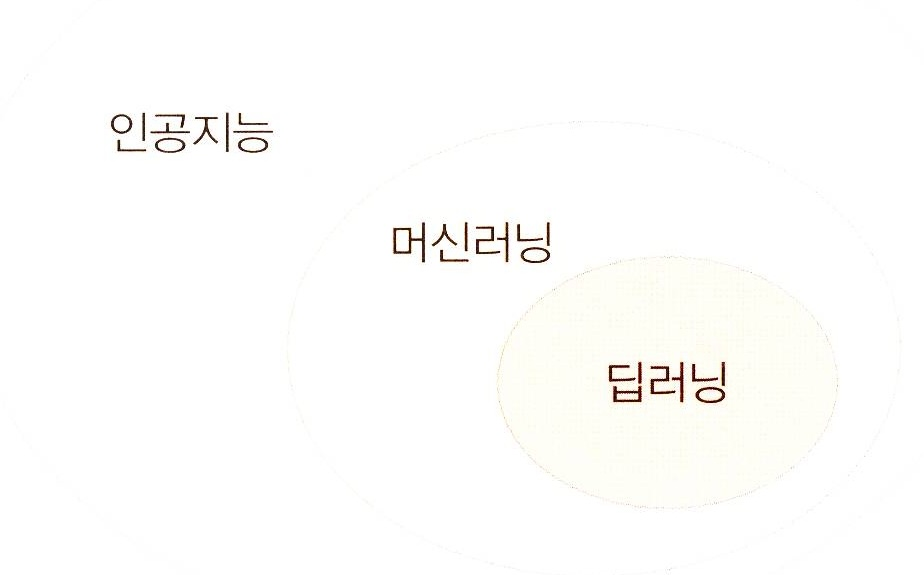

머신러닝<sup>Machine Learning</sup>은 인공지능<sup>Artificial Intelligence</sup>의 두뇌 역할을 하는 기술로써 스스로 학습하여 지식을 만들어 내는 역할을 한다. 머신러닝 분야에는 다양한 예측 모델들이 존재하며 서로 유기적인 역할을 수행하기도 한다. 그중 인간의 신경망을 모사하여 만든 모델을 인공 신경망<sup>Artificial Neural Network</sup>이라고 한다. 인공 신경망은 구현에 대한 자유도가 매우 높아서 다양한 형태의 구조를 구축할 수 있다. 이때 신경망의 깊이에 해당하는 층<sup>Layer</sup>을 여러 개 쌓아 만든 신경망을 깊은 신경망<sup>Deep Neural Network</sup>이라고 하며, 이를 학습하는 방법을 딥러닝<sup>Deep Learning</sup>이라고 한다.

인공 신경망과 딥러닝은 2016년 3월 대한민국의 바둑 고수 이세돌 9단과 인공지능 알파고<sup>AlphaGo</sup>의 바둑 대결을 통해 매우 유명해졌지만 사실 최신 기술은 아니다. 인공 신경망은 1957년 코넬 항공 연구소의 Frank Rosenblatt가 패턴 인식을 위해 고안한 퍼셉트론 알고리즘<sup>Perceptron algorithm</sup>을 시작으로 인공 신경망에 대한 기대가 매우 컸다. 하지만 1969년 Minsky 교수의 XOR 문제 제기로 인해 당시 인공지능의 한계를 드러냈다. 이를 해결하기 위해 1974년 Paul Werbos는 역전파<sup>Backpropagation</sup>를 제안했지만 이목을 끌지는 못했다.

시간이 흘러 현재 AI 거장 중 한 명인 제프리 힌튼<sup>Geoffrey Hinton</sup>은 1986년 독자적으로 만든 역전파를 제안하였고 다시 인공 신경망이 주목받기 시작했다. 하지만 이러한 업적도 오래가지 않아 기울기 사라짐<sup>Vanishing gradient</sup>과 기존 데이터를 과하게 학습하여 생기는 과적합<sup>Overfitting</sup> 문제 그리고 큰 규모의 문제에서 발생하는 높은 계산 복잡도와 컴퓨터 성능의 한계 등으로 인해 90년대 후반 다시 암흑기를 맞이한다.

다시 시간이 흘러 2006년 제프리 힌튼은 적절한 초깃값 설정을 위한 사전훈련<sup>Pre-training</sup>과 깊은 네트워크를 통한 해결책을 제시하면서 딥러닝의 희망을 놓지 않았고 2012년에는 자동차, 동물, 물건 등으로 구성된 ImageNet 데이터베이스를 기반으로 하는 이미지 판별 대회에서 딥러닝이 두각을 나타내면서 많은 사람들의 관심을 받게 되었다. 동시에 컴퓨터 성능의 급격한 발전이 일어나며 더욱 활발한 연구가 이뤄졌다. 이후 다양한 딥러닝 구조를 만들고 새로운 개념을 도입하면서 지금까지도 성능이 꾸준히 개선되고 있으며 자율주행 자동차, 의학, 제조, 생명 공학, 로봇 공학, 언어학 등 다양한 분야에서 적용되고 있다.

### 1.1.2 인공 신경망

신경세포인 뉴런은 신경 전달 물질을 방출하는 시냅스를 통해 다음 뉴런에게 정보를 제공한다. 인간의 신경망은 수많은 뉴런들이 연결되어 뇌로 정보를 전달하는 구조를 지닌다. 딥러닝은 앞서 표현한 인간의 신경망을 모사하여 만든 인공 신경망<sup>Artificial Neural Network</sup>을 기반으로 하는 학습 방법이다. 인공 신경망은 노드와 가중치가 연결된 구조로써 노드<sup>Node</sup>는 뉴런에 해당하고 가중치<sup>Weight</sup>는 시냅스에 대응하는 개념이다. 이때 노드에 있는 값과 시냅스에서 나오는 가중치가 선형 결합<sup>Linear combination</sup>의 형태로 계산되어 다음 노드로 정보가 전달된다.

그림 1.2 인간의 신경망
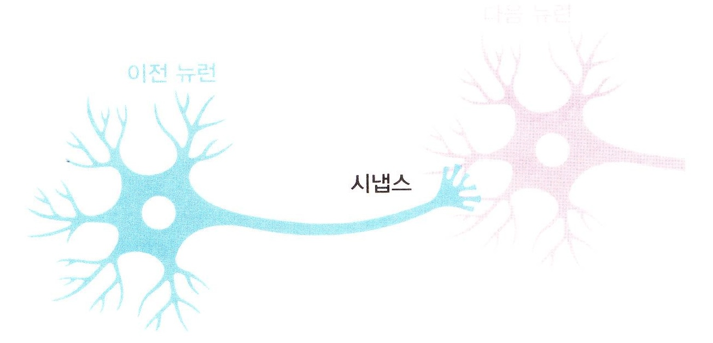

인공 신경망은 3가지 종류의 층으로 나눌 수 있으며 각 층마다 원형으로 표시된 노드로 구성되어 있다. 가장 첫 번째는 입력층<sup>Input layer</sup>이라고 하며 처음으로 데이터가 들어오는 층을 의미한다.

받은 데이터의 값은 가중치가 있는 선을 거쳐 일련의 계산을 통해 은닉층<sup>Hidden layer</sup>으로 보내지고, 다시 다음 가중치와 계산된 값은 마지막 결과 산출에 해당하는 출력층<sup>Output layer</sup>으로 보내지게 된다. 이때 입력층과 출력층 사이에 있는 은닉층이 많은 경우를 깊은 신경망이라고 말한다. 또한 방금 설명한 입력층부터 은닉층을 거쳐 출력층까지의 계산 과정을 순전파<sup>Forward propagation</sup>라고 하며 실질적인 예측 과정에 해당한다.

### 1.1.3 최근 동향

인공지능 분야는 최근 더 급격한 발전을 보이고 있다. 투고되는 논문 수가 해마다 증가하고 있으며, 다른 분야에서도 딥러닝 기술을 접목하는 사례가 늘어나고 있다. 특히 그림 1.3과 같이 컴퓨터 비전과 언어 처리 분야가 가장 활발한 연구 분야라고 할 수 있다. 대표적인 최신 기술로는 OpenAI에서 만든 인간과 유사한 텍스트를 생성하는 GPT-3<sup>Generative Pretrained Transformer 3</sup>가 있다. 현재 가장 핫한 인공지능 키워드들은 자동 머신러닝<sup>AutoML</sup>, 설명 가능한 인공지능<sup>Explainable AI</sup>, 자가 지도 학습<sup>Self-supervised learning</sup>, 퓨샷 러닝<sup>Few-shot learning</sup> 등이 있다.

그림 1.3 컴퓨터 비전 및 언어 처리 분야의 논문 수 통계
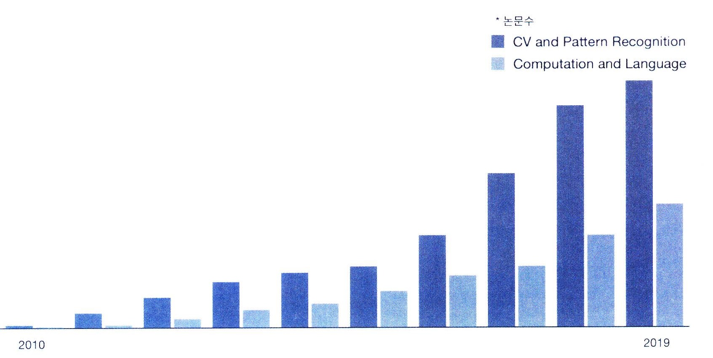

## 1.2 파이썬과 파이토치

딥러닝에서 개념 이해만큼 중요한 것이 구현 능력이며, 목적에 따라 다양한 프로그래밍 언어가 사용된다. 대표 언어인 파이썬<sup>Python</sup>은 Numpy, SciPy, Pandas, Matplotlib, Pytorch와 같은 다양한 라이브러리를 쉽게 이용할 수 있다는 것과 많은 유저를 확보하고 있기 때문에 정보를 얻기 쉽다. 이런 이유로 인해 데이터 분석가들로부터 많은 사랑을 받고 있다.

그림 1.4 파이썬
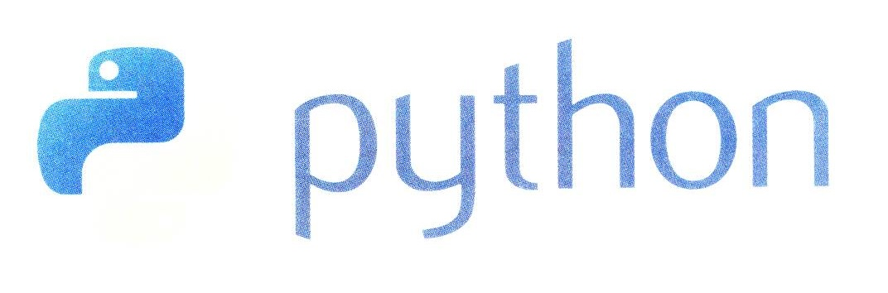

파이토치<sup>Pytorch</sup>는 파이썬을 기반으로 만든 오픈소스 머신러닝 라이브러리다. 파이토치는 다음과 같은 장점을 통해 많은 사용자를 확보하고 있다.

1. GPU 연산을 제공하여 멀티 태스킹이나 고차원 문제를 빠르게 해결할 수 있게 한다.
2. 다양한 모델과 데이터 세트를 제공하여 복잡한 코딩 없이 고성능의 유명한 모델을 구축할 수 있다.
3. 파이토치는 파이썬 Numpy와 사용방법이 유사하고 구조가 매우 직관적이기 때문에 이해하기 쉽다.
4. 사용자가 증가하면서 정보 공유가 수월하다.

그림 1.5 파이토치
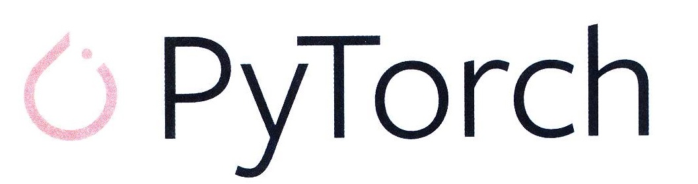

■ **구글 코랩(Google Colaboratory)**
딥러닝을 공부하기 위해서는 GPU 사용이 권장된다. 만약에 GPU를 가지고 있지 않아서 구매를 하려면 큰 금액을 지출해야만 한다. 다행히도 우리가 학습용으로 딥러닝 코드를 구현한다면 구글 코랩<sup>Colab</sup>을 통해 무료로 GPU를 사용할 수 있다. 구글 코랩은 구글에서 제공하는 가상 머신이기 때문에 구글 계정만 있다면 개인 컴퓨터에 GPU가 없어도 GPU 연산이 가능하다.

또한 구글 드라이브와 연동이 가능해 데이터 세트나 실행 파일을 저장하고 불러올 수 있다. 따라서 딥러닝 입문자에게 천사 같은 존재다. 물론 좀 더 나은 환경을 사용하기 위해서 유료로 제공하는 코랩 프로를 사용할 수도 있다.

그림 1.6 구글 코랩


■ **구글 드라이브 접속과 구글 코랩 실행**
구글 드라이브 접속을 위해 먼저 구글 계정을 만들고, 구글에 로그인을 한다. 그리고 우측 상단 9개 사각형 모양을 클릭한 후 드라이브를 클릭한다.

그림 1.7 구글 드라이브 접속 경로
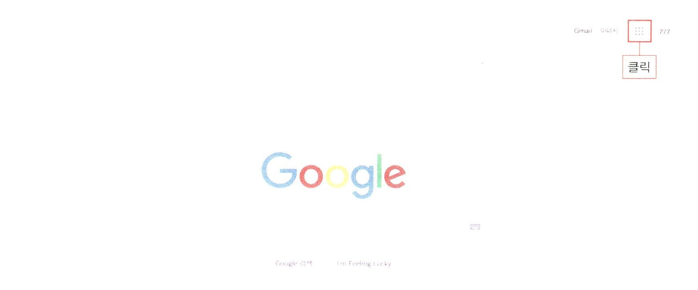

그림 1.8 구글 드라이브 접속하기
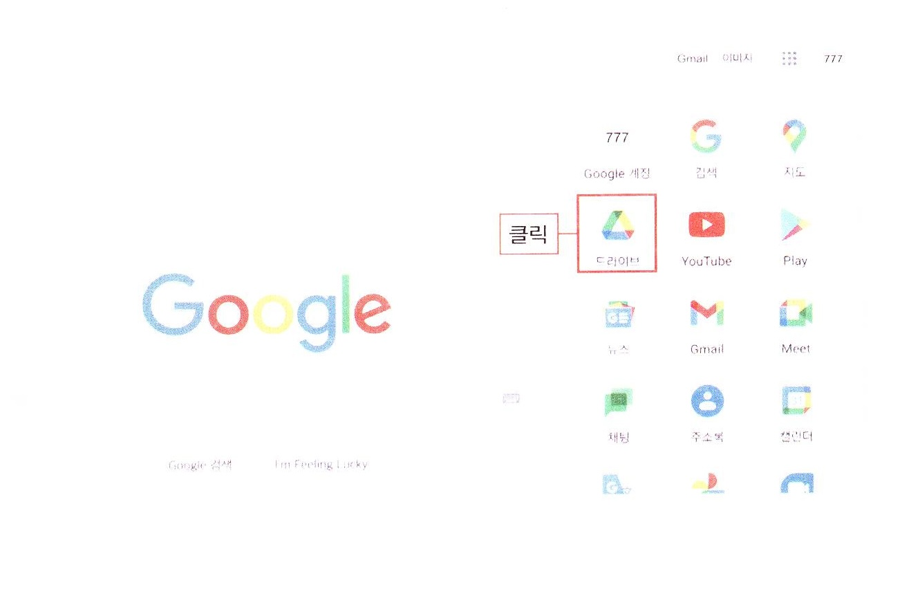

마우스 우클릭을 통해 새로운 폴더 생성 및 이동, 복사 등을 수행할 수 있으며 다양한 프로그램을 사용할 수 있다. 여기서 구글 코랩을 실행한다. 구글 코랩이 없다면 "연결할 앱 더보기"를 통해 무료로 설치할 수 있다(구글에서 구글 코랩을 검색하여 바로 코랩을 사용할 수도 있다).

그림 1.9 구글 드라이브에서 구글 코랩 실행하기
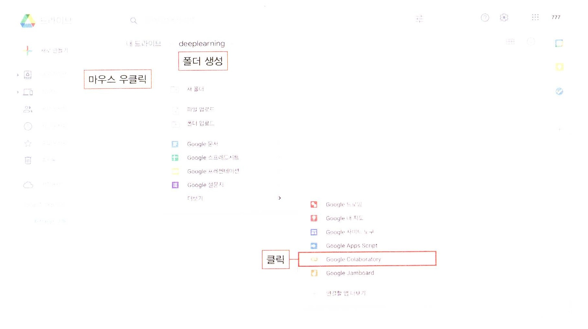

■ **구글 코랩 노트북 파일**

❶ 파일명을 변경할 수 있다.
❷ 연산 종류, 창 정리, 초기화 등의 작업을 수행할 수 있다.
❸ 작업창에 있는 하나의 작업 공간을 셀이라고 하는데, +Code는 코딩의 연산을 할 수 있는 셀을 생성하고 +Text는 연산에 직접적인 영향이 없는 관련 내용, 주석 등을 다루는 셀을 생성한다.
❹ 코랩의 인터페이스 및 폰트 등을 조정할 수 있다.
❺ 다수의 셀을 만들어 작업하는 작업창이다.
❻ 코랩을 실행하면 현재 구동되고 있는 파일이 무엇인지 메모리와 디스크 할당량은 얼마인지를 알려준다. 무료 코랩은 최대 12시간 연속 작업이 가능하다.

그림 1.10 구글 코랩 작업창
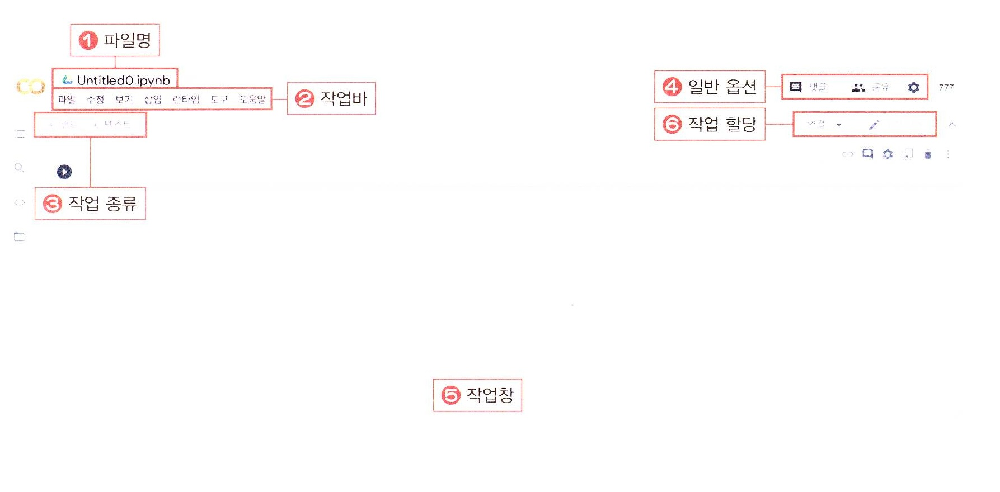

■ **GPU 연산 이용하기**

런타임 > 런타임 유형 변경을 클릭한다.

그림 1.11 GPU 활성화하기
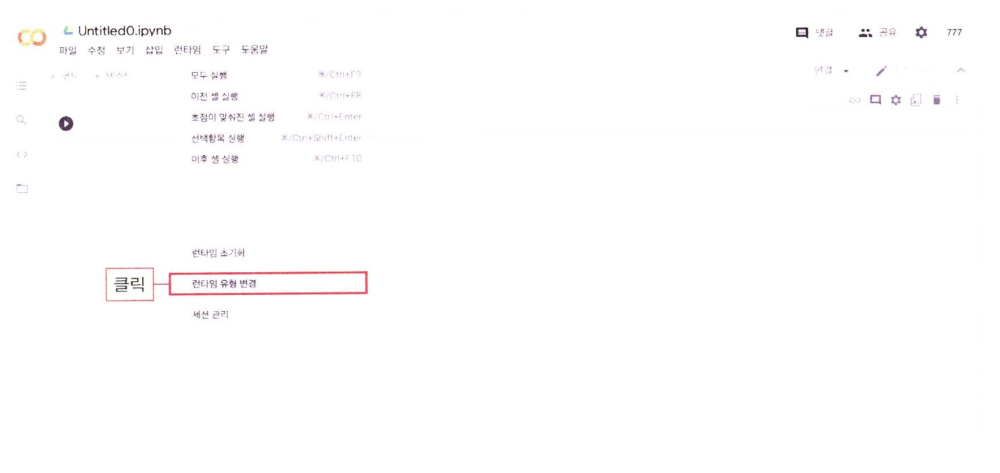

GPU 연산이 필요한 경우에는 코드 실행 전 반드시 GPU로 유형을 활성화시켜야 한다. 무료 코랩인 경우 GPU 연산/메모리 할당량에 제한이 프로보다 크기 때문에, 사용하지 않을 경우 다시 None으로 코랩을 사용할 수 있다. TPU는 구글에서 제작한 머신러닝 연산에 특화된 텐서 병렬 처리 하드웨어다. 현재 텐서플로우<sup>TensorFlow</sup>에서 사용 가능하다.

(1) None: CPU<sup>Central Processing Unit</sup> 연산만 가능
(2) GPU: GPU<sup>Graphics Processing Unit</sup> 연산 가능
(3) TPU: TPU<sup>Tensor Processing Unit</sup> 연산 가능

그림 1.12 하드웨어 가속기 설정
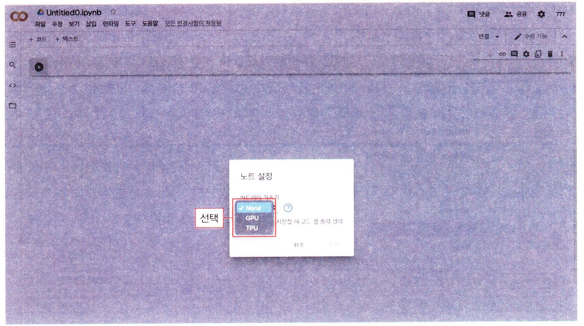

■ **구글 코랩에서 구글 드라이브 연동하기**

다음과 같이 셀에 입력하면 암호키를 입력하라는 문구가 뜬다.

```python
from google.colab import drive
drive.mount('/content/gdrive')
```

그림 1.13 구글 코랩에서 구글 드라이브 연동하기
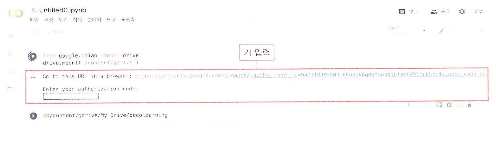

파란색 링크로 들어가서 코드를 복사하여 빈 칸에 붙여넣기를 한다.

그림 1.14 계정 선택
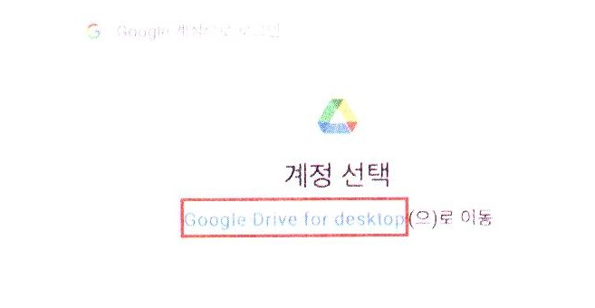

그림 1.15 암호키 복사
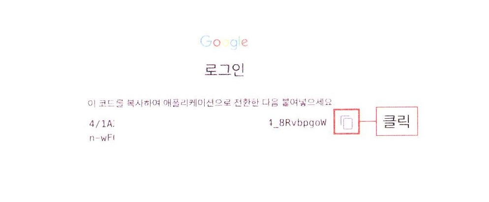

그림 1.16 키 붙여넣기
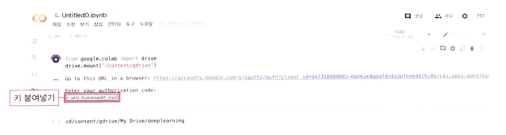

■ **작업 폴더로 진입하기**

마운트 완료 후 작업하는 폴더에 접속한다. 구글 드라이브의 가장 첫 페이지 경로는 `cd/content/gdrive/My Drive/` 이다. 따라서 해당 경로 뒤에 폴더 위치를 나열한다. 예를 들어 메인에 있는 deeplearning 폴더를 접속하고 싶다면 다음과 같이 작성한다.

```python
from google.colab import drive
drive.mount('/content/gdrive')
```

```bash
cd/content/gdrive/My Drive/deeplearning
```

그림 1.17 작업 폴더로 진입하기
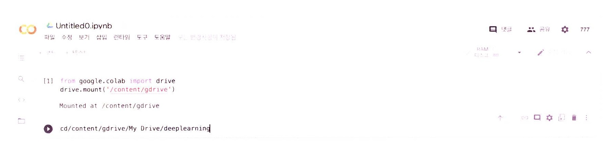

■ **라이브러리 설치 및 실행하기**

간혹 작성해놓은 코드에서 사용한 라이브러리가 코랩에 없어서 실행이 안 되는 경우가 있다. 이 경우에는 별도 설치를 해야만 한다. 예를 들어 개인 컴퓨터에 텐서보드X를 설치한다면, `pip install tensorboardX`를 터미널에 입력할 수 있다. 또한 파이썬 파일 main.py를 터미널에서 실행할 경우 `python main.py`라고 입력한다. 여기서 주의할 점은 코랩에서 동일한 명령을 수행할 경우 가장 앞에 느낌표(!)를 붙여서 셀에 입력한다.

```bash
!pip install tensorboardX
!python main.py
```

그림 1.18 구글 드라이브 경로 설정
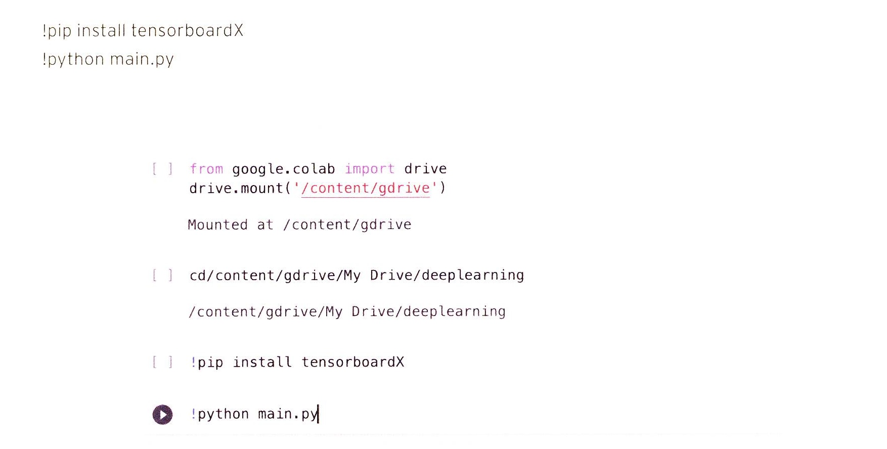

> "인공지능의 다음 혁명은 지도 학습도 아니고 전적인 강화 학습도 아닐 것이다."
> 
> — **얀 르쿤**
