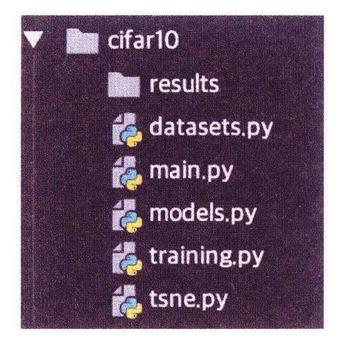
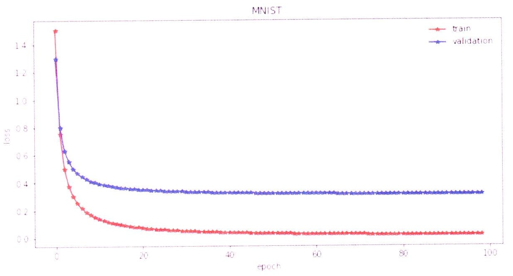
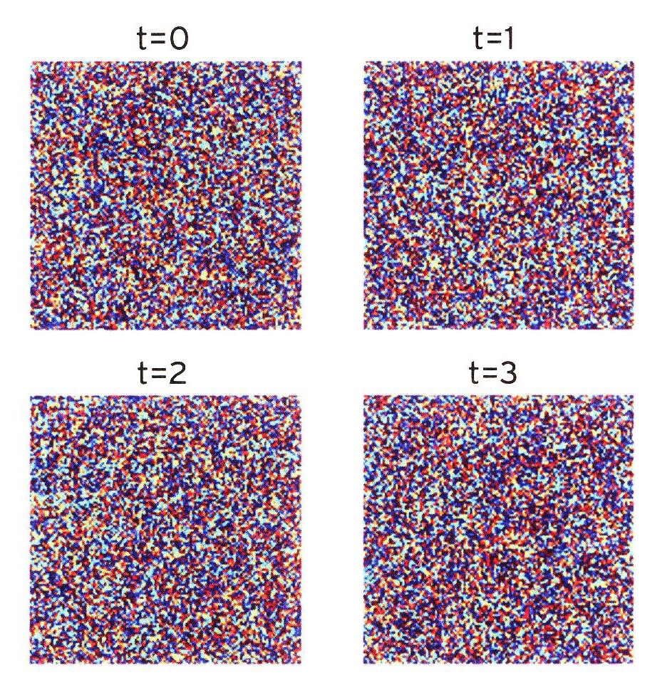

# CHAPTER 2 파이썬

파이토치는 파이썬 기반의 오픈소스 머신러닝 라이브러리다. 따라서 파이썬에 대한 기본 지식이 요구된다. 2장에서는 프로그래밍 언어에서 가장 기본적이고 중요한 변수 타입부터 문법, 시각화, 실행 방법 등 파이썬에 대한 전반적인 내용을 다룬다.

- 변수, 출력문, 라이브러리
- 리스트, 튜플, 딕셔너리
- 넘파이
- 조건문과 반복문
- 함수와 모듈
- 클래스
- 그래프 그리기
- 폴더 및 파일 관리
- 터미널에서 파이썬 실행하기

## 2.1 변수, 출력문, 라이브러리

한국어, 영어와 같은 언어의 구성은 알파벳부터 문법 그리고 어휘 등으로 구성되어 있으며 이를 지켜야만 원활한 의사소통을 할 수 있다. 프로그래밍 언어도 이와 동일하게 기본 형태, 구조, 다양한 표현들이 존재하며 약속된 기호와 문법 그리고 올바른 논리를 사용해야만 컴퓨터에게 제대로 된 명령을 내릴 수 있다. 보통 프로그래밍 언어의 기본은 변수에 대한 타입이다. 변수 타입<sup>Type</sup>은 숫자, 문자, 데이터 묶음 등 매우 다양하게 있는데, 여기서는 기본적으로 많이 사용되는 타입에 대해서 알아보도록 한다. 특히, 변수는 타입에 따라 다른 성질을 가지고 있다는 것에 초점을 맞추어 학습하도록 한다.

### 2.1.1 정수형(int)

파이썬에서의 "="은 "같다"라는 의미가 아니고 x에 1을 "넣는다"는 개념으로 생각한다. 따라서 x에 1이라는 정수를 넣었으므로 x는 정수형 타입이 된다. 타입은 type() 함수를 사용하여 확인할 수 있으며 정수형<sup>Integer</sup> 타입은 int로 출력된다.

```python
x = 1
type(x)
```
Output: `int`

### 2.1.2 실수형(float)

실수는 -4, 1.2, 1/3 등과 같은 유리수와 $\pi$, $\sqrt{3}$, $e$ 등의 무리수를 포함하는 숫자이며, 실수형 타입은 float로 출력된다.

```python
x = 1.5
type(x)
```
Output: `float`

■ **실수형과 정수형**

다음 예시에서 x, y는 어떤 차이가 있을까? 두 변수 모두 1을 가지고 있지만 x는 1.(즉, x=1.0)을 넣어 실수형이고 y는 정수 1을 가지고 있는 정수형 타입이다. 또한 정수형과 실수형을 연산하면 실수형이 된다.

```python
x = 1.
y = 1
type(x+y)
```
Output: `float`

■ **부동 소수점(floating point)**

x=0.5와 같이 정수 부분이 0인 실수라면 x=.5라고 표현할 수 있다. 또한 y+z를 계산하면 1.2+2.4=3.6임을 알 수 있지만 실제 출력은 3.5999999999999996이다. 이는 컴퓨터가 기본적으로 2진수 연산을 하기 때문에 10진수로 표현된 1.2와 2.4를 2진수 형태로 변환하여 계산 후 다시 10진수로 보여주는 과정을 거치는데, 실수를 근사하게 표현하는 부동 소수점 방식에 의해 오차가 발생하게 된다. 따라서 컴퓨터에게 "1.2+2.4가 3.6인가?"라는 등식 형태의 질문을 하는 것은 조심해야 한다.

```python
x = .5
y = 1.2
z = 2.4
y+z
```
Output: `3.5999999999999996`

■ **숫자 연산**

기본적으로 실수형, 정수형은 함께 연산이 가능하고 덧셈, 뺄셈, 곱셈, 나눗셈, 거듭제곱은 각각 +, -, \*, /, \*\*으로 표현된다. 또한 예시와 같이 정수형으로만 계산을 하더라도 실수형으로 타입이 나올 수 있다.

```python
x = 2
y = 3

x+y
```

Output: `5`

```python
x-y
```
Output: `-1`

```python
x*y
```
Output: `6`

```python
x/y
```
Output: `0.6666666666666666`

추가적으로 //은 나눗셈 /와 연산은 동일하지만 소수점을 버린다. 즉 0.666..은 0이고 1.5는 1로 출력된다. %은 나머지를 구할 때 사용한다. 따라서 y%x에서 3을 2로 나눈 나머지가 1이므로 1이 출력된다.

```python
x//y
```
Output: `0`

```python
y//x
```
Output: `1`

```python
y%x
```
Output: `1`

```python
x%y
```
Output: `2`

숫자 계산 시 괄호 ()를 의도대로 올바르게 사용해야 한다. 모든 연산은 () 안을 먼저 수행한다. 덧셈, 뺄셈 보다는 곱셈, 나눗셈이 연산에서의 우선 순위에 있다. 따라서 x는 -10이고 y는 -6이다.

```python
x = 2-4*3
y = (2-4)*3
```

### 2.1.3 문자형(string)

문자형은 큰따옴표 " "나 작은따옴표 ' ' 사이에 숫자나 문자를 넣어 표현하게 되며 타입은 str로 출력된다. 여기서 조심해야 할 부분은 y는 1이라는 문자를 가진 변수이므로 정수형 타입이 아니다. 하지만 print() 함수를 사용해서 값을 출력을 할 경우에는 정수형 1과 문자형 "1"은 모두 1로 보이게 출력이 되기 때문에 숫자만 보고 정수형 타입이라고 생각할 수 있다. 따라서 간혹 숫자 계산 시 에러가 날 때 숫자라고 생각한 변수가 문자형인 경우도 있다.

```python
x = 'hello'
y = '1'
type(x)
```
Output: `str`

숫자가 문자형으로 표현되어 있다면 int(), float() 함수를 사용하여 숫자 형태로 변경할 수 있다.

```python
z = int(y)
type(z)
```
Output: `int`

문자와 숫자는 연산이 불가능하다. 따라서 목적에 따라 두 변수를 동일한 타입으로 바꿔줘야 한다. 정수형 계산을 해야 한다면 y에 int()를 사용하여 정수 2로 변환 후 x+int(y)를 계산하면 1+2=3이 된다.

```python
x = 1
y = '2'

x+int(y)
```
Output: `3`

문자형 연산이 필요하다면 str() 함수를 사용하여 1을 '1'로 변환하여 str(x)+y을 계산을 하면 '1'과 '2'가 붙어 '12'가 된다.

```python
str(x)+y
```
Output: `'12'`

문자형에서의 덧셈은 둘을 이어주는 역할을 한다. 여기서 중요한 것은 공백<sup>space</sup>도 문자로 취급한다. 예를 들어 x1='deep'과 x2='deep '은 완전히 다른 변수다. 따라서 x+y는 deep 띄고 learning으로 보이게 된다. 그리고 3\*y는 y를 3번 나열한다는 의미다.

```python
x1 = 'deep'
x2 = 'deep '
y = 'learning'

x1+y
```
Output: `'deeplearning'`

```python
x2+y
```
Output: `'deep learning'`

```python
3*y
```
Output: `'learninglearninglearning'`

■ **문자형 인덱싱**

문자형은 각 알파벳 하나 혹은 부분을 뽑을 수가 있다. 파이썬에서는 순서를 0부터 세기 때문에 y[0]은 learning의 가장 첫 번째 알파벳인 'l'이고 y[1]은 두 번째 알파벳인 'e'이다. -1은 마지막을 나타내는 의미로 y[-1]은 'g'이고 y[-2]는 뒤에서 두 번째인 'n'을 의미한다. 이때 [ ] 안의 숫자를 인덱스<sup>index</sup>라고 한다. 연속된 인덱스를 표현할 때에는 콜론 ":"를 이용하는데 마지막 숫자는 셈에서 포함하지 않는다. 즉, y[1:4]는 1, 2, 3번째 인덱스에 대해서 관련 문자를 출력하여 'ear'가 된다(1:4는 1, 2, 3, 4가 아니고 1, 2, 3이다).

```python
y[1]
```
Output: `'e'`

```python
y[-1]
```
Output: `'g'`

```python
y[1:4]
```
Output: `'ear'`

### 2.1.4 부울형(bool)

부울형은 True나 False로만 표현되며 타입은 bool이다.

```python
x = True
y = False
type(x)
```
Output: `bool`

y+z가 3.6임을 물어본다면 예<sup>True</sup>, 아니오<sup>False</sup>로 답할 수 있을 것이다. 이때 같은지를 물어 볼 때에는 ==을 사용하는데 bool 타입으로 결과를 보여준다. 결과는 부동 소수점에 의해 False임을 알 수 있다.

```python
y = 1.2
z = 2.4
y+z == 3.6
```
Output: `False`

### 2.1.5 출력문(print)

코드 실행 중에 진행 상황과 결과를 알고 싶을 때 출력문을 통해 관련 변수에 대해서 확인할 수 있다. 출력문의 기본적인 표현 방법에 대해서 알아보자.

```python
print("Hello")
```
Output: `Hello`

기본적으로 print()에 큰따옴표 " " 나 작은따옴표 ' '를 사용하면 그 안의 문자가 그대로 출력된다.

```python
a = 5
print("a")
```
Output: `a`

따라서 변수 a 값을 출력할 경우 큰따옴표 " "나 작은따옴표 ' '를 사용하지 않는다.

```python
print(a)
```
Output: `5`

f" "는 따옴표 안에서도 변수를 출력할 수 있게 해준다. 따옴표 안에서 변수를 출력하고 싶을 때에는 {}를 사용한다.

```python
a = 9
b = 10
print(f"I got {a} out of {b}.")
```
Output: `I got 9 out of 10.`

" "는 문자형이다. 따라서 +를 이용하여 문자열을 차례대로 이을 수 있다. 여기서 a는 정수형이므로 문자형 변수와 계산을 하기 위해 str()를 사용하여 타입을 str로 변경한다. 또한 띄어쓰기를 위해 따옴표 안에 공백을 포함시킨다. 하지만 문자형을 나열할 때 콤마 ,를 사용하면 각 문자형 변수 사이에 띄어쓰기가 자동으로 들어가 출력된다.

```python
a = 5
print('I am ' + str(a) + ' years old.')
print('I am', str(a), 'years old.')
```
Output:
```
I am 5 years old.
I am 5 years old.
```

실수형은 소수점 자릿수를 조절하여 출력할 수 있는데 %.1f은 소수점 첫째 자리까지, %.2f는 둘째 자리까지 출력을 한다. 정수형은 %d, 문자형은 %s을 사용하며 %(a, b, c)의 타입 순서를 맞춰서 동시에 출력을 할 수 있다.

```python
a = 4
b = "cat"
c = 4.2123213
print(c)
print("%.1f" % (c))
print("%.2f" % (c))
print("%.4f" % (c))
print("%d, %s, %.1f" % (a, b, c))
```
Output:
```
4.2123213
4.2
4.21
4.2123
4, cat, 4.2
```

■ **주석 처리**

코드를 작성할 때 코드의 설명을 위해 코멘트를 남기고 싶은 경우에는 샵(#) 뒤에 글을 쓰고, 글이 길어질 경우에는 큰따옴표 3개를 위아래로 표시하고 그 가운데 글을 작성하면 알고리즘 연산에는 영향을 주지 않는 코멘트가 된다.

```python
# Hello, there!
"""
Hello, there!
My name is Python.
"""
```

### 2.1.6 라이브러리(library)

라이브러리는 사용자가 쉽게 코딩을 할 수 있도록 미리 만들어 놓은 도구 묶음이다. 따라서 코드에서 필요한 라이브러리가 있다면 불러와서 바로 사용할 수 있기 때문에 코딩에 필수적인 요소다. 예를 들어 배열을 관리하고 계산하는데 유용한 numpy 라이브러리가 있는데, 우리는 import를 통해 해당 라이브러리를 불러와서 사용하기만 하면 된다. numpy는 sum, mean, std, array, concatenate 등 매우 다양한 기능을 제공한다. 만약 array 배열 하나를 만들고 싶다면 numpy.array라고 작성한다. 여기서 점과 "."는 안에 있다라는 의미로 numpy 도구 상자 안에 있는 array()라는 도구를 꺼내서 쓰겠다는 것이다. 다음은 numpy 배열 arr = numpy.array([1, 2, 3])의 성분의 합을 구한다면 arr[0]+arr[1]+arr[2]와 같은 방식으로 계산할 수 있다. 하지만 크기가 큰 배열에 대해서는 매우 비효율적인 계산이다. 다행히 numpy는 성분의 합을 구해주는 sum() 함수를 제공하기 때문에 numpy.sum(arr)를 이용해 간단히 답을 구할 수 있다.

```python
import numpy
arr = numpy.array([1,2,3])
numpy.sum(arr)
```
Output: `6`

■ **라이브러리 사용법**

우리가 첫 번째 예시와 같이 import numpy를 이용해 라이브러리를 불러 왔다면 numpy 내의 함수를 사용할 때마다 numpy.array(), numpy.sum(), numpy.ones() 와 같이 numpy.을 붙여줘야 한다. 따라서 라이브러리 명이 길면 코딩이 번거롭다. 이때 import 부분에 as를 붙여 줄임말을 만들 수 있다. 따라서 예시와 같이 더 이상 numpy.를 적지 않고 np.로만 함수 사용이 가능하다.

```python
import numpy as np
arr = np.array([1,2,3])
np.sum(arr)
```
Output: `6`

또한 라이브러리 전체를 불러오지 않고 from과 import를 이용해 필요한 함수만 불러올 수 있다. 즉, numpy로부터 array와 mean을 직접 불러왔다면 numpy.나 np.를 붙이지 않고 함수명만 적어 사용할 수 있다.

```python
from numpy import array, mean
arr = array([1,2,3])
mean(arr)
```
Output: `2.0`

■ **다양한 라이브러리**

라이브러리 종류는 매우 다양하고 목적에 따라 다수의 라이브러리를 사용하게 된다. 일반적으로 코드의 가장 윗부분에 라이브러리를 불러오는 문장을 작성한 후 코딩을 한다.

```python
import numpy as np
import pandas as pd
import sklearn
import torch
import tqdm as tqdm
......
```

## 2.2 리스트, 튜플, 딕셔너리

인공 신경망을 학습하기 위해서는 다량의 데이터를 가공 및 처리를 해야 한다. 따라서 다량의 데이터를 포함한 데이터 세트를 어떻게 정의하는지가 중요하다. 파이썬은 다양한 데이터 타입만큼 다양한 형태로 데이터를 묶을 수 있다. 그중 가장 많이 사용되는 리스트, 튜플, 딕셔너리에 대해서 학습한다.

### 2.2.1 리스트(list)

리스트는 데이터를 묶을 수 있는 가장 쉬운 타입 중 하나다. 단일 숫자를 모을 수도 있고 리스트나 배열 같은 모임을 담을 수도 있다. list의 타입은 list이기 때문에 array와 연산을 할 때에는 array로 변환을 하여 연산하거나 array를 list로 바꿔 타입을 맞춰 계산해야 한다. 원하는 연산을 위해서는 타입이 매우 중요하다는 것을 다시 한 번 생각한다.
리스트의 성분은 콤마(,)로 나눈다. 예를 들어 1, 2, 3, 4 숫자 4개를 담고 싶다면 콤마를 이용해 구분하고 대괄호 [ ]를 사용하여 하나의 리스트를 표현한다.

```python
list1 = [1, 2, 3, 4]
print(list1, type(list1))
```
Output: `[1, 2, 3, 4] <class 'list'>`

리스트의 인덱싱은 대괄호 [ ]의 번호를 통해 할 수 있다. 즉, list1[0]은 리스트 list1에서 0번째 성분을 의미하므로 1을 출력한다. -1번째는 마지막 성분을 의미하며 -2번째는 마지막에서 두 번째 성분을 의미한다. 성분을 차례대로 여러 개를 얻고 싶다면 콜론 :을 사용하며 콜론 뒤의 숫자는 계산 시 포함하지 않는다. 즉, list1[1:3]는 list1의 1번째, 2번째 성분을 출력하며 이 또한 타입이 리스트다.

```python
print(list1[0], list1[-1], list1[-2], list1[1:3])
```
Output: `1 4 3 [2, 3]`

리스트에는 문자형도 담을 수 있다. list2[0]은 'math'이며 문자형 'math'의 1번째 문자는 'a'이므로 list2[0][1]는 'a'을 출력한다.

```python
list2 = ['math', 'english']
list2[0]
```
Output: `'math'`

```python
list2[0][1]
```
Output: `'a'`

리스트는 서로 다른 타입도 담을 수 있다.

```python
list3 = [1, '2', [1, 2, 3]]
list3
```
Output: `[1, '2', [1, 2, 3]]`

■ **리스트 연산**

리스트에서 덧셈 +은 앞뒤를 붙여 주는 역할을 한다. 리스트에 정수를 곱하면 리스트가 정수배 만큼 뒤에 붙는다. append는 기존 리스트에서 추가 성분을 만들어 주는 역할을 하며 리스트가 업데이트되는 in-place 방식이다. 즉, list4는 성분이 3개이므로 list4.append(list5)를 통해 list5를 받아 성분이 4개가 되며 list4는 더 이상 [1, 2, 3]이 아닌 [1, 2, 3, [4, 5]]으로 업데이트된다.

```python
list4 = [1, 2, 3]
list5 = [4, 5]
list4 + list5
```
Output: `[1, 2, 3, 4, 5]`

```python
2*list4
```
Output: `[1, 2, 3, 1, 2, 3]`

```python
list4.append(list5)
list4
```
Output: `[1, 2, 3, [4, 5]]`

[1, 2, 3, [4, 5]]에서 -1번째 성분은 [4, 5]이고 -2번째 성분은 3이다. 만약 -2번째부터 빈 리스트로 대체한다면 0번째, 1번째 원소만 남게 된다.

```python
list4[-2:] = []
list4
```
Output: `[1, 2]`

리스트들을 모아서 연산에 활용할 수 있다. 인덱싱은 순차적으로 대괄호 [ ]를 이용한다. 예를 들어 [[1, 2], [0, 5]]에서 2를 출력하고 싶다면 0번째 리스트에서 1번째 성분을 뽑아야 하므로 c[0][1]라고 표현할 수 있다. 또한 리스트는 성분을 삭제, 추가, 변경할 수 있다. c[0][1]의 값을 10으로 변경할 경우에는 c[0][1]=10라고 표현한다.

```python
a = [1, 2]
b = [0, 5]
c = [a, b]
c
```
Output: `[[1, 2], [0, 5]]`

```python
c[0][1]
```
Output: `2`

```python
c[0][1] = 10
c
```

Output: `[[1, 10], [0, 5]]`

■ **리스트 관련 함수**

range(n) 함수는 0부터 정수 n-1까지 나열된 리스트다. 즉, range(10)은 [0, 1, 2, 3, 4, 5, 6, 7, 8, 9]이다.

```python
a = range(10)
a
```
Output: `range(0, 10)`

sum(a)은 a의 성분이 숫자일 때 모든 성분을 더해준다. 즉, 0부터 9까지 자연수를 더해 45가 출력된다.

```python
sum(a)
```
Output: `45`

sorted() 함수는 오름차순 작은 숫자부터 성분을 나열한다.

```python
b = [2, 10, 0, -2]
sorted(b)
```
Output: `[-2, 0, 2, 10]`

b.index(0)는 0이라는 성분의 위치(인덱스)를 알려준다. 따라서 [2, 10, 0, -2]의 2번째에 해당하는 2를 출력한다. len()는 가장 많이 활용하는 함수로서 리스트의 길이(성분의 개수)를 의미한다. 이 밖에 매우 다양한 함수가 존재하며 필요한 부분에 대해서 검색하여 학습하는 습관을 가지면 좋다.

```python
b.index(0)
len(b)
print(b.index(0), len(b))
```
Output: `2 4`

### 2.2.2 튜플(tuple)

튜플은 리스트와 마찬가지로 원하는 데이터를 묶는 역할을 한다. 하지만 리스트와 가장 큰 차이점은 한 번 정의된 튜플은 수정이 불가능하며 괄호 ()를 이용하여 하나의 튜플을 정의한다.
값을 변경하려고 하면 에러 메시지가 출력된다.

```python
a = (1, 2)
print(a, type(a))
```
Output: `(1, 2) <class 'tuple'>`

```python
a[0] = 4
```
Output: `TypeError: 'tuple' object does not support item assignment`

다음 예시와 같이 리스트와 동일한 연산을 사용할 수 있으며, 다양한 타입을 포함할 수 있다.

```python
a = (1, 2)
b = (0, (1, 4))
a + b
```
Output: `(1, 2, 0, (1, 4))`

### 2.2.3 딕셔너리(dict)

딕셔너리는 키<sup>Key</sup>와 값<sup>Value</sup>으로 대응되어 데이터가 정리된 모임이다. 각 키에 콜론 :으로 표현하여 값을 할당하며 키를 통해 원하는 데이터를 바로 불러올 수 있다.

```python
a = {"class": ['deep learning', 'machine learning'], "num_students": [40, 20]}
```
Output: `{'class': ['deep learning', 'machine learning'], 'num_students': [40, 20]}`

```python
type(a)
```

Output: `<class 'dict'>`

하나의 딕셔너리를 만들 때는 중괄호 {}를 사용하며 각 키와 값의 쌍을 콤마 ,로 구분한다. 예를 들어 "class"라는 키에 하나의 리스트를 넣고 싶다면 "class": ['deep learning', 'machine learning']라고 표현한다. 내부 값을 불러올 때는 a["class"]와 같이 키를 통해 불러온다.

```python
a["class"]
```
Output: `['deep learning', 'machine learning']`

새로운 키를 생성하고 싶을 때는 딕셔너리에 a['grade']=['A', 'B', 'C']와 같이 새로운 키를 적고 값을 대입한다. 하지만 키는 중복이 되지 않기 때문에 동일한 키 명을 입력할 경우 이전 데이터가 사라지므로 유념하도록 한다.

```python
a['grade'] = ['A', 'B', 'C']
a
```
Output: `{'class': ['deep learning', 'machine learning'], 'grade': ['A', 'B', 'C'], 'num_students': [40, 20]}`

키 목록을 알고 싶은 경우에는 keys()를 사용하며 dict_keys 타입으로 반환한다. 따라서 리스트 형태로 사용하고 싶을 때는 list()를 이용하여 타입을 리스트로 변경할 수 있다.

```python
a.keys()
```
Output: `dict_keys(['class', 'num_students', 'grade'])`

```python
list(a.keys())
```
Output: `['class', 'num_students', 'grade']`

값만 얻고 싶은 경우에는 values()를 사용하며 dict_values 타입으로 반환한다.

```python
a.values()
```
Output: `dict_values([['deep learning', 'machine learning'], [40, 20], ['A', 'B', 'C']])`

items()는 딕셔너리의 데이터를 각 키와 값을 튜플로 묶어 dict_items 형태로 출력한다.

```python
a.items()
```
Output: `dict_items([('class', ['deep learning', 'machine learning']), ('num_students', [40, 20]), ('grade', ['A', 'B', 'C'])])`

get()은 해당 키의 값을 불러오며 a['class']와 동일하다. 하지만 예를 들어 존재하지 않는 키 date에 대해 a['date']를 불러올 경우 오류가 나는 반면 a.get('date')는 None 값을 반환한다. in을 통해 딕셔너리 a에서 "class" 키의 유무를 확인할 수 있다.

```python
a.get('class')
```
Output: `['deep learning', 'machine learning']`

```python
"class" in a
```
Output: `True`

## 2.3 넘파이(Numpy)

머신러닝 모델은 주어진 데이터를 가지고 복잡한 행렬 연산을 거쳐 결과값을 산출한다. 따라서 행렬 연산이 가능한 배열 형태로 데이터를 만들어 사용해야 한다. 이를 위해 우리는 행렬 연산 및 관련 함수들을 제공하는 넘파이<sup>Numpy</sup> 라이브러리를 사용할 수 있다.

### 2.3.1 여러 가지 배열

Numpy의 기본 단위는 배열이고 타입은 numpy.ndarray이다. 따라서 다양한 배열과 배열에 관한 연산을 제공한다. 기본적인 배열은 np.array를 통해 정의할 수 있으며 내부에는 리스트로 표현하여 값을 넣어준다. 배열의 내부를 리스트 하나로 표현한다면 1차원이다. 리스트의 리스트로 표현하면 2차원이 된다. 이와 같이 n차원 배열에 대해서 표현할 수 있다. a는 모든 성분이 정수인 1차원 배열이다. b는 모든 성분이 실수형 1이고 크기가 $2 \times 2 \times 2$인 3차원 배열이다. c는 모든 성분이 실수형 0이고 크기가 $2 \times 3$인 2차원 배열이다. d는 0부터 9까지 10개의 정수가 차례대로 나열된 1차원 배열이다. e는 0과 10을 배열의 양 끝 성분으로 취하고 배열의 크기가 5가 되게 하는 등차수열 성분을 나열한 1차원 배열이다. f는 2 이상 10 미만의 정수 중 중복을 허용하여 5개를 뽑아 만든 1차원 배열이다.

```python
import numpy as np
a = np.array([1, 5, 0, -1])
b = np.ones((2, 2, 2))
c = np.zeros((2, 3))
d = np.arange(10)
e = np.linspace(0, 10, 5)
f = np.random.randint(2, 10, 5)
print("a: ", a)
print("b: ", b)
print("c: ", c)
print("d: ", d)
print("e: ", e)
print("f: ", f)
```

Output:
```
a:  [ 1  5  0 -1]
b:  [[[1. 1.]
  [1. 1.]]

 [[1. 1.]
  [1. 1.]]]
c:  [[0. 0. 0.]
 [0. 0. 0.]]
d:  [0 1 2 3 4 5 6 7 8 9]
e:  [ 0.   2.5  5.   7.5 10. ]
f:  [4 4 9 4 8]
```

### 2.3.2 배열의 크기와 변환

shape을 통해서 배열의 크기를 알 수 있다. len(c)는 배열의 차원 중 첫 번째 크기를 나타내며 c.shape[0]과 같다. ndim은 배열의 차원을 나타낸다. 즉, shape의 크기를 의미한다. dtype은 배열 내 성분의 타입을 의미한다.

```python
c.shape
```
Output: `(2, 3)`

```python
len(c)
```
Output: `2`

```python
c.ndim
```
Output: `2`

```python
c.dtype
```
Output: `dtype('float64')`

배열의 크기는 reshape을 통해 사각형 형태의 배열로 변경할 수 있다. 예를 들어서 c는 $2 \times 3$ 배열이기 때문에 6개의 성분으로 만들 수 있는 6, $1 \times 6$, $6 \times 1$, $2 \times 3$, $3 \times 2$ 배열로만 변경할 수 있다. c.reshape(6)과 c.reshape(1, 6)의 중요한 차이점이 있다. 전자는 크기가 6인 1차원 배열이고 후자는 크기가 $1 \times 6$인 2차원 배열이다. 따라서 연산시 배열 크기를 신경 써야 한다. 배열 내의 성분 타입을 바꾸고 싶다면 astype을 사용한다. 여기서 c는 실수형 0이 들어가 있는데 c=c.astype('int')을 통해 정수형으로 변환할 수 있다. 물론 처음에 c = np.zeros((2, 3), dtype='int') 이라고 정의하면 정수형 영(0) 배열을 만들 수 있다.

```python
c.reshape(1, 6)
```
Output: `array([[0., 0., 0., 0., 0., 0.]])`

```python
c.astype('int')
```
Output: `array([[0, 0, 0], [0, 0, 0]])`

reshape을 들여다보면 성분을 차례대로 놓고 크기에 맞게 잘라서 재배치하는 것을 볼 수 있다. 예를 들어 d는 크기가 10인 1차원 배열이므로 d.shape이 (10,)라고 출력된다. 이때, 성분 10개로 만들 수 있는 $2 \times 5$ 배열을 reshape을 통해 만들면 5개가 2개 있다는 의미이므로 차례대로 0부터 4까지가 1행이고 5부터 9까지가 2행으로 배치된다. 자주 사용되는 다른 표현으로는 d.reshape(2, -1)이다. 여기서 -1은 2를 곱해서 10이 나오는 값을 자동으로 계산해 5를 할당받는다. 기본적으로 ravel()은 배열을 행 순서로 이어 붙여 1차원 배열로 변환해 준다.

```python
d.shape
```
Output: `(10,)`

```python
d1 = d.reshape(2, 5)
d1
```
Output: `array([[0, 1, 2, 3, 4], [5, 6, 7, 8, 9]])`

```python
d1.shape
```
Output: `(2, 5)`

```python
d1.ravel()
```
Output: `array([0, 1, 2, 3, 4, 5, 6, 7, 8, 9])`

d1[0], d1[1]은 각각 d1의 0행, 1행을 의미한다. d1[0][2]와 d1[0, 2]는 0행 2열 성분인 2이다.

```python
# d1 = array([[0, 1, 2, 3, 4], [5, 6, 7, 8, 9]]) 이다.
d1[0]
```
Output: `array([0, 1, 2, 3, 4])`

```python
d1[1]
```
Output: `array([5, 6, 7, 8, 9])`

```python
d1[0][2]
```
Output: `2`

```python
d1[0, 2]
```
Output: `2`

d1[0, 2:4]는 0행에서 2, 3번째 해당하는 성분을 의미하는 array([2, 3])인 부분 배열이다. 콜론 :은 연속적인 인덱스를 표현할 때 사용되며 마지막 숫자는 포함하지 않는다.

콜론 앞에 숫자가 없다면 "처음부터"라는 의미이고 뒤에 숫자가 없다면 "마지막까지"라는 의미다. 예를 들어 :2는 0, 1번째를 나타낸다. 또한 인덱스의 -1은 마지막을 나타낸다. 즉, d1[-1, 3]에서 -1은 마지막 행이고 3은 3번째 성분으로 1행 3열 성분인 8을 의미한다.

```python
d1[0, 2:4]
```
Output: `array([2, 3])`

```python
d1[0, :2]
```
Output: `array([0, 1])`

```python
d1[-1, 3]
```
Output: `8`

### 2.3.3 조건문을 이용한 인덱스 검색

평균 mu=0, 표준편차 sigma=1인 정규분포를 따르는 $5 \times 3$ 배열을 arr이라고 하자. arr에서 특정 조건을 만족하는 성분의 위치를 알고 싶다면 np.where를 사용할 수 있다. np.where(조건문, 참 결과, 거짓 결과)로 표현한다.

```python
mu = 0
sigma = 1
arr = np.random.normal(mu, sigma, (5, 3))
arr
```
Output:
```
array([[-0.35736656,  0.71449282,  2.07740178],
       [ 0.03821877,  0.5007874 , -2.73122232],
       [ 1.49578828,  0.16220325, -1.12810778],
       [-0.67127611, -1.46080391, -0.79618848],
       [-0.3184558 ,  0.40233296,  0.52044431]])
```

예를 들어 np.where(abs(arr) > sigma, "out", "in")에서 조건은 abs(arr) > sigma이고 이 조건이 만족하면 "out", 만족하지 않으면 "in"을 반환한다. 따라서 모든 성분의 절댓값이 1보다 큰 2.07740178(0행2열), -2.73122232(1행2열), 1.49578828(2행0열), -1.12810778(2행2열), -1.46080391(3행1열) 부분은 "out"이고 나머지는 "in"으로 반환한다.

```python
np.where(abs(arr) > sigma, "out", "in")
```
Output:
```
array([['in', 'in', 'out'],
       ['in', 'in', 'out'],
       ['out', 'in', 'out'],
       ['in', 'out', 'in'],
       ['in', 'in', 'in']], dtype='<U3')
```

np.where(abs(arr) > sigma)와 같이 반환값을 설정하지 않으면 해당 인덱스를 산출하며 array([0, 1, 2, 2, 3])는 행에 대한 인덱스이고 array([2, 2, 0, 2, 1])는 열에 대한 인덱스다. 따라서 2차원 배열은 행과 열을 나타내는 2개의 성분을 가진 튜플로 반환되며, n차원 배열의 경우 n개의 성분을 가진 튜플을 반환한다.

```python
np.where(abs(arr) > sigma)
```
Output: `(array([0, 1, 2, 2, 3]), array([2, 2, 0, 2, 1]))`

### 2.3.4 배열의 기본 연산

$2 \times 2$ 배열 a, b가 주어졌다고 하자. 두 배열의 +(덧셈), -(뺄셈), \*(곱셈), /(나누기), \*\*(제곱) 연산은 같은 위치의 성분끼리 계산을 하며 배열이 아닌 단일 숫자와 배열의 연산은 모든 위치에서 동일한 단일 숫자를 계산한다. 따라서 행렬의 곱 연산을 해야 할 경우 \*가 아닌 np.matmul 함수를 사용한다.

```python
a = np.array([[1, 3], [0, -1]])
b = np.random.randint(0, 10, 4).reshape(2, 2)
a + b
```
Output: `array([[ 1, 11], [ 3, 1]])`

```python
a * b
```
Output: `array([[ 0, 24], [ 0, -2]])`

```python
a ** b
```
Output: `array([[ 1, 6561], [ 0, 1]])`

```python
2 * a
```
Output: `array([[ 2, 6], [ 0, -2]])`

```python
a - 1
```
Output: `array([[ 0, 2], [-1, -2]])`

```python
np.matmul(a, b)
```
Output: `array([[ 9, 14], [-3, -2]])`

### 2.3.5 배열의 병합

여러 개의 배열을 합쳐서 데이터를 모아야 할 경우 concatenate 함수를 많이 사용한다. 이때 axis를 통해 어느 차원으로 배열을 합쳐야 하는지를 정해준다. 예시의 배열은 2차원 배열이므로 0, 1 축이 존재한다. axis=0이면 $2 \times 2$ 배열 a에 $2 \times 2$ 배열 b가 행 기준으로 붙기 때문에 크기가 $4 \times 2$인 2차원 배열이 된다. axis=1이면 열 기준으로 병합되어 크기가 $2 \times 4$인 2차원 배열이 된다. 행 기준은 np.vstack(), 열 기준은 np.hstack()과 동일한 결과를 얻는다. 더 확장해서 np.concatenate([a1, a2, a3, a4], axis=0)와 같이 2개 이상도 순서대로 병합이 가능하다.

```python
np.concatenate([a, b], axis=0)
```
Output: `array([[ 1,  3], [ 0, -1], [ 0,  8], [ 3,  2]])`

```python
np.vstack((a, b))
```
Output: `array([[ 1,  3], [ 0, -1], [ 0,  8], [ 3,  2]])`

```python
np.concatenate([a, b], axis=1)
```
Output: `array([[ 1,  3,  0,  8], [ 0, -1,  3,  2]])`

```python
np.hstack((a, b))
```
Output: `array([[ 1,  3,  0,  8], [ 0, -1,  3,  2]])`

### 2.3.6 다양한 계산 함수

Numpy는 sum(합), mean(평균), std(표준편차), max(최댓값), min(최솟값) 등과 기본 계산 함수부터 선형대수 numpy.linalg, 푸리에 변환 numpy.fft 등과 같은 다양한 수치 함수들을 제공한다.

```python
des = [np.sum(a), np.mean(a), np.std(a), np.max(a), np.min(a)]
print(des)
```
Output: `[5, 1.25, 2.277608394786075, 5, -1]`

## 2.4 조건문과 반복문

조건문은 특정 조건에 따라 알고리즘이 동작할 수 있도록 제어하는 문장이고, 반복문은 규칙적이고 반복적인 연산을 자동으로 시행하는 역할로서 프로그래밍에 필수적인 부분이다.

### 2.4.1 if문

조건문은 if와 콜론 : 사이에 조건을 넣어주며 해당 조건에 대한 코드를 들여쓰기를 통해 구분한다. 이때 ==(같음), !=(다름), <(작음), >(큼), <=(작거나 같음), >=(크거나 같음) 등의 부등식이나 논리 기호, 포함 관계 등의 다양한 조건을 만들 수 있다. 예를 들어 x가 1인지 아닌지를 판단하는 조건문을 보면 if x==1:을 주 조건으로 놓고 1이 아닐 때에는 else로 표현한다.

```python
x = 10
if x == 1:
    print("x = 1")
else:
    print("x != 1")
```
Output: `x != 1`

조건이 여러 개로 나눠질 경우에는 elif를 넣어 조건을 나열한다.

```python
x = 10

if x == 1:
    print("x는 1 입니다.")
elif x == 2:
    print("x는 2 입니다.")
elif x == 3:
    print("x는 3 입니다.")
else:
    print("x는 4 이상 입니다.")
```
Output: `x는 4 이상 입니다.`

### 2.4.2 for문

for a in A:는 A에서 차례대로 성분을 하나씩 꺼내서 a로 사용하겠다는 의미다. 따라서 for i in range(5):는 [0, 1, 2, 3, 4] 리스트에서 차례대로 하나씩 성분을 꺼내어 i의 값으로 사용된다.

```python
for i in range(5): # range(5) = [0,1,2,3,4] list
    print(i)
```
Output:
```
0
1
2
3
4
```

### 2.4.3 while문

while 조건:은 특정 조건이 만족하면 반복문을 이행하겠다는 의미다. 따라서 while i < 5:는 i가 5보다 작으면 반복문을 계속 실행하겠다는 뜻이다. 만약 반복문이 한 번 돌 때마다 i+=1을 통해 i가 1씩 증가된다면 i가 5가 되는 시점에 while문은 종료된다.

```python
i = 0
while i < 5:
    print(i)
    i += 1 # i = i+1
```
Output:
```
0
1
2
3
4
```

### 2.4.4 break, continue문

continue가 있는 조건문에 들어오게 되면 해당 반복 회차를 건너뛰게 된다.

```python
for i in range(5):
    if i == 3:
        continue
    print(i)
```
Output:
```
0
1
2
4
```

break가 있는 조건문에 들어오게 되면 해당 반복문을 중단한다.

```python
for i in range(5):
    if i == 3:
        break
    print(i)
```
Output:
```
0
1
2
```

### 2.4.5 try & except문

일반적으로 for문을 진행할 때 예기치 못한 오류가 생기면 반복문을 멈추고 에러 메시지를 산출한다. 만약에 다음 알고리즘과 같이 y=i+1에서 숫자가 아닌 문자가 들어오면 오류가 나고 더 이상 반복문이 진행되지 않는다. 예시를 보면 i는 x의 성분을 하나씩 받아 y=i+1을 계산하는데 3번째 성분은 "s"를 처리할 때 문제가 생긴다. 따라서 오류가 나더라도 오류를 배제하고 다음 반복문을 진행하기 위해 try & except문을 사용한다. 만약 try 내에서 오류가 생기면 except문으로 넘겨주고 오류가 없다면 그대로 try문을 실행한다. 따라서 3번째 반복에서 계산 오류가 나고 except문으로 넘어가는데 pass는 그냥 지나가겠다는 의미다. 물론 print()를 통해 오류에 대해서 메시지를 출력할 수도 있다. 데이터가 많으면 데이터 내의 오류를 전부 수정하는데 오래 걸리거나 미처 수정하지 못할 수 있다. 이때 try & except문으로 소수의 오류로 인해 알고리즘이 멈추는 것을 방지할 수 있다.

```python
x = [1, 2, 3, "s", 4, 5]
for i in x:
    try:
        y = i + 1
        print(y)
    except:
        pass
```
Output:
```
2
3
4
5
6
```

■ **조건 반복문**

동전을 세 번 던져 앞(1)이 3번 나오면 1등, 뒤(0)가 세 번 나오면 2등, 첫 번째 던진 게 무조건 앞면이고 다음 두 번의 시도 중 한 번만 앞면이 나오면 3등이고, 나머지 경우의 수에 대해서는 꽝인 내기를 10번 했다고 가정할 때 다음 게임에 대해서 등수를 구하는 알고리즘을 작성해 보자.

이 게임을 2회 시행해서 나온 결과를 한 줄로 표현하면 Z = np.random.randint(0, 2, (2, 3))이다. Z는 0(뒷면)과 1(앞면)로만 구성된 3개의 성분으로 구성된 2행을 가진 배열이다. 따라서 Z의 한 행 씩 불러와서 반복문을 돌려 결과를 산출할 수 있다. 즉, for z in Z:에서 z는 Z의 0행부터 4행까지 들어오게 되고 앞이 1로 표현되어 있기 때문에 앞이 3번 나오면 성분의 합이 3, 두 번 나오면 2, 한 번 나오면 1, 모두 뒷면이면 0이 될 것이다. 따라서 cond를 sum(z)로 표현한다. 만약 첫 번째 z가 array([1,

1, 1])라면 "1등 입니다."를 출력한다. 또한 조건이 2개 이상이 있다면 and(그리고)나 or(또는)과 같은 논리 연산을 통해 표현할 수 있다. 3등의 경우, 동시에 만족해야 하는 조건이 2개이므로 and를 사용한다.

```python
Z = np.random.randint(0, 2, (2, 3))

for z in Z:
    cond = sum(z)
    if cond == 3:
        print("1등 입니다.")
    elif cond == 0:
        print("2등 입니다.")
    elif (cond == 2) and (z[0] == 1):
        print("3등 입니다.")
    else:
        print("꽝 입니다.")
```
Output:
```
1등 입니다.
꽝 입니다.
```

## 2.5 함수와 모듈

코딩을 하다 보면 동일한 연산을 자주 사용하거나 문장이 길어지는 논리가 있을 수 있다. 이때 우리는 함수 하나를 정의해 코드를 쉽게 알아볼 수 있게 하고 필요할 때마다 편리하게 미리 정의된 함수를 불러와서 사용할 수 있다. 또한 하나의 코드 안에 많은 함수를 담고 있다면 기능에 따라 모듈이라고 불리는 파일을 별도로 만든다.

### 2.5.1 함수

주어진 문제에서 반복적인 연산이 나온다고 하면 해당 연산을 함수로 만들어 사용하면 된다. 함수는 def 다음 함수명을 적고 괄호 () 안에는 필요한 변수를 적는다. 즉, 예시의 함수명은 sincos이고 필요한 변수는 x다. 마지막으로 함수로부터 얻어진 값을 산출하고 싶으면 return 뒤에 원하는 값을 넣는다.

```python
import numpy as np

def sincos(x):
    return np.sin(x) + np.cos(x)

sincos(1)
```
Output: `1.3817732906760363`

```python
sincos([1, 2])
```
Output: `[1.38177329 0.49315059]`

### 2.5.2 모듈

한 파일 내에 많은 기능들을 구현한다면 코드가 복잡해지며 지저분하게 보일 수 있다. 또한 같은 기능이나 별도로 관리해야 할 내용에 대해서 가독성이 떨어진다. 따라서 코드를 구현할 때에는 기능에 따라 파일을 별도로 만들어 전체적인 코드를 완성한다. 또한 별도의 파일을 생성하기 때문에 다른 업무에서 동일 작업이 필요할 때 파일만 불러와서 사용할 수 있어 중복된 코드를 작성할 필요가 없다. 이때 전역 변수, 함수 등을 포함한 별도의 파일을 모듈이라고 한다.

```
▼ cifar10
    results
    datasets.py
    main.py
    models.py
    training.py
    tsne.py
```
*그림 2.1 모듈 파일*


그림 2.1과 같이 목적에 따라 datasets, main, models, training, tsne 파일로 구분이 되어 있고 만약에 models.py에 linear regression이라는 함수가 있고 코드 실행을 담당하는 main.py에서 linear regression 함수를 실행해야 할 경우에는 모듈에 있는 함수들을 불러올 수 있다. 모듈을 불러오는 방법은 라이브러리를 불러오는 것과 같이 import를 사용한다.

```python
import models
X = ... # 변수 데이터
y = ... # 타깃 데이터
models.linear_regression(X, y)
```

linear regression은 models.py 안에 있기 때문에 사용할 때에는 기본적으로 함수명 앞에 모듈명을 적어야 한다. 또한 같은 폴더가 아닌 results 폴더에 들어가 있다면 import results.models로 작성한다. 만약에 오류가 날 경우 디렉터리 소스의 기본이 현재 폴더로 되어 있는지 확인해야 한다. 예시에서는 main.py와 models.py가 동일 폴더 안에 있으므로 import models로 입력하고 models.linear_regression()를 사용한다.

## 2.6 클래스

어떤 하나의 기능을 구현하는데 여러 개의 함수가 필요할 때가 있다. 이럴 경우 데이터와 세부적인 기능을 수행하는 함수들을 묶어서 구현할 수 있는데, 이때 기본적으로 사용되는 것이 클래스이다. 클래스는 상속 등의 다양한 기능을 통해 프로그램의 복잡도를 감소시켜 주며 확장에 매우 유리하게 작용한다. 또한 중요 변수를 클래스에 넣어 외부의 변수들과 혼동될 위험을 줄여준다.
데이터 전처리에 관한 클래스를 만들어 보자. 데이터 전처리 클래스를 만들어 전처리에 관련된 함수들을 모아서 관리한다면 전처리 기능에 대한 보완, 확장, 삭제 등이 용이할 것이다. 클래스는 기본적으로 class 다음 클래스명을 적는데, 첫 문자를 대문자로 적는 것이 관례이며 다른 사람들도 알아볼 수 있는 이름이 좋다.

```python
import numpy as np

class DataPreprocessing:
    def __init__(self, data, target):
        self.data = data
        self.target = target
        self.num_instances = self.data.shape[0]
        self.num_features = self.data.shape[1]
    
    def minmax(self):
        for i in range(self.num_features):
            col = self.data[:, i]
            self.data[:, i] = (self.data[:, i] - np.min(col)) / (np.max(col) - np.min(col))
        return self
    
    def normalization(self):
        for i in range(self.num_features):
            col = self.data[:, i]
            mu, sigma = np.mean(col), np.std(col)
            self.data[:, i] = (self.data[:, i] - mu) / sigma
        return self
```

- 데이터 전처리에 관한 클래스이므로 DataPreprocessing이라고 선언한다. 클래스 내부에 외부 변수를 불러올 때는 `__init__` 함수를 사용하고 괄호 안에 self를 반드시 넣어주고 추가적으로 원하는 변수들을 나열한다.
- 여기서는 data라는 변수와 target이라는 타깃값을 받는다.

- 클래스 내부의 함수에는 self를 반드시 기입한다. 또한 변수에도 self를 붙여 선언할 수 있으며, self를 붙인 변수는 클래스 내부의 함수들에서 별도의 선언 없이 자유롭게 사용이 가능하다. 따라서 data를 자유롭게 사용할 수 있도록 self.data로 선언하고 필요한 변수들에 대해서도 self로 선언할 수 있다. 즉, self.data, self.target, self.num_instances, self.num_features는 함수들을 사용할 때 별도의 선언 없이 사용할 수 있다.

```python
    def scaler(self, scaling=None):
        if scaling == 'minmax':
            self.minmax()
        elif scaling == 'standard':
            self.normalization()
        else:
            pass
        return self.data
```

- 스케일링 함수를 정의한다.
- if scaling == 'minmax'에 만족한다면 self.minmax()을 실행하게 된다. def minmax(self):을 보면 별도의 변수가 필요 없는 함수이고 모든 계산을 클래스를 선언할 때 만들었던 self.data와 self.num_features를 이용한다.
- 반복문에서는 self.data[:, i] = (self.data[:, i] - np.min(col)) / (np.max(col) - np.min(col))을 통해 기존 값이 스케일링 된 값으로 대체되어 self.data가 열 기준으로 계산된 0 이상 1 이하의 값을 가진 데이터로 변환된다.
- 마지막에는 self를 반환하는데 단순히 메서드(혹은 함수)가 호출된 인스턴스 객체에 대한 참조를 반환한다는 것을 의미한다. 마찬가지로 'standard'도 동일한 방식으로 구동되며 평균이 0이고 표준편차가 1인 정규분포 상에 분포된 데이터로 변환하여 data에 값을 넣어준다. 만약 scaling='log'인 경우에는 if문의 else에 해당하여 전처리 없이 데이터를 내보낸다.

■ **클래스 불러오기**

```python
data = np.random.normal(0, 10, (5, 5))
target = np.random.normal(0, 1, 5)
print(data)

data_processor = DataPreprocessing(data, target)
data = data_processor.scaler('minmax')
print(data)
```

Output:
```
[[-1.04845599  7.5144646  -2.03399282 -19.72781797 -5.84755528]
 [ 16.38063855 -2.5117761   5.90989859 -10.94496687  7.29374154]
 [ -8.19084985  7.75890429  8.59519841   6.52196157 -11.95537424]
 [-19.83592772 -3.96600475 10.21935663   8.77669422 -4.9856054 ]
 [-11.79597928  9.12318592 -7.3540468  -12.92625181  0.84817637]]
```

Output:
```
[[0.51875353 0.87709543 0.30273328 0.         0.31730387]
 [1.         0.1111015  0.75477385 0.30812143 1.        ]
 [0.32154009 0.89577036 0.90757862 0.9208991  0.        ]
 [0.         0.         1.         1.         0.36208255]
 [0.22199643 1.         0.         0.23861367 0.66515006]]
```

- 클래스를 불러오는 방법은 클래스명과 괄호 안에 필요한 변수들을 넣어주고 data_processor라는 변수명으로 선언한다.
- 클래스의 함수나 변수를 사용하고 싶을 때는 data_processor.함수명(혹은 변수명)을 선언한다. Scaler 함수는 scaling이라는 변수를 받고 기본값으로 None이 들어가 있다. 따라서 data = data_processor.scaler()는 if문의 else에 해당하여 전처리 없이 데이터를 내보낸다.

■ **클래스의 상속**

클래스는 상속을 통해 다른 클래스의 메서드를 모두 사용할 수 있으며 방법은 다음과 같다.

```python
class DataPipeline(DataPreprocessing):
    def __init__(self, data):
        self.data = data
        self.num_features = self.data.shape[1]

pipe = DataPipeline(data)
data = pipe.scaler('minmax')
```

- 상속받고자 하는 하위 클래스명 괄호 안에 상속을 해 주는 클래스명을 기입한다. 클래스 DataPipeline은 DataPreprocessing의 상속을 받아 DataPreprocessing 내의 메서드를 모두 사용할 수 있다. 예시와 같이 스케일링에 필요한 변수를 가지고 있는 클래스를 pipe라고 선언한 후 data = pipe.scaler('minmax')와 같이 DataPreprocessing 내에 있는 scaler 함수명을 그대로 이용하면 된다. 여러 개의 클래스를 상속받고 싶은 경우 class DataPipeline(DataPreprocessing, OutlierDectection):와 같이 콤마로 여러 개의 상위 클래스명을 적어준다.

## 2.7 그래프 그리기

데이터 특징, 분석의 결과, 현재 상태 등 다양한 분석을 위해 시각화는 매우 중요한 요소 중에 하나다. 여러 가지 시각화 라이브러리가 있지만, 기본적으로 널리 사용되는 Matplotlib을 알아본다. Matplotlib은 다양한 기능을 제공하고 있기 때문에 많은 기능을 암기할 수는 없다. 따라서 특별한 그래프나 디테일한 세팅이 필요하다면 구글링을 통해 해결하는 습관을 만드는 것이 좋다.

```python
import numpy as np
from matplotlib import pyplot as plt

epoch = np.arange(1, 100)
train_loss = 1.5 / (epoch) # 예시
val_loss = .3 + 1 / (epoch) # 예시
```

우리가 모델을 학습할 때에 기본적으로 얻을 수 있는 값이 loss다. loss는 말 그대로 손실을 의미한다. 따라서 값이 작으면 "실제값과 예측값의 차이가 작다"라는 뜻이고 학습이 잘 됐다는 시그널이다 (물론 학습이 잘 됐다고 모델 성능이 무조건 좋은 것은 아니지만 가장 기본적으로 살펴보아야 할 수치가 loss다). 예를 들어 100회를 반복해서 모델을 학습하여 각각 100개의 train loss와 validation loss를 얻었다고 가정한다면 각 변수는 크기가 100인 리스트나 넘파이 배열로 저장되어 있을 것이다.

```python
plt.figure(figsize=(10, 5))
plt.plot(train_loss, 'r-*')
plt.plot(val_loss, 'b-*')
plt.legend(['train', 'validation'])
plt.title("MNIST")
plt.xlabel("epoch")
plt.ylabel("loss")
plt.show()
```

- plt.figure()는 그래프의 틀을 담당하며 figsize=(너비, 높이)로 전체 표의 사이즈를 조절할 수 있다.
- plt.plot()은 리스트나 넘파이 배열 모두를 2차원 그래프로 표현하며 추가적인 함수를 통해 그래프를 꾸며준다. 여기서 plot(x변수, y변수, ...)로 표현하면 (x, y)에 해당하는 그래프를 그려주고 예시와 같이 x변수 없이 plot(y변수, ...)라고 표현하면 x변수는 0, 1, 2, ... 의 정수가 자동으로 들어간다. plot 안을 살펴보면 r-는 빨간선으로 표시하고 *은 해당 점을 별로 표시하라는 의미다.

- legend()는 범례를 나타내는 함수로써 그래프가 그려지는 순서대로 할당이 된다. 예시에서는 train_loss가 출력되고 난 다음 val_loss가 출력되기 때문에 train_loss에 대한 이름을 먼저 적어 리스트 ['train', 'validation']을 legend에 넣는다.
- title()은 제목, xlabel은 x축명, ylabel은 y축명이다. 그래프를 다 꾸몄다면 마지막에 plt.show()를 통해 그래프(그림 2.2)를 출력한다. 만약에 plt.show() 대신에 plt.savefig("./loss.png")을 사용하면 동일 폴더에 그래프를 저장할 수 있다.

```
MNIST
loss vs epoch (train / validation 손실 함수 그래프)
```
*그림 2.2 손실 함수 그래프 예시*


■ **다중 그래프 그리기**

```python
random_images = np.random.normal(0, 1, (4, 216, 216))
extend = [-1, 1, -1, 1]
plt.figure(figsize=(5, 5))
plt.subplot(221)
plt.imshow(random_images[0], interpolation='nearest', cmap='jet')
plt.title("t=0", fontsize=20)
plt.clim(-1, 1)
plt.axis('off')
plt.subplot(222)
plt.imshow(random_images[1], interpolation='nearest', cmap='jet')
plt.title("t=1", fontsize=20)
plt.clim(-1, 1)
plt.axis('off')
plt.subplot(223)
plt.imshow(random_images[2], interpolation='nearest', cmap='jet')
plt.title("t=2", fontsize=20)
plt.clim(-1, 1)
plt.axis('off')
plt.subplot(224)
```

```python
plt.imshow(random_images[3], interpolation='nearest', cmap='jet')
plt.title("t=3", fontsize=20)
plt.clim(-1, 1)
plt.axis('off')
plt.show()
```

- plt.subplot(221)을 통해 다중 그래프를 표현한다면 3개의 숫자를 통해 틀과 위치를 정할 수 있다. 221에서 첫 번째 2는 행, 두 번째 2는 열로써 2행 2열 형태의 그래프 4개를 만들겠다는 의미이고 1은 첫 번째 그래프라는 의미다. 따라서 정사각형 형태의 표를 만들기 때문에 figsize는 (5, 5)로 정사각형 형태가 나오게 설정한다. 예를 들어 넘파이 배열 타입인 $216 \times 216$ 이미지 4장이 있다면 plt.imshow()를 통해 이미지로 출력을 할 수 있다.
- 또한 cmap을 통해 컬러 스타일을 정할 수 있는데, 예시에서는 jet를 사용하고 동일한 컬러 스케일링을 위해 컬러 값의 범위를 정해주는
- plt.clim(-1, 1)을 사용한다.
- 마지막으로 이미지만 얻고 싶은 경우 plt.axis('off')을 통해 표에 대한 x축, y축을 없앨 수 있다. 나머지 그림에 대해서도 동일한 옵션을 적용하여 그림 2.3을 출력한다.

```
t=0  t=1
t=2  t=3
(2x2 컬러 이미지 Subplot)
```
*그림 2.3 2x2 Subplot 예시*


## 2.8 폴더 및 파일 관리

데이터를 불러오고 저장하고 수정하는 등의 데이터 관리는 데이터 분석에서 필수적인 요소다.

■ **폴더 생성**

```python
import os

def newfolder(directory):
    try:
        if not os.path.exists(directory):
            os.makedirs(directory)
    except OSError:
        print('Error')

parent_folder = './new'
newfolder(parent_folder)
```

- os.makedirs()를 포함한 함수를 만들어서 폴더를 생성할 수 있다. 만약에 폴더가 있다면 덮어쓰기를 방지하기 위해 if 조건문을 작성하여 존재하는 폴더명이라면 생성하지 않는다.
- 또한 try & except문을 통해 오류가 발생해도 코드가 멈추지 않게 작성한다.
- 폴더명에는 parent_folder = './new'와 같이 경로로 작성한다. ./의 의미는 현재 디렉터리라는 의미이기 때문에 newfolder('./new')는 현재 디렉터리에서 new라는 폴더를 생성한다.

■ **경로 불러오기**

glob() 함수를 통해 필요한 경로를 리스트에 담을 수 있다. glob.glob('./data/*')는 현재 디렉터리에서 data 폴더 안에 모든 폴더 및 파일에 관한 경로를 불러온다. 만약 data 폴더에 다양한 확장자(py, jpg, csv 등)가 존재하고 png 확장자만 불러오고 싶다면 glob.glob('./data/*.png')를 사용한다. 또는 현재 디렉터리에서 모든 폴더에 대한 jpg 파일을 불러올 경우에는 glob.glob('./*/*.jpg')라고 표현하면 된다. 따라서 흩어져 있는 데이터에 대해서 한 곳에 모을 수 없다면 glob을 통해 경로를 모아서 데이터를 일괄처리할 수 있다.

```python
import glob
path = glob.glob('./data/*')
print(path)
```
Output: `['./data/img4.jpg', './data/img3.jpg', './data/img2.jpg', './data/img1.jpg']`

■ **파일 불러오기 및 저장하기**

파일을 불러오거나 저장하는 것은 코드 구성, 파일의 형태, 데이터의 형태마다 다르기 때문에 구글링을 통해 찾거나 직접 작성해야 한다. 대표적인 파일 쓰기는 open(), numpy.load(), pandas.read_csv(), pandas.read_pickle() 등이 있고, 파일 저장은 write(), numpy.save(), numpy.savetxt(), pandas.to_csv() 등이 사용된다. 따라서 주어진 데이터의 형태를 파악하는 것이 우선이다.

## 2.9 터미널에서 파이썬 실행하기

기본적으로 코드를 수정할 때 아나콘다, 파이참, 주피터 노트북 등의 편집기를 켜서 작업을 진행한다. 하지만 완성된 코드를 실행할 때마다 편집기를 켜서 진행하는 것은 비효율적일 것이다. 따라서 완성된 코드에 대해서는 편집기를 켜지 않고 터미널 창에서 연속적으로 작업을 할 수 있도록 sh 파일과 argparse 라이브러리를 이용한다.

■ **main.py**

메인 코드에서 if `__name__` == "__main__":가 시작하는 곳에 parse들을 정의한다. 변수명은 --를 두 번 작성 후 --변수명으로 정의하며 type에는 변수의 타입을 설정하고 default에는 어떤 값도 들어오지 않는 경우에 사용되는 기본값을 넣어준다. 또한 help를 통해 변수의 설명을 적어 준다면 다른 사용자들도 쉽게 이해할 수 있다. 예를 들어 parser.add_argument('--img_size', default=216, type=int, help='image size')에서 --img_size를 통해 받은 변수는 파이썬 내부에서 args.img_size라는 변수명을 갖는다. 기본값은 216이며 정수형이다. help를 통해 이 값은 이미지 크기($216 \times 216$)임을 알 수 있다. 마찬가지로 args.batch_size, args.l2 등으로 args.를 붙여 변수를 사용할 수 있다.

```python
import argparse

if __name__ == "__main__":
    parser = argparse.ArgumentParser(description='Image Classification')
    parser.add_argument('--img_size', default=216, type=int, help='image size')
    parser.add_argument('--batch_size', default=30, type=int, help='batch size')
    parser.add_argument('--num_epochs', default=101, type=int, help='training epoch')
    parser.add_argument('--data', default=2, type=int, help='data')
    parser.add_argument('--cv', default=3, type=int, help='k-folds')
    parser.add_argument('--lr', default=5e-4, type=float, help='learning rate')
    parser.add_argument('--l2', default=0, type=float, help='weight decay')
    parser.add_argument('--ls', default=0.2, type=float, help='label smoothing')
    parser.add_argument('--cutmix', default='n', type=str, help='mixed image')
    parser.add_argument('--type', default='train', type=str, help='train or eval')
    args = parser.parse_args()
```

■ **execute.sh**

결과가 자동으로 저장되도록 코드가 잘 짜였다면 쉘(shell) 파일을 통해 여러 개의 옵션에 대한 실험을 하도록 컴퓨터에게 한 번에 업무를 줄 수 있다. 이를 통해 실험이 순차적으로 되는 동안 우리는 커피 한 잔을 마시거나 다른 업무를 볼 수 있다.

```bash
# 4개의 실험을 순차적으로 진행한다.
python main.py
python main.py --data 1
python main.py --data 3 --ls 0.4
```

- 어떤 실험을 할 지 정했다면 sh 파일을 만들고 #!/bin/bash 아래에 파이썬을 실행하는 명령어를 나열한다. #는 주석을 의미한다.
- python main.py은 파이썬 파일인 main.py을 실행한다는 의미로 모든 parser 값은 기본값으로 할당된다. 다음 옵션을 설정할 때에는 이미 정의한 parser의 변수명을 차례로 적고 해당 값을 입력한다.
- 예를 들어 python main.py --data 3 --ls 0.4에서 데이터는 3번 데이터를 쓰고 라벨 스무딩 비율은 0.4로 진행하겠다는 의미다.
마지막으로 해당 디렉터리의 터미널에서 sh execute.sh를 입력하면 execute.sh 파일이 실행되고 그 안에 작성된 코드 2~4가 순차적으로 실행된다.

```bash
(base) Macbook:final $ sh execute.sh
```
*그림 2.4 터미널에서 shell 실행하기*

> "인공지능 창조의 성공은 인류 역사상 가장 큰 사건이 될 것 입니다."
> 
> \- **앤드류 응**
