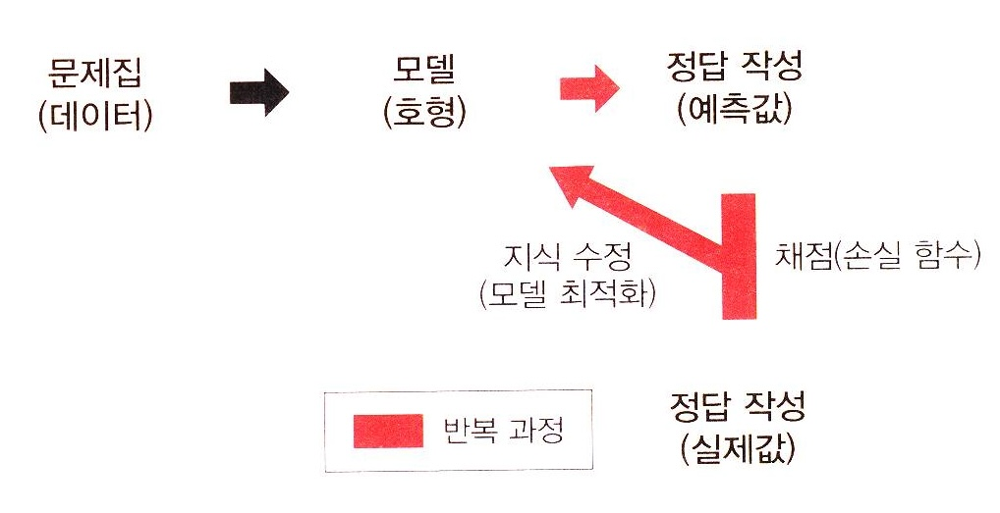
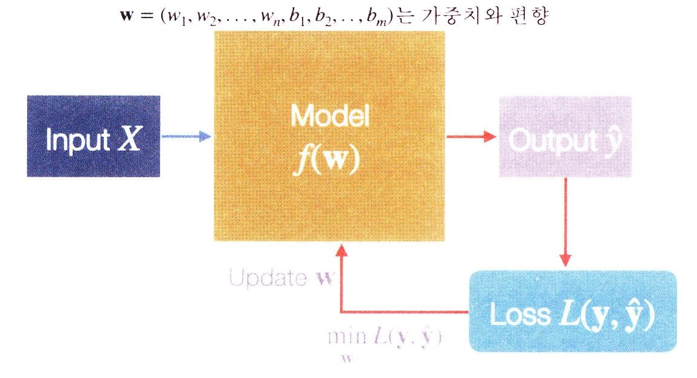

# 3 CHAPTER 지도 학습

지도 학습은 모델에게 정답을 알려주어 학습하는 방법으로 가장 기본적인 학습 방법이다. 3장에서는 지도 학습의 개념과 과정을 살펴보고 우리가 다루는 대표적인 문제가 무엇이 있는지 알아본다. 추가적으로 머신러닝 업무에서 가장 기본인 용도에 따라 데이터 세트를 나누는 방법에 대해서 살펴본다.

- 지도 학습이란
- 지도 학습의 종류
- 데이터 세트 분할

# 3.1 지도 학습이란

호형은 중요한 시험을 위해 시험공부를 하고 있다. 문제집을 사서 그 안에 들어 있는 다수의 문제들을 풀고 답을 내놓고 채점을 통해 실제 정답과 비교하면서 무엇이 틀렸는지 파악하고 다시 점수를 올리기 위해 자신의 지식을 정리하고 다시 문제를 풀어 답을 내놓고 실제 정답과 비교하는 것을 반복하면서 실력을 쌓아간다. 이와 같은 학습 방법이 지도 학습<sup>Supervised learning</sup>이다.

따라서 지도 학습에서는 좋은 모델을 만들기 위해 학습 과정에서 데이터를 이용한 예측값과 실제값을 맞춰 보는 과정이 핵심 구조라고 할 수 있다. 반대로, 학습 중 정답지를 사용하지 않고 문제만을 풀어 문제의 패턴을 파악하는 방법을 비지도 학습<sup>Unsupervised learning</sup>이라고 한다.

```
[문제집(데이터)] -> [모델(호형)] -> [정답 작성(예측값)]
                           ^            |
                           |       채점(손실 함수)
                           |            v
                     [지식 수정] <- [정답 작성(실제값)]
                     (모델 최적화)
                     (반복 과정)
```
*그림 3.1 지도 학습의 흐름*


지도 학습의 장점은 학습 과정에서 정답을 사용하기 때문에 일반적으로 비지도 학습보다 성능이 좋다. 하지만 지도 학습은 데이터에 대응하는 라벨<sup>label</sup> 혹은 목표값<sup>target value</sup>이라고 불리는 실제 정답을 가지고 있어야 하기 때문에 실제값이 없을 경우에는 모델 구축 이전에 실제값을 정의해야만 한다. 예를 들어 우리가 강아지, 개, 호랑이 등의 동물 10,000여 종의 사진을 각각 500,000장씩 가지고 있다고 가정해 보자. 우리가 이 데이터를 가지고 지도 학습을 하기 위해서는 어떤 사진이 어떤 동물인지 표시를 하는 라벨링 작업<sup>labeling 혹은 annotation</sup>을 하거나 폴더 정리를 거쳐야만 한다. 이때 많은 시간과 비용이 소모될 수 있다. 또한 라벨링을 잘못할 가능성이 있기 때문에 데이터 관리를 잘해야 한다. 따라서 지도 학습을 위해 기본적으로 정확히 정답이 표기된 데이터를 가지고 있어야 한다.

■ **기본적인 지도 학습 과정**

우리의 목적은 예측을 잘 하는 좋은 모델을 만드는 것이다. 모델은 가중치와 편향을 통해 예측값을 산출하기 때문에 좋은 모델이라는 의미는 문제에 적합한 가중치와 편향을 가진 모델이라는 뜻이다. 따라서 지도 학습의 목표는 학습을 통해 적절한 모델의 가중치와 편향을 찾는 것이다. 처음 학습 시에는 무작위로 가중치와 편향을 정하여 예측값을 산출한다. 따라서 예측값이 얼마나 정확한지를 판단할 필요가 있다.

$\mathbf{w} = (w_1, w_2, \dots, w_n, b_1, b_2, \dots, b_m)$는 가중치와 편향

```
Input X -> [ Model f(w) ] -> Output \hat{y}
                 ^                 |
                 |                 v
            Update w        [ Loss L(y, \hat{y}) ]
                       \min_w L(y, \hat{y})
```
*그림 3.2 기본적인 지도 학습 과정*


이때 사용되는 개념이 손실 함수다. 손실 함수<sup>Loss function</sup>는 실제값과 예측값이 얼마나 차이가 나는지를 측정하는 척도로써 문제에 따라 적절한 손실 함수를 정해주는 것이 중요하다. 일반적으로 손실 함숫값이 작다는 의미는 실제값과 예측값의 차이가 작다는 뜻으로 학습을 잘하고 있다는 것이고, 반대로 함숫값이 크면 학습이 효과적이지 못하다는 의미다.

따라서 현재 예측을 통해 얻은 손실 함숫값 보다 다음 학습 시 더 작은 손실 함숫값을 얻기 위해 이전 가중치와 편향을 좀 더 적절한 가중치와 편향으로 최적화<sup>Optimization</sup>하게 된다. 가중치와 편향의 업데이트는 손실 함수의 최적화 문제로 귀결된다. 즉, 손실 함수 $L$이 최소가 되게 하는 가중치와 편향을 구하게 되는데 이때 필요한 것이 미분 개념이다.

미분 계산으로 구성된 역전파<sup>Back-propagation</sup>를 통해 손실 함수의 최소 지점을 찾게 된다. 이 과정에서 구해진 새로운 가중치와 편향으로 다시 예측값을 구해서 손실 함수를 계산하고 역전파를 통해 다시 가중치와 편향을 업데이트하는 일련의 과정을 반복하게 된다.

```python
# 1. # 데이터 정의 (1)
# 2. train_data = ...
# 3. train_loader = ...
# 4. # 반복 학습
# 5. for epoch in range(num_epochs): # 전체 데이터에 대한 반복 학습 (6)
# 6.     for inputs, labels in train_loader: # 입력값과 실제값 - 배치 데이터* (2)
# 7.         ... 중략 ...
# 8.         optimizer.zero_grad() # 최적화 초기화
# 9.         outputs = model(inputs) # 예측값 산출 (2)
# 10.        loss = criterion(outputs, labels) # 손실 함수 계산 (3)
# 11.        loss.backward() # 손실 함수 기준으로 역전파 설정 (4)
# 12.        optimizer.step() # 모델 가중치 업데이트 (5)
# 13.
# 14.    ... 중략 ...
```

- ❷, ❸: 데이터를 준비한다(학습 데이터).
- ❾: 모델이 데이터를 받아 예측값을 산출한다(인공신경망 모델).
- ❿: 예측값과 실제값을 이용해 손실 함수를 계산한다(손실 함수).
- ⓫, ⓬: 손실 함수를 기준으로 가중치와 편향을 최적화한다(최적화 기법).
- ❻ ~ ⓭: for문을 통해 데이터를 나누어 학습한다.
- ❺ ~ ⓮: 반복문을 통해 전체 데이터를 여러 번 학습한다.

### 배치(Batch) 데이터
많은 양의 데이터를 한 번에 계산하면 메모리 문제가 발생할 수 있다. 따라서 데이터를 분할해서 학습에 사용한다. 예를 들어 50000개의 학습 데이터가 있다면 20개씩 나눠 2500번의 내부 for문을 돌게 된다. 즉, 내부 for문이 다 돌면 50000개의 데이터를 한 번 학습했다는 의미다. 최종적으로 외부 for문을 통해 50000개의 데이터를 여러 번 반복 학습한다.

# 3.2 지도 학습의 종류

지도 학습 문제 중 회귀 문제<sup>Regression</sup>와 분류 문제<sup>Classification</sup>를 가장 쉽게 접할 수 있다. 회귀 문제는 우리가 원하는 결과값이 연속적인 변수인 것을 예측하는 문제다. 예를 들어 집값 예측, 온도 예측이 있다. 반면에 분류 문제는 우리가 원하는 결과값이 클래스<sup>Class</sup>라고 하는 유한한 모임으로 분류되는 문제다. 예를 들어 질병 예측(양성(1) 또는 음성(0)), 만족도 예측(1, 2, 3점)이 있다.

여기서 만족도를 1, 2, 3이라고 구분 짓는 것을 라벨링<sup>Labeling</sup>이라고 하며 1, 2, 3 숫자들을 라벨<sup>Label</sup>이라고 한다. 만약 1, 2, 3을 0과 1로만 구성된 벡터 (1, 0, 0), (0, 1, 0), (0, 0, 1)로 표현하는 방법을 원-핫 인코딩<sup>One-hot encoding</sup>이라고 부르며, 표현된 벡터를 원-핫 벡터<sup>One-hot vector</sup>라고 한다.

■ **회귀 문제**
- 보스턴 집값 예측 - 집값
- 주가 예측 - 종가
- 대기질 예측 - 이산화질소, 질소산화물 농도
- 자전거 공유 서비스 - 임시 사용자 수

■ **분류 문제**
- MNIST - 숫자(0, 1, 2, 3, 4, 5, 6, 7, 8, 9)
- CIFAR10 - 객체(비행기, 승용차, 새, 고양이, 사슴, 개, 개구리, 말, 배, 트럭)
- 유방암 진단 - 양성, 음성
- 와인 품질 예측 - 평점(1, 2, 3, 4, 5점 중)

■ **대표적인 데이터 소스**
- Sklearn 데이터셋 라이브러리
- Pytorch 데이터셋 라이브러리
- UCI https://archive.ics.uci.edu
- Kaggle https://www.kaggle.com

# 3.3 데이터 세트 분할

시험 대비를 위해 문제집 100권을 샀다고 가정하자. 그리고 100권 전체를 1000번 반복해서 문제를 풀면서 지식을 쌓았다면 우리는 100권 안에 있는 모든 문제를 다 맞을 수 있을 것이다. 그렇다면 지금 가지고 있는 문제집에서 100점을 맞았다고 해서 "실제 시험에서 100점을 맞을 수 있을까?"라는 의문을 가질 수 있다.
물론 많은 문제집을 풀었기 때문에 높은 점수를 기대할 수 있지만 장담은 못한 것이다. 따라서 현재까지 공부한 실력을 검증할 수 있도록 모의고사를 보면 좋다. 즉, 100권 중 80권은 지도 학습 방법으로 공부를 하고 나머지 20권은 학습 이후에 검증을 목적으로 풀어 보는 것이다. 예를 들어 80권을 학습하여 100점을 맞고 학습에 사용하지 않은 20권에서는 50점을 맞았다면 공부 방법(학습)이 잘못된 것이고, 20권을 풀었을 때 90점을 맞았다면 학습을 잘했다고 자신의 실력을 판단할 수 있을 것이다.
이렇듯, 보편적으로 용도에 따라 데이터를 분할하여 사용하게 되며 학습에 사용되는 데이터를 학습 데이터<sup>Train data</sup>, 평가에 사용되는 데이터를 평가 데이터<sup>Test data</sup>라고 부른다. 하지만 평가 데이터로부터 얻은 결과를 기준으로 가장 좋은 모델을 선택한다면 평가 데이터 외 새로운 데이터에 대해서 예측을 잘못할 수 있기 때문에 학습, 검증<sup>Validation</sup>, 평가용으로 데이터를 3 종류로 나누기도 한다. 데이터 분할 비율은 정해진 것이 없지만 일반적으로 학습 : 평가 = 7 : 3 (5 : 5, 6 : 4) 혹은 학습 : 검증 : 평가 = 6 : 2 : 2로 나누며 데이터 셋이 큰 경우에는 학습 데이터 비율을 8, 9까지 놓기도 한다.
데이터를 분할하는 방법은 무작위 추출<sup>Random sampling</sup>, 층화 추출<sup>Random Stratified sampling</sup>, 교차 검증<sup>Cross-validation</sup> 등 다양한 방법들이 있다. 기본적으로 무작위 방식으로 데이터를 나누며 sklearn 라이브러리를 통해 쉽게 적용할 수 있다. 가장 중요한 것은 어떠한 방식으로 데이터를 학습, 검증, 평가 세트로 나누더라도 데이터가 절대 중복으로 들어가서는 안된다.

■ **무작위로 섞어서 데이터 분할**
**CODE** 3.3 Data split.ipynb

```python
import numpy as np
from sklearn.model_selection import train_test_split

X, y = np.arange(1000).reshape((100, 10)), np.arange(100)
X_train, X_test, y_train, y_test = train_test_split(X, y, test_size=0.3, random_state=0)
```

- ❷ sklearn 라이브러리의 train_test_split을 이용해 원하는 분할 비율로 데이터를 학습 데이터와 평가 데이터로 나눌 수 있다.

- ❺ test_size=0.3인 경우에는 평가 데이터가 전체의 30%이므로 100개 중 무작위로 골라 70개가 학습 데이터가 되고 나머지 30개가 평가 데이터가 된다. 이와 같은 방법으로 학습, 검증, 평가 데이터로 나눌 수도 있다. 참고로 train_test_split의 입력 데이터는 리스트, numpy 배열, scipy-sparse 행렬, pandas 데이터프레임 형태를 허용한다.

```python
import numpy as np
from sklearn.model_selection import train_test_split
X, y = np.arange(1000).reshape((100, 10)), np.arange(100)
X_train, X_test, y_train, y_test = train_test_split(X, y, test_size=0.4, random_state=0)
X_test, X_val, y_test, y_val = train_test_split(X_test, y_test, test_size=0.5, random_state=1)
```

- ❹, ❺ 만약에 학습, 검증, 평가 데이터의 비율이 6 : 2 : 2라고 한다면 학습 데이터와 평가 데이터를 6 : 4로 나눈 후 평가 데이터를 다시 평가 데이터와 검증 데이터 비율이 5 : 5로 나누면 결과적으로 6 : 2 : 2라는 비율을 얻게 된다.

> "기계가 실수하지 않을 것이라 기대된다면 그것은 지적일 수 없습니다."
> 
> \- **앨런 튜링**
