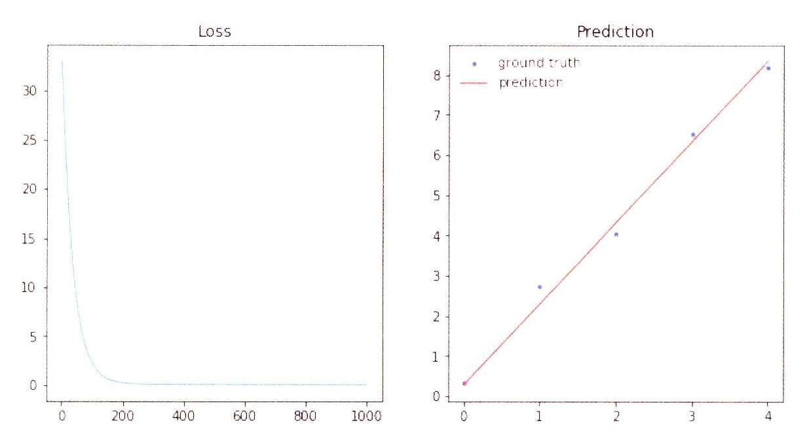
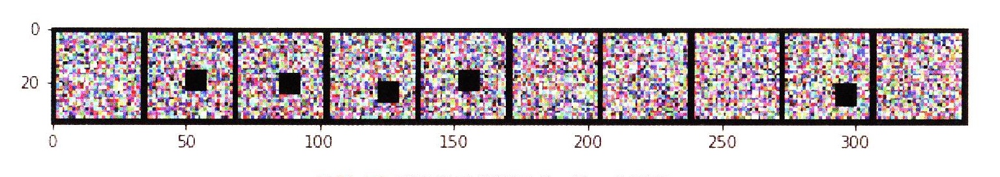

# 4 CHAPTER 파이토치 기본

파이썬 학습에서도 언급했듯이 프로그래밍 언어에서 가장 중요한 것은 타입이다. 따라서 4장에서는 파이토치의 기본 타입인 텐서를 먼저 학습하고 딥러닝 모델을 최적화할 때 필요한 자동 미분법과 효율적으로 학습 데이터를 사용하는 방법에 대해서 배운다.

- 텐서
- 역전파
- 데이터 불러오기

# 4.1 텐서

파이토치 모델 연산을 위해서는 파이토치의 기본 단위인 텐서<sup>Tensor</sup>를 이용해야 한다. 따라서 텐서의 종류와 연산을 잘 숙지해야만 효율적인 코드를 작성할 수 있다.

### 4.1.1 여러 가지 텐서
**CODE** 4.1 Tensor.ipynb

텐서<sup>Tensor</sup>는 파이토치의 기본 단위이며, GPU 연산을 가능하게 한다. 또한 Numpy의 배열과 유사하여 손쉽게 다룰 수 있다.

```python
import torch
import numpy as np

x = torch.empty(5,4)
print(x)
```

Output:
```python
tensor([[ 0.0000e+00, -1.5846e+29,  1.0836e-27, -2.5250e-29],
        [ 1.8361e+25,  1.4603e-19,  1.6795e+08,  4.7423e+30],
        [ 4.7393e+30,  9.5461e-01,  4.4377e+27,  1.7975e+19],
        [ 4.6894e+27,  7.9463e+08,  3.2604e-12,  1.7743e+28],
        [ 2.0535e-19,  5.9682e-02,  7.0374e+22,  3.8946e+21]])
```

- ❶ torch는 Pytorch를 사용하기 위한 기본 라이브러리다.
- ❹ torch.empty를 통해 크기가 $5 \times 4$인 빈 텐서를 생성한다. 이때 초기화되지 않은 행렬인 경우 해당 시점에 할당된 메모리에 존재하던 값들이 초깃값으로 나타난다.

torch는 ones, zeros, empty 등 넘파이에서 사용되는 동일한 형태의 함수들을 많이 제공하고 있다.

```python
torch.ones(3,3) # 3x3 일 행렬
```

Output:
```python
tensor([[1., 1., 1.],
        [1., 1., 1.],
        [1., 1., 1.]])
```

```python
torch.zeros(2) # 2행 영 벡터
```

Output:
```python
tensor([0., 0.])
```

```python
torch.rand(5,6) # 5x6 무작위 행렬
```

Output:
```python
tensor([[0.0570, 0.2543, 0.6556, 0.0770, 0.3769, 0.4685],
        [0.4154, 0.8835, 0.1464, 0.5772, 0.5132, 0.0357],
        [0.0067, 0.1813, 0.4656, 0.6091, 0.5241, 0.3152],
        [0.1441, 0.8257, 0.9880, 0.2956, 0.4270, 0.3678],
        [0.7060, 0.0831, 0.0380, 0.2950, 0.7109, 0.0694]])
```

### 4.1.2 리스트, 넘파이 배열을 텐서로 만들기

torch.tensor()를 통해 텐서로 변환이 가능하다. 또한 torch.FloatTensor(), torch.LongTensor()와 같이 구체적인 텐서 타입을 정의할 수도 있다.

```python
l = [13,4] # 리스트 생성
r = np.array([4,56,7]) # 넘파이 배열 생성
torch.tensor(l)
```

Output:
```python
tensor([13, 4])
```

```python
torch.tensor(r)
```

Output:
```python
tensor([ 4, 56,  7])
```

### 4.1.3 텐서의 크기, 타입, 연산

.size()는 텐서의 크기를 확인할 수 있으며 매우 자주 사용된다. x.size()는 x텐서($5 \times 4$)의 크기이므로 torch.Size([5, 4])로 출력된다. 따라서 x.size()[1]는 4를 출력한다. 혹은 x.size(1)로도 표현이 가능하다.

```python
x.size()[1]
```

Output:
```
4
```

텐서의 타입은 torch.Tensor다.

```python
type(x)
```

Output:
```
torch.Tensor
```

텐서의 사칙연산, 제곱, 몫 계산 등의 기본 연산은 넘파이와 동일하다.

```python
x = torch.rand(2,2) # 2x2 랜덤 행렬
y = torch.rand(2,2) # 2x2 랜덤 행렬
x+y
```

Output:
```python
tensor([[1.0745, 0.9452],
        [1.1449, 1.3838]])
```

```python
torch.add(x,y)
y.add(x)
```

Output:
```python
tensor([[1.0745, 0.9452],
        [1.1449, 1.3838]])
tensor([[1.0745, 0.9452],
        [1.1449, 1.3838]])
```

- ❶ torch.add(x,y)는 x+y와 같은 의미다.
- ❷ y.add(x)는 y에 x를 더한다는 의미다.

```python
y.add_(x)
```

- ❶ y.add_()는 y에 x를 더하여 y를 갱신한다. 즉, y는 기존 y와 x가 더해진 값으로 바뀌어있다. 이와 같이 기존의 값을 덮어 씌우는 방식을 인플레이스<sup>in-place</sup> 방식이라고 한다.

### 4.1.4 텐서의 크기 변환

```python
x = torch.rand(8,8) # 8x8 랜덤 행렬
print(x.size())
```

Output:
```python
torch.Size([8, 8])
```

```python
a = x.view(64) # 크기를 바꿔주는 view 8x8 -> 64
print(a.size())
```

Output:
```python
torch.Size([64])
```

```python
b = x.view(-1,4,4) # -1은 원래 크기가 되게 하는 값 8x8 -> -1x4x4 즉, 4x4x4이다.
print(b.size())
```

Output:
```python
torch.Size([4, 4, 4])
```

- ❸ view는 텐서 크기를 바꿔주는 함수다. 즉, x.view(64)는 $8 \times 8$에서 일렬로 만든 텐서다.
- ❺ -1은 원래 크기가 되게 하는 값으로 전체 성분이 64개가 되게 하는 $4 \times 4 \times 4$ 배열을 만들어야 한다. 따라서 -1은 4로 자동 할당된다.

### 4.1.5 텐서에서 넘파이 배열로 변환

```python
x = torch.rand(8,8)
y = x.numpy()
type(y)
```

Output:
```python
numpy.ndarray
```

- ❷ 텐서 뒤에 .numpy()만 붙여주면 넘파이 배열로 변환된다.

### 4.1.6 단일 텐서에서 값으로 변환하기

.item()은 손실 함숫값과 같이 숫자가 하나인 텐서를 텐서가 아닌 값으로 만들어 준다.

```python
x = torch.ones(1)
print(x.item())
```

Output:
```
1.0
```

# 4.2 역전파

모델 파라미터의 최적화는 미분의 성질과 연쇄 법칙을 기반으로 한 역전파를 통해 진행된다. 역전파는 모델이 복잡할수록 계산 과정이 복잡해져 코드를 직접 구현하기에는 어려움이 있다. 따라서 파이토치는 간단하게 사용할 수 있는 다양한 최적화 방법을 제공하고 있다.

### 4.2.1 그래디언트 텐서
**CODE** 4.2 Backpropagation.ipynb

일반적으로 인공 신경망의 최적화라는 것은 손실 함수의 최솟값<sup>Global minimum</sup>이 나오게 하는 신경망의 최적 가중치를 찾는 과정이다. 따라서 최적화를 위해 변화량을 나타내는 미분은 필수적인 요소다. 이때 깊은 인공 신경망의 구조는 입력값이 들어와 다중의 층을 지나 출력값을 산출하는 합성 함수 형태임을 알 수 있다. 따라서 미분의 성질과 연쇄 법칙<sup>Chain rule</sup>을 통해 원하는 변수에 대한 미분값을 계산할 수 있다. 다만 층이 깊어지거나 구조가 복잡할수록 계산이 복잡해지기 때문에 사람이 직접 계산하기는 매우 힘들다. 파이토치는 앞서 언급한 일련의 계산 과정을 자동으로 해주는 자동 미분 계산 함수를 제공하고 있다. 따라서 최적화 과정인 역전파를 쉽게 작성할 수 있다.

```python
import torch
x = torch.ones(2,2, requires_grad=True)
y = x+1
z = 2*y**2
r = z.mean()
print("Result: ", r)
```

Output:
```python
Result:  tensor(8., grad_fn=<MeanBackward0>)
```

requires_grad=True는 해당 텐서를 기준으로 모든 연산들을 추적하여 그래디언트<sup>Gradient</sup>라고 하는 미분값의 모임(배열)을 계산할 수 있게 한다. ❷ 즉, x에 대해서 연쇄 법칙을 이용한 미분이 가능하다는 것이다. 다음 예시를 보면 y는 x에 대한 식, z는 y에 대한 식, r은 z에 대한 식이다. 따라서 이는 합성 함수의 개념으로써 최종 함수 r은 x에 대해서 표현 및 미분이 가능하다.
여기서 수학적인 이해가 필요한 부분이 있는데 미분을 한다는 것은 미분이 가능한 함수라는 것이고, 함수라는 것은 미분하려는 변수가 함수의 조건을 만족해야 한다는 의미다. 함수의 조건은 정의역에 속하는 주어진 값 x는 오직 하나에 대한 r값이 치역에 존재해야 한다. 따라서 y와 z는 함수의 조건에 만족하지

않고 일련의 계산 과정이기 때문에 y와 z를 x에 대해서 미분을 하려고 했을 때 에러가 난다. 따라서 모델의 최적화를 위해 단일값이 나오는 손실 함수를 정의하는 것이다.

```python
r.backward()
print(x.grad)
```

Output:
```python
tensor([[2., 2.],
        [2., 2.]])
```

- ❼ r를 기준으로 역전파를 진행하겠다는 의미이므로 $\frac{dr}{dx}$을 계산한다. 따라서 $r = \frac{z_1 + z_2 + z_3 + z_4}{4}$이고 $z_i = 2y_i^2 = 2(x_i+1)^2$이므로 $\frac{dr}{dx_i} = x_i + 1$이다.
- ❽ 모든 x의 성분이 1이므로 그래디언트 x.grad를 통해 나온 미분값은 모두 2가 된다.

### 4.2.2 자동 미분 - 선형회귀식
**CODE** 4.2 Autograd.ipynb

자동 미분을 위해 과거에는 Tensor를 덮어씌워 사용하는 Variable을 사용했다. 하지만 현재 텐서는 자동 미분을 위한 기능을 직접 제공하기 때문에 Variable을 사용하지 않고 Tensor를 바로 이용한다.

```python
import torch
from matplotlib import pyplot as plt
x = torch.FloatTensor(range(5)).unsqueeze(1)
y = 2*x + torch.rand(5,1)
num_features = x.shape[1]
```

- ❶, ❷ 파이토치 이용과 그래프를 그리기 위해 라이브러리를 불러온다.
- ❸, ❹ 이해를 돕기 위해 일변수 데이터를 생성하여 이용한다. 즉 (x,y)인 형태로 2차원 상에서 표현이 가능한 데이터다.
- ❸ torch.FloatTensor(range(5))는 리스트 range(5)를 이용해 텐서로 만든다. 이때 원래 크기는 1차원인 torch.Size([5])이어서 행렬 계산을 위해 2차원 배열로 만들어 준다. 이때 unsqueeze(1)는 1번째 위치의 차원을 늘려주는 역할을 하여 최종적으로 x의 크기는 torch.Size([5, 1])이 된다(만약 unsqueeze(0)이면 크기는 torch.Size([1, 5])가 된다).
- ❹ y는 실제 값으로 임의로 5개를 만들어 준다.

- ❺ 다음으로 변수의 개수를 저장하는 num_features를 만든다. x의 크기는 torch.Size([5, 1])이므로 인스턴스의 개수가 5개이고 변수(피처)의 개수가 1개인 데이터다. 따라서 x.shape[1]은 변수의 개수가 된다.

```python
w = torch.randn(num_features, 1, requires_grad=True)
b = torch.randn(1, requires_grad=True)
```

- ❻ 선형식은 $y=xw+b$으로 표현된다. 따라서 w는 $5 \times 1$ 데이터와 곱할 수 있어야 하며, 예측값이 하나로 나와야 하므로 크기가 1(피처수) $\times$ 1(출력값 크기)인 배열로 정의하자. 따라서 xw는 $5 \times 1$이 된다.
- ❼ 편향 b는 모든 인스턴스에 동일한 숫자를 더해주는 것이므로 크기가 1인 텐서로 정의한다.

우리의 목표는 $xw+b$가 잘 예측을 할 수 있는 w와 b를 찾는 것이다. 초깃값에 대한 좋은 정보가 있을 경우에는 좋은 값으로 초깃값을 설정한다면 수렴이 빠르고 정확도도 높아질 수 있지만, 모르는 경우에는 초깃값을 무작위로 준다. 이 예시에서는 torch.randn을 이용한다. ❸, ❹의 텐서와 ❻, ❼ 텐서의 가장 큰 차이는 requires_grad=True 유무다. 데이터는 변하지 않는 값으로서 업데이트가 필요하지 않는 반면 w, b값은 역전파를 통해 최적값을 찾는 것이므로 w, b에 requires_grad를 True로 활성화시킨다.
가중치를 업데이트하는 최적화 방법은 매우 다양하다. 그중 가장 널리 사용되는 방법이 경사하강법이다. 경사하강법<sup>Gradient descent</sup>은 목적 함수인 손실 함수를 기준으로 그래디언트를 계산하여 변수를 최적화하는 기법이다. 이 예시에서는 가장 기본적인 최적화 방법인 확률적 경사하강법<sup>SGD</sup>을 사용한다.

```python
learning_rate = 1e-3
optimizer = torch.optim.SGD([w, b], lr=learning_rate)
```

- ❽, ❾ torch.optim.SGD 내부에 변수를 리스트로 묶어 넣어주고 적절한 학습률<sup>Learning rate</sup>을 정하여 자동으로 가중치와 편향을 업데이트한다.

```python
loss_stack = []
for epoch in range(1001):
    optimizer.zero_grad()
    y_hat = torch.matmul(x, w) + b
    loss = torch.mean((y_hat-y)**2)
    loss.backward()
    optimizer.step()
    loss_stack.append(loss.item())
```

```python
    if epoch % 100 == 0:
        print(f'Epoch {epoch}:{loss.item()}')
```

Output:
```
Epoch 0:33.04575729370117
.... 중략 ....
Epoch 1000:0.06831956654787064
```

- ⑩ 매 에폭<sup>epoch</sup>마다 손실 함숫값을 저장하기 위해 빈 리스트 loss_stack = []를 생성한다.
- ⑪ 학습 반복 수를 1001로 한다.
- ⑬ 최적화는 계산을 누적시키기 때문에 매 에폭마다 누적된 값을 optimizer.zero_grad()을 통해 초기화한다.
- ⑭ 회귀식 모델을 이용하여 예측값을 산출한다.
- ⑮ 예측값과 실제값을 이용하여 손실 함수를 계산한다. 여기서 사용된 함수는 Mean Square Error<sup>MSE</sup>이다.
- ⑯ 역전파의 기준을 손실 함수로 정한다.
- ⑰ 미리 정의한 optimizer를 이용하여 최적화를 시행한다.
- ⑱ 그래프를 그리기 위해 손실 함숫값만 loss_stack에 하나씩 넣는다. item()을 사용하지 않으면 loss 텐서 전체를 저장하게 된다.
- ⑳, ㉑ 에폭이 100으로 나눠 떨어질 때마다 손실 함숫값을 출력한다.

```python
with torch.no_grad():
    y_hat = torch.matmul(x, w) + b
```

- ㉒, ㉓ 최종 학습된 w, b로 예측값을 산출한다. 이때 최적화를 사용하지 않으므로 requires_grad를 비활성화한다. 이때 with torch.no_grad():를 이용하여 구문 내부에 있는 requires_grad가 작동하지 않도록 할 수 있다.

```python
plt.figure(figsize=(10, 5))
plt.subplot(121)
plt.plot(loss_stack)
plt.title("Loss")
plt.subplot(122)
plt.plot(x, y,'.b')
plt.plot(x, y_hat, 'r-')
plt.legend(['ground truth','prediction'])
plt.title("Prediction")
plt.show()
```

<그림 4.1 손실 함수와 회귀선 그래프>


# 4.3 데이터 불러오기

메모리와 같은 하드웨어 성능의 한계 등의 이유로 한 번에 전체 데이터를 모델에 주어 학습하기 힘들기 때문에 일반적으로 배치 형태의 묶음으로 데이터를 나누어 모델 학습에 이용한다. 또한 모델을 학습할 때 데이터의 특징과 사용 방법에 따라 학습 성능의 차이가 날 수 있다. 따라서 데이터를 배치 형태로 만드는 법과 데이터를 전처리하는 방법에 대해서 알아본다.

### 4.3.1 파이토치 제공 데이터 사용
**CODE** 4.3 Data Loader(기본편).ipynb

```python
import torch
import torchvision
import torchvision.transforms as tr
from torch.utils.data import DataLoader, Dataset
import numpy as np
import matplotlib.pyplot as plt
```

- ❶ 파이토치 기본 라이브러리
- ❷ 이미지와 관련된 파이토치 라이브러리
- ❸ 이미지 전처리 기능들을 제공하는 라이브러리
- ❹ 데이터를 모델에 사용할 수 있도록 정리해 주는 라이브러리

```python
transf = tr.Compose([tr.Resize(16),tr.ToTensor()])
trainset = torchvision.datasets.CIFAR10(root='./data', train=True, download=True,
transform=transf)
testset = torchvision.datasets.CIFAR10(root='./data', train=False, download=True,
transform=transf)
```

- ❼ tr.Compose 내에 원하는 전처리를 차례대로 넣어주면 된다. 예시에서는 $16 \times 16$으로 이미지 크기 변환 후 텐서 타입으로 변환한다. 만약 원본 이미지의 너비, 높이가 다를 경우 너비, 높이를 각각 지정을 해야 하기 때문에 tr.Resize((16, 16))이라고 입력해야 한다.
- ❽, ❾ torchvision.datasets에서 제공하는 CIFAR10 데이터를 불러온다(CIFAR10은 클래스가 10개인 이미지 데이터 세트다). root에는 다운로드받을 경로를 입력한다. train=True이면 학습 데이터를 불러오고 train=False이면 테스트 데이터를 불러온다. 마지막으로 미리 선언한 전처리를 사용하기 위해 transform=transf을 입력한다.

```python
print(trainset[0][0].size())
```

Output:
```python
torch.Size([3, 16, 16])
```

일반적으로 데이터셋은 이미지와 라벨이 동시에 들어있는 튜플(tuple) 형태다. 따라서 trainset[0]은 학습 데이터의 첫 번째 데이터로 이미지 한 장과 라벨 숫자 하나가 저장되어 있다. 즉, trainset[0][0]은 이미지이며 trainset[0][1]은 라벨이다. 현재 이미지 사이즈는 $3 \times 16 \times 16$이다. 여기서 3은 채널 수를 말하고 $16 \times 16$은 이미지의 너비와 높이를 의미한다. 일반적인 컬러 사진은 RGB 이미지이기 때문에 채널이 3개이고 (너비)$\times$(높이)$\times$(채널 수)로 크기가 표현된다. 하지만 파이토치에서는 이미지 한 장이 (채널 수)$\times$(너비)$\times$(높이)로 표현되니 유의하도록 한다.

```python
trainloader = DataLoader(trainset, batch_size=50, shuffle=True)
testloader = DataLoader(testset, batch_size=50, shuffle=False)
```

DataLoader는 데이터를 미니 배치 형태로 만들어 준다. 따라서 배치 데이터에 관한 배치 사이즈 및 셔플 여부 등을 선택할 수 있다. 즉, batch_size=50, shuffle=True은 무작위로 데이터를 섞어 한 번에 50개의 이미지를 묶은 배치로 제공하겠다는 의미다.

```python
len(trainloader)
```

Output:
```
1000
```

- ⑬ CIFAR10의 학습 이미지는 50000장이고 배치 사이즈가 50장이므로 1000은 배치의 개수가 된다.

```python
images, labels = iter(trainloader).next()
print(images.size())
```

Output:
```python
torch.Size([50, 3, 16, 16])
```

- ⑭ 배치 이미지를 간단히 확인하기 위해 파이썬에서 제공하는 iter와 next 함수를 이용한다. 이를 통해 trainloader의 첫 번째 배치를 불러올 수 있다.
- ⑮ 배치 사이즈는 (배치 크기)$\times$(채널 수)$\times$(너비)$\times$(높이)를 의미한다. 즉, 배치 하나에 이미지 50개가 잘 들어가 있음을 알 수 있다.

```python
oneshot = images[1].permute(1,2,0).numpy()
plt.figure(figsize=(2,2))
plt.imshow(oneshot)
plt.axis("off")
plt.show()
```

- ⑯ image[1]의 크기는 (3, 16, 16)이다. 이때 그림을 그려주기 위해서 채널 수가 가장 뒤로 가는 형태인 (16, 16, 3)을 만들어야 한다. permute(1,2,0)은 기존 차원의 위치인 0, 1, 2를 1, 2, 0으로 바꾸는 함수다. 따라서 0번째의 크기가 3인 텐서를 마지막으로 보낸다. 마지막으로 numpy()를 이용해 넘파이 배열로 변환한다.

<그림 4.2 CIFAR10 이미지 예시>


### 4.3.2 같은 클래스 별로 폴더를 정리한 경우
**CODE** 4.3 Data Loader(기본편).ipynb

데이터가 같은 클래스 별로 미리 폴더를 정리한 경우, ImageFolder 하나로 개인 데이터를 사용할 수 있다. 또한 별도의 라벨링이 필요 없으며 폴더 별로 자동으로 라벨링을 한다. 예를 들어 class 폴더에 tiger, lion 폴더(./class/tiger와 ./class/lion)를 미리 만든다. 마지막으로 ❷ ImageFolder에 상위 폴더 ./class를 입력하면 이미지와 라벨이 정리되어 데이터를 불러온다.

```python
transf = tr.Compose([tr.Resize(128),tr.ToTensor()])
trainset = torchvision.datasets.ImageFolder(root='./class',transform=transf)
trainloader = DataLoader(trainset, batch_size=1, shuffle=False)
```

### 4.3.3 정리되지 않은 커스텀 데이터 불러오기
**CODE** 4.3 Data Loader(기본편).ipynb

ImageFolder를 이용하면 매우 간단하게 이미지 데이터를 사용할 수 있지만 여러 가지 이유로 사용이 불가한 경우가 있다.

1. 라벨 별로 폴더 정리가 되어 있으면 매우 좋겠지만 그렇지 않은 경우가 많다.
2. 정리를 하고 싶지만 다른 작업들과 공유된 데이터인 경우 폴더를 함부로 정리할 수 없다.
3. 이미지 데이터라도 이미지가 아닌 텍스트, 리스트, 배열 등의 다른 형태로 저장되어 있는 경우도 있다.

다음 양식은 커스텀 데이터를 불러오는 가장 기본적인 형태다.

```python
from torch.utils.data import Dataset

class 클래스명(Dataset):

    def __init__(self):
        .....
    def __getitem__(self, index):
        .....
    def __len__(self):
        .....
```

- ❻ Dataset을 상속받아 DataLoader에서 배치 단위로 불러올 수 있게 해준다.
- ❽ def __init__(self)은 데이터 세팅에 필요한 것들을 미리 정의하는 역할을 한다.
- ❿ 이후 DataLoader를 통해 샘플이 요청되면 __getitem__(self, index)은 인덱스에 해당하는 샘플을 찾아서 준다.
- ⑫ __len__(self)은 크기를 반환한다.

■ **커스텀 데이터 세트 예시**
현재 $32 \times 32$ 크기인 RGB 컬러 이미지 100장과 그에 대한 라벨이 되어 있고 넘파이 배열로 정리가 되어 있다고 가정하자.

```python
train_images = np.random.randint(256, size=(100,32,32,3))/255
train_labels = np.random.randint(2, size=(100,1))

class TensorData(Dataset):

    def __init__(self, x_data, y_data):
        self.x_data = torch.FloatTensor(x_data)
        self.x_data = self.x_data.permute(0,3,1,2)
        self.y_data = torch.LongTensor(y_data)
        self.len = self.y_data.shape[0]

    def __getitem__(self, index):
        return self.x_data[index], self.y_data[index]
```

```python
    def __len__(self):
        return self.len
```

- ❺ init_에서 데이터를 받아 ❻, ❽ 데이터를 텐서로 변환한다.
- ❼ 원래 이미지의 크기가 (100,32,32,3)이므로 permute(0,3,1,2) 함수를 통해 (100,3,32,32)으로 바꿔준다((이미지 수)$\times$(너비)$\times$(높이)$\times$(채널 수) $\rightarrow$ (배치 크기)$\times$(채널 수)$\times$(너비)$\times$(높이)).
- ❾ 입력 데이터의 개수에 대한 변수 self.len을 만들어준다.
- ⑪, ⑫ getitem_에서는 뽑아낸 데이터에 대해서 인덱스 처리를 하여 적어준다.
- ⑭, ⑮ len_에서는 미리 선언한 self.len를 반환할 수 있도록 넣어준다.

```python
train_data = TensorData(train_images,train_labels)
train_loader = DataLoader(train_data, batch_size=10, shuffle=True)
```

- ⑯, ⑰ TensorData 클래스를 train_data로 정의하여 DataLoader에 넣어주면 배치 데이터의 형태로 사용할 수 있다.

### 4.3.4 커스텀 데이터와 커스텀 전처리 사용하기
**CODE** 4.3 Data Loader(심화편).ipynb

파이토치는 전처리 함수들을 제공하여 매우 편리하게 사용할 수 있다. 하지만 이미지의 경우 PILImage 타입이거나 Tensor 타입일 때 사용이 가능하다. 또한 제공하지 않는 기능에 대해서는 직접 구현이 필요하다. 이번 예시에서는 전처리 클래스 2개를 직접 정의하고 사용한다.

```python
class ToTensor:
    def __call__(self, sample):
        inputs, labels = sample
        inputs = torch.FloatTensor(inputs)
        inputs = inputs.permute(2,0,1)
        return inputs, torch.LongTensor(labels)
```

텐서 변환 전처리 클래스를 정의한다. 전처리는 MyDataset 클래스의 sample을 불러와 작업하기 때문에 _call_ 함수를 이용한다. ToTensor는 입력 데이터를 텐서 데이터로 변환해 주고 학습에 맞는 크기로 변환하는 작업을 담당한다.
- ❹ ~ ❻ torch.FloatTensor와 torch.LongTensor를 이용해 텐서로 변환하고 permute(2,0,1)을 이용해 크기를 변경한다. 여기서 유의할 점은 _call_ 함수는 입력값을 하나씩 불러오기 때문에 permute(0,3,1,2)이 아닌 permute(2,0,1)로 코드를 작성한다.

다음은 CutOut 전처리 클래스를 정의한다. CutOut은 이미지 내부에 무작위로 사각형 영역을 선택하여 0으로 만드는 데이터 증식 방법이다.

```python
class CutOut:

    def __init__(self, ratio=.5):
        self.ratio = int(1/ratio)

    def __call__(self, sample):
        inputs, labels = sample
        active = int(np.random.randint(0, self.ratio, 1))

        if active == 0:
            _, w, h = inputs.size()
            min_len = min(w, h)
            box_size = int(min_len//4)
            idx = int(np.random.randint(0, min_len-box_size, 1))
            inputs[:,idx:idx+box_size,idx:idx+box_size] = 0

        return inputs, labels
```

- ❸, ❹ ToTensor와 다르게 외부에서 CutOut 발생 비율을 받기 위해 __init__ 함수를 사용하여 ratio를 받는다. 기본 ratio는 0.5로 세팅하면 불러온 이미지에 대해서 50% 확률로 CutOut를 발현한다.
- ❼ __call__ 함수에서는 샘플을 받는다.
- ❽ active는 정수를 뽑는다. 50%일 경우 0과 1 중 하나를 뽑게 되고 ❿ 0이면 CutOut를 발현하고 0이 아니면 원본을 그대로 내보내게 된다.
- ⑪ 다음은 이미지의 너비와 높이를 받아 ⑫ 최솟값을 구한다. inputs의 크기는 (채널 수, 너비, 높이)이므로 등식 왼쪽에 있는 출력 개수를 맞춰야 하기 때문에 변수를 3개 선언해야 한다. 하지만 채널 수는 필요없기 때문에 _를 통해 값을 저장하지 않는다.
- ⑬ 이 코드에서는 CutOut의 크기를 길이의 최솟값의 25%로 설정한다.
- ⑭ idx를 통해 CutOut 박스의 좌측 상단 꼭지점 위치를 정해준다.
- ⑮ 해당 정사각형 영역의 값을 0으로 대체한다(당연히 코드를 변형하여 다른 모양으로도 만들 수 있다).

4.3.3의 MyDataset에서 전처리를 추가해 보자.

```python
class MyDataset(Dataset):

    def __init__(self, x_data, y_data, transform=None):
```

```python
        self.x_data = x_data
        self.y_data = y_data
        self.transform = transform
        self.len = len(y_data)
        self.tensor = ToTensor()

    def __getitem__(self, index):
        sample = self.x_data[index], self.y_data[index]

        if self.transform:
            sample = self.transform(sample)
        else:
            sample = self.tensor(sample)
        return sample

    def __len__(self):
        return self.len
```

- ❸ __init__의 입력값에 transform=None을 추가한다. 입력값을 =로 표현하여 기본값을 지정해 줄 수 있다. 즉, transform=None는 아무 것도 적지 않으면 전처리를 사용하지 않겠다는 의미다.
- ⑬ 만약 transform이 None이 아니라면 __getitem__에서 sample을 반환하기 전에 전처리를 할 수 있도록 if문을 작성한다.
- ⑮, ⑯ 이 예시에서는 transform=None일 경우에는 텐서 변환은 기본적으로 하도록 구성한다.

```python
trans = tr.Compose([ToTensor(),CutOut()])
dataset1 = MyDataset(train_images,train_labels, transform=trans)
train_loader1 = DataLoader(dataset1, batch_size=10, shuffle=True)
```

- ❶ 4.3.1에서는 파이토치에서 제공하는 텐서 변환 tr.ToTensor()로 사용했었다. 하지만 tr.Compose 내에서 확인할 수 있듯이 이 예제는 우리가 직접 만든 ToTensor()를 사용한다. CutOut은 괄호 ()에 아무 값도 없으므로 발현 비율의 기본값인 0.5로 CutOut이 시행된다.
- ❷, ❸ 정의된 전처리를 입력한 데이터 세트를 만들고 DataLoader를 사용한다.

```python
import torchvision
images1, labels1 = iter(train_loader1).next()

def imshow(img):
    plt.figure(figsize=(10,100))
    plt.imshow(img.permute(1,2,0).numpy())
```

```python
    plt.show()

imshow(torchvision.utils.make_grid(images1, nrow=10))
```

- ❶ 그리드를 만들어주는 torchvision.utils.make_grid를 사용하기 위해 torchvision을 불러온다.
- ❷ iter, next로 첫 번째 배치를 불러와 결과를 확인한다.
- ❹ ~ ❼ 그림을 그리기 위해 (채널 수, 너비, 높이)인 이미지 크기를 permute(1,2,0)으로 (너비, 높이, 채널 수)로 변경하고 numpy()를 이용하여 넘파이 배열로 변환한다.

<그림 4.3 무작위로 적용된 CutOut 이미지>


### 4.3.5 커스텀 데이터와 파이토치 제공 전처리 사용하기
**CODE** 4.3 Data Loader(심화편).ipynb

텐서 변환과 같은 전처리는 파이토치에서 제공하는 전처리를 사용하면 편리하다. 하지만 앞서 언급했듯이 파이토치에서 제공되는 많은 전처리는 PILImage 타입일 경우 사용할 수 있다. 따라서 기능은 있는데 데이터 타입이 다른 경우는 PILImage 타입으로 변환하여 제공된 전처리를 사용할 수 있다.

```python
class MyTransform:

    def __call__(self, sample):
        inputs, labels = sample
        inputs = torch.FloatTensor(inputs)
        inputs = inputs.permute(2,0,1)
        labels = torch.FloatTensor(labels)

        transf = tr.Compose([tr.ToPILImage(), tr.Resize(128), tr.ToTensor()])
        final_output = transf(inputs)

        return final_output, labels
```

- ❶ 전처리 클래스 MyTransform을 정의하여 원하는 전처리를 모두 작성한다.
- ❾ tr.Compose는 차례대로 전처리 작업을 하므로 가장 첫 번째에 tr.ToPILImage()를 넣어 이미지 타입을 바꿔줄 수 있다.
- ❿ 다음 불러온 샘플을 전처리 작업에 넣어준다.

```python
dataset2 = MyDataset(train_images,train_labels, transform=MyTransform())
train_loader2 = DataLoader(dataset2, batch_size=10, shuffle=True)
```

MyDataset는 4.3.4와 동일하게 사용하고 전처리에 MyTransform()을 넣어준다.

### 4.3.6 커스텀 전처리와 파이토치에서 제공하는 전처리 함께 사용하기
**CODE** 4.3 Data Loader(심화편).ipynb

4.3.4에서 사용한 CutOut과 달리 위 CutOut은 라벨은 받지 않고 이미지를 받아 처리하도록 세팅한다. 그 이유는 Compose 내부에 있는 제공된 전처리는 이미지만 받아서 처리하기 때문에 그 양식을 맞춰 주어야 하기 때문이다. 우리가 만든 CutOut은 텐서나 넘파이 배열 타입 모두 작동을 하게 만들었지만 PILImage 타입에서는 타입 오류가 난다. 따라서 tr.ToTensor() 뒤에 CutOut을 배치한다.

```python
class CutOut:

    def __init__(self, ratio=.5):
        self.ratio = int(1/ratio)

    def __call__(self, inputs):
        active = int(np.random.randint(0, self.ratio, 1))

        if active == 0:
            _, w, h = inputs.size()
            min_len = min(w, h)
            box_size = int(min_len//4)
            idx = int(np.random.randint(0, min_len-box_size, 1))
            inputs[:,idx:idx+box_size,idx:idx+box_size] = 0

        return inputs

transf = tr.Compose([tr.Resize(128), tr.ToTensor(), CutOut()])
trainset = torchvision.datasets.CIFAR10(root='./data', train=True, download=True, transform=transf)
```

다음 결과를 통해 CIFAR10 데이터가 배치 10개씩 나눠지고 이미지 사이즈를 128로 늘린 뒤 텐서로 변환되고 50% 확률로 무작위 선택하여 CutOut을 적용한 것을 알 수 있다.

```python
trainloader = DataLoader(trainset, batch_size=10, shuffle=True)
images, labels = iter(trainloader).next()
imshow(torchvision.utils.make_grid(images,nrow=10))
print(images.size()) # 배치 및 이미지 크기 확인
```

Output:
```python
torch.Size([10, 3, 128, 128])
```

<그림 4.4 CutOut이 적용된 CIFAR10 이미지>

> "머신러닝의 혁신은 마이크로소프트 10개의 가치를 지닌다."
>
> 빌 게이츠
