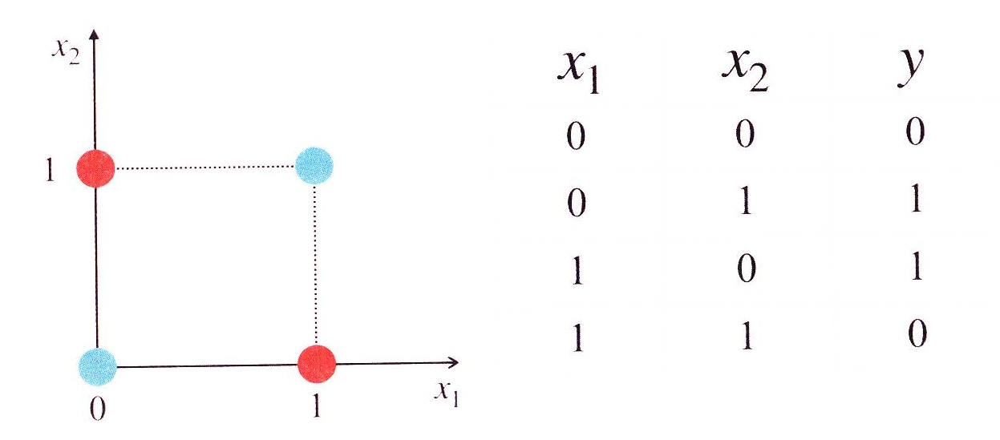
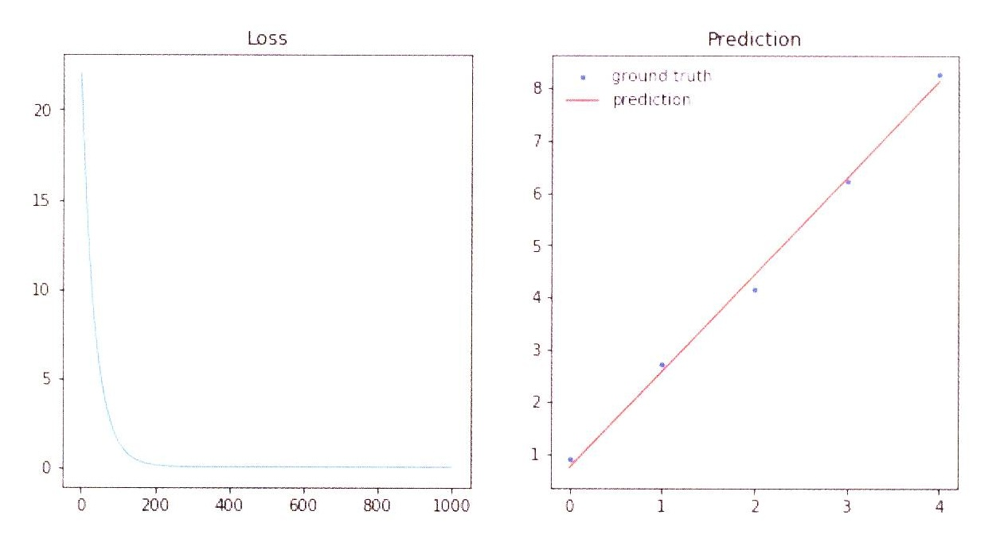
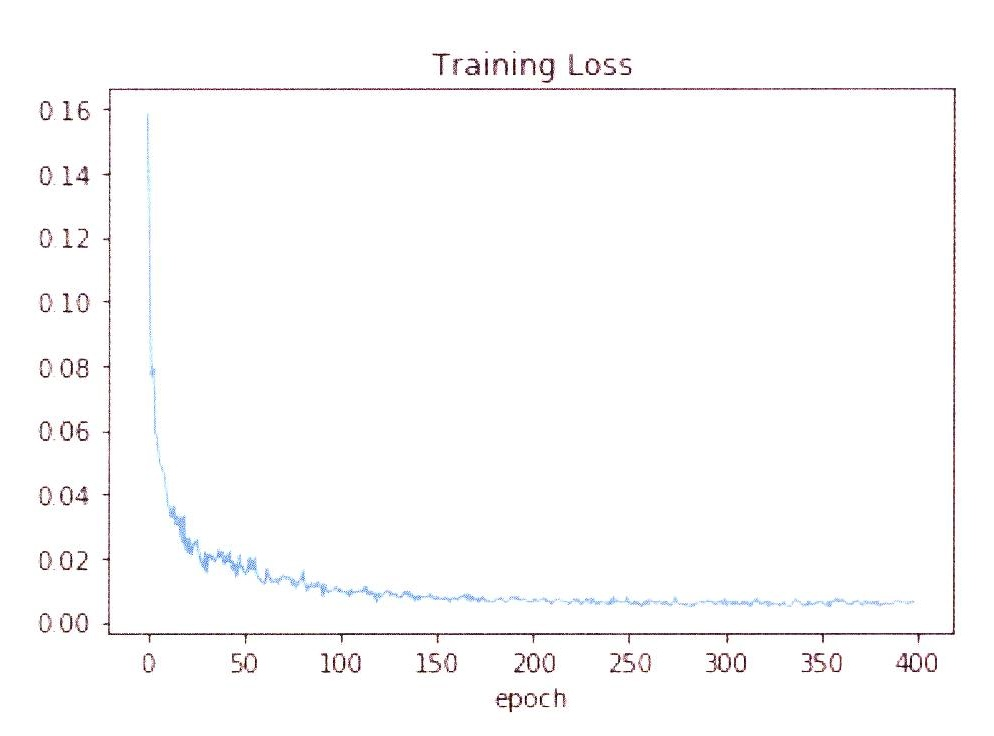
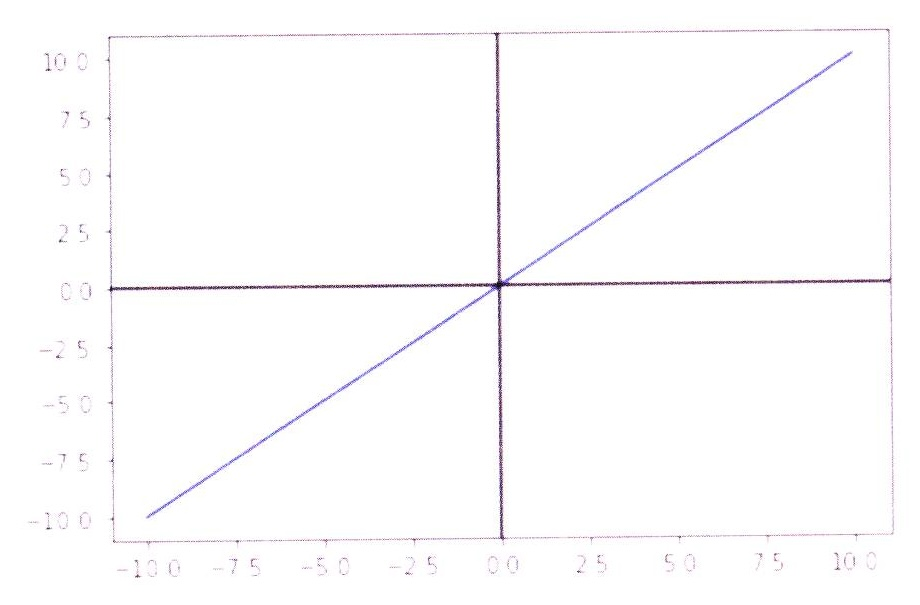
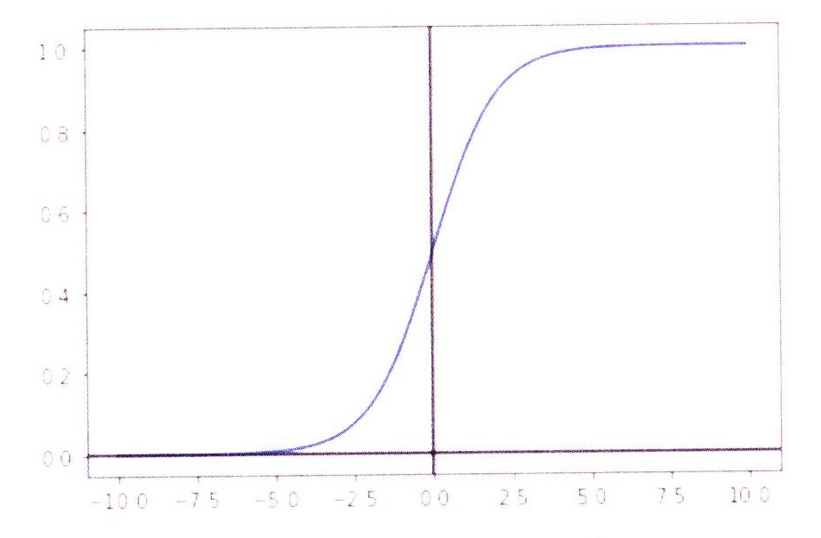
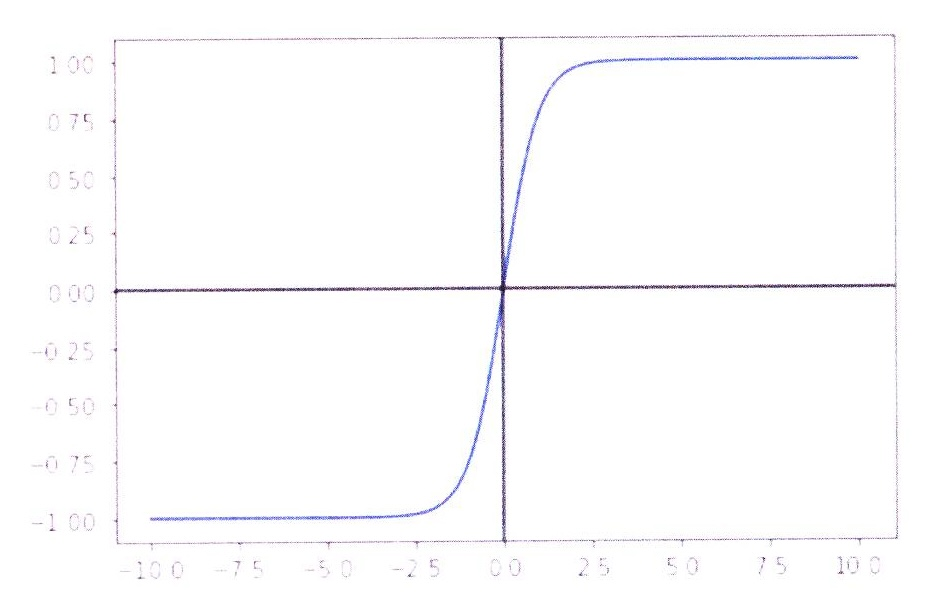
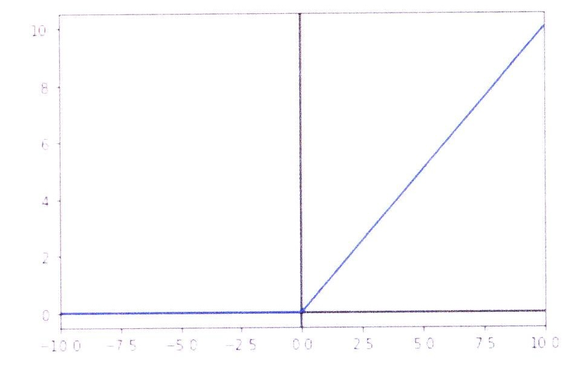
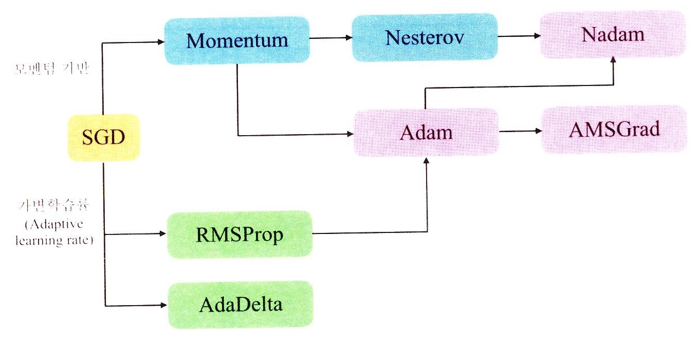
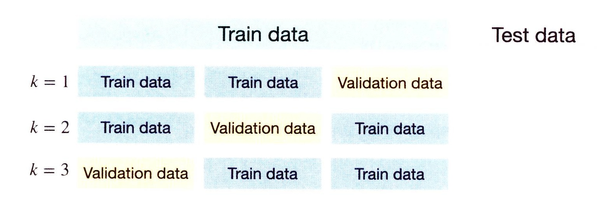

# 5 CHAPTER 인공 신경망

인공 신경망의 특징은 다른 머신러닝 방법론보다 구조 구축에 대한 자유도가 크다. 즉, 연구자가 원하는 구조를 구현할 수 있기 때문에 다른 모델들 보다 뛰어난 성능을 얻을 수 있다. 하지만 좋은 모델을 만들기 위해서는 고려해야 할 부분이 매우 많기 때문에 많은 실험이 필요하다. 5장에서는 인공 신경망을 구축하고 학습하는데 기본적으로 고려해야 할 인공 신경망의 기본 구조, 활성화 함수, 손실 함수, 최적화 기법 등에 대한 전반적인 내용을 다룬다.

- 다층 퍼셉트론
- 활성화 함수
- 손실 함수
- 최적화 기법
- 교차 검증
- 모델 구조 및 가중치 확인

# 5.1 다층 퍼셉트론

4.2.2절에서 다룬 선형 회귀 모델은 입력층과 출력층만 있는 단순한 회귀식을 의미한다. 이를 단층 퍼셉트론<sup>Single-layer perceptron</sup>이라고 한다. 단층 퍼셉트론의 한계는 비선형적인 문제를 풀 수 없다는 것인데 대표적으로 XOR 문제가 있다. 그림 5.1과 같이 입력값이 2개이고 출력값이 하나인 문제인데, 빨간점(y=1)과 파란점(y=0)을 선형적으로 절대 나눌 수 없다는 것이다. 실제로 1969년 Marvin Minsky 교수는 단층 퍼셉트론으로는 XOR 문제를 해결할 수 없음을 수학적으로 증명하여 AI 연구의 암흑기를 맞이했고 많은 연구자들이 인공지능 연구를 중단하기도 했다. XOR 문제는 활성화 함수와 입력층과 출력층 사이에 은닉층을 추가한 다층 퍼셉트론<sup>Multi-Layer Perceptron, MLP</sup>을 통해 해결이 가능하다.

| $x_1$ | $x_2$ | y |
| :---: | :---: | :-: |
| 0 | 0 | 0 |
| 0 | 1 | 1 |
| 1 | 0 | 1 |
| 1 | 1 | 0 |

**&lt;그림 5.1 XOR 문제&gt;**


### 5.1.1 선형 회귀
**CODE** 5.1 Linear Regression.ipynb

먼저 4.2.2에서 다룬 선형 회귀 모델(단층 퍼셉트론)을 파이토치를 이용해 구축한다.

```python
import torch
import torch.nn as nn
from matplotlib import pyplot as plt
```

```python
x = torch.FloatTensor(range(5)).unsqueeze(1)
y = 2*x + torch.rand(5,1)
```

- ❹, ❺ x, y 데이터를 만든다. 이때 각각 2차원 데이터로 표현하기 위해 unsqueeze(1)를 사용한다.

```python
class LinearRegressor(nn.Module):
    def __init__(self):
        super().__init__()
        self.fc = nn.Linear(1, 1, bias=True)

    def forward(self, x):
        y = self.fc(x)

        return y
```

- ❻ 먼저 nn.Module을 상속받는 클래스 LinearRegressor를 만든다.
- ❼ ~ ❾ 초기 세팅에 필요한 내용을 입력하는 __init__과 super().__init__()을 적어준다.
- ❾ 선형 회귀 모델 $y=wx+b$를 nn.Linear(N, M, bias=True)으로 표현할 수 있다. N은 입력 변수의 개수이고 M은 출력 변수의 개수다. 여기서 x의 크기가 1(N=1), y의 크기가 1(M=1)이다(nn.Linear는 기본적으로 bias=True이기 때문에 True로 하고 싶을 경우 별도로 명시하지 않아도 된다).
- ⑫ forward 함수는 실제 입력값이 들어와 연산이 진행하는 순서와 방법을 정하는 곳이다. 따라서 self.fc로 위에서 정의된 선형식을 사용하여 x값을 받아 y값을 반환하도록 한다.

```python
model = LinearRegressor()
learning_rate = 1e-3
criterion = nn.MSELoss()
optimizer = torch.optim.SGD(model.parameters(), lr=learning_rate)
```

- ⑮ 클래스가 완성됐다면 model을 선언한다.
- ⑰ MSE를 손실 함수로 사용한다.
- ⑱ 최적화 방법에 모델 파라미터를 넣어 줄 때는 model.parameters()라고 입력한다.

```python
loss_stack = []
for epoch in range(1001):

    optimizer.zero_grad()

    y_hat = model(x)
    loss = criterion(y_hat,y)

    loss.backward()
    optimizer.step()
    loss_stack.append(loss.item())
```

```python
    if epoch % 100 == 0:
        print(f'Epoch {epoch}:{loss.item()}')
```

나머지는 기존 4.2.2절의 코드와 동일하며, ㉓, ㉔ model을 이용한 예측값 산출과 손실 함수 부분만 수정한다.

Output:
```
Epoch 0:22.0584659576416
.... 중략 ....
Epoch 900:0.028982335701584816
Epoch 1000:0.028786618262529373
```

```python
with torch.no_grad():
    y_hat = model(x)
```

- ❶ 예측은 학습이 아니기 때문에 with torch.no_grad():을 통해 requires_grad를 비활성화한다.
- ❷ 학습된 모델을 통해 예측값을 산출한다.

```python
plt.figure(figsize=(10, 5))
plt.subplot(121)
plt.plot(loss_stack)
plt.title("Loss")
plt.subplot(122)
plt.plot(x, y,'.b')
plt.plot(x, y_hat, 'r-')
plt.legend(['ground truth','prediction'])
plt.title("Prediction")
plt.show()
```

- ❸ ~ ⑫ 그래프를 그린다.
- ❾ 'r-' 옵션을 넣어 5개의 점이 아닌 점이 이어진 선 형식으로 표현한다.

**&lt;그림 5.2 손실 함수와 회귀선 그래프&gt;**


### 5.1.2 집값 예측하기
**CODE** 5.1 MLP.ipynb

선형 회귀식은 nn.Linear()가 하나 있는 모델을 의미한다. 선형식은 모든 데이터를 직선으로 예측하기 때문에 학습이 매우 빠르다는 장점이 있다. 하지만 데이터 내 변수들은 일반적으로 비선형 관계를 갖기 때문에 선형 모델을 가지고 예측하는 것은 한계가 있다. 따라서 nn.Linear()을 줄지어 여러 층으로 구성된 깊은 신경망을 만든다. 이를 다층 신경망<sup>Multi-layer Perceptron, MLP</sup>이라고 한다. 이를 통해 대표적인 회귀 문제인 집값 예측을 한다.

```python
import pandas as pd
import numpy as np
from sklearn.model_selection import train_test_split
import torch
from torch import nn, optim
from torch.utils.data import DataLoader, Dataset
import torch.nn.functional as F
from sklearn.metrics import mean_squared_error
import matplotlib.pyplot as plt
```

- ❶ 데이터프레임 형태를 다룰 수 있는 pandas는 데이터 분석을 위한 대표적인 파이썬 라이브러리다. 데이터를 데이터프레임 형태로 다룰 수 있어, 보다 안정적이고 쉽게 테이블형 데이터를 다룰 수 있다. 또한 다양한 통계 함수와 시각화 기능을 갖추고 있어 결과 분석에도 많이 사용되고 있다.
- ❹ ~ ❼ torch 내의 다양한 기능을 불러온다.

- ❽ 회귀 문제<sup>Regression</sup>의 평가를 위해 RMSE<sup>Root Mean Squared Error</sup>를 사용한다. 즉, MSE<sup>Mean Squared Error</sup> 척도를 라이브러리를 통해 불러온 후 MSE에 제곱근을 씌워 계산한다. MSE는 예측값과 실제값의 거리를 제곱을 이용하여 다음과 같이 정의한다.

$$MSE = \frac{1}{N}\sum_{i=1}^N (y_i - \hat{y}_i)^2$$

이는 미분 계산이 쉽기 때문에 머신러닝 모델을 최적화하기 위해 자주 사용되는 손실 함수다. 하지만 기본 단위에 제곱을 취해서 나온 척도이므로 데이터와 동일한 단위가 아니다. 따라서 통계적 해석을 할 때에는 단위를 맞추기 위해 MSE에 제곱근을 씌워 RMSE로 결과를 평가할 수 있다.

$$RMSE = \sqrt{\frac{1}{N}\sum_{i=1}^N (y_i - \hat{y}_i)^2}$$

### 데이터 세트 만들기

```python
df = pd.read_csv('./data/reg.csv', index_col=[0])
```

- ❶ 스케일링된 집값 데이터를 read_csv를 통해 불러온다. 이 때 index_col=[0]을 이용하여 csv 파일의 첫 번째 열에 있는 데이터의 인덱스를 배제하고 데이터프레임을 만든다. 데이터 내의 변수의 개수가 13개이고 인스턴스의 개수는 506개이다.

### 데이터 프레임을 넘파이 배열로 만들기

```python
X = df.drop('Price', axis=1).to_numpy()
Y = df['Price'].to_numpy().reshape((-1,1))
```

- ❶ 데이터프레임 df에서 Price를 제외한 나머지를 변수로 사용한다. drop의 axis=1은 열을 의미하여 Price를 열 기준으로 배제하겠다는 의미다.
- ❷ Price를 타겟값 Y로 사용한다.

```python
X_train, X_test, Y_train, Y_test = train_test_split(X, Y, test_size=0.5)
```

전체 데이터를 50:50으로 학습 데이터와 평가 데이터로 나눈다.

### 텐서 데이터 만들기

4.3.3에서 배운 방법을 이용하여 ⑬ ~ ⑯ trainloader와 testloader를 만든다. 일반적으로 학습 데이터는 shuffle=True로 주고 평가는 shuffle=False로 설정한다.

```python
class TensorData(Dataset):

    def __init__(self, x_data, y_data):
        self.x_data = torch.FloatTensor(x_data)
        self.y_data = torch.FloatTensor(y_data)
        self.len = self.y_data.shape[0]

    def __getitem__(self, index):
        return self.x_data[index], self.y_data[index]

    def __len__(self):
        return self.len

trainsets = TensorData(X_train, Y_train)
trainloader = torch.utils.data.DataLoader(trainsets, batch_size=32, shuffle=True)
testsets = TensorData(X_test, Y_test)
testloader = torch.utils.data.DataLoader(testsets, batch_size=32, shuffle=False)
```

### 모델 구축하기

Regressor는 입력층 1개, 은닉층 2개, 출력층 1개를 가진 모델이다. 데이터 피처의 개수가 13이므로 입력층의 노드가 13개가 있어야 하고, 하나의 값으로 표현된 집값을 예측하는 것이므로 출력층은 1개의 노드를 가져야만 한다. 은닉층은 사용자의 선택으로 정할 수 있는데 이 모델에서는 각 은닉층마다 50, 30개의 노드를 갖도록 구축한다(기본적으로 이전 층의 출력값과 다음 층의 입력값의 크기는 같아야 한다).

```python
class Regressor(nn.Module):
    def __init__(self):
        super().__init__()
        self.fc1 = nn.Linear(13, 50, bias=True)
        self.fc2 = nn.Linear(50, 30, bias=True)
        self.fc3 = nn.Linear(30, 1, bias=True)
        self.dropout = nn.Dropout(0.5)

    def forward(self, x):
        x = F.relu(self.fc1(x))
        x = self.dropout(F.relu(self.fc2(x)))
        x = F.relu(self.fc3(x))
        return x
```

- ❹ 입력층(노드수: 13) $\rightarrow$ 은닉층1(50)으로 가는 연산
- ❺ 은닉층1(50) $\rightarrow$ 은닉층2(30)으로 가는 연산
- ❻ 은닉층2(30) $\rightarrow$ 출력층(1)으로 가는 연산
- ❼ 연산이 될 때마다 50%의 비율로 랜덤하게 노드를 없앤다(forward 함수에서 적용 위치를 정해준다).
- ❿ F.relu(self.fc1(x))는 선형 연산 후 ReLU라는 활성화 함수를 적용한다. 일반적으로 활성화 함수는 이전 층에서 다음 층으로 값을 비선형적으로 변환하여 넘겨주는 역할을 한다. 이는 층과 층 사이의 관계를 비선형으로 만들어 줄 수 있어 성능 향상에 도움이 된다.
- ⓫ self.dropout(F.relu(self.fc2(x))) 데이터가 노드가 50개인 이전 은닉층에서 30개의 은닉층으로 넘어갈 때 ReLU라는 활성화 함수를 거치고 self.dropout을 이용해 30개 중 50%의 확률로 값을 0으로 만든다. 드롭아웃은 과적합<sup>Overfitting</sup>을 방지하기 위해 노드의 일부를 배제하고 학습하는 방식이기 때문에 사용위치는 임의로 정할 수 있지만 절대로 출력층에 사용해서는 안 된다.
- ⑫, ⑬ 배치가 32개고 출력값이 하나이기 때문에 크기가 torch.Size([32, 1])인 결과를 뽑아내어 반환한다(학습 데이터는 총 203개이므로 마지막 배치는 32개가 아니고 29개가 들어온다).

### 모델 학습하기

```python
model = Regressor()
criterion = nn.MSELoss()
optimizer = optim.Adam(model.parameters(), lr=0.001, weight_decay=1e-7)
```

- ❸ Adam 최적화 방법을 정의한다. weight_decay는 $L_2$ 정규화에서의 penalty 값을 의미하며 값이 클수록 제약조건이 강함을 의미한다.

```python
loss_ = []
n = len(trainloader)
for epoch in range(400):
    running_loss = 0.0
    for data in trainloader:
        inputs, values = data
        optimizer.zero_grad()
        outputs = model(inputs)
        loss = criterion(outputs, values)
        loss.backward()
        optimizer.step()
        running_loss += loss.item()

    loss_.append(running_loss/n)
```

- ❹ 그래프를 그리기 위한 loss 저장용 리스트를 만든다.
- ❺ 매 에폭 손실 함수값의 평균을 구하기 위해 배치 반복 수를 n이라고 한다.
- ❻ 400번 데이터를 반복 학습한다.
- ❼ 매 에폭 손실 함수값의 평균을 구하기 위해 초깃값을 0으로 한다.
- ❽ 배치를 불러와 학습한다.
- ❾ 입력값, 타깃값을 받는다.
- ❿ 그래디언트를 초기화한다.
- ⓫ model에 입력값을 넣어 예측값을 산출한다.
- ⑫ ~ ⑭ 손실 함수값 계산 및 최적화를 진행한다.
- ⑮ 매 에폭 손실 함수값의 평균을 구하기 위해 running_loss에 배치마다 로스를 더한다.
- ⑰ 저장용 리스트에 매 에폭 결과를 저장한다.

### 손실 함수값 그리기

학습 데이터의 손실 함수값으로는 모델의 성능을 판단할 수 없지만, 학습이 잘 진행되었는지는 파악할 수 있다. 그림 5.3에서 손실 함수값이 감소하는 것은 학습이 잘 진행되었다고 판단할 수 있다. 물론 차후 과적합 현상이 나타났는지 평가 결과는 어떤지에 따라 모델을 튜닝하거나 학습 전략을 다르게 설정해야만 한다.

```python
plt.plot(loss_)
plt.title("Training Loss")
plt.xlabel("epoch")
plt.show()
```

**&lt;그림 5.3 훈련 손실 함수 그래프&gt;**


### 모델 평가하기

최종적인 모델 평가는 RMSE<sup>Root Mean Square Error</sup>를 사용한다.

```python
def evaluation(dataloader):

    predictions = torch.tensor([], dtype=torch.float)
    actual = torch.tensor([], dtype=torch.float)
    with torch.no_grad():
        model.eval()
        for data in dataloader:
            inputs, values = data
            outputs = model(inputs)
            predictions = torch.cat((predictions, outputs), 0)
            actual = torch.cat((actual, values), 0)

    predictions = predictions.numpy()
    actual = actual.numpy()
    rmse = np.sqrt(mean_squared_error(predictions, actual))

    return rmse
```

- ❶ evaluation 함수에 dataloader를 받는다.
- ❸, ❹ 예측값과 그에 대응하는 실제값을 저장하기 위해 빈 텐서를 만든다(값들을 모두 저장하지 않고 for문에서 누적 방식으로도 계산할 수 있지만 예시를 통해 torch.cat에 대해서 알아보자).
- ❺ with torch.no_grad()로 requires_grad를 비활성화한다.
- ❻ 드롭아웃 등과 같은 정규화 기법은 학습시에만 적용해야 한다. 따라서 모델 내에서 학습 시에만 동작하는 장치들을 비활성화하기 위해 model.eval()을 적용한다.
- ❼ ~ ⓫ 배치 단위로 데이터를 받아 예측값을 산출하고 실제값과 누적시킨다. 이때 torch.cat에서 0이라는 것은 0번째 차원을 기준으로 누적한다는 의미다(예를 들어 10x2와 10x2인 두 텐서가 있을 때, cat 기준이 0이면 20x2가 되고 1이면 10x4가 결과로 나온다).
- ⑬, ⑭ 텐서 데이터를 넘파이 배열로 변경한다.
- ⑮ mean_squared_error(predictions, actual)로 MSE를 계산한 후 루트를 씌워 RMSE를 계산한다.

```python
train_rmse = evaluation(trainloader) # 학습 데이터의 RMSE
test_rmse = evaluation(testloader) # 시험 데이터의 RMSE
print("Train RMSE: ",train_rmse)
print("Test RMSE: ",test_rmse)
```

Output:
```
Train RMSE: 0.048989985
Test RMSE: 0.08607124
```

결과를 보면 학습 결과와 테스트 결과가 차이가 크다. 따라서 학습 데이터에 과적합이 되어 있다고 판단할 수 있다. 하지만 데이터를 무작위로 나누고 모델의 초깃값도 random initial parameter를 사용했기 때문에 학습을 할 때마다 결과가 다르게 나올 수 있다. 따라서 교차 검증이나 여러 번의 실험을 통해 결과의 성향성을 봐야 한다.

# 5.2 활성화 함수

활성화 함수는 인공 신경망에서 필수적인 요소 중 하나다. 따라서 활성화 함수의 종류에 따라서 성능의 변화를 줄 수 있다. 이번 절에서는 기본적인 활성화 함수의 역할과 종류에 대해서 알아본다.

### 5.2.1 활성화 함수가 필요한 이유

기본적으로 인공 신경망은 선형식 계산의 연속이다(즉, 선형 결합 형태의 함수가 합성된 형태). 이를 통해 연산을 쉽게 할 수 있으며 미분이 가능하고 미분을 쉽게 풀 수 있게 된다. 이 부분에서 "과연 노드 간의 관계가 항상 선형적일까?"라는 합리적인 의심을 해볼 수 있다. 사회, 경제, 자연 현상들을 보면 비선형적인 관계가 많다는 것을 알 수 있다. 따라서 비선형적인 층 사이의 관계를 표현할 수 있는 활성화 함수<sup>Activation function</sup>를 사용한다. 활성화 함수 $a(x)$는 합성 함수의 일환으로 이전 노드의 값과 가중치가 계산된 값을 활성화 함수에 넣어 계산한 뒤 다음 노드로 보내게 된다.

**&lt;그림 5.4 비선형 활성화 함수가 적용된 노드 계산&gt;**

그림 5.4과 같이 이전 층에 있는 노드값은 가중치와 각각 곱해져 더하는 선형 결합이다. 활성화 함수를 적용하지 않으면 계산된 값이 그대로 다음 층으로 들어간다. 만약 활성화 함수를 적용한다면 이전 층과 다음 층 사이에 있는 활성화 함수 $a(x)$를 거치게 된다. 만약 함수 $a(x)=max(x, 0)$로 정의된 ReLU 함수를 사용했다면 음수는 모두 0으로 나오고, 양수는 계산 그대로 넘겨주게 된다.

### 5.2.2 선형 함수

선형 함수는 $a(x)=mx+n$ 형태인 활성화 함수다. 만약 $m=1, n=0$이면 항등 함수로써 넘어온 값을 그대로 받는다는 의미다. 활성화 함수의 역할은 1차적으로 비선형 관계를 만들어 주기 때문에 거의 사용하지 않는다.

**&lt;그림 5.5 선형함수
 $a(x)=mx+n$&gt;**

### 5.2.3 시그모이드(sigmoid) 함수 `torch.sigmoid() / nn.Sigmoid()`

시그모이드 함수 $\sigma(x) = \frac{1}{1+e^{-x}}$는 모든 입력값에 대해 0과 1 사이로 변환하는 역할을 하며 일반적으로 $\sigma$(sigma)로 표기한다. 또한 0.5를 기준으로 0.5 이하면 0, 초과면 1로 변환하여 두 가지 클래스를 분류하는 이진분류<sup>binary classification</sup> 문제에도 활용할 수 있다.

**&lt;그림 5.6 시그모이드 함수
 $\sigma(x) = \frac{1}{1+e^{-x}}$&gt;**

### 5.2.4 tanh 함수 `torch.tanh() / nn.Tanh()`

시그모이드 함수와 형태는 유사하지만 -1과 1 사이의 값을 취할 수 있어 0과 음수값을 가질 수 있다. 또한 0 부근에서 $\sigma$ 보다 더 가파른 기울기를 갖는다는 것이 차이점이다.

**&lt;그림 5.7 tanh 함수
 $a(x)=\tanh(x)$&gt;**

### 5.2.5 ReLU 함수 `torch.nn.functional.relu() / nn.ReLU()`

두 개의 직선을 이어 만든 것으로 비선형 함수지만 선형과 매우 유사한 성질을 가지고 있다. 따라서 계산이 쉽고 미분도 쉽게 풀 수 있다. 또한 가장 중요한 점은 모델 최적화에 유용한 선형적 성질들을 보존하고 있어서 최적화를 쉽게 할 수 있게 한다. 따라서 가장 널리 사용되며 성능이 매우 좋은 것으로 알려져 있다.

**&lt;그림 5.8 ReLU 함수
 $a(x)=\max(x, 0)$&gt;**

### 5.2.6 Softmax 함수 `torch.nn.functional.softmax() / nn.Softmax()`

벡터 $\mathbf{x} = (x_1, x_2, \cdots, x_n)$에 대하여 모든 성분이 항상 양수이며, 그 합이 1이 되도록 변환한다. 따라서 음수값이 오더라도 항상 양수가 나오도록 지수 함수를 이용한 함수다. 벡터 형태로 예측값이 나오는 다중 분류문제에서 자주 사용된다.

$$a(\mathbf{x}) = \frac{e^{x_i}}{\sum_{k=1}^n e^{x_k}}$$

### 5.2.7 기타 활성화 함수

파이토치에서는 nn.ELU(), nn.LeakyReLU(), nn.LogSigmoid(), nn.SELU()와 같은 매우 다양한 함수를 제공하고 있으며, 필요에 따라 직접 활성화 함수를 만들기도 한다.

# 5.3 손실 함수

손실 함수는 최적화를 하는데 목적 함수가 되기 때문에 문제에 맞는 손실 함수를 사용해야만 한다. 또한 필요에 따라 손실 함수를 2개 이상 운용하는 모델도 있으며 가중치를 주어 특정 조건에 대해서 손실 함수값을 조정하는 방법도 있다. 이번 절에서는 가장 자주 사용되는 손실 함수를 알아본다.

### 5.3.1 MAE `torch.nn.L1Loss`

유사도, 거리 측정, 회귀 문제 등에 많이 사용되는 손실 함수다.

$$L = \frac{1}{N}\sum_{i=1}^N |y_i - \hat{y}_i|$$

### 5.3.2 MSE `torch.nn.MSELoss`

MAE와 함께 유사도, 거리 측정, 회귀 문제 등에 많이 사용되는 손실 함수다.

$$L = \frac{1}{N}\sum_{i=1}^N (y_i - \hat{y}_i)^2$$

### 5.3.3 Cross Entropy Loss `torch.nn.CrossEntropyLoss`

주로 다중 분류 문제에서 사용된다. 유의할 점은 파이토치에서는 예측값은 벡터 형태, 타깃값은 라벨 형태로 세팅해야 에러가 나지 않는다.

$$L = -\frac{1}{N}\sum_{i=1}^N y_i \log(\text{softmax}(\hat{y}_i))$$

### 5.3.4 기타 손실 함수

파이토치에서는 nn.BCELoss, nn.NLLLoss, nn.KLDivLoss 등 다양한 손실 함수를 제공한다.

# 5.4 최적화 기법

인공 신경망은 예측한 값과 타깃값을 정량적으로 비교할 수 있는 손실 함수를 통해 모델을 평가할 수 있다. 따라서 일반적으로 손실 함수값이 작다는 의미는 예측값과 타깃값의 차이가 작다라는 의미이므로 손실 함수값이 작게 나오게 하는 모델의 변수를 구하는 것이 최적화의 목적이다. 즉, 그림 5.9와 같이 손실 함수가 그려져 있고 현재 모델의 변수가 $w_0$라고 한다면 손실 함수값이 가장 작게 나오게 하는 변수 $w^*$를 찾는게 목적이 되는 것이다. 직관적으로 경사가 떨어지는 방향으로 간다면 우리가 원하는 이상적인 값을 얻을 수 있다. 이를 경사하강법<sup>Gradient Descent</sup>이라고 한다.

**&lt;그림 5.9 손실 함수를 기준으로 최적화 진행&gt;**

즉, 경사를 의미하는 미분을 이용해 $w$를 업데이트 하는데, 이때 하강에 대한 보폭을 정해주는 값이 학습률<sup>Learning rate 또는 Step size</sup> $\mu$이다.

$$w \leftarrow w - \mu \frac{\partial L}{\partial w}$$

최적화 문제는 깊게 들어가면 복잡한 수식과 증명들을 볼 수 있다. 다행히 파이토치는 계산을 자동으로 해주는 다양한 최적화 기법들을 제공하기 때문에 최적화 기법에 대한 하이퍼 파라미터<sup>Hyper-parameter</sup>만 신경써주면 된다. 하이퍼 파라미터란 제안된 방법론을 사용하기 위해 미리 선택하여 사용되는 변수를 의미하며, 예를 들어 학습률이 있다.

### 5.4.1 확률적 경사하강법(SGD) `torch.optim.SGD`

경사하강법의 특징은 모든 변수의 미분을 계산해 한 번에 갱신한다는 것이다. 따라서 노드 수와 가중치 수 그리고 데이터가 많을 경우에는 연산량이 많아 모델의 학습 속도가 느려지며, 계산에 필요한 메모리가 부족한 경우가 발생할 수 있다. 이를 해결하기 위해 데이터를 나눠서 학습하는 방법이 널리 쓰인다. 만약 n개의 데이터가 있다면 임의로 k개의 데이터 묶음을 만들어 학습을 진행한다. 이때 나눠진 데이터 세트를 미니 배치<sup>mini-batch</sup>라고 하며, 미니 배치를 이용해 경사하강법을 진행하는 것을 확률적 경사하강법<sup>Stochastic Gradient Descent, SGD</sup>이라고 한다. 따라서 일반 경사하강법과 SGD의 차이는 데이터 전체를 한 번에 사용하는지 나눠서 사용하는지의 차이일 뿐, 계산 과정의 차이는 없다. 또한 "확률적"이라고 하는 이유는 미니 배치를 나눌 때 데이터를 무작위로 섞어서 나누기 때문이다.

```python
optimizer = torch.optim.SGD(model.parameters(), lr=0.01)
```

### 5.4.2 다양한 최적화 기법

경사하강법과 SGD의 단점은 학습률 $\mu$가 고정되어 있다는 것이다. 따라서 변수의 위치에 상관없이 이동 비율이 항상 같기 때문에 계산이 비효율적일 수 있다. 따라서 더 효율적인 최적화를 위해 여러 가지 방법들이 고안되었다. 그중 기본적으로 많이 사용되는 방법은 모멘텀+스케줄링이나 Adam이다.

**&lt;그림 5.10 여러 가지 최적화 기법&gt;**


### momentum 방법

SGD 함수에 momentum 지수를 넣어준다.

```python
optimizer = torch.optim.SGD(model.parameters(), lr=0.01, momentum=0.9)
```

### Adam 방법

```python
optimizer = torch.optim.Adam(model.parameters(), lr=0.01)
```

### 기타

torch.optim.Adadelta, torch.optim.Adagrad, torch.optim.RMSprop 등이 제공된다.

### 5.4.3 스케줄링

가변 학습률을 사용하지 않는 방법에 대해서는 학습률이 변하지 않는다. 따라서 별도로 학습률이 어떻게 바뀌는지 규칙을 정해주는 것을 스케줄링이라고 한다. 예를 들어 학습 반복 30번마다 학습률을 0.1배씩 줄여주고 싶다면 ❷ optim.lr_scheduler.StepLR을 optimizer 아래 선언할 수 있다. 그리고 for문 안에 ⓮ scheduler.step()만 추가하면 자동으로 학습률을 변경해 준다.

```python
optimizer = torch.optim.SGD(model.parameters(), lr=0.1, momentum=0.9)
scheduler = optim.lr_scheduler.StepLR(optimizer, step_size=30, gamma=0.1)
... 중략 ...
for epoch in range(400):
    running_loss = 0.0
    for data in trainloader:
        inputs, values = data
        optimizer.zero_grad()
        outputs = model(inputs)
        loss = criterion(outputs, values)
        loss.backward()
        optimizer.step()
    ... 중략 ...
    scheduler.step()
```

파이토치는 MultiplicativeLR, LambdaLR, StepLR, MultiStepLR, ExponentialLR, CosineAnnealingLR 등 다양한 스케줄링을 제공한다.

### 5.4.4 MADGRAD

MADGRAD는 모멘텀과 가변식 방법을 병행하는 최신 최적화 방법으로 SGD와 ADAM을 능가하는 것으로 페이스북 연구팀이 발표한 바 있다.

```
madgrad.MADGRAD(모델 변수, lr = 학습률(default: 0.01), momentum = 모멘텀지수(default: 0.9), weight_decay = L2페널티(default: 0))
```

```bash
pip install madgrad
```

- ❶ 터미널 창에서 별도의 설치가 필요하다. 구글 코랩 내에서는 느낌표를 붙여 !pip install madgrad라고 입력하여 설치를 먼저 한다.

```python
import madgrad
optimizer = madgrad.MADGRAD(model.parameters())
```

- ❷ madgrad를 불러온 후 ❸ 기존 최적화 방법의 사용법과 동일하게 모델 변수를 넣어 사용한다.

# 5.5 교차 검증

기본적인 모델의 학습과 평가 과정은 학습 데이터로 학습하고 평가 데이터로 성능을 확인한다. 이때 평가 데이터에서 가장 성능이 잘 나오는 모델을 고르게 된다. 학습 시 평가 데이터를 사용하지 않기 때문에 평가 방법에 문제가 되지 않는다고 생각할 수 있지만, 평가 데이터를 기준으로 모델을 튜닝한다면 평가 데이터에 과적합이 될 수도 있다. 물론 빠르게 작업할 수 있으며 어느 정도 성능은 충분히 가늠할 수 있기 때문에 많이 사용된다. 하지만 앞에서 언급한 단점을 보완하기 위해 검증 데이터를 사용한다. 전체 데이터를 학습, 검증, 평가 데이터로 나누어 학습 데이터로 모델을 학습하고 검증 데이터로 모델을 평가하고 튜닝한 다음 평가 데이터로 최종 평가를 한다.
데이터를 나누는 방법은 매우 다양하다. 그 중 k겹 교차 검증<sup>k-Fold Cross-Validation</sup>은 학습 데이터 전체를 사용하면서 검증할 수 있는 방법으로 머신러닝 분야에서 매우 널리 쓰이는 검증 방법이다. 학습 데이터를 k개로 나누어 1개는 검증 데이터로 사용하고 나머지 k-1개는 학습 데이터로 사용한다. 따라서 k번의 검증 과정이 필요하기 때문에 느린 것이 단점이다. 그림 5.11은 3개의 폴드로 학습 데이터를 나눈 것이다. 따라서 각각 3번의 검증을 한 뒤 3개의 검증 성능의 평균을 내어 점수를 산정하여 모델의 성능을 가늠한다.

**&lt;그림 5.11 교차 검증 예시&gt;**


### 5.5.1 교차 검증을 통한 집값 예측 모델 평가
**CODE** Cross-Validation.ipynb

### 모델 평가하기

```python
import pandas as pd
import numpy as np
from sklearn.model_selection import train_test_split
import torch
from torch import nn, optim
from torch.utils.data import DataLoader, Dataset
import torch.nn.functional as F
from sklearn.model_selection import KFold
from sklearn.metrics import mean_squared_error
import matplotlib.pyplot as plt
```

- ❽ from sklearn.model_selection import KFold는 학습 데이터 세트를 k개의 부분 데이터 세트(폴드)로 나눈 후 k-1개의 폴드는 학습 데이터로 사용하고, 나머지 1개는 검증 데이터로 사용할 수 있도록 전체 학습 데이터 세트에서 인덱스를 나눠주는 역할을 한다.

### 데이터 프레임을 넘파이 배열로 만들기

```python
df = pd.read_csv('./data/reg.csv', index_col=[0])
X = df.drop('Price', axis=1).to_numpy()
Y = df['Price'].to_numpy().reshape((-1,1))
```

- ❶ 스케일링된 집값 데이터를 read_csv를 통해 불러온다. 이 때 index_col=[0]을 이용하여 csv 파일의 첫 번째 열에 있는 데이터의 인덱스를 배제하고 데이터프레임을 만든다.
- ❷ 데이터프레임 df에서 Price를 제외한 나머지를 변수로 사용한다. drop의 axis=1은 열을 의미하여 Price를 열 기준으로 배제하겠다는 의미다.
- ❸ Price를 타겟값 Y로 사용한다.

### 텐서 데이터 만들기

trainset은 교차 검증을 위해 나누기 때문에 미리 DataLoader를 정의하지 않는다.

```python
class TensorData(Dataset):

    def __init__(self, x_data, y_data):
        self.x_data = torch.FloatTensor(x_data)
        self.y_data = torch.FloatTensor(y_data)
        self.len = self.y_data.shape[0]

    def __getitem__(self, index):
        return self.x_data[index], self.y_data[index]

    def __len__(self):
        return self.len

X_train, X_test, Y_train, Y_test = train_test_split(X, Y, test_size=0.7)
trainset = TensorData(X_train, Y_train)
testset = TensorData(X_test, Y_test)
testloader = torch.utils.data.DataLoader(testset, batch_size=32, shuffle=False)
```

### 모델 구축

```python
class Regressor(nn.Module):
    def __init__(self):
        super().__init__()
        self.fc1 = nn.Linear(13, 50, bias=True)
        self.fc2 = nn.Linear(50, 30, bias=True)
        self.fc3 = nn.Linear(30, 1, bias=True)

    def forward(self, x):
        x = self.fc1(x)
        x = self.fc2(x)
        x = self.fc3(x)
        return x
```

### 손실 함수와 교차 검증 정의

```python
kfold = KFold(n_splits=3, shuffle=True)
criterion = nn.MSELoss()
```

- ❶ 학습 데이터를 3개의 폴드로 나눠 3겹 교차 검증을 진행한다.

### 평가 함수 정의

```python
def evaluation(dataloader):

    predictions = torch.tensor([], dtype=torch.float)
    actual = torch.tensor([], dtype=torch.float)

    with torch.no_grad():
        model.eval() # 평가를 할 때에는 .eval()을 반드시 사용해야 한다.
        for data in dataloader:
            inputs, values = data
            outputs = model(inputs)

            predictions = torch.cat((predictions, outputs), 0) # cat을 통해 예측값을 누적
            actual = torch.cat((actual, values), 0) # cat을 통해 실제값을 누적
    predictions = predictions.numpy()
    actual = actual.numpy()
    rmse = np.sqrt(mean_squared_error(predictions, actual))
    model.train()
    return rmse
```

- ❶ 평가하고자 하는 데이터로더를 불러온다.
- ❸, ❹ 예측값과 실제값을 저장할 빈 텐서를 만든다.
- ❻ 평가시에는 모델 파라미터에 대한 업데이트가 필요 없으므로 requires_grad를 비활성화 한다.
- ❼ 평가를 위해 model을 eval 모드로 변경한다.
- ❽ ~ ⓬ 데이터를 불러와 예측을 시행하고 예측값과 실제값을 저장한다.
- ⓮, ⓯ CPU용 텐서를 넘파이 배열로 변환한다.
- ⓰ RMSE를 측정하여 성능을 평가한다.
- ⓱ 이번 예시에서는 상관없으나, 평가 시에는 정규화 기술을 배제하여 온전한 모델로 평가를 해야 한다. 따라서 .eval()을 사용한다. 즉, 드롭아웃이나 배치 정규화 등과 같이 학습 시에만 사용하는 기술들이 적용된 모델은 평가 시에는 비활성화 해야 하며, 학습 시 다시 .train()을 사용한다.

### 교차 검증을 이용한 학습 및 평가

```python
validation_loss = []
for fold, (train_idx, val_idx) in enumerate(kfold.split(trainset)):

    train_subsampler = torch.utils.data.SubsetRandomSampler(train_idx)
    val_subsampler = torch.utils.data.SubsetRandomSampler(val_idx)
    trainloader = torch.utils.data.DataLoader(trainset, batch_size=32,
sampler=train_subsampler)
    valloader = torch.utils.data.DataLoader(trainset, batch_size=32, sampler=val_subsampler)

    model = Regressor()
    optimizer = optim.Adam(model.parameters(), lr=0.001, weight_decay=1e-7)

    for epoch in range(400):
        for data in trainloader:
            inputs, values = data
            optimizer.zero_grad()

            outputs = model(inputs)
            loss = criterion(outputs, values)
            loss.backward()
            optimizer.step()

    train_rmse = evaluation(trainloader)
    val_rmse = evaluation(valloader)
    print("k-fold", fold, "Train Loss: %.4f, Validation Loss: %.4f" %(train_rmse, val_rmse))
    validation_loss.append(val_rmse)
```

- ❶ 검증 점수를 산출하기 위해 폴드 별 로스 저장 리스트를 만든다.
- ❷ kfold.split(trainset)을 이용하여 나눠진 학습 데이터의 인덱스를 불러온다.
- ❹ ~ ❼ TensorData로 정의된 데이터의 일부를 불러와 배치 데이터 형태로 활용할 수 있도록 DataLoader와 SubsetRandomSampler를 함께 사용한다.
- ❾, ❿ 매 학습마다 모델 파라미터를 초기화하기 위해 for문 안에 모델을 선언한다.
- ⓬ ~ ⓴ 데이터를 학습한다.
- 22, 23 각 검증마다 학습 데이터와 검증 데이터를 가지고 RMSE를 계산한다(총 3번 계산).
- 25 검증 RMSE를 저장한다.

```
Output:
k-fold 0 Train Loss: 0.0976, Validation Loss: 0.1228
k-fold 1 Train Loss: 0.0912, Validation Loss: 0.1277
k-fold 2 Train Loss: 0.0982, Validation Loss: 0.1101
```

### 검증 점수 산출

```python
validation_loss = np.array(validation_loss)
mean = np.mean(validation_loss)
std = np.std(validation_loss)
print("Validation Score: %.4f, +- %.4f" %(mean, std))
```

```
Output: Validation Score: 0.1159, +- 0.0079
```

- ❷ ~ ❹ 저장된 검증 RMSE의 평균과 표준편차를 구해 출력한다.

### 모델 평가

```python
trainloader = torch.utils.data.DataLoader(trainset, batch_size=32, shuffle=False)
train_rmse = evaluation(trainloader)
test_rmse = evaluation(testloader)
print("Train RMSE: %.4f" %train_rmse)
print("Test RMSE: %.4f" %test_rmse)
```

```
Output:
Train RMSE: 0.1037
Test RMSE: 0.1200
```

- ❶, ❷ 학습 데이터 전체에 대해 DataLoader를 생성하여 학습 데이터에 대한 RMSE를 계산한다.
- ❸ 평가 데이터 세트에 대해 평가를 진행한다.

# 5.6 모델 구조 및 가중치 확인

모델 튜닝에 필요한 모델 구조 및 가중치를 확인하는 방법에 대해서 알아본다.

### 5.6.1 모델 구조
**CODE** Model parameters.ipynb

```python
import torch
from torch import nn
import torch.nn.functional as F
from torchsummary import summary
```

- ❹ torchsummary는 구조와 모델 변수를 간략히 알려주는 라이브러리다. !pip install torchsummary를 통해 별도의 설치가 필요하다.

```python
class Regressor(nn.Module):
    def __init__(self):
        super().__init__()
        self.fc1 = nn.Linear(13, 50)
        self.fc2 = nn.Linear(50, 30)
        self.fc3 = nn.Linear(30, 1)
        self.dropout = nn.Dropout(0.5)

    def forward(self, x):
        x = F.relu(self.fc1(x))
        x = self.dropout(F.relu(self.fc2(x)))
        x = F.relu(self.fc3(x))

        return x
```

모델을 보면 변수가 있는 곳은 ❹ ~ ❻ nn.Linear 부분이다. 입력층에서 첫 번째 은닉층으로 넘어가는 부분의 가중치는 $13 \times 50=650$개, 편향이 50개이므로 총 700개의 변수가 존재한다. 첫 번째 은닉층에서 두 번째 은닉층 사이에는 가중치가 $50 \times 30=1500$개, 편향이 30개이므로 변수가 총 1530개이고 마지막 출력층으로 가는 길목에는 가중치 30개, 편향 1개를 포함해 총 31개가 존재한다.

```python
model = Regressor()
print(model)
```

```
Output:
Regressor(
  (fc1): Linear(in_features=13, out_features=50, bias=True)
  (fc2): Linear(in_features=50, out_features=30, bias=True)
  (fc3): Linear(in_features=30, out_features=1, bias=True)
  (dropout): Dropout(p=0.5, inplace=False)
)
```

- ❷ 모델을 출력하면 `__init__` 부분에서 정의된 구조를 확인할 수 있다.

### 5.6.2 모델 변수
**CODE** Model parameters.ipynb

```python
for parameter in model.parameters():
    print(parameter.size())
```

```
Output:
torch.Size([50, 13])
torch.Size([50])
torch.Size([30, 50])
torch.Size([30])
torch.Size([1, 30])
torch.Size([1])
```

- ❶ model.parameters()를 통해 정의된 순서대로 변수를 얻을 수 있다.

```python
print(model.fc1.weight.size(), model.fc1.bias.size())
```

```
Output: torch.Size([50, 13]) torch.Size([50])
```

변수명을 알고 있다면 직접 접근하여 변수를 불러올 수 있다. 예를 들어 model에 fc1의 가중치를 불러 오고 싶다면 model.fc1.weight이라고 작성하고, 편향은 model.fc1.bias이라고 작성한다.

```python
for name, param in model.named_parameters():
    print(name, param.size())
```

```
Output:
fc1.weight torch.Size([50, 13])
fc1.bias torch.Size([50])
fc2.weight torch.Size([30, 50])
fc2.bias torch.Size([30])
fc3.weight torch.Size([1, 30])
fc3.bias torch.Size([1])
```

- ❶ 변수명을 잘 모를 경우에는 model.named_parameters()을 통해 변수명과 변수를 동시에 불러올 수 있다.

앞서 다룬 내용들을 바탕으로 특정 변수에 대한 옵션과 값을 변경할 수 있다.

```python
summary(model, (10, 13))
```

```
Output:
----------------------------------------------------------------
        Layer (type)               Output Shape         Param #
================================================================
            Linear-1               [-1, 10, 50]             700
            Linear-2               [-1, 10, 30]           1,530
           Dropout-3               [-1, 10, 30]               0
            Linear-4                [-1, 10, 1]              31
================================================================
Total params: 2,261
Trainable params: 2,261
Non-trainable params: 0
----------------------------------------------------------------
Input size (MB): 0.00
Forward/backward pass size (MB): 0.01
Params size (MB): 0.01
Estimated Total Size (MB): 0.02
----------------------------------------------------------------
```

- ❶ torchsummary에서 제공하는 summary에 model을 넣고 임의의 입력 데이터 사이즈를 넣으면 층마다 출력값의 크기와 변수에 대한 정보를 테이블로 만들어준다.

> "우리는 AI의 황금기의 시작에 있습니다."
> 
> 제프 베이조스
