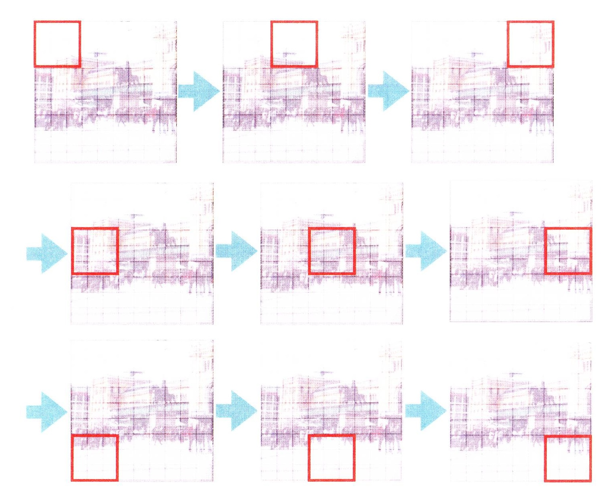
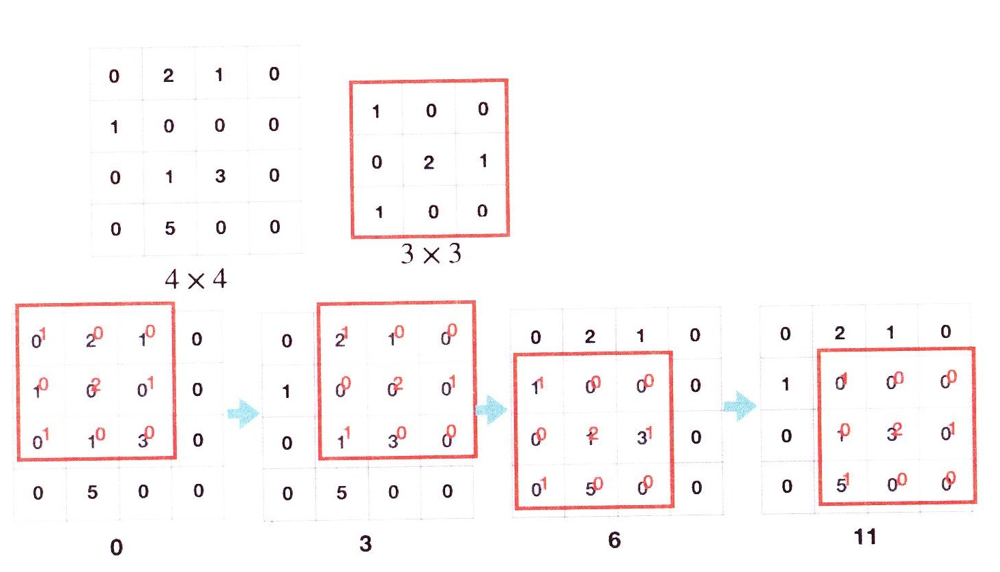
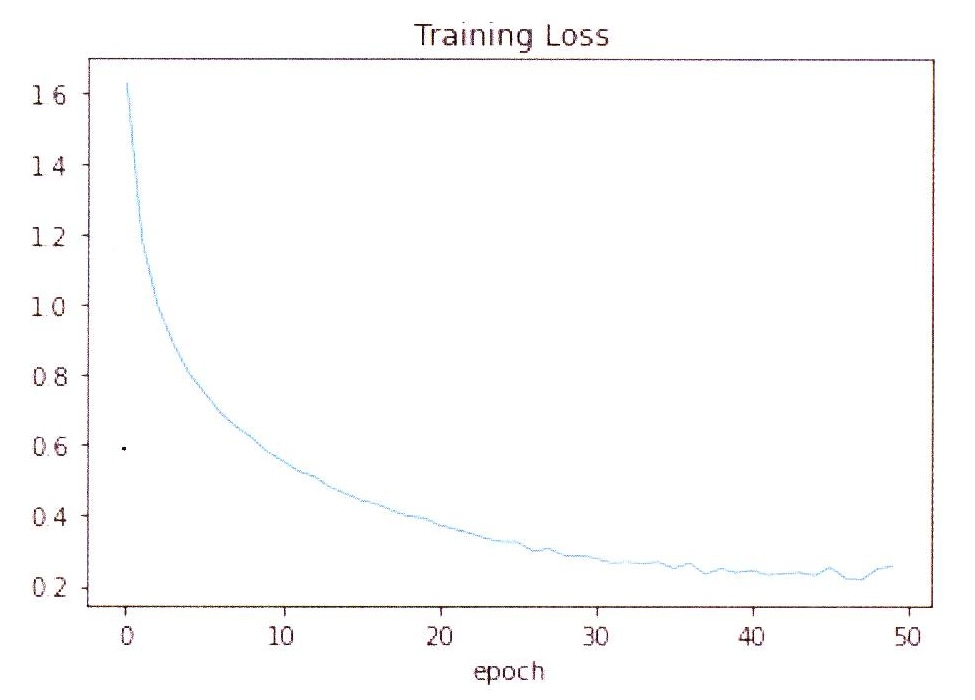
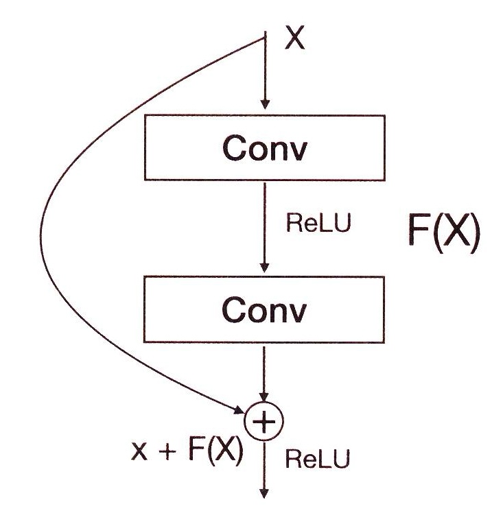
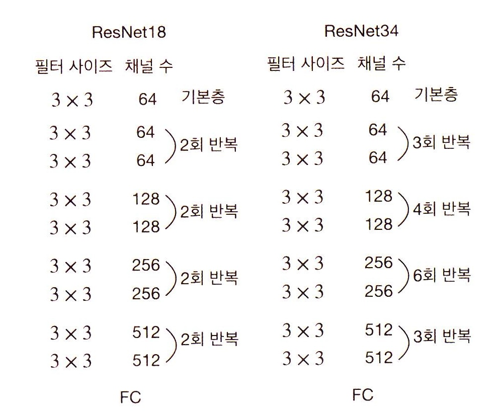

# CHAPTER 6 합성곱 신경망

최근에는 합성곱 신경망에 대항하는 비전 트랜스포머(Vision Transformer) 모델들이 떠오르고 있지만 합성곱 신경망은 여전히 이미지 분류, 객체 인식 등의 이미지 관련 문제에서 가장 많이 사용되는 모델이다. 6장에서는 합성곱 연산과 합성곱 신경망 구축에 대해서 다뤄보고 파이토치에서 제공하는 모델에 대해서 알아본다.

- 합성곱 연산과 풀링 연산
- ALEXNET
- RESNET
- 다양한 합성곱 신경망

# 6.1 합성곱 연산과 풀링 연산

합성곱 신경망의 기본 연산인 합성곱 연산과 풀링 연산에 대해서 다룬다.

### 6.1.1 이미지 데이터

이미지는 픽셀이라는 기본 단위가 존재한다. 따라서 이미지 데이터는 기본 단위로 구성된 행렬이다. 예를 들어 크기가 128x128 이미지는 128x128 행렬로 표현되며 색깔에 따라 각 성분의 값이 결정된다. 좀 더 자세히 설명하면 흑백 이미지는 하나의 행렬로 색을 표현할 수 있으므로, 이미지 크기는 128x128x1이며 1을 채널<sup>Channel</sup>이라고 말한다. 즉, 채널은 이미지 하나가 몇 장으로 구성되어 있는지를 나타낸다. 대표적으로 널리 쓰이는 RGB 이미지는 빨강<sup>R</sup>, 초록<sup>G</sup>, 파랑<sup>B</sup> 채널의 값들이 적절히 합쳐져 색을 결정하는 형태로서 128x128x3 이미지라고 할 수 있다. 물론 3채널 이상의 이미지도 존재하며 RGB가 아닌 H<sup>색상</sup>, S<sup>채도</sup>, V<sup>명도</sup>로 표현된 HSV 이미지 등의 다른 표현 방식들도 있다.
여기서 강조하고 싶은 것은 이미지도 숫자로 이루어져 있다는 것이다. 일반적으로 사용되는 RGB 이미지는 기본적으로 0 이상 255 이하의 값이며 그 이미지 값을 이용해 이미지 크기 조정, 값의 스케일링, 이미지 변환, 노이즈 제거 등 다양한 연구들이 진행되고 있다. 이를 이미지 처리<sup>Image processing</sup>라고 하며 수학적으로는 행렬과 벡터의 연산이다.

### 6.1.2 MLP와 이미지 처리

지금까지 배웠던 MLP 구조를 생각해 보면 입력층이 일렬 형태라는 것을 알 수 있다. 따라서 MLP 구조를 이용하여 사각형 모양의 사진을 처리하려면 이미지를 일렬 형태로 변환 후 모델에 입력시켜야만 한다. 예를 들어 3x3 이미지 행렬은 9x1 벡터가 되어 모델에 들어가게 되고 모델은 일렬 형태의 이미지 벡터를 통해 학습을 한다. 실제로 단순한 이미지 분류 문제에서는 MLP도 좋은 성능을 보이지만 일반적으로 좋은 성능을 내기 어렵다. 그 이유는 행렬의 성분을 순서대로 일렬로 붙여 벡터화 하기 때문에 이미지 내에 같은 객체가 있다고 하더라도 그 위치나 크기가 조금만 달라져도 벡터는 크게 변화할 수 있기 때문이다.
즉, 같은 객체라도 완전히 다른 벡터로 변환되어 객체의 공통된 특성을 뽑아낼 수 없을 가능성이 커진다. 따라서 전체 이미지를 벡터화 하지 않고 이미지의 일부분을 하나씩 살펴 보면서 전체 이미지를 해석할 필요가 있다. 이것이 바로 CNN의 기본 개념이자 핵심 포인트다.

### 6.1.3 합성곱 연산과 풀링 연산

앞서 강조했듯이 이미지의 일부분을 차례대로 훑어 보면서 이미지 전체를 파악하는 것이 CNN의 기본 메커니즘이다. 예를 들어 그림 6.1과 같이 3x3 빨간 상자를 만들어 내부를 보고 다음 부분으로 이동을 시키면서 전체 부분을 살펴볼 수 있다. 따라서 부분들에서 얻어진 정보를 모아 이미지 한 장을 해석하기 때문에 이미지를 벡터로 만들었을 때보다 객체의 크기와 위치에 덜 민감하다.

<그림 6.1 합성곱 필터의 이동>


이때 빨간 부분을 어떻게 보는지가 중요한데, 기본적으로 합성곱<sup>Convolution</sup>과 풀링<sup>Pooling</sup>이라는 방법을 통해 해당 부분을 해석하게 된다. 합성곱은 특정 값을 지닌 빨간 상자를 가지고 해당 부분의 이미지 값과 연산하는 방법으로써 빨간 상자를 필터<sup>Filter</sup> 혹은 커널<sup>Kernel</sup>이라고 한다. 따라서 필터에 따라 추출되는 특성이 다르기 때문에 모델 최적화를 통해 적절한 필터의 값을 찾는 것이 목표가 된다.

### 합성곱 연산 `nn.Conv2d`, `torch.nn.functional.conv2d`

합성곱은 필터가 위치한 부분에서 동일한 위치의 성분끼리 곱하여 전체를 더하는 것이다. 필터가 움직이는 보폭<sup>Stride</sup>을 정할 수 있으며 이미지 밖을 특정 값으로 둘러싸는 패딩<sup>Padding</sup>을 이용할 수도 있다.

<그림 6.2 합성곱 연산>


### 풀링 연산 `nn.AvgPool2d`, `torch.nn.functional.avg_pool2d` / `nn.MaxPool2d`, `torch.nn.functional.max_pool2d`

풀링은 앞서 언급한 합성곱과 같은 방법으로 작업이 진행된다. 다만 커널 안에서의 연산이 다를 뿐이다. 일반적으로 영역 내에서 최댓값을 뽑아내는 최댓값 풀링<sup>Max pooling</sup>과 평균값을 뽑아내는 평균값 풀링<sup>Average pooling</sup>이 많이 사용된다. 또한 기본적으로 풀링은 커널의 크기와 보폭을 같게 함으로써<sup>non-overlapping pooling</sup> 이동하는 커널이 같은 부분을 중복 계산하지 않게 한다. 즉, 영역별 대푯값을 하나씩 뽑아내는 연산이며 주로 컨볼루션 층 다음에 배치한다.

# 6.2 AlexNet

AlexNet은 ILSVRC<sup>ImageNet Large Scale Visual Recognition Challenge</sup> 2012 대회에서 우승을 차지한 합성곱 신경망<sup>Convolutional Neural Network, CNN</sup>이며 가장 기본적인 CNN 모델이라고 할 수 있다. 원 논문에서는 현재는 쓰이지 않는 기술들이 적용되어 파이토치에서는 이런 부분들을 수정하여 모델을 제공하고 있다. 이번 절에서는 파이토치에서 제공하는 모델을 사용하지 않고 직접 작성해 본다.

### 라이브러리 불러오기
**CODE** 6.2 CNN - AlexNet.ipynb

```python
import torch
import torchvision
import torchvision.transforms as transforms
from torch.utils.data import DataLoader
import torch.nn as nn
import torch.nn.functional as F
import torch.optim as optim
import matplotlib.pyplot as plt
```

### CIFAR10 데이터 세트 불러오기

transforms.Normalize는 특정 평균과 표준편차를 따르는 정규분포를 통해 이미지를 표준화하는 방법이다. CIFAR10은 3채널 컬러 이미지이므로 각 장의 평균과 표준편차를 정한다. 첫 번째 (0.5, 0.5, 0.5)는 각 채널 당 평균을 할당한 것이고 튜플로 입력한다. 두 번째 (0.5, 0.5, 0.5)는 각 채널의 표준편차를 기입한 것이다. 평균과 표준편차는 학습 전에 가지고 있는 이미지로부터 계산하지만 이번 예시에서는 임의의 값 0.5를 기입한다.

```python
transform = transforms.Compose([transforms.ToTensor(), transforms.Normalize((0.5, 0.5, 0.5), (0.5, 0.5, 0.5))])
trainset = torchvision.datasets.CIFAR10(root='./data', train=True, download=True, transform=transform)
trainloader = torch.utils.data.DataLoader(trainset, batch_size=32, shuffle=True)

testset = torchvision.datasets.CIFAR10(root='./data', train=False, download=True, transform=transform)
testloader = torch.utils.data.DataLoader(testset, batch_size=32, shuffle=False)
```

### GPU 연산 체크하기

```python
device = torch.device("cuda:0" if torch.cuda.is_available() else "cpu")
print(f'{device} is available.')
```

```
Output: cuda:0 is available.
```

- ❶ 일반적으로 최근 CNN은 깊고 복잡하다. 따라서 다수의 필터를 계산하고 업데이트해야 하기 때문에 GPU가 필수적인 요소다. 따라서 GPU 연산이 활성화되어 있는지 확인한다. 만약 비활성화 상태라면 코랩에서 GPU 연산으로 옵션을 변경한다. 그리고 torch.device를 통해 GPU가 가능한 텐서로 연산을 수행할 수 있다.
- ❷ cuda:0는 GPU를 사용할 수 있다는 의미다.

### AlexNet 구축하기

본래 AlexNet은 ImageNet 데이터를 위해 만들어졌다. ImageNet은 1000개의 클래스로 분류되어 있는 $256 \times 256$ 또는 $224 \times 224$ 크기를 갖는 이미지이다. 따라서 크기가 $32 \times 32$인 CIFAR10 이미지는 제대로 동작을 안 할 수 있다. 따라서 데이터에 맞게 필터의 크기와 보폭 수를 조정해 모델을 구축한다.

```python
class AlexNet(nn.Module):
    def __init__(self):
        super(AlexNet, self).__init__()
        self.features = nn.Sequential(
            nn.Conv2d(3, 64, 3), nn.ReLU(),
            nn.MaxPool2d(2, 2),
            nn.Conv2d(64, 192, 3, padding=1), nn.ReLU(),
            nn.MaxPool2d(2, 2),
            nn.Conv2d(192, 384, 3, padding=1), nn.ReLU(),
            nn.Conv2d(384, 256, 3, padding=1), nn.ReLU(),
            nn.Conv2d(256, 256, 1), nn.ReLU(),
            nn.MaxPool2d(2, 2)
        )
        self.classifier = nn.Sequential(
            nn.Dropout(0.5),
            nn.Linear(256*3*3, 1024), nn.ReLU(),
            nn.Dropout(0.5),
            nn.Linear(1024, 512), nn.ReLU(),
            nn.Linear(512, 10)
        )

    def forward(self, x):
```

```python
        x = self.features(x)
        x = x.view(-1, 256*3*3)
        x = self.classifier(x)
        return x
```

- ❶ AlexNet 클래스를 만든다.
- ❷ `__init__` 함수에 구조를 작성한다.
- ❹, ⓮ nn.Sequential를 이용하면 순차적으로 행해지는 연산을 한 번에 묶을 수 있다. nn.Sequential의 괄호 안은 작성 순서대로 연산이 수행된다.
- ❹ ~ ⓬ self.features는 합성곱 연산과 풀링 연산이 행해지는 피쳐 추출<sup>Feature extraction</sup> 부분이다.
- ❺ CIFAR10은 RGB 컬러 이미지다. 따라서 입력 채널의 수가 3이므로 반드시 nn.Conv2d에서 입력 채널 수에 3을 입력해야 한다(즉, nn.Conv2d(3(입력 채널 수), 64(출력 채널 수), 3(필터의 크기))). 채널의 출력 크기는 임의로 정해준다. 보폭은 별도로 지정하지 않았으므로 기본값 1로 진행된다. 다음 활성화 함수 nn.ReLU를 적용한다.
- ❻ 다음 2x2 크기의 필터를 2칸씩 이동하는 최댓값 풀링 nn.MaxPool2d(필터의 크기, 보폭)을 시행한다.
- ❼ ~ ⓬ 위와 같은 방법으로 층을 쌓는다(기본적으로 이전 층의 출력값과 다음 층의 입력값의 크기는 같아야 한다). padding=1은 해당 층의 입력 피처맵의 가장 외곽을 0으로 한 겹 둘러쌌다는 의미다. 예를 들어 100x100 피처맵에 한 겹을 씌우면 102x102가 되며 가장 외곽의 값은 0이 된다. 또한 외곽을 0으로 채우는 영패딩<sup>Zero pad</sup> 이외에도 padding_mode를 통해 다른 패드를 사용할 수 있다('zeros', 'reflect', 'replicate', 'circular').
- ⓮ ~ ⓳ Fully-connected layer<sup>FC</sup>로 구성된 self.classifier을 정의한다.
- ⓰ 유의할 점은 처음 들어오는 입력값의 크기와 self.features에서 나온 23 피처맵을 일렬로 편 벡터의 크기가 같아야 한다.
- ⓳ 또한 CIFAR10은 10개의 클래스를 가진 데이터이므로 마지막 노드 수는 10이 되어야 한다. 나머지 노드 수나 드롭아웃은 사용자가 임의로 정할 수 있다.

### 손실 함수 및 최적화 방법 정의하기

다중 분류 문제에서는 Cross Entropy Loss를 기본으로 사용한다. 파이토치에서 제공하는 Cross Entropy Loss는 softmax 계산까지 포함되어 있으므로 모델의 마지막 출력값에 별도의 softmax를 적용하지 않아도 된다. 그리고 GPU 연산을 위해 모델을 불러올 때 .to(device)를 반드시 붙여준다.

```python
criterion = nn.CrossEntropyLoss()
alexnet = AlexNet().to(device)
optimizer = optim.Adam(alexnet.parameters(), lr=1e-3)
```

### AlexNet 모델 학습하기

```python
loss_ = [] # 그래프를 그리기 위한 loss 저장용 리스트
n = len(trainloader) # 배치 개수
for epoch in range(50):
    running_loss = 0.0
    for data in trainloader:
        inputs, labels = data[0].to(device), data[1].to(device) # 배치 데이터
        optimizer.zero_grad()
        outputs = alexnet(inputs) # 예측값 산출
        loss = criterion(outputs, labels) # 손실 함수 계산
        loss.backward() # 손실 함수 기준으로 역전파 선언
        optimizer.step() # 가중치 최적화
        running_loss += loss.item()

    loss_.append(running_loss / n)
    print('[%d] loss: %.3f' %(epoch + 1, running_loss / len(trainloader)))
```

```
Output:
[1] loss: 1.626
[2] loss: 1.184
[3] loss: 0.998
[4] loss: 0.891
... 이하 생략 ...
```

- ❻ 모델의 학습 과정은 MLP와 동일하다. 추가적으로 GPU 연산을 위해 모델을 불러올 때 데이터에 .to(device)를 반드시 붙여준다.

### 학습 손실 함수 그래프 그리기

```python
plt.plot(loss_)
plt.title("Training Loss")
plt.xlabel("epoch")
plt.show()
```

<그림 6.3 훈련 손실 함수 그래프>


### 파이토치 모델 저장 및 불러오기

평가가 잘 되었다면 추후 이어서 학습을 하거나 실험 자료를 남기기 위해 모델을 저장해야 한다.

```python
PATH = './models/cifar_alexnet.pth'
torch.save(alexnet.state_dict(), PATH)
```

- ❶ 모델 저장 경로와 모델명.pth를 입력한다.
- ❷ torch.save(alexnet.state_dict(), PATH)을 이용하여 모델을 저장한다.

```python
alexnet = AlexNet().to(device)
alexnet.load_state_dict(torch.load(PATH))
```

- ❶ 모델 저장은 모델을 통째로 저장하는 것이 아니고 모델 파라미터를 저장하는 것이다. 따라서 저장된 모델을 불러올 때 모델이 선행적으로 선언되어 있어야만 한다.
- ❷ 모델의 파라미터를 불러와 모델에 주입한다.

### 평가하기

```python
correct = 0
total = 0
with torch.no_grad():
    alexnet.eval()
    for data in testloader:
        images, labels = data[0].to(device), data[1].to(device)
        outputs = alexnet(images)
        _, predicted = torch.max(outputs, 1)
        total += labels.size(0) # 개수 누적(총 개수)
        correct += (predicted == labels).sum().item() # 누적(맞으면 1, 틀리면 0으로 합산)

print('Test accuracy: %.2f %%' % (100 * correct / total))
```

```
Output: Test accuracy: 76.66 %
```

- ❶, ❷ 데이터 전체 개수와 정답 개수를 누적할 수 있는 변수를 선언한다.
- ❸ 평가 시에는 requires_grad를 비활성화 한다.
- ❹ 평가 시에는 드롭아웃 등과 같은 정규화 작업을 시행해서는 안된다. 따라서 alexnet.eval()을 선언하여 정규화 작업을 비활성화 한다.
- ❽ outputs은 크기가 (배치 크기) $\times 10$인 벡터 형태로 나온다. 따라서 열 기준으로 가장 큰 원소의 위치가 라벨이 되는 것이기 때문에 최댓값을 열(1) 기준으로 계산하여 예측값을 구한다. torch.max는 최댓값과 최댓값의 위치를 산출해주는데 여기서 우리는 최댓값은 필요가 없으므로 받지 않아도 된다. 따라서 _로 처리하여 해당 출력값은 저장하지 않는다. 즉, _, predicted는 최댓값의 위치만 predicted에 저장하겠다는 의미다.

# 6.3 ResNet

ResNet은 ILSVRC<sup>ImageNet Large Scale Visual Recognition Challenge</sup> 2015 대회에서 우승을 차지한 합성곱 신경망이며, 이후 CNN에서 중요한 개념으로 자리 잡은 Residual block을 제안한 모델이다.
스킵 커넥션<sup>Skip connection</sup>이란 그림 6.4와 같이 여러 레이어를 건너 뛰어 이전 정보를 더하는 것을 의미하며, 이 하나의 과정을 묶어 만든 것이 Residual block이다. Residual block의 위치나 구조에 따라 성능이 달라질 수 있지만, 기본적으로 합성곱 층 2, 3칸을 뛰어넘어 더하는 방식을 사용한다. ResNet은 Residual block 여러 개를 붙여놓은 모델이며, 모델명에 붙은 숫자는 층의 개수를 의미한다. 즉, ResNet18은 층이 18개이고, ResNet34는 34개의 층을 가지고 있는 모델이다.

<그림 6.4 Residual block>


ImageNet 데이터에 맞춰진 ResNet은 기본층에서 7x7 필터를 사용하는 합성곱과 3x3 맥스 풀링을 사용한다. CIFAR10은 이미지 사이즈가 ImageNet 이미지 보다 훨씬 작기 때문에 그림 6.5와 같이 기본층의 합성곱 필터 사이즈를 3x3으로 줄이고 맥스풀링을 생략한다. 또한 ResNet18과 ResNet34는 동일한 블록을 사용하기 때문에 층을 조절하여 두 모델을 구현할 수 있다.

| ResNet18 필터 사이즈 | 채널 수 | 비고 | ResNet34 필터 사이즈 | 채널 수 | 비고 |
| :--- | :--- | :--- | :--- | :--- | :--- |
| 3 x 3 | 64 | 기본층 | 3 x 3 | 64 | 기본층 |
| 3 x 3<br>3 x 3 | 64<br>64 | 2회 반복 | 3 x 3<br>3 x 3 | 64<br>64 | 3회 반복 |
| 3 x 3<br>3 x 3 | 128<br>128 | 2회 반복 | 3 x 3<br>3 x 3 | 128<br>128 | 4회 반복 |
| 3 x 3<br>3 x 3 | 256<br>256 | 2회 반복 | 3 x 3<br>3 x 3 | 256<br>256 | 6회 반복 |
| 3 x 3<br>3 x 3 | 512<br>512 | 2회 반복 | 3 x 3<br>3 x 3 | 512<br>512 | 3회 반복 |
| FC | | | FC | | |

<그림 6.5 ResNet18, ResNet34의 층 정보>


### Residual block 구축하기

```python
# CODE 6.3 CNN - ResNet.ipynb

class ResidualBlock(nn.Module):
    def __init__(self, in_channels, out_channels, stride=1):
        super(ResidualBlock, self).__init__()
        self.stride = stride
        self.in_channels = in_channels
        self.out_channels = out_channels
        self.conv_block = nn.Sequential(
            nn.Conv2d(self.in_channels, self.out_channels, kernel_size=3, stride=stride,
                      padding=1, bias=False),
            nn.BatchNorm2d(self.out_channels),
            nn.ReLU(),
            nn.Conv2d(self.out_channels, self.out_channels, kernel_size=3, stride=1,
                      padding=1, bias=False),
            nn.BatchNorm2d(self.out_channels)
        )
        if self.stride != 1 or self.in_channels != self.out_channels:
            self.downsample = nn.Sequential(
                nn.Conv2d(self.in_channels, self.out_channels, kernel_size=1,
                          stride=stride, bias=False),
                nn.BatchNorm2d(self.out_channels)
            )

    def forward(self, x):
        out = self.conv_block(x)
        if self.stride != 1 or self.in_channels != self.out_channels:
            x = self.downsample(x)
        out = F.relu(x + out)
        return out
```

- ❽ ~ ❿ 컨볼루션 연산 2개를 포함한 블록을 만들어준다.

- ❾, ❿ 학습을 빠르게 할 수 있는 배치 정규화<sup>Batch Normalization</sup>를 층 사이에 적용한다. 배치 정규화는 각 배치의 평균과 분산을 이용해서 데이터를 정규화하는 방법이다.
- ⓫ ~ ⓭ ResNet은 ResidualBlock 하나를 거칠 때마다 이미지 사이즈가 줄어들고 채널 수는 늘어나는 구조다. 따라서 처음 들어오는 x값과 블록을 거친 출력값 out의 크기가 같아야만 한다. 따라서 차이가 나는 경우 출력값의 크기와 입력값의 크기를 동일하게 하기 위해 별도의 컨볼루션 연산을 진행하여 입력 크기를 출력 크기와 맞춰준다.
- ⓱ ~ ⓲ 사이즈 조정이 필요하다면 입력값의 크기를 조정한다.
- ⓳ Skip connection을 시행한다.

### ResNet 모델 구축하기

```python
class ResNet(nn.Module):
    def __init__(self, num_blocks, num_classes=10):
        super(ResNet, self).__init__()
        self.in_channels = 64
        self.base = nn.Sequential(
            nn.Conv2d(3, 64, kernel_size=3, stride=1, padding=1, bias=False),
            nn.BatchNorm2d(64),
            nn.ReLU()
        )
        self.layer1 = self._make_layer(64, num_blocks[0], stride=1)
        self.layer2 = self._make_layer(128, num_blocks[1], stride=2)
        self.layer3 = self._make_layer(256, num_blocks[2], stride=2)
        self.layer4 = self._make_layer(512, num_blocks[3], stride=2)
        self.gap = nn.AvgPool2d(4) # 4: 필터 사이즈
        self.fc = nn.Linear(512, num_classes)

    def _make_layer(self, out_channels, num_blocks, stride):
        strides = [stride] + [1]*(num_blocks-1)
        layers = []
        for stride in strides:
            block = ResidualBlock(self.in_channels, out_channels, stride)
            layers.append(block)
            self.in_channels = out_channels
        return nn.Sequential(*layers)
```

- ❶ ~ ❸ ResNet 클래스를 정의하고 `__init__`을 작성한다.
- ❺ ~ ❽ 입력 이미지가 들어와 연산을 수행하는 기본층을 만든다.
- ❾ ~ ⓬ 그림 6.5와 같이 기본층을 제외한 4개의 블록이 필요하다. 따라서 self._make_layer을 이용하여 4개의 블록 묶음을 선언한다.

- ⓭ 합성곱 층들을 지나면 최종적으로 크기가 4x4인 피처맵 512개가 나온다. 크기가 4x4인 평균 풀링을 이용하면 각 피처맵 당 1개의 평균값이 나오기 때문에 성분이 512개인 벡터를 얻을 수 있다.
- ⓮ 클래스가 10개인 이미지를 분류하는 것이므로 최종적으로 512개의 노드에서 10개의 노드로 가는 FC를 정의한다.
- ⓱ 블록의 반복 횟수만큼 stride를 저장한다.
- ⓲ ~ ⓴ ResidualBlock을 불러와서 append를 이용해 차례로 붙여준다. 이때 이전 출력 채널 크기와 다음 입력 채널 크기가 같아야 하므로 ⓴ self.in_channels = out_channels을 작성한다.
- ⓳ nn.Sequential에 넣어 모델을 구축한다. *리스트는 리스트의 길이에 상관 없이 모든 성분을 별도로 nn.Sequential에 전달하는 역할을 한다.

```python
    def forward(self, x):
        out = self.base(x)
        out = self.layer1(out)
        out = self.layer2(out)
        out = self.layer3(out)
        out = self.layer4(out)
        out = self.gap(out)
        out = out.view(out.size(0), -1)
        out = self.fc(out)
        return out
```

- ⓴ ~ ⓳ 마지막으로 ResNet 클래스 안에 연산을 행하는 forward를 정의한다.

```python
def modeltype(model):
    if model == 'resnet18':
        return ResNet([2, 2, 2, 2])
    elif model == 'resnet34':
        return ResNet([3, 4, 6, 3])
```

- ❶ ~ ❺ 클래스를 불러오는 함수를 만든다. 그림 6.5와 같이 각 모델마다 블록의 반복 횟수를 리스트로 정의하여 입력한다. 이를 통해 18, 34 외에 4개의 블록을 가진 레이어의 개수를 조정할 수 있다.

```python
resnet = modeltype('resnet18').to(device)
print(resnet)
PATH = './models/cifar_resnet.pth' # 모델 저장 경로
```

```
Output:
ResNet(
  (base): Sequential(
    (0): Conv2d(3, 64, kernel_size=(3, 3), stride=(1, 1), padding=(1, 1), bias=False)
    (1): BatchNorm2d(64, eps=1e-05, momentum=0.1, affine=True, track_running_stats=True)
    (2): ReLU()
  ... 중략 ...
  (gap): AvgPool2d(kernel_size=4, stride=4, padding=0)
  (fc): Linear(in_features=512, out_features=10, bias=True)
)
```

### ResNet18 학습 및 평가하기

AlexNet 평가에서 사용한 코드로 학습과 평가 과정을 동일하게 진행한다. 결과적으로 ResNet18의 평가 정확도는 76.66%(학습 50회)인 AlexNet보다 약 6.6% 높은 83.25%(학습 10회)를 달성한다.

```
Output: Test accuracy: 83.25 %
```

# 6.4 다양한 합성곱 신경망

파이토치에서는 손쉽게 이용할 수 있는 다양한 신경망을 제공한다.

```python
import torchvision.models as models
alexnet = models.alexnet().to(device)
alexnet.classifier[6] = nn.Linear(4096, 5)
"""
resnet18 = models.resnet18().to(device)
vgg16 = models.vgg16().to(device)
densenet = models.densenet161().to(device)
inception = models.inception_v3().to(device)
googlenet = models.googlenet().to(device)
shufflenet = models.shufflenet_v2_x1_0().to(device)
mobilenet_v2 = models.mobilenet_v2().to(device)
resnext50_32x4d = models.resnext50_32x4d().to(device)
wide_resnet50_2 = models.wide_resnet50_2().to(device)
mnasnet = models.mnasnet1_0().to(device)
"""
```

- ❶ torchvision.models as models을 이용해 모델을 불러올 수 있다.
- ❷ AlexNet 모델을 사용한다면 alexnet = models.alexnet().to(device)을 선언하면 된다. 여기서 중요한 것은 제공 모델들이 클래스 개수가 1,000개인 ImageNet 데이터를 위해 만들어졌기 때문에 모델의 최종 출력 노드수가 1,000개다. 따라서 우리가 다루는 데이터의 클래스 수로 변경해야 한다.
- ❸ 만약 5개의 클래스를 분류하는 문제라고 했을 때, AlexNet의 경우는 마지막 층이 alexnet.classifier[6]이기 때문에 alexnet.classifier[6] = nn.Linear(4096, 5)라고 층을 재정의하면 된다. 모델마다 해당 층의 이름과 인덱스가 다를 수 있다. 이때 5.6절에서 배운 내용을 토대로 이름을 알아낼 수 있다. 현재 파이토치에서는 30여 개의 합성곱 신경망을 제공하고 있다.

> "우리가 자율주행 자동차를 갖게 된다는 것은 매우 분명하다고 생각한다."
> 
> — 제프리 힌튼
