# CHAPTER 7 순환 신경망

순환 신경망은 합성곱 신경망과 더불어 가장 많이 사용되는 신경망이다. 주어진 데이터가 시간, 순서에 따라 서로 연관이 있다면 우리는 이를 고려하여 모델을 구축해야 한다. 이러한 시퀀스 데이터는 기온 예측, 주가 예측, 번역 등과 같이 우리 생활에 직접적으로 필요한 부분이 많기 때문에 모델이 매우 빠르게 개선되고 있다. 하지만 순환 신경망의 최신 모델을 이해하려면 기본적인 개념들을 이해해야 한다. 7장에서는 시퀀스 데이터의 의미와 기본적인 순환 신경망에 대해서 알아본다.

- 기본 순환 신경망
- LSTM과 GRU
- Bi-LSTM

# 7.1 기본 순환 신경망

순환 신경망에서 일반적으로 사용되는 데이터와 기본 구조를 알아본다.

## 7.1.1 시계열 데이터

<그림 7.1 순환 신경망의 응용 분야
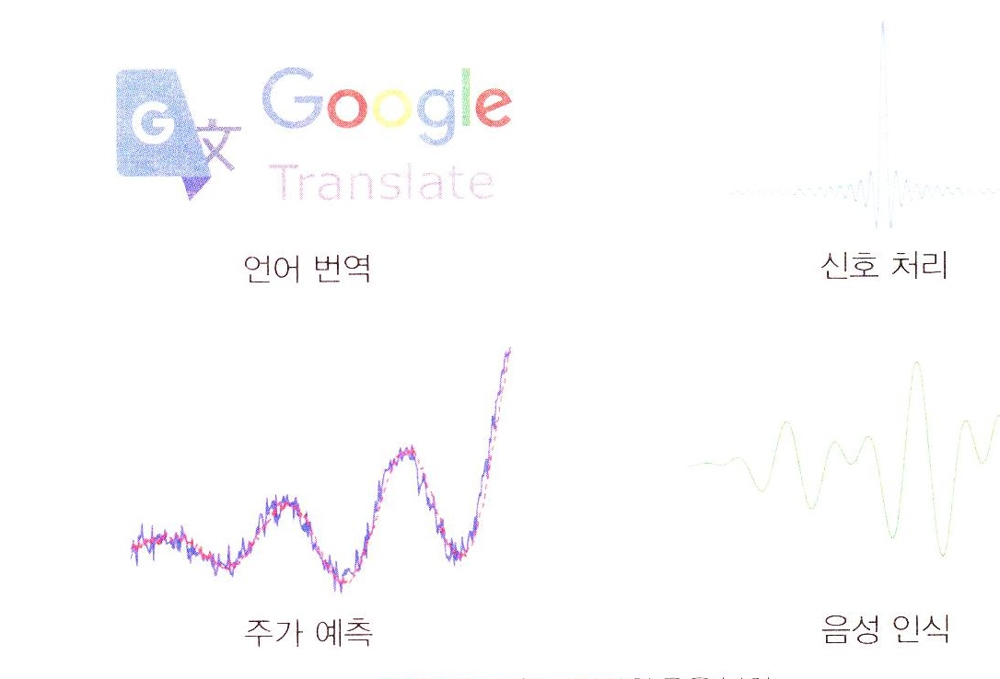 (언어 번역, 신호 처리, 주가 예측, 음성 인식)>

시계열 데이터란 일정 시간 간격으로 배치된 데이터다. 대표적으로 시간에 따른 온도, 주식, 신호 변화 등의 데이터가 있고 추가적으로 음성, 대화 등의 데이터와 같이 단어가 나열된 형태도 연속적으로 관계가 있는 데이터라고 볼 수 있다. 그림 7.1과 같이 시퀀스 형태의 데이터를 통해 학습된 모델은 우리 주변에 이미 많이 사용되고 있다.

## 7.1.2 기본 인공 신경망과 순환 신경망

순환 신경망<sup>Recurrent Neural Network, RNN</sup>은 시퀀스 데이터를 예측하기 위해 만들어진 모델로 시계열 예측 기술의 근간이라고 할 수 있다. 기본적인 인공 신경망은 입력값 하나가 들어오면 출력값 하나를 산출하며 이전 입력값과 다음 입력값의 관계는 고려하지 않는다. 이를 개선하기 위해 그림 7.2와 같이 이전 단계에서 계산된 정보를 가공해서 다음 단계의 계산에 반영하는 것이 순환 신경망이다.

<그림 7.2 기본 인공 신경망 vs 순환 신경망
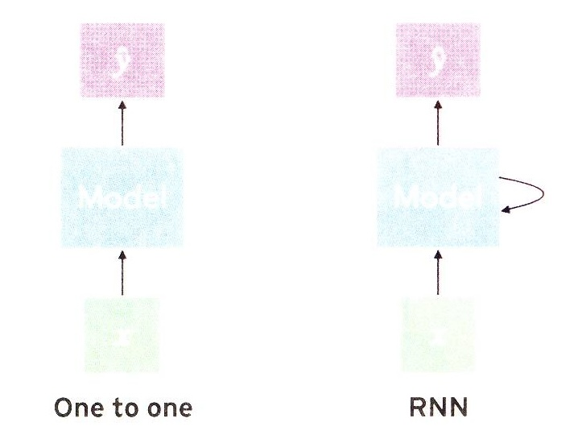 (One to one vs RNN)>

## 7.1.3 순환 신경망의 다양한 형태

순환 신경망은 다양한 구조가 존재한다. 그림 7.3과 같이 One to many 방식은 하나의 입력값을 받아 순차적으로 출력값을 산출한다. Many to one 방식은 여러 시간(시퀀스)에 대한 데이터를 받아 하나의 출력값을 산출한다. Many to many 방식은 여러 개의 시계열 데이터를 받아 여러 개의 출력값을 산출한다.

<그림 7.3 순환 신경망의 다양한 형태
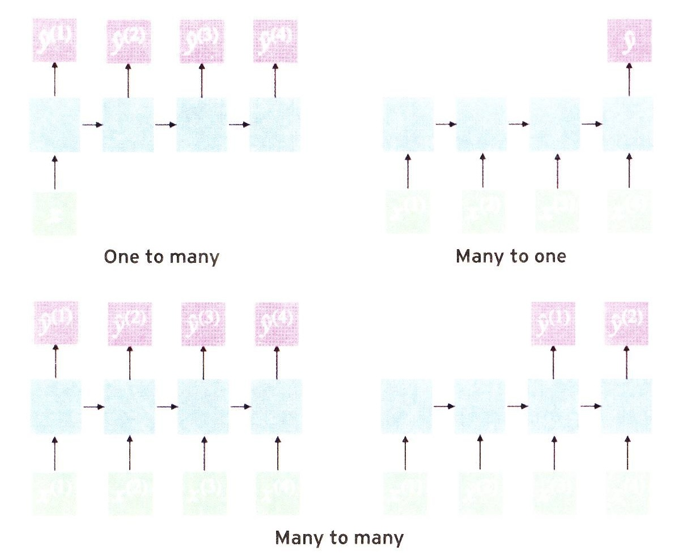 (One to many, Many to one, Many to many)>

## 7.1.4 기본 순환 신경망

이전 데이터로부터 얻은 정보를 다음 계산에 어떻게 반영할 것인지에 따라 종류가 나눠지는데, 기본적인 순환 신경망은 그림 7.4와 같이 연산이 진행된다. 입력값이 하나 들어오면 이전 정보와 입력값을 연산하여 $h$라는 은닉 상태를 구한다. 이때 얻은 $h$값은 선형식을 거쳐 $o$를 만든 후 활성화 함수를 통해 $y$를 산출한다. 다음 입력값이 들어오면 이전에 계산했던 $h$값을 이용하여 동일한 계산을 거치게 된다.

$$y^{(t)} = \text{softmax}(o^{(t)})$$
$$o^{(t)} = c + Vh^{(t)}$$
$$h^{(t)} = f_W(h^{(t-1)}, x^{(t)})$$

<그림 7.4 기본 순환 신경망>
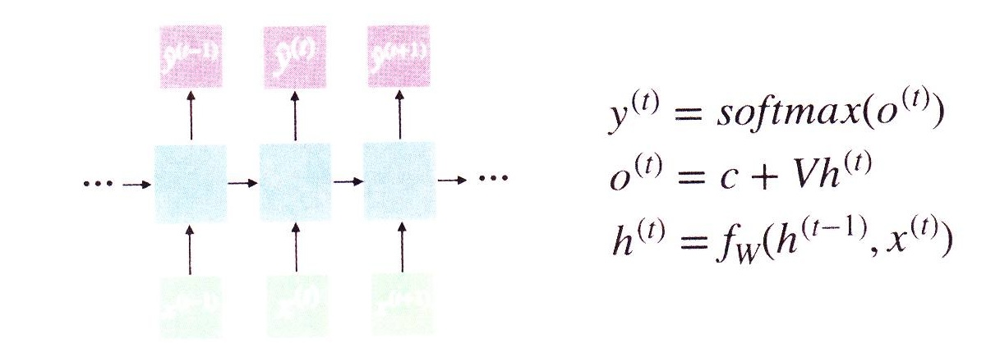

그림 7.5는 한 번의 연산에 필요한 변수와 구조를 표현한 것이다. 추가적으로 $W, U, V$가 모델 변수로써 하나의 시퀀스가 처리되면 최적화 방법을 통해 업데이트가 된다.

$$h^{(t)} = f_W(h^{(t-1)}, x^{(t)})$$
$$a^{(t)} = b + Wh^{(t-1)} + Ux^{(t)}$$
$$a^{(t)}, h^{(t)} : N \times 1 \quad x^{(t)} : M \times 1$$
$$W : N \times N, \quad U : N \times M, \quad V : L \times N$$
$$h^{(t)} = \tanh(a^{(t)})$$
$$o^{(t)} = c + Vh^{(t)}$$
$$y^{(t)} = \text{softmax}(o^{(t)})$$

<그림 7.5 기본 순환 신경망의 연산>
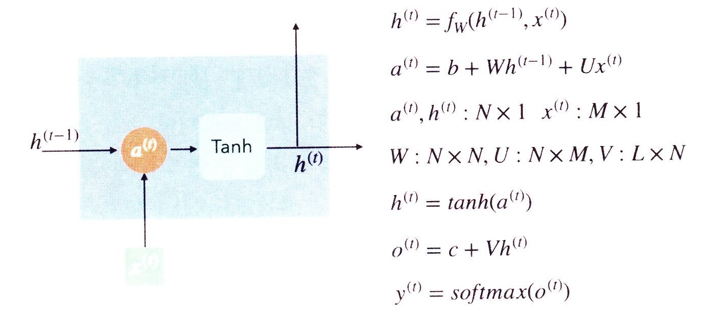

## 7.1.5 기본 순환 신경망 구현

```python
# CODE 7.1 Vanilla RNN.ipynb
```

### 라이브러리 및 데이터 불러오기

주가 데이터를 이용해 실습한다. 데이터는 일자, 시작가, 고가, 저가, 종가, 보정된 종가, 거래량으로 구성된 csv 파일이다.

```python
import numpy as np
import pandas as pd
from sklearn.preprocessing import MinMaxScaler
import torch
import torch.nn as nn
import torch.optim as optim
import matplotlib.pyplot as plt

df = pd.read_csv("./data/kospi.csv")
scaler = MinMaxScaler()
df[['Open','High','Low','Close','Volume']] = scaler.fit_transform(df[['Open','High','Low','Close','Volume']])
```

- ❷, ❽ pandas를 이용해서 csv 파일을 데이터프레임 형태로 불러온다. 데이터는 보정된 종가를 제외한 나머지를 사용하며 일자를 제외하고 MinMax 스케일을 사용하여 데이터를 가공한다.

```python
df.head()
```

```
Output:
        Date      Open      High       Low     Close    Adj Close    Volume
0 2019-01-30  0.722898  0.732351  0.745525  0.759235  2206.199951  0.242113
1 2019-01-31  0.763058  0.750069  0.769089  0.757866  2204.850098  0.274771
2 2019-02-01  0.751894  0.745714  0.769280  0.756456  2203.459961  0.241609
3 2019-02-07  0.755809  0.742538  0.764596  0.756415  2203.419922  0.215603
4 2019-02-08  0.731584  0.717777  0.739548  0.729669  2177.020049  0.197057
```

데이터프레임에서 .head()는 상위 5개 항목에 대한 테이블을 출력해 준다. 일자와 보정된 종가를 제외한 나머지가 스케일링된 것을 볼 수 있다.

### 텐서 데이터 만들기

사용할 데이터는 인스턴스가 431개이고 피처가 4개(Open, High, Low, Volume)이고 타깃값은 종가(Close)이다. 즉, $431 \times 4$ 시계열 데이터를 가지고 있다. 이 단계에서 고려해야 할 점은 며칠을 사용하여 다음 날 종가를 예측하느냐는 것과 학습 데이터와 평가 데이터의 비율이다.

```python
device = torch.device("cuda:0" if torch.cuda.is_available() else "cpu")
```

```python
X = df[['Open','High','Low','Volume']].values
y = df['Close'].values
```

데이터프레임에서는 .values를 이용하여 넘파이 배열로 만들 수가 있다. ❷ 입력 데이터와 ❸ 타깃 데이터를 생성한다.

```python
def seq_data(x, y, sequence_length):
    x_seq = []
    y_seq = []
    for i in range(len(x)-sequence_length):
        x_seq.append(x[i:i+sequence_length]) # a[2:6] -> 2,3,4,5
        y_seq.append(y[i+sequence_length])

    return torch.FloatTensor(x_seq).to(device), torch.FloatTensor(y_seq).to(device).view(-1, 1)
```

- ❶ 시퀀스 데이터를 만드는 함수를 생성한다.
- ❷, ❸ x, y값에 대한 시퀀스를 저장하는 빈 리스트를 생성한다.
- ❹ ~ ❻ 미리 정한 시퀀스 길이로 쪼개어 저장한다. 이때 데이터는 for문의 1회 당 한 칸 움직여 저장한다(보폭을 정해 줄 수도 있다). 예를 들어 길이가 3이면 처음 저장된 데이터는 0, 1, 2번째 데이터가 한 묶음이고 다음은 1, 2, 3, 그 다음은 2, 3, 4번째의 데이터가 한 묶음이 된다. y 데이터는 다음 날 값이 타깃값이기 때문에 입력값이 x[i:i+sequence_length]면 타깃값은 y[i+sequence_length]로 작성한다. 예를 들어 X가 0, 1, 2번째 데이터를 묶일 때 3번째 데이터의 y값이 대응되는 타깃값이 된다.
- ❽ 마지막으로 GPU용 텐서로 변환한다. 여기서 y 데이터를 view(-1, 1)를 사용하여 2차원으로 바꿔주는 이유는 MSE Loss가 기본적으로 2차원 타깃 데이터를 받기 때문이다.

```python
split = 200
sequence_length = 5
x_seq, y_seq = seq_data(X, y, sequence_length)
x_train_seq = x_seq[:split]
y_train_seq = y_seq[:split]
x_test_seq = x_seq[split:]
y_test_seq = y_seq[split:]
print(x_train_seq.size(), y_train_seq.size())
print(x_test_seq.size(), y_test_seq.size())
```

```
Output:
torch.Size([200, 5, 4]) torch.Size([200, 1])
torch.Size([226, 5, 4]) torch.Size([226, 1])
```

- ❷, ❸ 시퀀스 길이를 5로 한다면 426개(431(전체 데이터) - 5(시퀀스 길이))의 시퀀스 데이터를 만들 수 있다.
- ❶, ❹ ~ ❼ 이때 순서대로 200개 데이터는 학습 데이터로 사용하고 이후 데이터는 평가 데이터로 사용한다.

```python
train = torch.utils.data.TensorDataset(x_train_seq, y_train_seq)
test = torch.utils.data.TensorDataset(x_test_seq, y_test_seq)
batch_size = 20
train_loader = torch.utils.data.DataLoader(dataset=train, batch_size=batch_size, shuffle=True)
test_loader = torch.utils.data.DataLoader(dataset=test, batch_size=batch_size)
```

Dataset과 DataLoader를 이용해 배치 데이터로 만든다.

### RNN 구축에 필요한 하이퍼 파라미터 정의하기

```python
input_size = x_seq.size(2)
num_layers = 2
hidden_size = 8
```

그림 7.5에서 소개된 RNN의 연산은 파이토치에서 제공하기 때문에 전체를 직접 구현하지 않아도 된다. 우리가 정해야 하는 것은 ❶ 입력 변수의 개수, ❷ 은닉층의 개수, ❸ 은닉 상태를 저장하는 벡터의 크기다. 그림 7.6은 우리가 구축할 모델을 표현한 것이다.

<그림 7.6 종가 예측을 위한 RNN 모델>
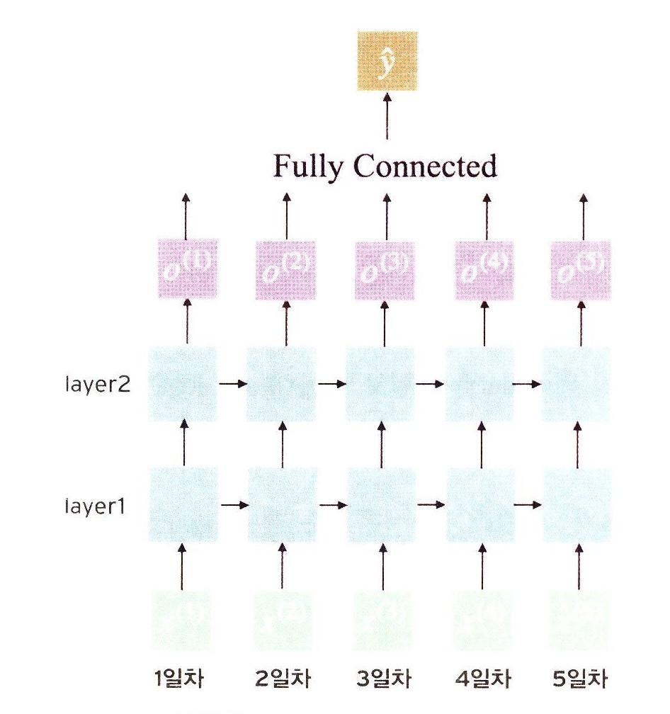

### RNN 구축하기

```python
class VanillaRNN(nn.Module):
    def __init__(self, input_size, hidden_size, sequence_length, num_layers, device):
        super(VanillaRNN, self).__init__()
        self.device = device
        self.hidden_size = hidden_size
        self.num_layers = num_layers
        self.rnn = nn.RNN(input_size, hidden_size, num_layers, batch_first=True)
        self.fc = nn.Sequential(nn.Linear(hidden_size*sequence_length, 1), nn.Sigmoid())

    def forward(self, x):
        h0 = torch.zeros(self.num_layers, x.size()[0], self.hidden_size).to(self.device)
        out, _ = self.rnn(x, h0)
        out = out.reshape(out.shape[0], -1)
        out = self.fc(out)
        return out
```

- ❶ RNN의 클래스를 만든다(가장 기본이 되는 방법 앞에 Vanilla를 붙여 말하기도 한다).
- ❸ ~ ❼ 각 변수를 정리한다.
- ❽ nn.RNN을 이용하면 한 줄로 모델이 정의된다. 이때 주의할 점은 원래 nn.RNN의 입력 데이터 크기는 시퀀스의 길이 $\times$ 배치사이즈 $\times$ 변수의 크기이기 때문에 (200, 5, 4) 크기의 데이터를 (5, 200, 4)으로 변경해야 한다. 하지만 batch_first=True를 적용하면 기존의 200x5x4 데이터를 그대로 사용할 수 있다.
- ❾ RNN에서 나온 출력값을 FC층 하나를 거쳐 하나의 예측값을 뽑을 수 있도록 self.fc를 정의한다.
- ⓬ RNN은 이전 h를 받아 계산하기 때문에 첫 번째 계산 시 이전 h가 없기 때문에 초깃값을 영<sup>zero</sup> 텐서로 정의하여 h0를 대입한다.
- ⓭ 정의된 self.rnn을 사용한다. 이때 파이토치에서 제공하는 모델은 many to many 방법을 가지고 각 시간에 대한 예측값과 은닉 상태를 산출한다. 이 예시에서는 은닉 상태를 사용하지 않기 때문에 out, _으로 예측값만 받는다(밑줄 _은 함수의 반환값을 받지 않을 때 사용한다).
- ⓮, ⓯ 모든 출력값을 사용하기 위해 out을 일렬로 만들어 self.fc에 넣는다.

### RNN 모델 불러오기

입력값의 크기, 은닉 상태 크기, 시퀀스 길이, 은닉층 개수, gpu 연산을 위한 device 변수까지 모델에 넣어준다. 또한 GPU 연산을 위해 model 뒤에 .to(device)를 붙여준다.

```python
model = VanillaRNN(input_size=input_size,
                   hidden_size=hidden_size,
                   sequence_length=sequence_length,
                   num_layers=num_layers,
                   device=device).to(device)
```

### 손실 함수 및 최적화 방법 정의

주가를 예측하는 것이므로 회귀문제다. 따라서 대표적인 MSE 손실 함수를 사용한다. 학습은 301회이고 최적화 방법은 Adam을 사용한다.

```python
criterion = nn.MSELoss()
num_epochs = 301
optimizer = optim.Adam(model.parameters(), lr=1e-3)
```

### 모델 학습하기

학습 과정은 전형적인 지도 학습 방법이다.

```python
loss_graph = []
n = len(train_loader)

for epoch in range(num_epochs):
    running_loss = 0.0

    for data in train_loader:
        seq, target = data # 배치 데이터
        out = model(seq) # 출력값 산출
        loss = criterion(out, target) # 손실 함수 계산

        optimizer.zero_grad()
        loss.backward()
        optimizer.step() # 최적화
        running_loss += loss.item()

    loss_graph.append(running_loss/n)
    if epoch % 100 == 0:
        print('[epoch: %d] loss: %.4f' %(epoch, running_loss/n))
```

```
Output:
[epoch: 0] loss: 0.0299
[epoch: 100] loss: 0.0010
[epoch: 200] loss: 0.0008
[epoch: 300] loss: 0.0007
```

### 학습 손실 함수값 그리기

손실 함수를 통해 단편적으로 훈련이 잘 됐음을 확인할 수 있다.

```python
plt.figure(figsize=(20,10))
plt.plot(loss_graph)
plt.show()
```

<그림 7.7 훈련 손실 함수 그래프>
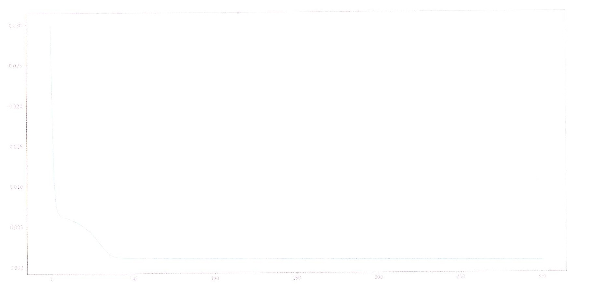

### 주가 그리기

```python
concatdata = torch.utils.data.ConcatDataset([train, test])
data_loader = torch.utils.data.DataLoader(dataset=concatdata, batch_size=100)
with torch.no_grad():
    pred = []
    model.eval()
    for data in data_loader:
        seq, target = data
        out = model(seq)
        pred += out.cpu().tolist()
```

```python
plt.figure(figsize=(20,10))
plt.plot(np.ones(100)*len(train),np.linspace(0,1,100),'--', linewidth=0.6)
plt.plot(df['Close'][sequence_length:].values,'--')
plt.plot(pred,'b', linewidth=0.6)
plt.legend(['train boundary','actual','prediction'])
plt.show()
```

- ❶ ConcatDataset은 여러 개의 데이터 세트를 함께 사용할 수 있도록 도와준다. 입력값은 데이터 세트의 리스트를 받기 때문에 앞서 정의한 train, test를 리스트 [train, test]로 넣어준다.
- ❹ 예측값을 저장할 빈 텐서 pred를 만든다.
- ❾ 예측값은 GPU 텐서다. 따라서 CPU 텐서로 변환 후 .tolist()를 이용하여 리스트로 만들어 순차적으로 리스트를 이어 붙인다.
- ⓫ 학습 일수와 평가 일수를 구분 짓는 선을 긋는다.
- ⓬, ⓭ 실제값과 예측값을 그린다.

<그림 7.8 RNN의 예측값과 실제값 그래프>
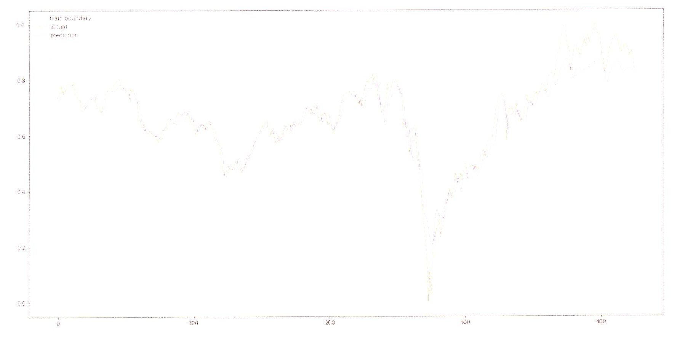

파란색 수직선을 기준으로 왼쪽을 훈련 데이터로 사용하고 오른쪽을 평가 데이터로 사용하였다. 따라서 훈련 데이터 부분은 학습이 잘 되어 실제값과 예측값이 잘 맞는다고 보여진다. 평가 부분은 급락하는 부분을 잡아내지는 못한다. 전체적으로 예측을 잘 하는 것처럼 보이지만 오른쪽으로 쉬프트<sup>Shift</sup> 된 현상을 볼 수 있다.

## 7.2 LSTM과 GRU

RNN은 시퀀스의 길이가 길거나 관련 정보들 간의 거리가 멀면 학습 능력이 크게 하락할 수 있다. 해당 단점을 보완하고자 LSTM이 개발되었고, 획기적인 모델로 인정받으며 많은 모델에 응용되었다. 또한 LSTM을 간소화한 GRU가 개발되었다.

### 7.2.1 기본 RNN의 문제

#### ■ 기울기 사라짐
RNN은 연속적으로 활성화 함수 Tanh를 계산하는 형태다. 따라서 역전파를 진행할 때 그림 7.9의 오른쪽 그림과 같은 형태의 Tanh의 미분을 수행하는데, 중앙에서 빨간줄 밖으로 나가면 값이 0에 아주 가까워짐을 알 수 있다. 따라서 미분을 이용하여 모델 변수를 업데이트하기 때문에 미분값이 0에 가까운 값들이 나오게 되면 적절한 변수를 찾기 어렵다.

<그림 7.9 tanh 함수와 tanh 함수의 미분 그래프>
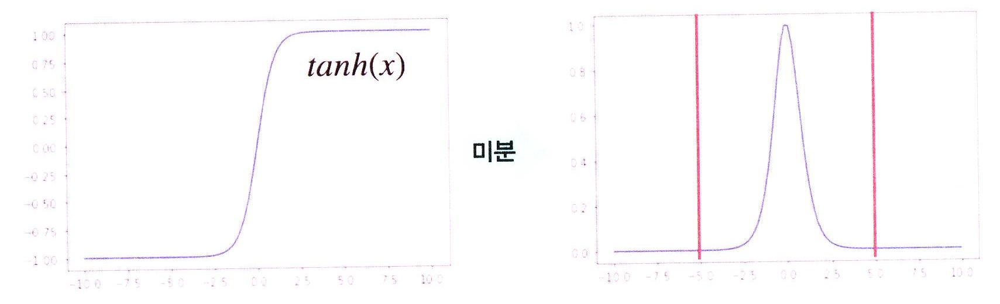

#### ■ 장기 의존성
기본 RNN의 경우 시퀀스가 너무 길다면 앞 쪽의 타임 스텝의 정보가 후반 타임 스텝까지 충분히 전달되지 못하는 문제가 있다.

### 7.2.2 LSTM(Long Short-Term Memory)

LSTM은 기본 RNN의 단점을 보완하고자 셀 상태 s와 모든 값이 0과 1 사이인 입력 게이트 $i$, 망각 게이트 $f$, 출력 게이트 $o$를 추가하여 이전 정보와 현재 정보를 비중을 조율하여 예측에 반영되고 그 값이 다음 타임 스텝으로 전달된다. 파이토치에서 제공하는 nn.LSTM을 사용하여 그림 7.10과 같은 내부 계산을 별도로 할 필요가 없다. 즉, LSTM의 모델 파라미터인 $W$와 $U$들이 자동으로 관리된다.

<그림 7.10 LSTM의 내부 구조>
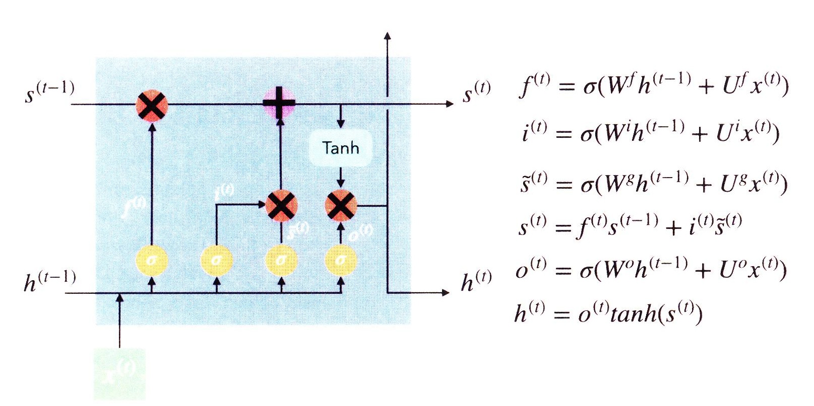

$$f^{(t)} = \sigma(W^f h^{(t-1)} + U^f x^{(t)})$$
$$i^{(t)} = \sigma(W^i h^{(t-1)} + U^i x^{(t)})$$
$$\tilde{s}^{(t)} = \sigma(W^g h^{(t-1)} + U^g x^{(t)})$$
$$s^{(t)} = f^{(t)} s^{(t-1)} + i^{(t)} \tilde{s}^{(t)}$$
$$o^{(t)} = \sigma(W^o h^{(t-1)} + U^o x^{(t)})$$
$$h^{(t)} = o^{(t)} \tanh(s^{(t)})$$

#### ■ 모델 구축하기
**CODE 7.2 LSTM.ipynb**

모델 구축 외 다른 부분은 RNN 코드와 동일하다.

```python
class LSTM(nn.Module):
    def __init__(self, input_size, hidden_size, sequence_length, num_layers, device):
        super(LSTM, self).__init__()
        self.device = device
        self.hidden_size = hidden_size
        self.num_layers = num_layers
        self.lstm = nn.LSTM(input_size, hidden_size, num_layers, batch_first=True)
        self.fc = nn.Linear(hidden_size*sequence_length, 1)

    def forward(self, x):
        h0 = torch.zeros(self.num_layers, x.size()[0], self.hidden_size).to(self.device)
        c0 = torch.zeros(self.num_layers, x.size()[0], self.hidden_size).to(self.device)
        out, _ = self.lstm(x, (h0, c0))
        out = out.reshape(out.shape[0], -1)
        out = self.fc(out)
        return out
```

- ❼ nn.LSTM을 통해 한 줄로 정의가 가능하다. LSTM은 은닉 상태와 셀 상태를 계산해 다음 타임 스텝으로 넘겨준다.
- ⓫ ~ ⓭ 은닉 상태와 셀 상태의 초깃값은 0으로 하여 모델에 넣어준다.

<그림 7.11 LSTM의 예측값과 실제값 그래프>
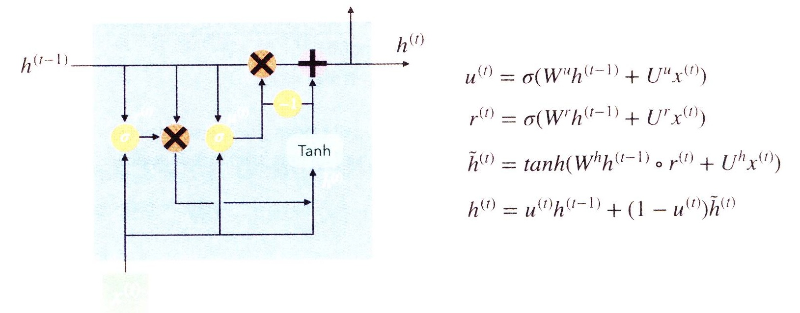

### 7.2.3 GRU(Gated Recurrent Units)

LSTM은 기본 RNN에서 추가로 셀 상태와 3개의 게이트를 사용하기 때문에 속도가 느리다. 이를 해결하기 위해 셀 상태를 없애고 2개의 게이트만 사용하여 LSTM을 간소화한 모델이 GRU이다. 그림 7.12와 같이 업데이트 게이트 $u$와 리셋 게이트 $r$을 통해 현재 은닉 상태를 연산할 때 이전 은닉 상태를 얼마나 반영할 것인지를 조율한다.

<그림 7.12 GRU의 내부 구조>
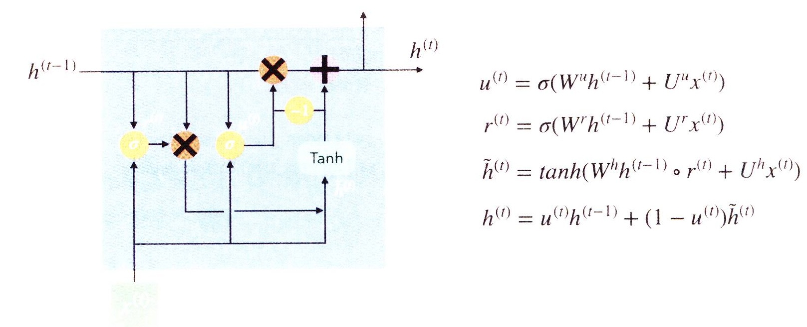

$$u^{(t)} = \sigma(W^u h^{(t-1)} + U^u x^{(t)})$$
$$r^{(t)} = \sigma(W^r h^{(t-1)} + U^r x^{(t)})$$
$$\tilde{h}^{(t)} = \tanh(W^{hh} h^{(t-1)} \circ r^{(t)} + U^h x^{(t)})$$
$$h^{(t)} = u^{(t)} h^{(t-1)} + (1 - u^{(t)}) \tilde{h}^{(t)}$$

#### ■ 모델 구축하기
**CODE 7.2 GRU.ipynb**

모델 구축 외 다른 부분은 RNN 코드와 동일하다.

```python
class GRU(nn.Module):
    def __init__(self, input_size, hidden_size, sequence_length, num_layers, device):
        super(GRU, self).__init__()
        self.device = device
        self.hidden_size = hidden_size
        self.num_layers = num_layers
        self.gru = nn.GRU(input_size, hidden_size, num_layers, batch_first=True)
        self.fc = nn.Linear(hidden_size*sequence_length, 1)

    def forward(self, x):
        h0 = torch.zeros(self.num_layers, x.size(0), self.hidden_size).to(self.device)
        out, _ = self.gru(x, h0)
        out = out.reshape(out.shape[0], -1)
        out = self.fc(out)
        return out
```

- ❼ nn.GRU를 통해 한 줄로 정의가 가능하다.
- ⓫ RNN과 마찬가지로 은닉 상태의 초깃값은 0으로 한다.

<그림 7.13 GRU의 예측값과 실제값 그래프>
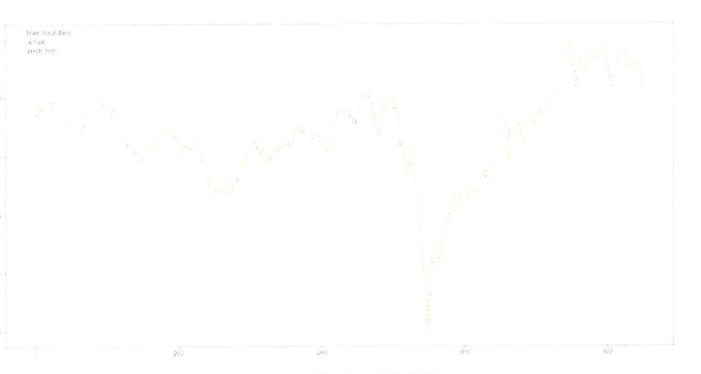

## 7.3 Bi-LSTM

우리가 지금까지 다룬 순환 신경망은 이전 상태의 정보를 현재 상태로 넘겨주어 연산을 하는 방식이다. 즉, 데이터 처리의 방향이 한 쪽으로 흐르는 정방향 연산임을 알 수 있다. 따라서 다음 상태를 현재 연산에 활용하기 위해 양방향 연산에 대한 구조를 만들 수 있다. 양방향 LSTM<sup>Bidirectional LSTM, Bi-LSTM</sup>은 순방향과 역방향의 연산을 담당하는 은닉층을 각각 두어 서로 다른 방향에 대해 계산을 수행하는 LSTM이다.
그림 7.14와 같이 정방향, 역방향에 대한 연산을 각각 수행하여 두 결과를 합쳐<sup>Concatenate</sup> 은닉층의 결과로 활용한다.

<그림 7.14 Bi-LSTM의 구조>
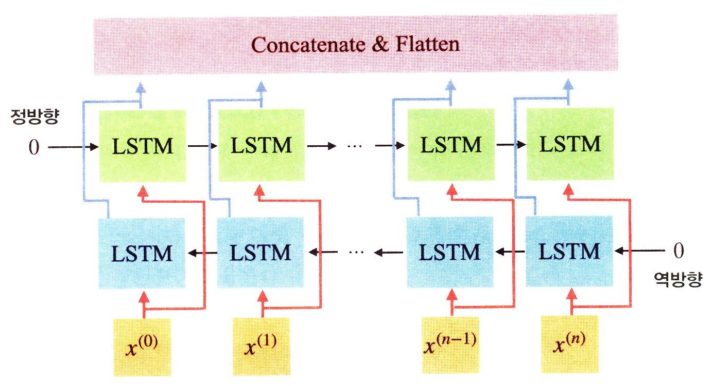

### 7.3.1 Bi-LSTM 구현하기
**CODE 7.3 Bi-LSTM.ipynb**

#### ■ 라이브러리 불러오기

```python
import torch
import torchvision
import torch.nn as nn
import torch.optim as optim
from torch.utils.data import DataLoader
```

#### ■ MNIST 데이터 불러오기

이번 예시에서는 숫자 이미지 판별을 양방향 LSTM을 통해 예측을 할 것이다. 우리가 다루는 이미지는 주로 (배치사이즈, 채널 수, 이미지 너비, 이미지 높이) 형태의 크기를 지니고 있다. MNIST 데이터의 채널 수는 1이고 이미지 크기가 28×28이므로 각 배치 데이터의 크기는 (배치사이즈, 1, 28, 28)이다. 이때 크기를 (배치사이즈, 28, 28)으로 생각할 수 있다. 또한 이미지 픽셀의 각 열을 하나의 벡터로 보고 행을 타임 스텝으로 본다면 (배치사이즈, 시계열의 길이, 벡터의 크기)를 가진 시계열 데이터로 생각할 수 있다. 즉, 순환 신경망도 이미지 처리에 활용될 수 있다.

```python
tensor_mode = torchvision.transforms.ToTensor()
trainset = torchvision.datasets.MNIST(root="./data", train=True, transform=tensor_mode, download=True)
testset = torchvision.datasets.MNIST(root="./data", train=False, transform=tensor_mode, download=True)

trainloader = DataLoader(trainset, batch_size=128, shuffle=True)
testloader = DataLoader(testset, batch_size=128, shuffle=False)
```

#### ■ Bi-LSTM 모델 구축하기

```python
class BiLSTM(nn.Module):
    def __init__(self, input_size, hidden_size, num_layers, seq_length, num_classes, device):
        super(BiLSTM, self).__init__()
        self.device = device
        self.hidden_size = hidden_size
        self.num_layers = num_layers
        self.seq_length = seq_length
        self.lstm = nn.LSTM(input_size, hidden_size, num_layers, batch_first=True,
                            bidirectional=True)
        self.fc = nn.Linear(seq_length*hidden_size * 2, num_classes)

    def forward(self, x):
        h0 = torch.zeros(self.num_layers * 2, x.size(0), self.hidden_size).to(self.device)
        c0 = torch.zeros(self.num_layers * 2, x.size(0), self.hidden_size).to(self.device)
        out, _ = self.lstm(x, (h0, c0))
        out = out.reshape(-1, self.seq_length*self.hidden_size * 2)
        out = self.fc(out)
        return out
```

- ❶ BiLSTM 클래스를 정의한다.
- ❷ 입력값의 크기(이미지의 열 크기), 은닉층의 노드수, 은닉층의 개수, 시계열의 길이(이미지의 행 크기), 클래스 수, gpu 활용 여부에 대한 값을 받는다.

- ❽ bidirectional=True으로 활성화하여 양방향 LSTM을 생성하고 batch_first=True로 지정하여 크기가 (배치 사이즈, 시계열의 길이, 입력값의 크기)를 지닌 데이터를 활용할 수 있도록 한다.
- ❾ 모든 타임 스텝에 대한 LSTM 결과를 분류에 사용한다. 따라서 self.fc의 입력값의 크기는 시계열의 길이 $\times$ 은닉층의 크기 $\times$ 2이다. 양방향 LSTM은 정방향, 역방향에 대한 LSTM을 계산한 후 합친 결과(concatenate)를 사용한다. 따라서 각각의 은닉층 결과 2개가 합쳐지므로 2를 곱하는 것이다.
- ⓫, ⓬ 은닉 상태와 셀 상태의 초깃값을 정의한다. 여기서도 양방향에 대한 초깃값을 지정해야 하므로 은닉층의 개수에 2를 곱한다(self.num_layers * 2).
- ⓭ ~ ⓯ 모델에서 나온 out의 크기는 (배치사이즈, 시계열의 길이, 은닉층의 노드수 $\times$ 2)가 된다. 모든 데이터를 nn.Linear에 사용하기 위해 reshape을 하여 크기를 (배치사이즈, 시계열의 길이 $\times$ 은닉층의 노드수 $\times$ 2)로 변경한다. 마지막으로 self.fc를 거친 후 크기가 10(클래스 수)인 출력 벡터를 산출한다.

#### ■ 하이퍼 파라미터 정의하기
모델에 필요한 변수를 정의한다. 위에서 언급했듯이 이미지 데이터의 행을 시계열로 열을 입력 벡터로 활용한다.

```python
device = torch.device("cuda" if torch.cuda.is_available() else "cpu")
sequence_length = trainset.data.size(1)
input_size = trainset.data.size(2)
num_layers = 2
hidden_size = 12
num_classes = 10
```

- ❷, ❸ 시계열의 길이는 trainset.data.size(1)이고 입력 벡터의 크기는 trainset.data.size(2)이다.
- ❹, ❺ Bi-LSTM의 은닉층 정보는 적절한 값을 넣어주고 ❻ 클래스 수는 10으로 정의한다.

#### ■ 모델, 손실 함수, 최적화 기법 정의하기

```python
model = BiLSTM(input_size, hidden_size, num_layers, sequence_length, num_classes, device)
model = model.to(device)
criterion = nn.CrossEntropyLoss()
optimizer = optim.Adam(model.parameters(), lr=5e-3)
```

#### ■ 모델 학습하기
학습 방법은 지금까지 했던 모델과 동일하게 진행한다.

```python
for epoch in range(51):
    correct = 0
    total = 0
    for data in trainloader:
        optimizer.zero_grad()
        inputs, labels = data[0].to(device).squeeze(1), data[1].to(device)
        outputs = model(inputs)
        loss = criterion(outputs, labels)
        loss.backward()
        optimizer.step()
        _, predicted = torch.max(outputs.detach(), 1)
        total += labels.size(0)
        correct += (predicted == labels).sum().item()
    print('[%d] train acc: %.2f' %(epoch, 100*correct/total))
```

```
Output:
[0] train acc: 91.93
[1] train acc: 97.54
.... 중략 ....
[50] train acc: 99.80
```

- ❻ 다만 원래 배치 데이터의 크기가 (배치사이즈, 1, 28, 28)이므로 squeeze(1)을 통해 데이터의 크기를 (배치사이즈, 28, 28)로 변환한다.
- ⓫ 학습 도중 정확도를 구할 때에는 변수 업데이트가 필요없으므로 detach()을 사용하여 outputs의 requires_grad를 비활성화한다.

#### ■ 모델 평가하기
순환 신경망을 통해서 98.6%의 평가 정확도를 달성했다. 이와 같이 순환 신경망을 이미지 처리에 사용할 수도 있다.

```python
def accuracy(dataloader):
    correct = 0
    total = 0
    with torch.no_grad():
        model.eval()
        for data in dataloader:
            inputs, labels = data[0].to(device).squeeze(1), data[1].to(device)
            outputs = model(inputs)
            _, predicted = torch.max(outputs, 1)
            total += labels.size(0)
            correct += (predicted == labels).sum().item()

    acc = 100*correct/total
    model.train()
    return acc

train_acc = accuracy(trainloader)
test_acc = accuracy(testloader)
print("Train Acc: %.1f, Test Acc: %.1f" %(train_acc, test_acc))
```

```
Output:
Train Acc: 99.9, Test Acc: 98.6
```

> "생성적 적대 신경망은 지난 10년간 가장 흥미로운 아이디어입니다."
> 
> — 얀 르쿤
