# 8 CHAPTER 비지도 학습

일반적으로 라벨이나 목표값 등의 정답이 있는 데이터보다 정답이 없는 데이터가 압도적으로 많다. 따라서 지도 학습을 위한 학습 데이터가 충분하지 못할 수 있다. 따라서 정답이 있는 데이터가 부족한 문제를 해결하기 위해 준지도 학습, 비지도 학습, 전이 학습 등의 다른 학습 방법론을 적용할 수 있다. 8장에서는 비지도 학습의 대표적인 신경망인 오토인코더와 생성적 적대 신경망을 주로 다룬다.

- 비지도 학습이란
- K-평균 알고리즘
- 오토인코더
- 생성적 적대 신경망
- 이미지 스타일 변이
- 깊은 K-평균 알고리즘

## 8.1 비지도 학습이란

우리가 실제 데이터를 이용하여 모델을 구축하고 데이터를 분석한다고 가정할 때 가장 어려운 부분은 데이터 수집 및 가공이다. 학습용으로 다루는 데이터들은 일반적으로 양도 충분하고 정답<sup>타깃값, 라벨</sup>도 있어 지도 학습을 진행할 수 있다. 하지만 정답이 없는 경우에는 지도 학습을 위해 데이터 전체에 정답을 달아줘야 한다. 이때 데이터가 많다면 시간과 비용이 많이 들고 상황에 따라서는 정답을 어떻게 줘야 할지 애매한 경우가 있다. 또한 실수로 정답을 잘못 적는 경우도 생길 수 있다.
비지도 학습은 정답<sup>타깃값, 라벨</sup> 없이 데이터의 특성을 파악하는 학습 방법이다. 즉, 모델에게 정답을 알려주지 않기 때문에 라벨링이 없는 데이터를 사용할 수 있다는 장점이 있다. 하지만 정답을 모르기 때문에 상대적으로 지도 학습보다는 성능이 낮을 수 있다. 대표적인 비지도 학습의 종류로는 입력 데이터로부터 특성을 뽑아 유사 성질들을 군집화하는 클러스터링<sup>Clustering</sup>과 새로운 데이터를 생성해 내는 오토인코더<sup>Autoencoder</sup>와 생성적 적대 신경망<sup>GAN</sup>이 있다. 그림 8.1은 오토인코더를 통해 만들어 낸 숫자 이미지다.

<그림 8.1 오토인코더가 만든 숫자 데이터>
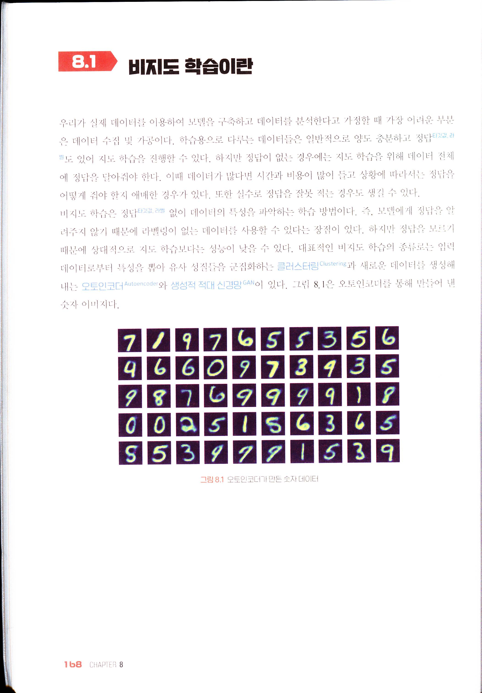

## 8.2 K-평균 알고리즘

클러스터링은 입력 데이터로부터 특성을 뽑아 유사 성질들을 군집화하는 비지도 학습이며 종류가 매우 다양하다. 정답이 없어 클러스터링 종류에 따라 군집을 다르게 할 수 있기 때문에 종류 선택과 각 알고리즘의 하이퍼 파라미터 값을 잘 따져 봐야 한다. K-평균<sup>K-means</sup> 알고리즘은 각 클러스터<sup>그룹</sup>의 평균을 기준으로 점들을 배치시키는 알고리즘이다. 이때, 특정 거리 함수를 통해 각 중심<sup>Centroid</sup>과 입력값의 거리를 측정하고 그 중 가장 가까운 그룹으로 할당을 한다. 예를 들어 그룹이 3개라면 각 그룹의 중심이 3개가 있고 어떤 한 점과 중심과의 거리를 계산한다. 이때 첫 번째 중심과의 거리가 가장 가까웠다면 이 점은 첫 번째 그룹으로 귀속된다. 모든 점이 할당되면 각 그룹의 평균을 구해 중심을 업데이트하고 위 과정을 반복하여 클러스터링을 시행한다.

### ■ 데이터 만들기
**CODE 8.2 Kmeans Clustering.ipynb**

```python
import torch
import numpy as np
import matplotlib.pyplot as plt
from sklearn.datasets import make_circles
x,y = make_circles(n_samples=500, noise=0.1)
plt.figure(figsize=(9,6))
plt.scatter(x[:,0], x[:,1], c=y)
plt.show()
```

- ❹ sklearn.datasets에서는 다양한 데이터를 제공한다. 이 예시에서는 make_circles을 이용한다.
- ❺ 500개의 점을 생성한다.

<그림 8.2 500개의 샘플 데이터>
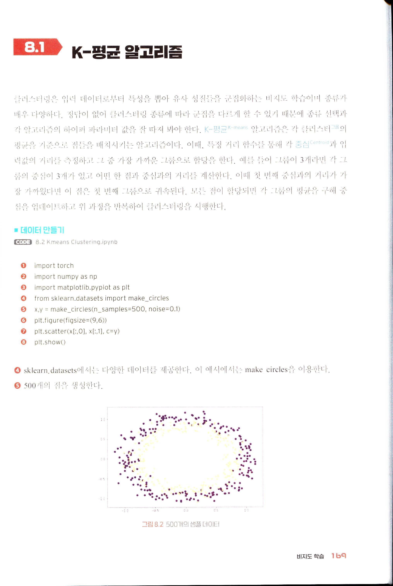

### ■ 텐서 데이터 변환하기

```python
x = torch.FloatTensor(x)
```

### ■ K-평균 알고리즘

```python
def l2distance(a, b):
    return torch.argmin(torch.sum((a-b)**2,dim=1),dim=0)
```

- ❶ 거리 함수를 정의한다. 여기서는 L2 거리 함수로 두 점(중심과 각 점)들의 거리를 측정한다.
- ❷ 각 점과 중심과의 거리를 계산하여 가장 거리가 가까운 점의 인덱스를 반환한다.

```python
def kmeans(x, num_clusters=2, max_iteration = 5):
    device = torch.device("cuda:0" if torch.cuda.is_available() else "cpu")
    x = x.to(device)
    centroids = torch.rand(num_clusters, x.size(1)).to(device)
    for update in range(max_iteration):
        y_assign = []
        for m in range(x.size(0)):
            h = x[m].expand(num_clusters,-1)
            assign = l2distance(h, centroids)
            y_assign.append(assign.item())

        y_assign = np.array(y_assign)
        if update != max_iteration-1:
            for i in range(num_clusters):
                idx = np.where(y_assign == i)[0]
                centroids[i] = torch.mean(x[idx], dim=0)
    return y_assign, centroids
```

- ❸ K-평균 알고리즘에서는 클러스터의 수를 정해줘야만 한다. 따라서 군집의 수를 알 수 없을 때 적절한 숫자를 찾아야 한다. 여기서는 기본값을 num_clusters=2로 했다. max_iteration은 중심이 업데이트되는 횟수를 의미한다.
- ❻ 초기 중심을 랜덤으로 할당한다. 중심 하나의 벡터 크기는 입력값의 피처 개수 x.size(1)와 같아야 한다.
- ❿ 이때 입력값 하나가 각 중심까지의 거리를 구해야 하므로 expand를 통해 입력값을 클러스터 개수만큼 복사하여 확장한다.
- ❿ ~ ⓬ 각 입력값마다 모든 중심과의 거리를 계산하여 가장 가까운 그룹으로 할당한다.
- ⓬ 할당된 클러스터 정보를 저장한다.

- ⓯ ~ ⓲ update 횟수가 완료될 때까지 완성된 그룹들의 각 평균을 계산하여 중심을 업데이트한다.

### ■ 알고리즘 실행 및 그래프 그리기

K-평균 알고리즘은 sklearn에서 제공하는 from sklearn.cluster import KMeans가 많이 사용된다. 하지만 파이토치를 통해 코드를 작성한다면 추후에 GPU 연산도 할 수 있으며 requires_grad를 사용하여 다른 모델과 조합할 경우 역전파도 이용할 수 있다(물론 파이토치를 위한 라이브러리도 있다). 결과를 보면 그림 8.2와 그림 8.3이 다르게 군집을 하는 것을 볼 수 있다. 따라서 클러스터링은 클러스터링의 종류, 거리 함수 종류, 클러스터의 개수 등의 사항들을 잘 따져야 한다.

```python
y_pred, centroids = kmeans(x,2)
plt.figure(figsize=(9,6))
plt.scatter(x[:,0], x[:,1], c=y_pred)
plt.plot(centroids[:,0], centroids[:,1], '*', markersize=30)
plt.show()
```

<그림 8.3 클러스터 개수에 따른 클러스터링 결과>
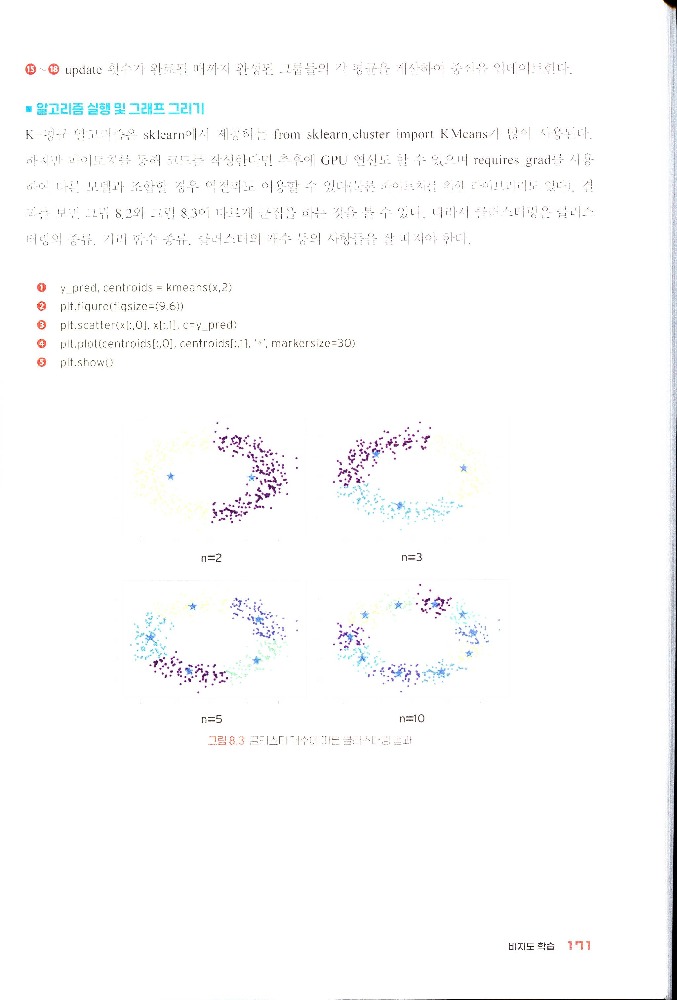

## 8.3 오토인코더

오토인코더는 정답 없이 모델을 학습시키는 비지도 학습 모델이다. 일반적으로 그림 8.4와 같이 대칭형 구조를 지니고 있으며 입력 데이터를 압축하는 인코더<sup>Encoder</sup> 부분과 압축을 푸는 디코더<sup>Decoder</sup> 부분으로 구성되어 있다. 따라서 인코더를 통해 차원 축소가 된 잠재 변수<sup>Latent variable</sup>를 가지고 별도로 계산을 할 수도 있고 디코더를 통해 입력값과 유사한 값을 생성할 수도 있다. 기본적으로 입력값 x와 출력값 x'를 이용하여 MSE를 정의하고 이를 기준으로 학습을 진행한다.

<그림 8.4 오토인코더 예시>
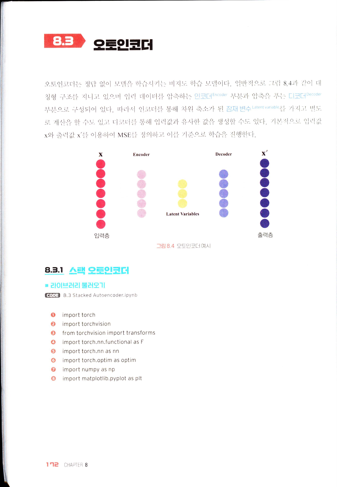

### 8.3.1 스택 오토인코더

#### ■ 라이브러리 불러오기
**CODE 8.3 Stacked Autoencoder.ipynb**

```python
import torch
import torchvision
from torchvision import transforms
import torch.nn.functional as F
import torch.nn as nn
import torch.optim as optim
import numpy as np
import matplotlib.pyplot as plt
```

#### ■ GPU 연산 정의 및 MNIST 데이터 불러오기

```python
device = torch.device("cuda:0" if torch.cuda.is_available() else "cpu")
dataset = torchvision.datasets.MNIST('./data/', download=True, train=True,
                                   transform=transforms.ToTensor())
trainloader = torch.utils.data.DataLoader(dataset,batch_size=50,shuffle=True)
```

- ❷ torchvision.datasets.MNIST를 통해 데이터를 불러오고 transforms를 이용하여 텐서 데이터로 변환한다.

#### ■ 모델 구축하기

기본 오토인코더 모델은 층을 여러 개 쌓았다고 해서 스택 오토인코더<sup>Stacked Autoencoder</sup>라고도 불린다.

```python
class Autoencoder(nn.Module):
    def __init__(self):
        super(Autoencoder, self).__init__()
        self.encoder = nn.Sequential(
            nn.Linear(784, 128),
            nn.ReLU(),
            nn.Linear(128, 32),
            nn.ReLU(),
            nn.Linear(32, 10),
            nn.ReLU())
        self.decoder = nn.Sequential(
            nn.Linear(10, 32),
            nn.ReLU(),
            nn.Linear(32, 128),
            nn.ReLU(),
            nn.Linear(128, 28*28),
            nn.Sigmoid())

    def forward(self, x):
        encoded = self.encoder(x)
        decoded = self.decoder(encoded)
        return decoded
```

- ❶ 모델 클래스를 정의한다.
- ❹, ⓫ 인코더와 디코더를 각각 nn.Sequential로 묶어 보기 좋게 한다.
- ❺ MNIST 이미지의 크기는 1×28×28이다. 따라서 nn.Linear에 넣어주기 위해 사진을 일렬로 편 후 인코더 부분에 크기가 784(28×28)인 벡터 하나가 들어오게 된다.
- ❻ ~ ❿ 층을 자유롭게 여러 개 쌓아 노드를 10개까지 줄인다. 즉, 잠재 변수의 크기가 10으로 정의된다.

- ⓫ ~ ⓱ 크기가 줄어든 잠재 변수 벡터를 디코더에 넣어 다시 크기를 늘려준다.
- ⓰ 마지막은 같은 크기의 이미지가 나와야 하므로 28*28로 입력한다.
- ⓱ MNIST 이미지의 픽셀값은 0 이상 1 이하이다. 따라서 nn.Sigmoid()를 이용해 범위를 정해서 수렴을 빨리 하게 할 수 있다.
- ⓳ ~ ⓴ forward에서는 encoder와 decoder를 차례대로 연산할 수 있도록 코드를 작성한다.

#### ■ 모델, 손실 함수, 최적화 기법 정의하기

우리의 목적은 입력 이미지와 유사한 출력 이미지를 얻는 것이다. 따라서 입력 이미지와 출력 이미지의 L2 거리를 계산하는 MSE 손실 함수를 사용하고 최적화 방법은 Adam을 사용한다.

```python
model = Autoencoder().to(device)
criterion = nn.MSELoss()
optimizer = optim.Adam(model.parameters(), lr=1e-4)
```

#### ■ 학습하기

```python
for epoch in range(51):
    running_loss = 0.0
    for data in trainloader:
        inputs = data[0].to(device)
        optimizer.zero_grad()
        outputs = model(inputs.view(-1, 28*28))
        outputs = outputs.view(-1, 1, 28, 28)
        loss = criterion(inputs, outputs)
        loss.backward()
        optimizer.step()
        running_loss += loss.item()
    cost = running_loss / len(trainloader)
    print('[%d] loss: %.3f' %(epoch + 1, cost))
```

```
Output:
[1] loss: 0.062
[2] loss: 0.048
... 이하 생략 ...
```

- ❻ 현재 오토인코더의 층은 합성곱 층이 아니고 일렬 노드로 구성된 nn.Linear이다. 따라서 이미지를 일렬로 펴서 넣어주기 위해 inputs.view(-1, 28*28)을 입력값으로 이용한다.

- ❼ 벡터 형태로 나온 출력값을 다시 정사각형 이미지로 변환하기 위해 outputs.view(-1, 1, 28, 28)를 작성한다. 그림 8.5는 생성된 이미지다.

<그림 8.5 결과 이미지>
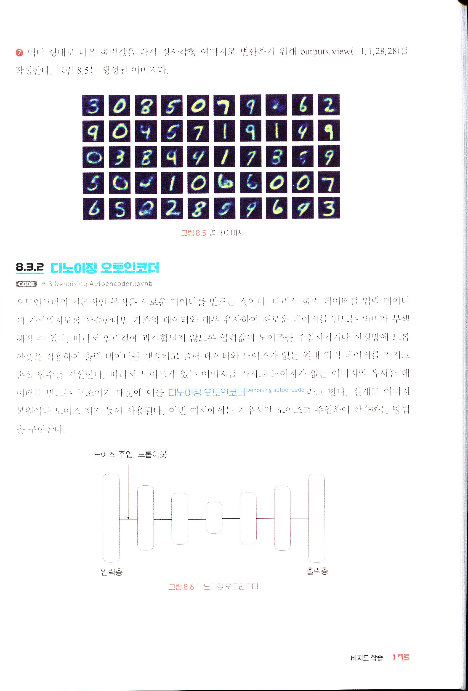

### 8.3.2 디노이징 오토인코더
**CODE 8.3 Denoising Autoencoder.ipynb**

오토인코더의 기본적인 목적은 새로운 데이터를 만드는 것이다. 따라서 출력 데이터를 입력 데이터에 가까워지도록 학습한다면 기존의 데이터와 매우 유사하여 새로운 데이터를 만드는 의미가 무색해질 수 있다. 따라서 입력값에 과적합되지 않도록 입력값에 노이즈를 주입시키거나 신경망에 드롭아웃을 적용하여 출력 데이터를 생성하고 출력 데이터와 노이즈가 없는 원래 입력 데이터를 가지고 손실 함수를 계산한다. 따라서 노이즈가 있는 이미지를 가지고 노이즈가 없는 이미지와 유사한 데이터를 만드는 구조이기 때문에 이를 디노이징 오토인코더<sup>Denoising autoencoder</sup>라고 한다. 실제로 이미지 복원이나 노이즈 제거 등에 사용된다. 이번 예시에서는 가우시안 노이즈를 주입하여 학습하는 방법을 구현한다.

<그림 8.6 디노이징 오토인코더>
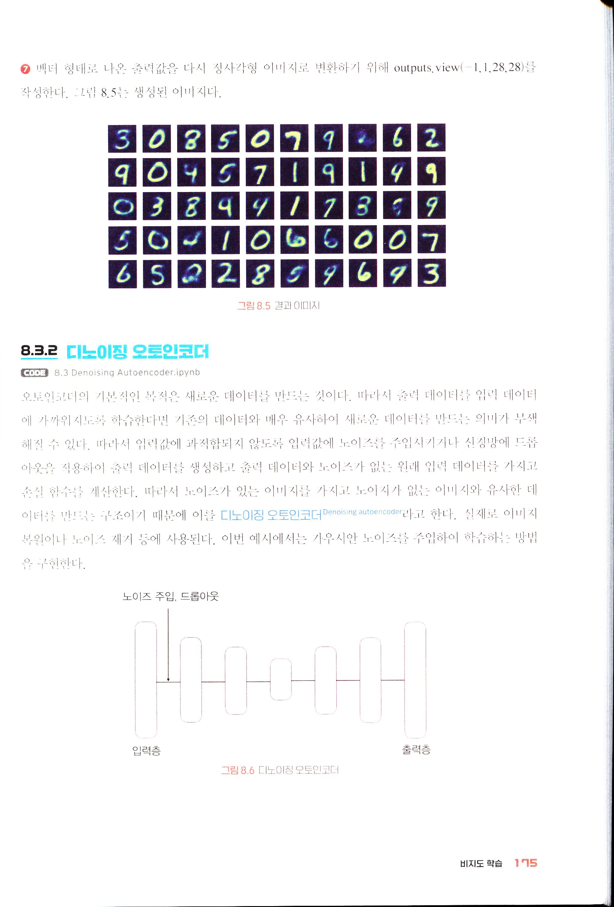

#### ■ 학습하기

```python
for epoch in range(101):
    running_loss = 0.0
    for data in trainloader:
        inputs = data[0].to(device)
        optimizer.zero_grad()
        dirty_inputs = inputs + torch.normal(0, 0.5, size=inputs.size()).to(device)
        outputs = model(dirty_inputs.view(-1, 28*28))
        outputs = outputs.view(-1, 1, 28, 28)
        loss = criterion(inputs, outputs)
        
        loss.backward()
        optimizer.step()
        running_loss += loss.item()
    cost = running_loss / len(trainloader)
    print('[%d] loss: %.3f' %(epoch + 1, cost))
```

- ❽, ❾ 해당 코드는 스택 오토인코더와 동일하며 입력 이미지에 가우시안 노이즈만 주입하면 된다. 노이즈 텐서의 사이즈는 이미지 사이즈와 같아야 하기 때문에 size=inputs.size()를 입력하고 평균과 표준편차는 임의로 0, 0.5를 넣는다. 그림 8.7은 생성된 이미지다.

<그림 8.7 디노이징 오토인코더의 결과 이미지>
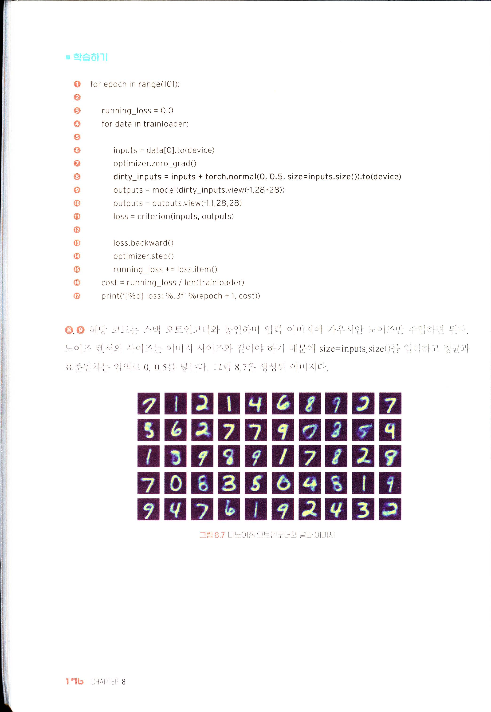

### 8.3.3 합성곱 오토인코더
**CODE 8.3 Convolutional Autoencoder.ipynb**

합성곱 오토인코더<sup>Convolutional autoencoder</sup>는 nn.Linear 대신 합성곱 층 nn.Conv2d를 사용하는 구조다. 따라서 이미지 데이터가 일렬로 펴지지 않고 그대로 들어와 연산이 진행된다. 기본적으로 잠재 변수 $h$는 일렬 형태인 벡터이기 때문에, 인코더에서 나온 피처맵을 일렬로 펴서 $h$를 추출하고 다시 $h$를 은닉층을 거친 뒤 사각형 모양의 피처맵으로 만들어 디코더에 넣어준다. 실제 $h$를 벡터화하는 방법은 응용 범위가 다양하다.

<그림 8.8 합성곱 오토인코더>
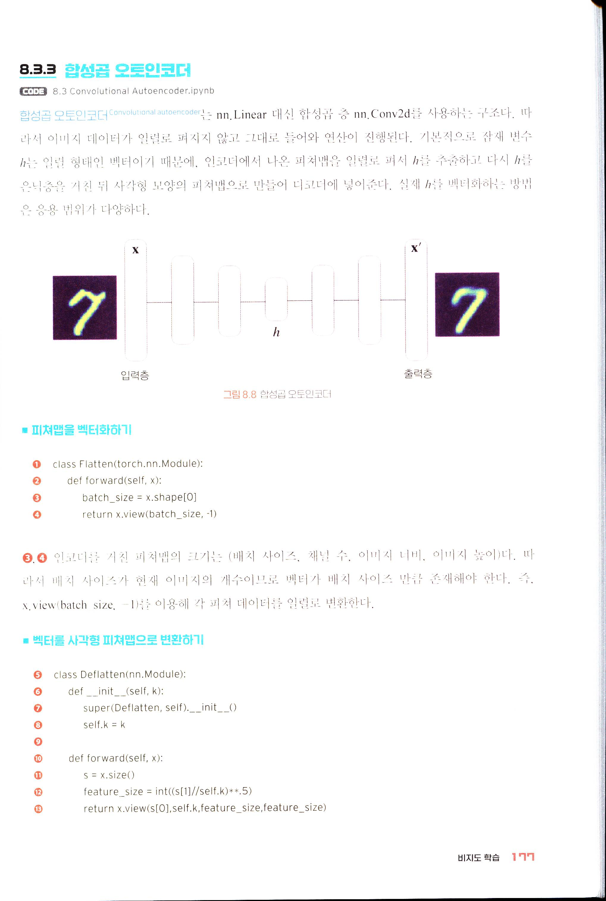

#### ■ 피처맵을 벡터화하기

```python
class Flatten(torch.nn.Module):
    def forward(self, x):
        batch_size = x.shape[0]
        return x.view(batch_size, -1)
```

- ❸, ❹ 인코더를 거친 피처맵의 크기는 (배치 사이즈, 채널 수, 이미지 너비, 이미지 높이)다. 따라서 배치 사이즈가 현재 이미지의 개수이므로 벡터가 배치 사이즈 만큼 존재해야 한다. 즉, x.view(batch_size, -1)를 이용해 각 피처 데이터를 일렬로 변환한다.

#### ■ 벡터를 사각형 피처맵으로 변환하기

```python
class Deflatten(nn.Module):
    def __init__(self, k):
        super(Deflatten, self).__init__()
        self.k = k

    def forward(self, x):
        s = x.size()
        feature_size = int((s[1]//self.k)**.5)
        return x.view(s[0], self.k, feature_size, feature_size)
```

- ⓬ 잠재 변수 h의 크기는 (배치사이즈, 채널 수*이미지 너비*이미지 높이)이다. 따라서 벡터 사이즈는 채널 수*이미지 너비*이미지 높이이고 너비와 높이가 같다면 채널 수*이미지 너비**2가 된다. 이미지 한 변의 길이는 (벡터 사이즈//채널 수)**.5가 된다.
- ⓭ 피처맵의 크기를 (배치사이즈, 채널 수, 이미지 너비, 이미지 높이) = (s[0], self.k, feature_size, feature_size)로 반환한다.

#### ■ 모델 구축하기

```python
class Autoencoder(nn.Module):
    def __init__(self):
        super(Autoencoder, self).__init__()
        k = 16
        self.encoder = nn.Sequential(
            nn.Conv2d(1, k, 3, stride=2), nn.ReLU(),
            nn.Conv2d(k, 2*k, 3, stride=2), nn.ReLU(),
            nn.Conv2d(2*k, 4*k, 3, stride=1), nn.ReLU(),
            Flatten(), nn.Linear(1024, 10), nn.ReLU())
```

- ❻ ~ ❽ 합성곱 층을 만든다.
- ❾ 합성곱 층으로부터 나온 피처맵을 일렬로 편다. 피처맵으로 만든 벡터를 은닉층 하나를 거쳐 크기가 10인 잠재 변수를 만든다.

```python
        self.decoder = nn.Sequential(
            nn.Linear(10, 1024), nn.ReLU(),
            Deflatten(4*k),
            nn.ConvTranspose2d(4*k, 2*k, 3, stride=1), nn.ReLU(),
            nn.ConvTranspose2d(2*k, k, 3, stride=2), nn.ReLU(),
            nn.ConvTranspose2d(k, 1, 3, stride=2, output_padding=1), nn.Sigmoid())

    def forward(self, x):
        encoded = self.encoder(x)
        decoded = self.decoder(encoded)
        return decoded
```

- ⓫ 잠재 변수를 은닉층 하나를 통해 다시 크기가 1024인 벡터로 만든다.
- ⓬ 사각형 형태의 피처맵으로 변환한다. nn.Conv2d는 일반적으로 입력 사이즈보다 출력 사이즈가 더 작다.

- ⓭ ~ ⓯ 크기가 작은 입력값을 크기가 큰 입력값으로 만들기 위해 nn.Conv2d 대신 nn.ConvTranspose2d를 사용한다. nn.ConvTranspose2d는 입력 성분(Conv의 결과)을 출력 성분(Conv의 입력)으로 미분하여 그 값을 입력 벡터와 곱해 출력 벡터를 산출하고 그 결과 벡터를 행렬 형태로 변환하는 연산이다. 사용방법은 nn.Conv2d와 마찬가지로 nn.ConvTranspose2d(입력 채널 수, 출력 채널 수, 필터 크기, stride)를 입력한다. 크기는 일반적인 정사각형 이미지와 필터를 사용했을 경우 다음 식에 의해 피처맵의 크기를 산출할 수 있다.

$$\text{(출력값의 크기)} = (\text{입력값의 크기} - 1) \times (\text{보폭}) - 2 \times (\text{패딩}) + (\text{필터의 크기}) + (\text{출력값 패딩})$$

- ⓯ output_padding은 크기를 맞춰주기 위해 전치 합성곱<sup>transposed convolution</sup> 연산을 한 후 패딩을 씌워주는 역할을 한다.

#### ■ 모델, 손실 함수, 최적화 기법 정의하기

```python
model = Autoencoder().to(device)
criterion = nn.MSELoss()
optimizer = optim.Adam(model.parameters(), lr=1e-3)
```

#### ■ 학습하기

앞서 배웠던 오토인코더와 학습 과정은 동일하다. 차이점은 이미지를 그대로 받아서 학습하기 때문에 별도의 크기 변환이 필요없다. 합성곱 오토인코더는 이미지 처리에서는 기본 신경망을 사용하는 오토인코더 보다 성능이 뛰어나다.

```python
for epoch in range(51):
    running_loss = 0.0
    for data in trainloader:
        inputs = data[0].to(device)
        optimizer.zero_grad()
        outputs = model(inputs)
        loss = criterion(inputs, outputs)
        loss.backward()
        optimizer.step()
        running_loss += loss.item()

    cost = running_loss / len(trainloader)
    if epoch % 10 == 0:
        print('[%d] loss: %.3f' %(epoch + 1, cost))
```

<그림 8.9 합성곱 오토인코더의 결과 이미지>
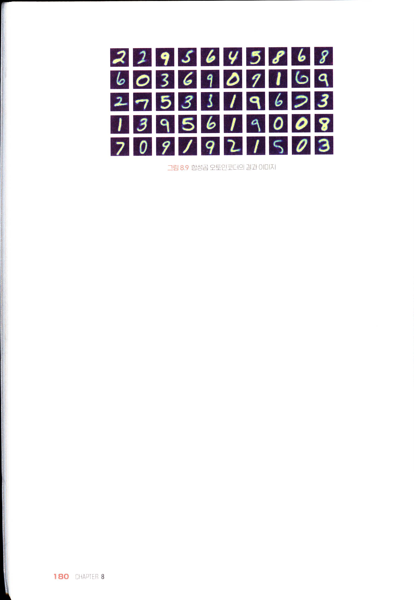

## 8.4 생성적 적대 신경망

생성적 적대 신경망<sup>Generative adversarial network, GAN</sup>은 아이디어 자체만으로 매우 가치있는 모델로 평가받고 있다. 실제로 얼굴 변환, 생성, 음성 변조, 그림 스타일 변환, 사진 복원 등 다양한 기술로 응용되고 있다. 기본적으로 생성적 적대 신경망은 진짜 같은 가짜 데이터를 만들어 내는 기술이다.

<그림 8.10 생성적 적대 신경망의 기본 구조>
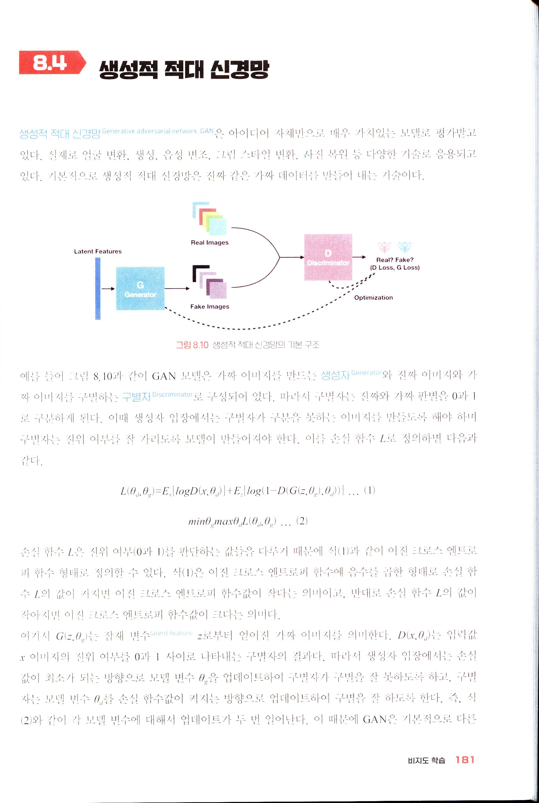

예를 들어 그림 8.10과 같이 GAN 모델은 가짜 이미지를 만드는 생성자<sup>Generator</sup>와 진짜 이미지와 가짜 이미지를 구별하는 구별자<sup>Discriminator</sup>로 구성되어 있다. 따라서 구별자는 진짜와 가짜 판별을 0과 1로 구분하게 된다. 이때 생성자 입장에서는 구별자가 구분을 못하는 이미지를 만들도록 해야 하며 구별자는 진위 여부를 잘 가리도록 모델이 만들어져야 한다. 이를 손실 함수 $L$로 정의하면 다음과 같다.

$$L(\theta_d, \theta_g) = E_x[\log D(x, \theta_d)] + E_z[\log(1 - D(G(z, \theta_g), \theta_d))] \quad \dots \text{ (1)}$$

$$\min_{\theta_g} \max_{\theta_d} L(\theta_d, \theta_g) \quad \dots \text{ (2)}$$

손실 함수 $L$은 진위 여부(0과 1)를 판단하는 값들을 다루기 때문에 식 (1)과 같이 이진 크로스 엔트로피 함수 형태로 정의할 수 있다. 식 (1)은 이진 크로스 엔트로피 함수에 음수를 곱한 형태로 손실 함수 $L$의 값이 커지면 이진 크로스 엔트로피 함수값이 작다는 의미이고, 반대로 손실 함수 $L$의 값이 작아지면 이진 크로스 엔트로피 함수값이 크다는 의미다.
여기서 $G(z, \theta_g)$는 잠재 변수<sup>latent feature</sup> $z$로부터 얻어진 가짜 이미지를 의미한다. $D(x, \theta_d)$는 입력값 $x$ 이미지의 진위 여부를 0과 1 사이로 나타내는 구별자의 결과다. 따라서 생성자 입장에서는 손실값이 최소가 되는 방향으로 모델 변수 $\theta_g$을 업데이트하여 구별자가 구별을 잘 못하도록 하고, 구별자는 모델 변수 $\theta_d$를 손실 함수값이 커지는 방향으로 업데이트하여 구별을 잘 하도록 한다. 즉, 식 (2)와 같이 각 모델 변수에 대해서 업데이트가 두 번 일어난다. 이 때문에 GAN은 기본적으로 다른

모델보다 학습이 오래 걸리고 수렴이 잘 안되는 경우가 많다.

### 8.4.1 Vanilla GAN

#### ■ 라이브러리 불러오기
**CODE 8.4 GAN.ipynb**

```python
import torch
import torch.nn as nn
import torch.optim as optim
from torchvision import transforms
from torch.utils.data import DataLoader
from torchvision.datasets import FashionMNIST
from torchvision.utils import make_grid
import imageio
import numpy as np
import matplotlib.pyplot as plt
```

- ❼ 격자 형태의 이미지를 만들게 하는 make_grid를 불러온다.
- ❽ gif 파일을 만들기 위해 imageio를 불러온다.

#### ■ 패션 아이템 데이터 불러오기

티셔츠, 바지, 풀오버, 드레스, 코트, 샌들, 셔츠, 스니커즈, 가방, 앵클부츠로 구성된 FashionMNIST 데이터를 불러온다.

```python
transform = transforms.Compose([transforms.ToTensor(),transforms.Normalize((0.5,),(0.5,))])
trainset = FashionMNIST(root='./data/', train=True, download=True, transform=transform)
trainloader = DataLoader(trainset, batch_size=100, shuffle=True)
device = torch.device("cuda:0" if torch.cuda.is_available() else "cpu")
```

#### ■ 생성자 구축하기

```python
class Generator(nn.Module):
    def __init__(self):
        super(Generator, self).__init__()
        self.n_features = 128
        self.n_out = 784
        self.linear = nn.Sequential(
            nn.Linear(self.n_features, 256),
            nn.LeakyReLU(0.2),
```

nn.Linear(256, 512),
            nn.LeakyReLU(0.2),
            nn.Linear(512, 1024),
            nn.LeakyReLU(0.2),
            nn.Linear(1024, self.n_out),
            nn.Tanh())

    def forward(self, x):
        x = self.linear(x)
        x = x.view(-1, 1, 28, 28)
        return x
```

- ❹, ❺ 생성자는 잠재 변수로부터 784(28×28) 크기인 벡터를 생성한다. 따라서 잠재 변수의 크기를 임의로 정하고 출력 크기는 이미지를 일렬로 편 크기인 784로 정의한다.
- ❼ ~ ⓮ 기본 GAN에서는 nn.Linear을 이용하여 모델을 구축하며 활성 함수로는 nn.LeakyReLU를 사용한다. ReLU는 입력값이 0보다 작으면 0으로 값을 바꿔준다. 따라서 음수 구간에서 미분을 할 경우 0이 나온다. 이때 기울기 사라짐 방지를 위해 음수 구간의 양의 기울기를 주어 값을 계산하는 LeakyReLU(0.2)로 대체를 한다. 0.2는 음수 구간의 그래프가 y=0.2x라는 의미로 직선의 기울기를 나타낸다.
- ⓰, ⓱ 정의된 MLP를 거치고 784 크기의 벡터를 크기가 28×28인 흑백 이미지로 변경하여 새로운 이미지를 생성한다.

#### ■ 구별자 구축하기

```python
class Discriminator(nn.Module):
    def __init__(self):
        super(Discriminator, self).__init__()
        self.n_in = 784
        self.n_out = 1
        self.linear = nn.Sequential(
            nn.Linear(self.n_in, 1024),
            nn.LeakyReLU(0.2),
            nn.Dropout(0.3),
            nn.Linear(1024, 512),
            nn.LeakyReLU(0.2),
            nn.Dropout(0.3),
            nn.Linear(512, 256),
            nn.LeakyReLU(0.2),
            nn.Dropout(0.3),
            nn.Linear(256, self.n_out),
            nn.Sigmoid())
```
def forward(self, x):
        x = x.view(-1, 784)
        x = self.linear(x)
        return x
```

- ❹ 이미지를 일렬로 편 크기를 입력한다.
- ❺ 출력값은 진위여부를 판단하기 위해 하나의 숫자로 정의한다.
- ❻ ~ ⓱ nn.Linear을 이용해 구조를 정의하고 출력값은 0과 1 사이의 값이 출력될 수 있도록 nn.Sigmoid 함수를 마지막에 적용한다.
- ⓳, ⓴ 이미지를 벡터 형태로 변경하여 신경망에 대입한다.

#### ■ 모델 정의하기

생성자와 구별자를 각각 선언한다.

```python
generator = Generator().to(device)
discriminator = Discriminator().to(device)
```

#### ■ 손실 함수 및 최적화 기법 정의하기

```python
g_optim = optim.Adam(generator.parameters(), lr=2e-4)
d_optim = optim.Adam(discriminator.parameters(), lr=2e-4)
g_losses = []
d_losses = []
images = []
criterion = nn.BCELoss()
```

- ❶ 생성자 변수 최적화를 위한 Adam을 정의한다.
- ❷ 구별자 변수 최적화를 위한 Adam을 별도로 정의한다.
- ❸ ~ ❺ 학습 동안 손실 함수값과 샘플 이미지 저장을 위해 빈 리스트를 만든다.
- ❻ 손실 함수는 이진 크로스 엔트로피 함수를 사용한다.

#### ■ 잠재 변수 및 라벨 정의하기

```python
def noise(n, n_features=128):
    data = torch.randn(n, n_features)
    return data.to(device)

def label_ones(size):
    data = torch.ones(size, 1)
    return data.to(device)

def label_zeros(size):
    data = torch.zeros(size, 1)
    return data.to(device)
```

- ❶ ~ ❸ 기본적으로 크기가 128인 잠재 변수 n개를 무작위로 생성한다. 이번 작업은 손실 함수에서 이미지의 진위 여부에 대한 계산을 하게 된다. 따라서 실제 이미지의 클래스를 사용하지 않고 진짜 데이터는 라벨을 1, 생성자로부터 만들어진 이미지의 라벨은 0이라고 정의하여 사용하게 된다.
- ❺ ~ ❼, ❾ ~ ⓫ 이를 위해 1과 0라벨을 만들어주는 함수를 정의한다.

#### ■ 구별자 학습 함수 정의하기

```python
def train_discriminator(optimizer, real_data, fake_data):
    n = real_data.size(0)
    optimizer.zero_grad()
    prediction_real = discriminator(real_data)
    d_loss = criterion(prediction_real, label_ones(n))
    prediction_fake = discriminator(fake_data)
    g_loss = criterion(prediction_fake, label_zeros(n))
    loss = d_loss + g_loss
    loss.backward()
    optimizer.step()
    return loss.item()
```

- ❶ 진짜 이미지, 가짜 이미지, 최적화 함수를 받는다.
- ❷ 각 이미지 진위 라벨을 할당하기 위해서 이미지의 개수를 확인한다.
- ❹ 진짜 이미지를 판별한다.
- ❺ 이미지 수 만큼 1라벨을 넣어 손실 함수를 계산한다.
- ❻, ❼ 가짜 이미지를 판별하고 이미지 수 만큼 0라벨을 넣어 손실 함수를 계산한다.
- ❽ ~ ⓫ 두 손실 함수의 합을 최종 손실 함수로 사용하여 구별자를 업데이트한다.

#### ■ 생성자 학습 함수 정의하기

```python
def train_generator(optimizer, fake_data):
    n = fake_data.size(0)
    optimizer.zero_grad()
    prediction = discriminator(fake_data)
    loss = criterion(prediction, label_ones(n))
    loss.backward()
    optimizer.step()
    return loss.item()
```

- ❶ 가짜 이미지를 받는다.
- ❷ 이미지 개수를 저장한다.
- ❹ 가짜 이미지를 구별자에 넣어 판별한다.
- ❺ 생성자 입장에서는 구별자가 진짜 이미지라고 판단하도록 업데이트가 되어야 하므로 0라벨이 아닌 1라벨을 넣어 손실 함수를 계산하게 한다. 이러한 방식으로 min max 형태의 손실 함수를 직접 구현하지 않고 최적화를 수행할 수 있다.

#### ■ 모델 학습하기

```python
test_noise = noise(64)
l = len(trainloader)
for epoch in range(151):
    g_loss = 0.0
    d_loss = 0.0
    for data in trainloader:
        imgs, _ = data
        n = len(imgs)
        fake_data = generator(noise(n)).detach()
        real_data = imgs.to(device)
        d_loss += train_discriminator(d_optim, real_data, fake_data)
        fake_data = generator(noise(n))
        g_loss += train_generator(g_optim, fake_data)

    img = generator(test_noise).detach().cpu()
    img = make_grid(img)
    images.append(img)
    g_losses.append(g_loss/l)
    d_losses.append(d_loss/l)
    if epoch % 10 == 0:
        print('Epoch {}: g_loss: {:.3f} d_loss: {:.3f}\r'.format(epoch, g_loss/l, d_loss/l))
```

- ❶ 검증을 위한 무작위 잠재 변수 64개를 생성한다.
- ❷ 평균 손실값을 구하는데 사용하는 배치 수를 저장한다.
- ❹, ❺ 각 에폭마다 손실값을 초기화한다.
- ❼, ❽ 진짜 이미지를 받고 진짜 이미지의 개수를 정의한다.
- ❾ 진짜 이미지의 개수만큼 가짜 이미지를 생성하며 detach()를 통해 불필요한 requires_grad를 비활성화 시킨다.
- ⓫ 가지고 있는 이미지를 모두 구별자에 넣어 판별을 하고 구별자를 업데이트하고 반환한 손실 함수값을 누적한다.
- ⓬, ⓭ 생성자를 업데이트하고 반환한 손실 함수값을 누적한다.
- ⓯ ~ ⓱ 검증을 위해 고정된 잠재 변수를 넣어 이미지를 생성하고 변화를 알아보기 위해 격자 형태의 이미지로 만들어 images 리스트에 저장시킨다.
- ⓲, ⓳ 손실 함수값의 변화를 저장한다.
- ⓴, ⓴-1(21) 에폭 10단위마다 손실값을 출력한다.

```
Output:
Epoch 0: g_loss: 2.541 d_loss: 0.786
... 중략 ...
Epoch 150: g_loss: 0.990 d_loss: 1.223
```

#### ■ 모델 저장하기

```python
torch.save(discriminator.state_dict(), './models/fmnist_disc.pth')
torch.save(generator.state_dict(), './models/fmnist_gner.pth')
```

#### ■ 검증 이미지 변화를 gif 파일로 저장하기

```python
to_image = transforms.ToPILImage()
imgs = [np.array(to_image(i)) for i in images]
imageio.mimsave('fashion_items.gif', imgs)
```

- ❶ images 리스트의 원소 하나는 격자 형태로 만들어진 이미지들의 모임이며 크기가 (3, 242, 242)인 하나의 텐서다. 이때 이미지 저장 형식을 맞추기 위해 ToPILImage()를 이용해 타입과 (242, 242, 3)으로 크기를 변환할 수 있다.
- ❷, ❸ 이미지를 넘파이 배열로 변경하여 gif 파일로 만든다.

<그림 8.11 학습에 따른 이미지 생성 결과>


#### ■ 손실 함수값 그래프 그리기

```python
plt.figure(figsize=(20,10))
plt.plot(g_losses)
plt.plot(d_losses)
plt.legend(['Generator','Discriminator'])
plt.title('Loss')
plt.savefig('gan_loss.png')
```

<그림 8.12 GAN 손실 함수 그래프>
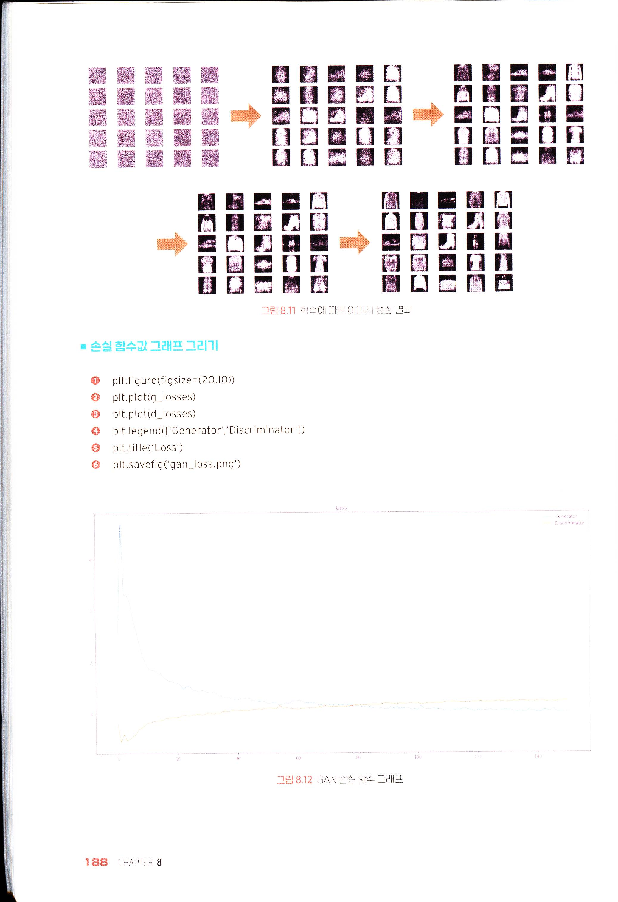

### 8.4.2 Deep Convolutional GAN(DCGAN)
**CODE 8.4 DCGAN.ipynb**

DCGAN은 GAN 구조를 합성곱 층으로 구성한 모델이다. 합성곱 신경망은 다층 퍼셉트론보다 이미지 처리에 매우 유리한 네트워크로 알려져 있다. 실제 다층 퍼셉트론으로 구성된 GAN보다 DCGAN을 통해 조금 더 선명한 이미지를 생성할 수 있다. 이번 예시는 8.4.1에서 소개된 모델을 간단하게 합성곱 층으로 변경하여 진행한다.

#### ■ 생성자 구축하기

```python
class Generator(nn.Module):
    def __init__(self):
        super(Generator, self).__init__()
        self.n_features = 128
        self.conv = nn.Sequential(
            nn.ConvTranspose2d(self.n_features, 256, 3, 1, bias=False), nn.ReLU(True),
            nn.ConvTranspose2d(256, 128, 3, 2, bias=False), nn.ReLU(True),
            nn.ConvTranspose2d(128, 64, 3, 2, bias=False), nn.ReLU(True),
            nn.ConvTranspose2d(64, 1, 2, 2, 1, bias=False), nn.Tanh())

    def forward(self, x):
        x = x.view(-1, self.n_features, 1, 1)
        x = self.conv(x)
        return x
```

- ❹, ⓫ 크기가 128인 잠재 변수를 가지고 채널이 128개인 1×1 크기 이미지를 입력값으로 받는다.
- ❺ ~ ⓽ 28×28 이미지 한 장을 얻기 위해 nn.ConvTranspose2d를 사용한다. nn.ConvTranspose2d는 입력 성분(Conv의 결과)을 출력 성분(Conv의 입력)으로 미분하여 그 값을 입력 벡터와 곱해 출력 벡터를 산출하고 그 결과 벡터를 행렬 형태로 변환하는 연산이다. 사용방법은 nn.ConvTranspose2d(입력 채널 수, 출력 채널 수, 필터 크기, stride)를 입력한다. 크기는 일반적인 정사각형 이미지와 필터를 사용했을 경우 다음 식에 의해 피처맵의 크기를 산출할 수 있다.

$$\text{(출력값의 크기)} = (\text{입력값의 크기} - 1) \times (\text{보폭}) - 2 \times (\text{패딩}) + (\text{필터의 크기}) + (\text{출력값 패딩})$$

예를 들어 입력값이 1×1 이미지이고 보폭<sup>stride</sup>은 1, 패딩은 0, 필터의 크기는 3×3, 출력값 패딩이 0이라면 출력값의 크기는 $3 (= 0 \times 1 - 0 + 3 + 0)$이 된다. 이와 같은 계산 과정을 거치면 생성자의 출력 이미지의 크기가 28×28임을 알 수 있다.

#### ■ 구별자 구축하기

```python
class Discriminator(nn.Module):
    def __init__(self):
        super(Discriminator, self).__init__()
        self.conv = nn.Sequential(
            nn.Conv2d(1, 128, 3, 2, 1, bias=False),
            nn.LeakyReLU(0.2),
            nn.Dropout(0.5),
            nn.Conv2d(128, 256, 3, 2, 1, bias=False),
            nn.LeakyReLU(0.2),
            nn.Dropout(0.5),
            nn.Conv2d(256, 256, 3, 2, 1, bias=False),
            nn.LeakyReLU(0.2, inplace=True),
            nn.Dropout(0.5),
            nn.Conv2d(256, 1, 3, 2, bias=False),
            nn.Sigmoid())

    def forward(self, x):
        x = self.conv(x)
        return x.view(-1,1)
```

- ❹ ~ ⓯ 진위 여부를 구별하기 위해 합성곱 신경망을 적용한다. 일반적으로 합성곱 층의 필터는 특성을 추출하는 역할을 하기 때문에 Dropout을 사용하지 않는다. 하지만 이번 예시에서는 구별자에 Dropout을 적용하여 생성자보다 학습에 불리한 조건을 가지게 한다.

#### ■ 손실 함수값 그래프 그리기

<그림 8.13 DCGAN의 손실 함수 그래프>
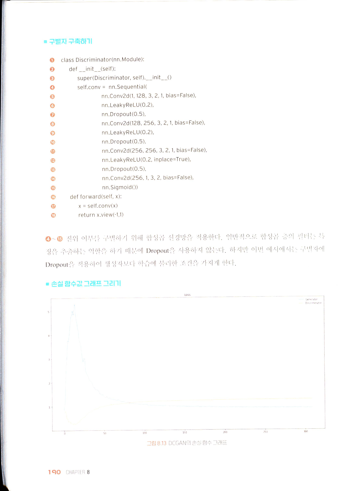

#### ■ Vanilla GAN과 DCGAN 결과 비교

그림 8.14와 같이 DCGAN이 조금 더 선명한 이미지를 만들어 내는 것을 알 수 있다.

<그림 8.14 테스트 이미지 결과>
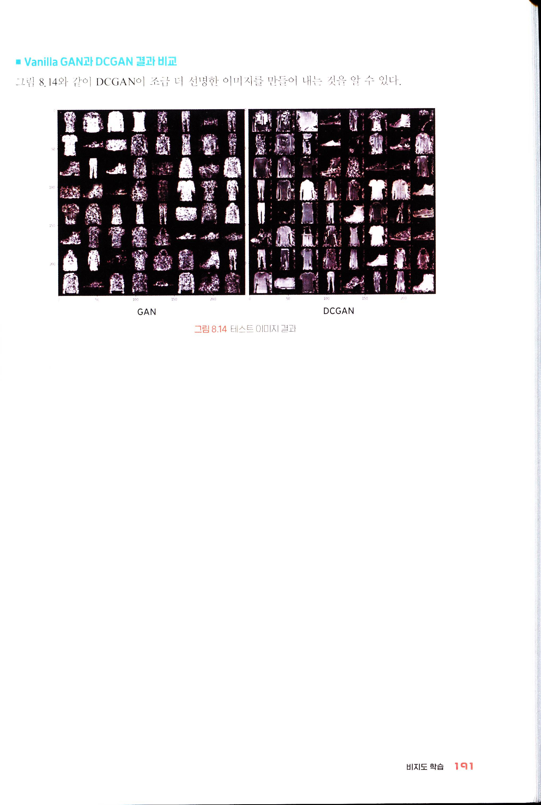

## 8.5 이미지 스타일 변이

그림 8.15와 같이 이미지 스타일 변이<sup>Image style transfer</sup>는 한 장의 스타일 이미지와 한 장의 내용 이미지를 가지고 새로운 스타일의 내용 이미지를 만드는 비지도 학습 방법이다. 따라서 우리는 임의의 결과 이미지를 만들고 우리가 원하는 그림이 나올 수 있도록 결과 이미지를 업데이트한다. 지금까지 배웠던 방법들이 모델들을 최적화했다면, 스타일 변이는 결과 이미지를 최적화하는 작업을 수행한다. 즉, 모델은 이미 학습된 모델을 사용하고 최적화를 진행하지 않는다.

<스타일 이미지> <내용 이미지>
<결과 이미지>
그림 8.15 스타일 변이 결과 이미지
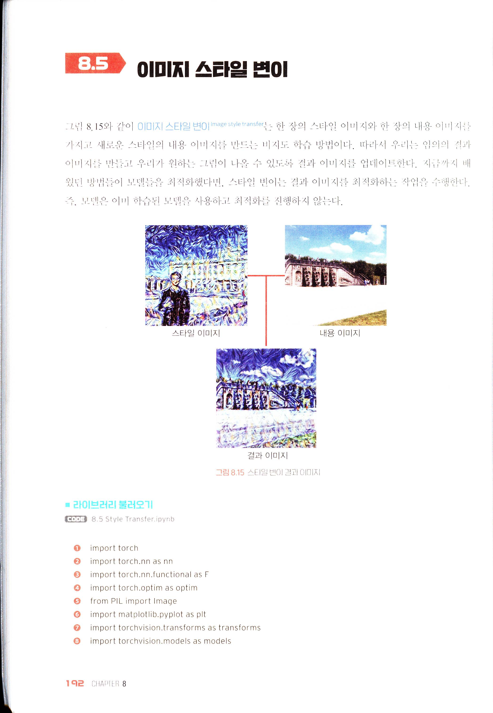

#### ■ 라이브러리 불러오기
**CODE 8.5 Style Transfer.ipynb**

```python
import torch
import torch.nn as nn
import torch.nn.functional as F
import torch.optim as optim
from PIL import Image
import matplotlib.pyplot as plt
import torchvision.transforms as transforms
import torchvision.models as models
```

#### ■ 모델 불러오기

이미지의 유의미한 특성을 추출하기 위해 사전 훈련된 모델 중 피처 추출 부분(합성곱 층)을 불러온다. 또한 모델에 대해 업데이트를 하고 피처 추출 용도로 사용하기 때문에 eval()을 활성화한다.

```python
device = torch.device("cuda:0" if torch.cuda.is_available() else "cpu")
cnn = models.vgg19(pretrained=True).features.to(device).eval()
```

#### ■ 내용 손실 함수 정의하기

업데이트를 하고자 하는 내용 이미지(input)의 피처맵과 원래의 내용 이미지(self.target)의 피처맵의 손실을 계산하기 위해 MSE 손실 함수를 사용한다.

```python
class ContentLoss(nn.Module):
    def __init__(self, target,):
        super(ContentLoss, self).__init__()
        self.target = target.detach()
    def forward(self, input):
        self.loss = F.mse_loss(input, self.target)
        return input
```

#### ■ 스타일 손실 함수 정의하기

스타일 손실 함수는 내용 손실 함수와는 다르게 각 피처맵의 유사도를 비교하기 위해 피처맵의 Gram matrix를 구한 결과 값을 사용하여 MSE 손실 함수를 계산한다.

```python
def gram_matrix(input):
    a, b, c, d = input.size()
    features = input.view(a * b, c * d)
    G = torch.mm(features, features.t())
    return G.div(a * b * c * d)
```

- ❶ Gram matrix에 대한 함수를 먼저 정의한다.
- ❷ 이미지의 크기를 저장한다.
- ❸ 크기가 (c)×(d)인 이미지를 일렬 벡터로 (배치 크기 a)×(채널 수 b) 개 만큼 만든다. 즉, features는 벡터들의 모임인 2차원 텐서가 된다.
- ❹ features를 F라 하면 F의 전치 텐서와 F를 행렬 곱을 수행한다. 즉, 각 벡터들의 내적을 계산하여 유사도를 정량적으로 표현할 수 있다.
- ❺ 마지막으로 전체 크기로 나누어 값을 반환한다.

```python
class StyleLoss(nn.Module):
    def __init__(self, target_feature):
        super(StyleLoss, self).__init__()
        self.target = gram_matrix(target_feature).detach()

    def forward(self, input):
        G = gram_matrix(input)
        self.loss = F.mse_loss(G, self.target)
        return input
```

- ❹, ❼ 스타일 이미지(self.target)와 업데이트할 이미지(input)의 각 피처맵의 Gram matrix를 각각 구한다. ❽ Gram matrix를 사용하여 MSE를 계산한다.

#### ■ 정규화 함수 정의하기

```python
class Normalization(nn.Module):
    def __init__(self, mean, std):
        super(Normalization, self).__init__()
        self.mean = mean.view(-1, 1, 1)
        self.std = std.view(-1, 1, 1)
    def forward(self, img):
        return (img - self.mean) / self.std
```

- ❶ 모델의 입력값을 정규화하기 위해 정규화 클래스를 정의한다.
- ❹, ❺ 평균과 표준편차를 정의한다.
- ❼ 들어오는 이미지에 대해 정규화를 진행한다.

#### ■ 모델 재정의하기

스타일 변환을 위해 모델 중간의 피처맵의 결과들을 활용해 손실 함수를 계산한다. 따라서 어느 부분의 정보를 사용할 것인지를 정의해야 한다.

```python
def get_style_model_and_losses(cnn, style_img, content_img):
    content_layers = ['conv_4']
    style_layers = ['conv_1', 'conv_2', 'conv_3', 'conv_4', 'conv_5']
    normalization_mean = torch.tensor([0.485, 0.456, 0.406]).to(device)
    normalization_std = torch.tensor([0.229, 0.224, 0.225]).to(device)
    normalization = Normalization(normalization_mean, normalization_std).to(device)
    content_losses = []
    style_losses = []
```

```python
    model = nn.Sequential(normalization)
    i = 0
```

- ❷ 내용 손실 함수는 VGG19의 4번째 합성곱 층의 피처맵을 사용하여 계산한다.
- ❸ 스타일 손실 함수는 1번째부터 5번째 합성곱 층의 피처맵을 사용한다. 이때 스타일 손실 함수는 학습 시 각 층의 손실 함수들의 합으로 정의한다.
- ❹, ❺ 정규화에 필요한 평균과 표준편차를 정의한다.
- ❻ 정규화 클래스를 정의한다.
- ❼, ❽ 각 층의 손실 함수를 별도로 저장하기 위해 리스트를 정의한다.
- ❾ 모델 재정의를 시작한다. 모델의 첫 클래스는 입력값을 정규화하는 normalization으로 시작한다.

```python
    for layer in cnn.children():
        if isinstance(layer, nn.Conv2d):
            i += 1
            name = 'conv_{}'.format(i)
        elif isinstance(layer, nn.ReLU):
            name = 'relu_{}'.format(i)
            layer = nn.ReLU(inplace=False)
        elif isinstance(layer, nn.MaxPool2d):
            name = 'maxpool_{}'.format(i)
        elif isinstance(layer, nn.BatchNorm2d):
            name = 'bn_{}'.format(i)
        else:
            raise RuntimeError('Unrecognized layer: {}'.format(layer.__class__.__name__))
```

- ⓫ 원래 모델 cnn의 층을 하나씩 불러온다.
- ⓬ ~ ⓮ 만약 층이 합성곱층이면 i를 1씩 더하여 층 이름을 'conv_숫자'로 하고
- ⓯ ~ ⓴-1 ReLU, 풀링, 배치 정규화도 마찬가지로 조건문에 따라 이름을 만든다.
- ⓴-2 ~ ⓴-3 만약 이름이 없다면 에러 메시지를 출력한다.

```python
        model.add_module(name, layer)
        if name in content_layers:
            target = model(content_img)
            content_loss = ContentLoss(target)
            model.add_module("content_loss_{}".format(i), content_loss)
            content_losses.append(content_loss)
        if name in style_layers:
            target_feature = model(style_img)
            style_loss = StyleLoss(target_feature)
```

```python
            model.add_module("style_loss_{}".format(i), style_loss)
            style_losses.append(style_loss)
```

- ⓴-4 이름을 정한 각 층을 하나씩 model에 추가하여 모델을 재구축한다.
- ⓴-5 ~ ⓴-9 name이 정의된 content_layers에 속하면 해당 층의 내용 손실 함수에 대해 정의하고 모델에 추가한다.
- 30 ~ 34 마찬가지로 name이 정의된 style_layers에 속하면 스타일 손실 함수에 대해 정의하고 모델에 추가한다.

```python
    for i in range(len(model) - 1, -1, -1):
        if isinstance(model[i], ContentLoss) or isinstance(model[i], StyleLoss):
            break
    model = model[:(i + 1)]
    return model, style_losses, content_losses
```

- 35 ~ 37 구성된 model을 역순으로 읽어 최종 손실 함수가 있는 위치 i를 파악한다.
- 38 최종 손실 함수가 있는 부분만 모델을 사용하기 때문에 i번째까지 층을 잘라 그 뒤는 배제한 뒤 모델을 정의한다.

#### ■ 결과 이미지 최적화하기

```python
def run_style_transfer(cnn, content_img, style_img, num_steps=300, style_weight=100000,
                       content_weight=1):
    input_img = content_img.clone().detach().requires_grad_(True)
    model, style_losses, content_losses = get_style_model_and_losses(cnn, style_img,
    content_img)
    optimizer = optim.LBFGS([input_img])
    iteration = [0]
    while iteration[0] <= num_steps:
        def closure():
            input_img.data.clamp_(0, 1)
            optimizer.zero_grad()
            model(input_img)
            style_score = 0
            content_score = 0
            for sl in style_losses:
                style_score += sl.loss
            for cl in content_losses:
                content_score += cl.loss
            loss = style_weight*style_score + content_weight*content_score
```

```python
            loss.backward()
            iteration[0] += 1
            if iteration[0] % 50 == 0:
                print('Iteration {}: Style Loss : {:4f} Content Loss: {:4f}'.format(
                    iteration[0], style_score.item(), content_score.item()))
            return style_score + content_score
        optimizer.step(closure)
    return input_img.data.clamp_(0, 1)
```

- ❶ 모델, 내용 이미지, 스타일 이미지, 학습 횟수, 손실 함수의 가중치들을 받는다.
- ❷ 업데이트하고자 하는 이미지 input_img의 초깃값을 내용 이미지로 정하고 최적화를 위해 requires_grad를 활성화한다.
- ❸ 앞서 정의한 get_style_model_and_losses을 이용해 특정 층에 손실 함수가 들어있는 모델을 만들고 손실 함수와 함께 정의한다.
- ❹ 최적화 기법으로는 L-BFGS<sup>Limited-memory Broyden-Fletcher-Goldfarb-Shanno algorithm</sup>를 사용하며 우리는 모델 최적화가 아닌 입력 이미지를 최적화하는 것이므로 변수에 [input_img]을 넣어준다. LBFGS는 헤시안 행렬(2차 미분)을 계산하는 방법으로 closure()를 정의하여 1차 미분값들을 저장해야 한다.
- ❼ ~ 23 따라서 학습 과정을 closure() 함수 내에서 진행하게 한다.
- ❽ 이미지 값을 0 이상 1 이하에서 관리하기 위해 clamp 함수를 사용한다. clamp_(0, 1)는 input_img의 값을 0과 1 기준으로 절삭하여 0 이상 1 이하의 값만 사용하도록 한다. 또한 _는 in-place 방식이라는 의미로 별도의 =없이 원래 input_img를 값을 절삭한 input_img로 만든다.
- ⓫ ~ ⓱ 지정한 층에서 계산된 스타일 손실 함수와 내용 손실 함수에 각각 가중치를 적용한다.
- 24 optimizer.step(closure)를 통해 LBFGS를 작동시킨다.
- 25 학습이 완료되면 다시 한 번 값을 정리하고 최종 이미지를 반환한다.

#### ■ 예제 이미지 불러오기

```python
def image_loader(img_path):
    loader = transforms.Compose([transforms.Resize((256,256)), transforms.ToTensor()])
    image = Image.open(img_path).convert('RGB')
    image = loader(image).unsqueeze(0)
    return image.to(device)

style_img = image_loader("./data/imgA.jpg")
content_img = image_loader("./data/imgB.jpg")
```

- ❶ ~ ❸ image_loader를 통해 이미지 사이즈는 256×256으로 설정하고 4채널 이미지에 대해 3채널로 변경하기 위해 이미지를 불러온 뒤 .convert('RGB')을 적용한다.
- ❹ 모델에 사용하기 위해 unsqueeze(0)을 이용해 배치 사이즈 1을 추가하여 4차원으로 이미지를 만든다.
- ❻, ❼ 내용 이미지와 스타일 이미지를 각각 불러온다.

#### ■ 이미지 학습하기

```python
output = run_style_transfer(cnn, content_img, style_img)
```

```
Output:
Iteration 50: Style Loss : 0.000012 Content Loss: 3.554613
... 중략 ...
Iteration 300: Style Loss : 0.000003 Content Loss: 2.373624
```

#### ■ 결과 이미지 보기

```python
def imshow(image, title):
    unloader = transforms.ToPILImage()
    image = unloader(image.squeeze(0).cpu())
    plt.figure(figsize=(5,5))
    plt.imshow(image)
    plt.title(title)
    plt.axis("off")
    plt.show()

imshow(output, title='Output Image')
```

<그림 8.16 결과 이미지>
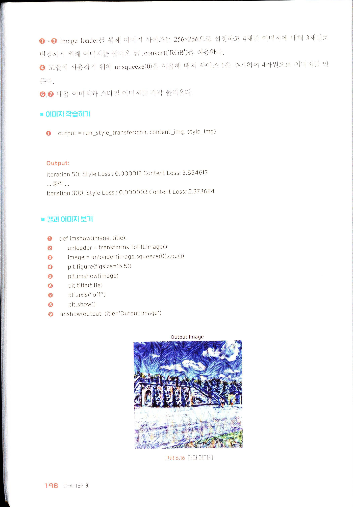

## 8.6 깊은 K-평균 알고리즘

이번 절에서는 앞서 배운 오토인코더와 K-평균 알고리즘을 조합하여 이미지를 클러스터링한다. 데이터는 MNIST 데이터를 사용하며 훈련 데이터에 라벨이 없다고 가정하고 비지도 학습으로 모델을 학습한다. 그림 8.17과 같이 오토인코더는 인코더 부분에 이미지가 들어와서 차원이 축소된 잠재 변수를 생성한 뒤 다시 디코더를 거쳐 원래 이미지와 같은 크기의 이미지를 출력한다.
즉, 잠재 변수와 크기가 같은 적절한 벡터를 디코더 부분에 주입하게 되면 가상 이미지가 생성되고 잠재 변수는 실제 이미지를 압축한 벡터로써 숫자에 대한 중요한 정보를 담고 있다고 볼 수 있다. 따라서 잠재 변수를 활용하여 이미지를 분류한다면 좋은 결과를 얻을 수 있다고 기대할 수 있을 것이다. 이를 깊은 K-평균 알고리즘<sup>Deep K-Means</sup>이라고 한다.

<그림 8.17 깊은 K-평균 알고리즘>
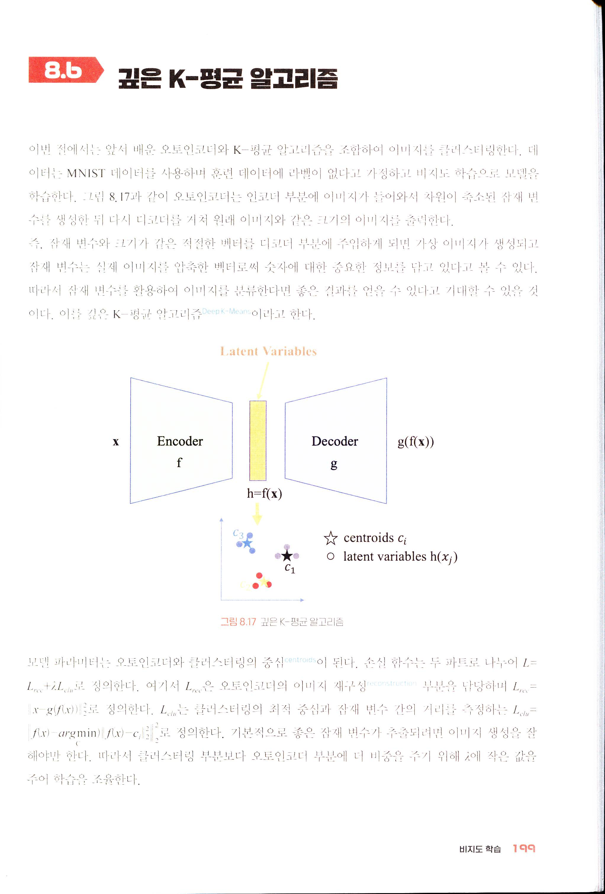

모델 파라미터는 오토인코더와 클러스터링의 중심<sup>centroids</sup>이 된다. 손실 함수는 두 파트로 나누어 $L = L_{rec} + \lambda L_{clu}$로 정의한다. 여기서 $L_{rec}$은 오토인코더의 이미지 재구성<sup>reconstruction</sup> 부분을 담당하며 $L_{rec} = ||x - g(f(x))||_2^2$로 정의한다. $L_{clu}$는 클러스터링의 최적 중심과 잠재 변수 간의 거리를 측정하는 $L_{clu} = ||f(x) - \underset{c}{\operatorname{argmin}} ||f(x) - c_i||_2^2||_2^2$로 정의한다. 기본적으로 좋은 잠재 변수가 추출되려면 이미지 생성을 잘 해야만 한다. 따라서 클러스터링 부분보다 오토인코더 부분에 더 비중을 주기 위해 $\lambda$에 작은 값을 주어 학습을 조율한다.

#### ■ 라이브러리 불러오기

```python
import torch
import torch.nn as nn
import torchvision
from torchvision import transforms
import numpy as np
from matplotlib import pyplot as plt
from scipy.optimize import linear_sum_assignment as linear_assignment
```

- ❶ ~ ❻ 관련 라이브러리를 불러온다.
- ❼ 클러스터링은 그룹의 순서를 고려하지 않고 데이터를 군집화 하는 것이다. 예를 들어 숫자 0, 1, 2를 분류하는 문제라면 클러스터 3개를 사용하게 되는데 그 결과가 (0, 1, 2), (0, 2, 1), (2, 0, 1) 등의 다양한 그룹으로 표현된다. 즉, 0, 1, 2 숫자가 완벽히 나눠졌더라도 0이 그룹0, 1이 그룹1, 2가 그룹2로 배치가 안 될 수도 있다는 의미다. 따라서 평가 시에는 평가 라벨에 맞춰 그룹을 재배치 해줘야 하는데, 이 때 이분 그래프에서 최소 가중치를 측정하는 linear_assignment 함수를 활용한다.

#### ■ 데이터 불러오기

```python
batch_size = 128
num_clusters = 10
latent_size = 10
```

- ❶ 배치 사이즈를 정한다.
- ❷ 적절한 클러스터 수를 정한다.
- ❸ 클러스터 수와 같을 필요는 없으며 적절한 잠재 변수의 크기를 정한다.

```python
trainset = torchvision.datasets.MNIST('./data/', download=True, train=True, transform=transforms.ToTensor())
testset = torchvision.datasets.MNIST('./data/', download=True, train=False, transform=transforms.ToTensor())
trainloader = torch.utils.data.DataLoader(trainset, batch_size=batch_size, shuffle=True)
testloader = torch.utils.data.DataLoader(testset, batch_size=batch_size, shuffle=True)
```

- ❹ ~ ❼ MNIST 데이터를 불러온다.

#### ■ 벡터화, 피처맵화 클래스 정의하기

```python
class Flatten(torch.nn.Module):
    def forward(self, x):
        batch_size = x.shape[0]
        return x.view(batch_size, -1)

class Deflatten(nn.Module):
    def __init__(self, k):
        super(Deflatten, self).__init__()
        self.k = k
    def forward(self, x):
        s = x.size()
        feature_size = int((s[1]//self.k)**.5)
        return x.view(s[0], self.k, feature_size, feature_size)
```

- ❶ ~ ❹ 이번 예시에서는 합성곱 오토인코더를 사용한다. 따라서 인코더의 마지막 피처맵은 4차원 텐서(배치사이즈, 채널수, 피처맵 너비, 높이)가 된다. 따라서 잠재 변수를 구하기 위해 인코더 부분에서 나온 피처맵을 벡터화한다.
- ❻ ~ ⓭ 디코더 부분의 계산을 위해 벡터화된 잠재 변수를 다시 4차원 텐서(배치사이즈, 채널수, 피처맵 너비, 높이)로 변환한다.

#### ■ k-평균 알고리즘 정의하기

```python
class Kmeans(nn.Module):
    def __init__(self, num_clusters, latent_size):
        super(Kmeans, self).__init__()
        device = torch.device("cuda:0" if torch.cuda.is_available() else "cpu")
        self.num_clusters = num_clusters
        self.centroids = nn.Parameter(torch.rand((self.num_clusters, latent_size)).to(device))

    def argminl2distance(self, a, b):
        return torch.argmin(torch.sum((a-b)**2, dim=1), dim=0)

    def forward(self, x):
        y_assign = []
        for m in range(x.size(0)):
            h = x[m].expand(self.num_clusters, -1)
            assign = self.argminl2distance(h, self.centroids)
            y_assign.append(assign.item())
        return y_assign, self.centroids[y_assign]
```

- ❶ ~ ❺ 클러스터의 중심 centroids를 정의하기 위해 클러스터 개수 num_clusters와 잠재 변수의 크기

latent_size를 고정한다. 이는 잠재 변수를 그룹화 하는 것이기 때문에 잠재 변수의 크기와 각 중심의 크기가 같아야 한다.
- ❻ centroids는 최적화가 되어야 할 변수다. 따라서 nn.Parameter로 정의한다.
- ❽, ❾ 잠재 변수의 그룹화를 위해 가장 가까운 중심을 argmin 함수로 찾는다. 즉, torch.sum((a-b)**2, dim=1)은 잠재 변수와 각 중심과의 유클리디안 거리를 측정한 것이고 torch.argmin(torch.sum((a-b)**2, dim=1), dim=0)은 각 거리들 중 가장 가까운 중심의 인덱스를 추출하는 것이다.
- ⓬ 각 이미지의 클러스터를 저장하기 위한 빈 리스트 y_assign를 선언한다.
- ⓭ 각 데이터를 그룹화하기 위해 인코더를 통해 나온 잠재 변수를 하나씩 불러온다.
- ⓮ 계산을 쉽게 하기 위해 하나의 잠재 변수를 클러스터 수만큼 확장(복사)한다.
- ⓯ 앞서 정의한 self.argminl2distance을 통해 각 잠재 변수의 할당 클러스터를 산출한다.
- ⓰ 할당된 클러스터를 y_assign에 누적한다.
- ⓱ 결과적으로 y_assign은 0부터 9까지의 값으로 구성되어 있기 때문에 예측에 사용되며, 최적화를 위해 각 할당된 클러스터에 대응하는 중심을 반환한다.

#### ■ 오토인코더 정의하기

```python
class Encoder(nn.Module):
    def __init__(self, latent_size):
        super(Encoder, self).__init__()

        k = 16
        self.encoder = nn.Sequential(
            nn.Conv2d(1, k, 3, stride=2),
            nn.ReLU(),
            nn.Conv2d(k, 2*k, 3, stride=2),
            nn.ReLU(),
            nn.Conv2d(2*k, 4*k, 3, stride=1),
            nn.ReLU(),
            Flatten(),
            nn.Linear(1024, latent_size),
            nn.ReLU())

    def forward(self, x):
        return self.encoder(x)

class Decoder(nn.Module):
    def __init__(self, latent_size):
        super(Decoder, self).__init__()
```

```python
        k = 16
        self.decoder = nn.Sequential(
            nn.Linear(latent_size, 1024),
            nn.ReLU(),
            Deflatten(4*k),
            nn.ConvTranspose2d(4*k, 2*k, 3, stride=1),
            nn.ReLU(),
            nn.ConvTranspose2d(2*k, k, 3, stride=2),
            nn.ReLU(),
            nn.ConvTranspose2d(k, 1, 3, stride=2, output_padding=1),
            nn.Sigmoid())

    def forward(self, x):
        return self.decoder(x)
```

8.3.3 합성곱 오토인코더에서 정의한 모델을 인코더와 디코더를 나누어 정의한다.

#### ■ 클러스터 라벨 재배치 함수 정의하기

```python
def cluster_acc(y_true, y_pred):
    y_true = np.array(y_true)
    y_pred = np.array(y_pred)
    D = max(y_pred.max(), y_true.max()) + 1
    w = np.zeros((D, D), dtype=np.int64)
    for i in range(y_pred.size):
        w[y_pred[i], y_true[i]] += 1
    ind = linear_assignment(w.max() - w)
    return sum([w[i, j] for i, j in zip(ind[0], ind[1])]) * 1.0 / y_pred.size
```

- ❶ 평가를 위해 실제 라벨과 예측 라벨을 받는다.
- ❷, ❸ 각 라벨을 넘파이 배열로 변환한다.
- ❹ 클러스터가 10개라고 해서 데이터들이 골고루 그룹 0에서부터 그룹 9까지 분배되지 않을 수 있다. 예를 들어 우리가 가지고 있는 데이터가 0, 1, 2, 4, 8이라고 하면 실제 클래스의 수보다 적게 클러스터링이 된다. 즉, 동일한 클래스 수에서 정확도를 측정하기 위해 실제 라벨 데이터와 예측 라벨 데이터에서 가장 큰 라벨을 기준한다.
- ❺ ~ ❼ 따라서 10×10의 w 행렬을 만들 수 있고 열(실제 라벨), 행(예측 라벨)을 비교하며 할당된 이미지 개수를 넣게 된다. 만약에 예측 라벨이 1이고 실제 라벨이 2이면 w의 2행 1열 성분에 1을 누적하게 된다. 결과적으로 예측 라벨과 실제 라벨의 관계를 배열 w로 표현하게 된다.
- ❽ 배열 w와 linear_assignment를 기준으로 인덱스를 재배치한다.
- ❾ 재배치된 인덱스 정보를 바탕으로 예측 라벨과 실제 라벨이 같은 개수만큼 더하고 전체 라벨 수를 나누어 정확도를 계산한다.

#### ■ 평가 함수 정의하기

```python
def evaluation(testloader, encoder, kmeans, device):
    predictions = []
    actual = []

    with torch.no_grad():
        for images, labels in testloader:
            inputs = images.to(device)
            labels = labels.to(device)
            latent_var = encoder(inputs)
            y_pred, _ = kmeans(latent_var)

            predictions += y_pred
            actual += labels.cpu().tolist()

    return cluster_acc(actual, predictions)
```

- ❷, ❸ 예측 라벨과 실제 라벨을 저장하기 위해 빈 리스트를 선언한다.
- ❻ ~ ❿ 예측 시에는 디코더 부분이 필요없다. 따라서 인코더와 k-평균 알고리즘을 통해 예측값을 산출한다.
- ⓬, ⓭ 미리 선언한 빈 리스트에 각 라벨을 저장한다.
- ⓯ 누적된 라벨 리스트를 cluster_acc 함수에 넣어 정확도를 계산한다.

#### ■ 손실 함수 및 최적화 방법 정의하기

```python
encoder = Encoder(latent_size).to(device)
decoder = Decoder(latent_size).to(device)
kmeans = Kmeans(num_clusters, latent_size).to(device)
criterion1 = torch.nn.MSELoss()
criterion2 = torch.nn.MSELoss()
optimizer = torch.optim.Adam(list(encoder.parameters()) + list(decoder.parameters()) + list(kmeans.parameters()), lr=1e-3)
```

- ❶ ~ ❸ 모델을 선언한다.
- ❹, ❺ 손실 함수 $L = L_{rec} + \lambda L_{clu}$의 두 부분에 대한 손실 함수를 정의한다.
- ❻ 분리된 모델을 동시에 최적화하고 싶은 경우 list의 합을 이용해 하나로 합쳐줄 수 있다.

#### ■ 모델 학습 변수 설정하기

```python
T1 = 50
T2 = 200
lam = 1e-3
ls = 0.05
```

- ❶ ~ ❸ 우리 모델은 설명에서도 언급했듯이 $\lambda$에 민감하다. 따라서 학습 초반에는 작은 $\lambda = lam / (T1 - T2)$로 시작하여 학습 횟수에 따라 점차 값을 증가하여 $\lambda = lam$까지 사용하는 방식<sup>annealing</sup>으로 모델을 학습한다. 따라서 $\lambda$에 대한 기준을 정한다.
- ❹ 모델 저장의 기준값을 임의로 설정한다.

#### ■ 모델 학습하기

```python
for ep in range(300):
    if (ep > T1) and (ep < T2):
        alpha = lam*(ep - T1)/(T2 - T1) # 1/100, 2/100, ..., 99/100
    elif ep >= T2:
        alpha = lam
    else:
        alpha = lam/(T2 - T1)
```

- ❶ 학습 횟수는 300으로 한다.
- ❷ ~ ❼ 앞서 언급한 annealing 기법으로 학습 횟수에 따라 $\lambda$를 조절한다.

```python
    running_loss = 0.0
    for images, _ in trainloader:
        inputs = images.to(device)
        optimizer.zero_grad()
        latent_var = encoder(inputs)
        _, centroids = kmeans(latent_var.detach())
        outputs = decoder(latent_var)

        l_rec = criterion1(inputs, outputs)
        l_clt = criterion2(latent_var, centroids)
        loss = l_rec + alpha*l_clt
        loss.backward()
        optimizer.step()
        running_loss += loss.item()
    avg_loss = running_loss / len(trainloader)
```

- ❽ 각 배치마다 손실 함수 값을 누적하기 위해 running_loss=0으로 설정한다.
- ❾ 학습 시 이미지만 사용한다. 따라서 라벨은 "_"을 사용하여 값을 사용하지 않는다.
- ❿ ~ ⓮ 오토인코더로부터 나온 가상 이미지와 클러스터의 중심을 출력한다.
- ⓭ kmeans 부분을 역전파할 때에는 잠재 변수를 고정하고 중심을 변수로 두게 하기 위해 latent_var에 .detach()를 붙여 requires_grad를 비활성화 한다.
- ⓰ ~ ⓴ 앞서 정의한 손실 함수를 계산하고 최적화를 시행한다.

```python
    if ep % 10 == 0:
        testacc = evaluation(testloader, encoder, kmeans, device)
        print('[%d] Train loss: %.4f, Test Accuracy: %.3f' %(ep, avg_loss, testacc))

    if avg_loss < ls:
        ls = avg_loss
        torch.save(encoder.state_dict(),'./models/dkm_en.pth')
        torch.save(decoder.state_dict(),'./models/dkm_de.pth')
        torch.save(kmeans.state_dict(),'./models/dkm_clt.pth')
```

```
Output:
[0] Train loss: 0.0998, Test Accuracy: 0.116
[10] Train loss: 0.0245, Test Accuracy: 0.279
...중략...
[280] Train loss: 0.0177, Test Accuracy: 0.893
[290] Train loss: 0.0177, Test Accuracy: 0.889
```

- 23 ~ 25 학습 횟수 10회마다 검증을 시행한다.
- 27 ~ 31 훈련 손실 함수를 기준으로 모델들을 저장한다(절대 평가 내용이 반영되면 안 된다).

#### ■ 최종 모델 평가하기

```python
encoder.load_state_dict(torch.load('./models/dkm_en.pth'))
decoder.load_state_dict(torch.load('./models/dkm_de.pth'))
kmeans.load_state_dict(torch.load('./models/dkm_clt.pth'))

predictions = []
actual = []
latent_features = []
with torch.no_grad():
    for images, labels in testloader:
        inputs = images.to(device)
        labels = labels.to(device)
        latent_var = encoder(inputs)
        y_pred, _ = kmeans(latent_var)

        predictions += y_pred
        latent_features += latent_var.cpu().tolist()
        actual += labels.cpu().tolist()
print(cluster_acc(actual, predictions))
```

```
Output:
0.894
```

- ❶ ~ ❸ 저장된 모델을 불러온다.
- ❹ ~ ⓲ 비지도 학습으로 모델을 평가하여 89.4%의 평가 정확도를 달성한다.

<그림 8.18 t-SNE(10.2절) 분포를 통한 결과 시각화>
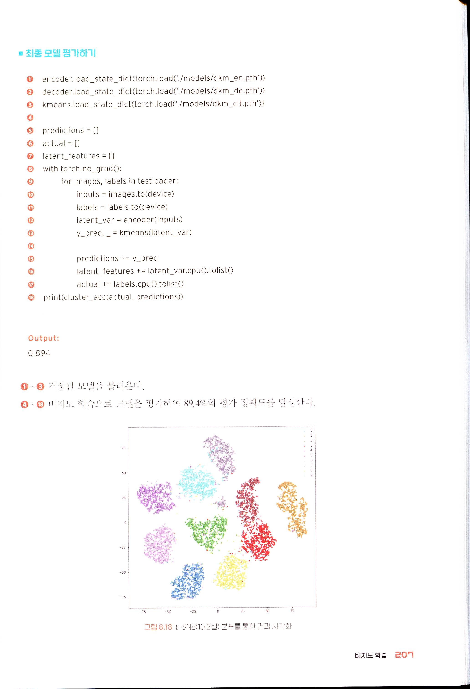

> "전이학습은 머신러닝의 성공을 이끌어 갈 것이다."
> 
> — 앤드류 응
