# CHAPTER 9 성능 개선

9장에서는 모델을 학습하면서 대표적으로 겪을 수 있는 문제인 과적합, 데이터 불균형, 데이터 부족을 해결하기 위한 방법을 알아본다.

- 과적합
- 데이터 불균형
- 전이 학습
- 준지도 학습

## 9.1 과적합

과적합<sup>Overfitting</sup>이란 학습 데이터에 대해서는 예측을 잘 하지만 테스트 데이터와 같은 학습에 사용되지 않은 데이터에 대해서 예측을 잘 못하는 현상이다. 머신러닝 분야에서의 과적합은 항상 문제로 대두되는 만큼 지금까지 다양한 방지 기법들이 개발되었다. 일반적으로 모델 파라미터 수가 많으면 쉽게 나타나는 것으로 알려져 있기 때문에 과적합 현상은 모델을 깊게 만드는데 방해 요소로 작용한다. 이때 과적합을 방지하면서 딥러닝 모델을 학습시키는 것을 정규화<sup>Regularization</sup> 방법이라고 한다.

<그림 9.1 과소적합과 과적합>
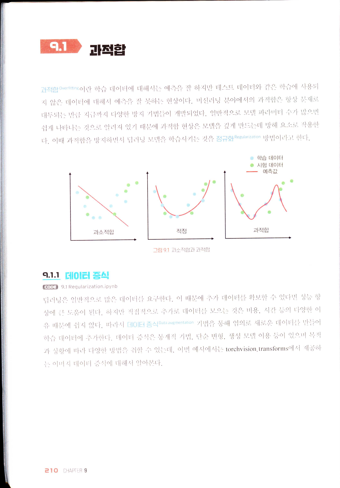

### 9.1.1 데이터 증식
`CODE 9.1 Regularization.ipynb`

딥러닝은 일반적으로 많은 데이터를 요구한다. 이 때문에 추가 데이터를 확보할 수 있다면 성능 향상에 큰 도움이 된다. 하지만 직접적으로 추가로 데이터를 모으는 것은 비용, 시간 등의 다양한 이유 때문에 쉽지 않다. 따라서 데이터 증식<sup>Data augmentation</sup> 기법을 통해 임의로 새로운 데이터를 만들어 학습 데이터에 추가한다. 데이터 증식은 통계적 기법, 단순 변형, 생성 모델 이용 등이 있으며 목적과 상황에 따라 다양한 방법을 취할 수 있는데, 이번 예시에서는 torchvision.transforms에서 제공하는 이미지 데이터 증식에 대해서 알아본다.

<그림 9.2 이미지 데이터 증식>
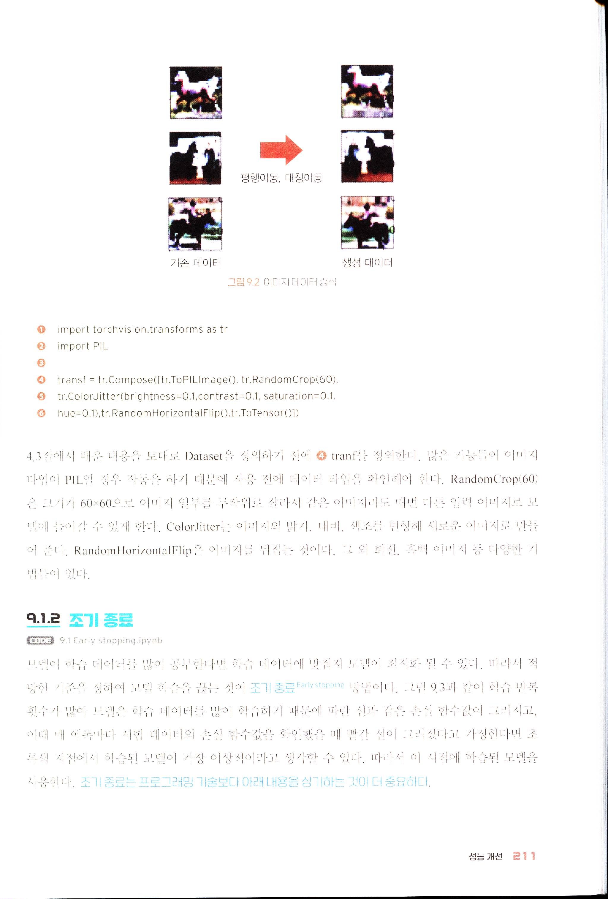

```python
import torchvision.transforms as tr
import PIL

transf = tr.Compose([tr.ToPILImage(), tr.RandomCrop(60),
tr.ColorJitter(brightness=0.1,contrast=0.1, saturation=0.1,
hue=0.1),tr.RandomHorizontalFlip(),tr.ToTensor()])
```

4.3절에서 배운 내용을 토대로 Dataset을 정의하기 전에 ❹ tranf를 정의한다. 많은 기능들이 이미지 타입이 PIL인 경우 작동을 하기 때문에 사용 전에 데이터 타입을 확인해야 한다. RandomCrop(60)은 크기가 $60 \times 60$으로 이미지 일부를 무작위로 잘라서 같은 이미지라도 매번 다른 입력 이미지로 모델에 들어갈 수 있게 한다. ColorJitter는 이미지의 밝기, 대비, 색조를 변형해 새로운 이미지로 만들어 준다. RandomHorizontalFlip은 이미지를 뒤집는 것이다. 그 외 회전, 흑백 이미지 등 다양한 기법들이 있다.

### 9.1.2 조기 종료
`CODE 9.1 Early stopping.ipynb`

모델이 학습 데이터를 많이 공부한다면 학습 데이터에 맞춰서 모델이 최적화 될 수 있다. 따라서 적당한 기준을 정하여 모델 학습을 끊는 것이 조기 종료<sup>Early stopping</sup> 방법이다. 그림 9.3과 같이 학습 반복 횟수가 많아 모델은 학습 데이터를 많이 학습하기 때문에 파란 선과 같은 손실 함수값이 그려지고, 이때 매 에폭마다 시험 데이터의 손실 함수값을 확인했을 때 빨간 선이 그려졌다고 가정한다면 초록색 지점에서 학습된 모델이 가장 이상적이라고 생각할 수 있다. 따라서 이 시점에 학습된 모델을 사용한다. 조기 종료는 프로그래밍 기술보다 아래 내용을 상기하는 것이 더 중요하다.

- 손실 함수값이 작다고 반드시 정확도가 높은 것은 아니다.
- 학습 반복 횟수를 그림 9.3보다 더 크게 할 경우 시험 데이터의 손실 함수값이 다시 내려오는 경우도 존재한다.
- 그림 9.3과 같이 모델을 선택하는데 직접적으로 시험 데이터를 사용하면 매우 위험할 수 있다. 따라서 검증 데이터를 사용해야 한다. 시험 데이터는 오직 평가에만 사용한다.

<그림 9.3 학습 손실 함수와 평가 손실 함수>
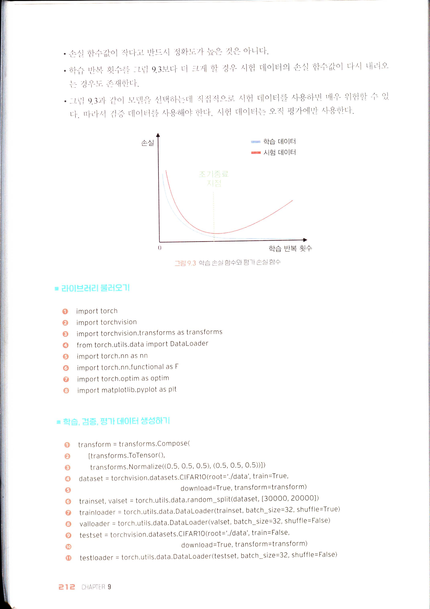

#### ■ 라이브러리 불러오기

```python
import torch
import torchvision
import torchvision.transforms as transforms
from torch.utils.data import DataLoader
import torch.nn as nn
import torch.nn.functional as F
import torch.optim as optim
import matplotlib.pyplot as plt
```

#### ■ 학습, 검증, 평가 데이터 생성하기

```python
transform = transforms.Compose(
    [transforms.ToTensor(),
     transforms.Normalize((0.5, 0.5, 0.5), (0.5, 0.5, 0.5))])
dataset = torchvision.datasets.CIFAR10(root='./data', train=True,
                                        download=True, transform=transform)
trainset, valset = torch.utils.data.random_split(dataset, [30000, 20000])
trainloader = torch.utils.data.DataLoader(trainset, batch_size=32, shuffle=True)
valloader = torch.utils.data.DataLoader(valset, batch_size=32, shuffle=False)
testset = torchvision.datasets.CIFAR10(root='./data', train=False,
                                       download=True, transform=transform)
testloader = torch.utils.data.DataLoader(testset, batch_size=32, shuffle=False)
```

- ❻ torch.utils.data.random_split을 통해 50000개의 dataset을 학습 데이터 30000개, 검증 데이터 20000개로 나눈다.
- ❾ 평가 데이터는 train=False를 입력하여 생성한다.

#### ■ GPU 연산 확인

```python
device = torch.device("cuda:0" if torch.cuda.is_available() else "cpu")
print(f'{device} is available.')
```

#### ■ 모델 정의하기

6.3절에서 구축한 ResNet을 이용한다.

```python
..... 생략 .....
resnet = modeltype('resnet18').to(device)
```

#### ■ 손실 함수 및 최적화 기법

```python
PATH = './cifar_resnet_early.pth'
criterion = nn.CrossEntropyLoss()
optimizer = optim.Adam(resnet.parameters(), lr=1e-3)
```

- ❶ 저장 모델명을 정의한다.
- ❷, ❸ 크로스 엔트로피 함수와 Adam을 이용한다.

#### ■ 검증 데이터에 대한 손실 함수값을 연산하는 함수 정의하기

```python
def validation_loss(dataloader):
    n = len(dataloader)
    running_loss = 0.0
    with torch.no_grad():
        resnet.eval()
        for data in dataloader:
            images, labels = data[0].to(device), data[1].to(device)
            outputs = resnet(images)
            loss = criterion(outputs, labels)
            running_loss += loss.item()
    resnet.train()
    return running_loss / n
```

- ❹ 평가만 하기 때문에 requires_grad를 비활성화한다.
- ❺ 평가 시 정규화 기법들이 작동하지 않도록 eval 모드로 설정한다.
- ⓫ 다시 모델을 train 모드로 변경한다.

#### ■ 학습하기

```python
train_loss_list = []
val_loss_list = []
n = len(trainloader)
early_stopping_loss = 1
```

- ❶, ❷ 손실 함수 그래프를 그리기 위해 학습 및 검증 데이터에 대한 손실 함수값을 각각 담을 수 있는 빈 리스트를 생성한다.
- ❸ 매 에폭마다 평균 손실 함수값을 구하기 위해 n을 설정한다.
- ❹ 가장 낮은 검증 손실 함수값에 해당하는 모델을 저장하기 위해 손실 함수값 초기 기준을 1로 한다.

```python
for epoch in range(51):
    running_loss = 0.0
    for data in trainloader:
        inputs, labels = data[0].to(device), data[1].to(device)
        optimizer.zero_grad()
        outputs = resnet(inputs)
        loss = criterion(outputs, labels)
        loss.backward()
        optimizer.step()
        running_loss += loss.item()
```

- ❼ ~ ⓮ 배치 데이터를 받아 학습을 진행한다.

```python
    train_loss = running_loss / n
    train_loss_list.append(train_loss)
    val_loss = validation_loss(valloader)
    val_loss_list.append(val_loss)
    print('[%d] train loss: %.3f , validation loss: %.3f' %(epoch + 1, train_loss, val_loss))
```

- ❶, ❷ 배치 학습이 한 번 완료될 때마다 평균 손실 함수값을 저장한다.
- ❸, ❹ 검증 데이터에 대한 손실 함수값을 저장한다.
- ❺ 현재 에폭의 평가, 검증 손실 함수값을 출력한다.

```python
    if val_loss < early_stopping_loss:
        torch.save(resnet.state_dict(), PATH)
        early_stopping_train_loss = train_loss
        early_stopping_val_loss = val_loss
        early_stopping_epoch = epoch

print('Final pretrained model >> [%d] train loss: %.3f , validation loss: %.3f' %(early_stopping_epoch + 1, early_stopping_train_loss, early_stopping_val_loss))
```

```
Output:
[1] train loss: 1.603 , validation loss: 1.272
[2] train loss: 1.243 , validation loss: 1.092
... 중략 ...
Final pretrained model >> [9] train loss: 0.135 , validation loss: 0.982
```

- ❻ ~ ❿ 만약 현재 검증 손실 함수값이 기준보다 작으면 모델을 저장하고 현재의 에폭, 평가, 검증 손실 함수값을 저장한다.
- ⓬ 학습이 완료되면 조기 종료를 한 에폭과 손실 함수값들을 출력한다. 결과를 보면 9번째 학습 시 검증 손실 함수값이 가장 작은 것을 알 수 있다.

#### ■ 손실 함수값 그래프 그리기

```python
plt.plot(train_loss_list)
plt.plot(val_loss_list)
plt.legend(['train','validation'])
plt.title("Loss")
plt.xlabel("epoch")
plt.show()
```

<그림 9.4 훈련 손실 함수와 검증 손실 함수>
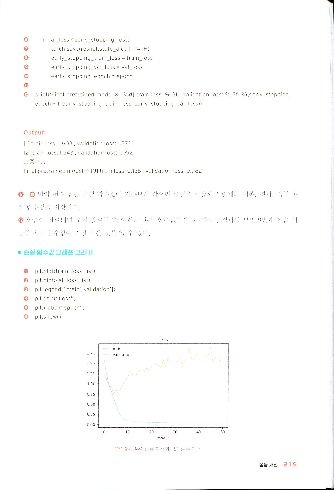

### 9.1.3 $L_2$ 정규화
`CODE 9.1 Regularization.ipynb`

$L_2$ 정규화는 그림 9.5에서 표현된 바와 같이 경계를 만들어 학습 데이터에서의 최적 변수 $w^*$에 도달하지 못하게 하며 경계 안에서만 변수를 최적화하도록 한다. 따라서 모델이 최적화된다면 $v^*$로 수렴하게 된다.

<그림 9.5 $L_2$ 정규화 예시>


Adam을 사용할 경우 weight_decay에 $L_2$ 페널티 값을 입력하여 $L_2$ 정규화를 활성화할 수 있으며, 페널티 값이 클수록 제약조건이 더 강해지고 0이면 정규화를 사용하지 않는다는 의미다. 따라서 문제마다 적절한 값을 입력해야 한다.

```python
optimizer = optim.Adam(resnet.parameters(), lr=1e-3, weight_decay=1e-3)
```

### 9.1.4 드롭아웃
`CODE 9.1 Regularization.ipynb`

<그림 9.6 드롭아웃의 원리>
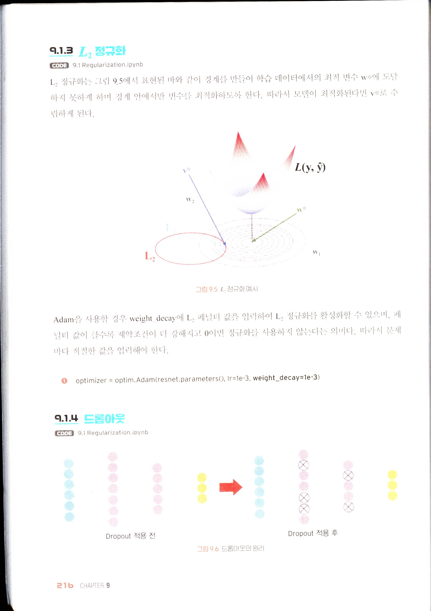

인공 신경망에서 무작위로 일정한 비율의 노드를 제외하여 학습하는 방법을 드롭아웃<sup>Dropout</sup>이라고 한다. 따라서 한 번 변수 갱신이 일어날 때마다 제외된 노드와 관련 있는 변수는 갱신이 되지 않기 때문에 학습 데이터에 대한 모델 최적화를 억제할 수 있다. 드롭아웃의 세팅 방법에 대해서 살펴보면 출력층은 예측값이 나오는 단계이기 때문에 적용하지 않는다. 즉, 출력층의 노드는 절대 지우지 않으며 원하는 층에만 적용할 수도 있고 제외 비율도 조정을 할 수 있다. 추가적으로 학습이 반복될 때마다 제외할 노드를 무작위로 선택하여 학습에서 과적합을 방지하며 시험 데이터를 이용하는 것과 같은 평가 단계에서는 드롭아웃을 적용하지 않고 원래 전체 모델을 사용한다(eval 함수를 선언).

```python
class Regressor(nn.Module):
    def __init__(self):
        super().__init__()
        self.fc1 = nn.Linear(13, 50)
        self.fc2 = nn.Linear(50, 1)
        self.dropout = nn.Dropout(0.5)

    def forward(self, x):
        x = self.dropout(F.relu(self.fc1(x)))
        x = F.relu(self.fc2(x))
        return x
```

nn.Dropout(0.5)은 해당 노드에 50%를 선택해 노드를 사용하지 않겠다는 의미로 F.relu(self.fc1(x))의 노드는 50개이므로 25개의 노드가 비활성화된다. 또다른 표현으로는 torch.nn.functional.dropout(input, p=0.5, training=True)가 있다.

### 9.1.5 배치 정규화
`CODE 9.1 Regularization.ipynb`

미니 배치를 이용하면 학습을 반복할 때마다 우리가 나눠 놓은 미니 배치들이 돌아가면서 사용된다. 즉, 학습을 한 번 할 때마다 입력값의 분포가 다르고 각 레이어의 입력값 분포 또한 다르다는 의미다. 기본적인 인공 신경망의 구조는 이전 층의 노드가 관련 변수들과 일차결합 연산을 거치고 그 값이 활성화 함수를 통해 다음 레이어로 가는 흐름인데, 여기서 활성화 함수로 들어가기 전에 각 노드로 들어오는 값인 피처<sup>Feature</sup>값을 보정된 정규화<sup>Normalization</sup>를 통해서 항상 동일한 분포 위에 있게 한다. 배치 정규화<sup>Batch normalization</sup>는 입력값들의 분포를 일정하게 하여 일반적으로 학습에 대한 수렴 속도가 빠르다. 또한 배치 단위의 정규화 분포는 전체의 데이터 분포와 다를 수 있기 때문에 과적합을 방지할 수 있다. 이 효과는 드롭아웃과 유사하며 속도가 더 빠른 것으로 알려져 있다. 6.3절 ResNet 구현편과 같이 층과 층 사이에 nn.BatchNorm2d()를 넣어주면 된다.

<그림 9.7 배치 정규화 수식 및 적용 위치>
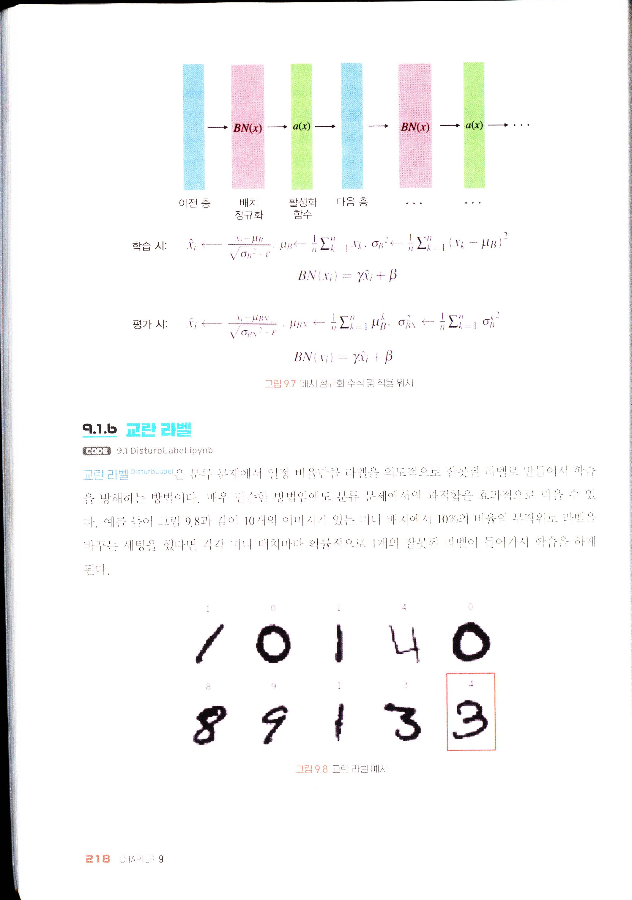

학습 시: $\hat{x}_i \leftarrow \frac{x_i - \mu_B}{\sqrt{\sigma_B^2 + \epsilon}}$, $\mu_B \leftarrow \frac{1}{n}\sum_{k=1}^n x_k$, $\sigma_B^2 \leftarrow \frac{1}{n}\sum_{k=1}^n (x_k - \mu_B)^2$
$$BN(x_i) = \gamma \hat{x}_i + \beta$$

평가 시: $\hat{x}_i \leftarrow \frac{x_i - \mu_{BN}}{\sqrt{\sigma_{BN}^2 + \epsilon}}$, $\mu_{BN} \leftarrow \frac{1}{n}\sum_{k=1}^n \mu_B^k$, $\sigma_{BN}^2 \leftarrow \frac{1}{n}\sum_{k=1}^n \sigma_B^2$
$$BN(x_i) = \gamma \hat{x}_i + \beta$$

### 9.1.6 교란 라벨
`CODE 9.1 DisturbLabel.ipynb`

교란 라벨<sup>DisturbLabel</sup>은 분류 문제에서 일정 비율만큼 라벨을 의도적으로 잘못된 라벨로 만들어서 학습을 방해하는 방법이다. 매우 단순한 방법임에도 분류 문제에서의 과적합을 효과적으로 막을 수 있다. 예를 들어 그림 9.8과 같이 10개의 이미지가 있는 미니 배치에서 10%의 비율의 무작위로 라벨을 바꾸는 세팅을 했다면 각각 미니 배치마다 확률적으로 1개의 잘못된 라벨이 들어가서 학습을 하게 된다.

<그림 9.8 교란 라벨 예시>
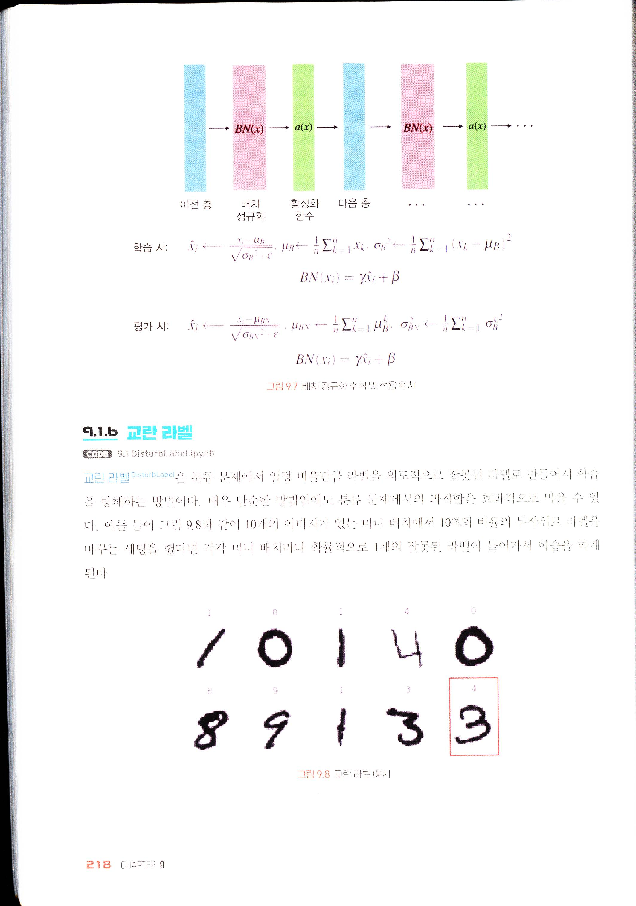

#### ■ 교란 라벨 정의하기

```python
class DisturbLabel(torch.nn.Module):
    def __init__(self, alpha, num_classes):
        super(DisturbLabel, self).__init__()
        self.alpha = alpha
        self.C = num_classes
        self.p_c = (1 - ((self.C - 1) / self.C) * (alpha / 100))
        self.p_i = (1 - self.p_c) / (self.C - 1)
```

- ❶ DisturbLabel 클래스를 만든다.
- ❷ 교란 라벨 비율(0 ~ 100)과 클래스 수를 받는다.
- ❻, ❼ 실제 라벨을 뽑을 확률을 self.p_c로 부여하고 나머지는 self.p_i값을 부여한다. 예를 들어, 클래스 수가 10개이고 교란 라벨 비율이 30%라면 self.p_c=73/100, self.p_i=3/100이 되고, 실제 라벨이 5라면 뽑힐 확률 분포는 (3/100, 3/100, 3/100, 3/100, 3/100, 73/100, 3/100, 3/100, 3/100, 3/100)이 된다.

```python
    def forward(self, y):
        y_tensor = y.type(torch.LongTensor).view(-1, 1)
        depth = self.C
        y_one_hot = torch.ones(y_tensor.size()[0], depth) * self.p_i
        y_one_hot.scatter_(1, y_tensor, self.p_c)
        y_one_hot = y_one_hot.view(*(tuple(y.shape) + (-1,)))
        distribution = torch.distributions.OneHotCategorical(y_one_hot)
        y_disturbed = distribution.sample()
        y_disturbed = y_disturbed.max(dim=1)[1]
        return y_disturbed
```

- ❾ ~ ⓬ 앞서 언급한 라벨이 뽑힐 확률 분포 (3/100, 3/100, 3/100, 3/100, 3/100, 73/100, 3/100, 3/100, 3/100, 3/100)를 만들어준다.
- ⓭ ~ ⓯ 해당 확률을 이용해 Multinoully 분포를 통해 샘플을 뽑는다.
- ⓰ 10개의 원소 중 가장 큰 값의 라벨을 뽑는다. 확률 분포를 이용해 교란 라벨을 만들기 때문에 비율이 30%라고 해서 반드시 미니 배치의 30%가 교란 라벨이 아닐 수 있다.

#### ■ 교란 라벨 선언 및 적용하기

```python
disturblabels = DisturbLabel(alpha=30, num_classes=10)
```

- ❶ 학습 전 DisturbLabel을 선언한다.

```python
for epoch in range(50):
    running_loss = 0.0
    for data in trainloader:
        inputs, labels = data[0].to(device), data[1].to(device)
        optimizer.zero_grad()
        outputs = resnet(inputs)
        labels = disturblabels(labels).to(device)
        loss = criterion(outputs, labels)
        .... 이하 생략 ....
```

- ❼ 손실 함수 계산 이전에 교란 라벨을 생성하여 거짓 라벨과 함께 손실 함수를 계산하게 한다.

### 9.1.7 교란 값
`CODE 9.1 DisturbValue.ipynb`

<그림 9.9 교란 값 예시>
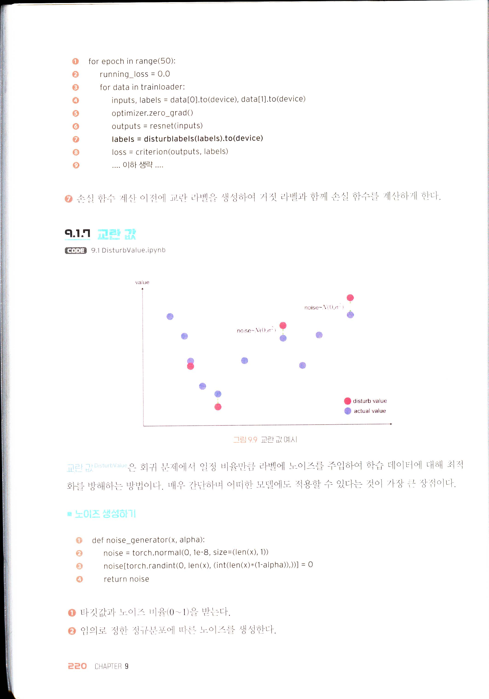

교란 값<sup>DisturbValue</sup>은 회귀 문제에서 일정 비율만큼 라벨에 노이즈를 주입하여 학습 데이터에 대해 최적화를 방해하는 방법이다. 매우 간단하며 어떠한 모델에도 적용할 수 있다는 것이 가장 큰 장점이다.

#### ■ 노이즈 생성하기

```python
def noise_generator(x, alpha):
    noise = torch.normal(0, 1e-8, size=(len(x), 1))
    noise[torch.randint(0, len(x), (int(len(x)*(1-alpha)),))] = 0
    return noise
```

- ❶ 타깃값과 노이즈 비율(0 ~ 1)을 받는다.
- ❷ 임의로 정한 정규분포에 따른 노이즈를 생성한다.

- ❸ 노이즈 타깃이 아닌 값은 노이즈를 0으로 한다.

#### ■ 교란 값 선언 및 적용하기

```python
for epoch in range(400):
    for data in trainloader:
        inputs, values = data
        optimizer.zero_grad()
        outputs = model(inputs)
        values = values + noise_generator(values, alpha)
        loss = criterion(outputs, values)
    .... 이하 생략 ....
```

### 9.1.8 라벨 스무딩
`CODE 9.1 Label Smoothing.ipynb`

분류 문제에서 사용하는 원-핫 벡터를 생각해 보면 (1, 0, 0)과 같이 0과 1로 구성되어 있고 우리는 소프트맥스나 시그모이드 함수를 통해 0과 1 사이의 예측값을 출력한다. 이때 교차 엔트로피 손실 함수를 계산할 때 실제 값을 0과 1이 아닌, 예를 들어 0.1과 0.8로 구성해서 과적합을 방지하는 기술이 라벨 스무딩<sup>Label Smoothing</sup>이다. 직관적으로 말하자면 0과 1을 맞춰야 하는 문제에서 예측값이 0.7이 나왔다면 원래 1을 맞추기 위해 1에 가까워지도록 학습이 될 것이다. 이때 기준을 0.8로 낮추면서 0.7만 나와도 이 정도면 맞았다고 모델이 스스로를 인정하면서 실제값에 가깝게 가려고 하지 않고 정답을 맞히게 되어 과적합을 막아주는 개념이다. 그림 9.10은 라벨 스무딩의 공식과 예시다. 예를 들어 클래스가 3개인 분류 문제에서는 라벨값이 0, 1, 2이고 원-핫 벡터로 표현할 때에는 (1, 0, 0), (0, 1, 0), (0, 0, 1)이 된다. 이때, 스무딩 비율이 0.1이면 위 공식에 의해 모든 실제 타깃은 1은 0.93으로 0은 0.03으로 변화하여 0과 1 사이의 차이를 0.93과 0.3으로 줄인다.

$$y_{ls} = (1 - \alpha) y + \frac{\alpha}{K}$$
($K$는 클래스 수, $\alpha$는 스무딩 비율, $y$는 0 또는 1)

$$\alpha = 0.1, K = 3 \quad y_{ls} = 0.9y + 0.03 \quad (1, 0, 0) \rightarrow (0.93, 0.03, 0.03)$$
$$\alpha = 0.3, K = 5 \quad y_{ls} = 0.7y + 0.06 \quad (0, 0, 1, 0, 0) \rightarrow (0.06, 0.06, 0.76, 0.06, 0.06)$$

<그림 9.10 라벨 스무딩 연산>
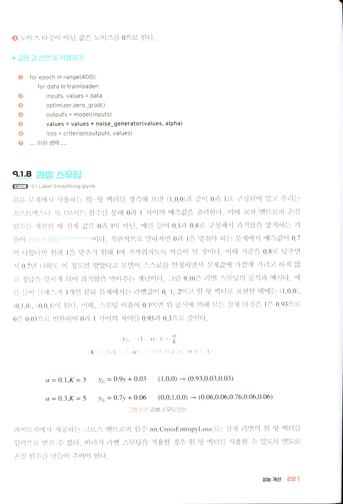

파이토치에서 제공하는 크로스 엔트로피 함수 nn.CrossEntropyLoss()는 실제 라벨의 원-핫 벡터를 입력으로 받을 수 없다. 따라서 라벨 스무딩을 적용할 경우 원-핫 벡터를 사용할 수 있도록 별도로 손실 함수를 만들어 주어야 한다.

#### ■ 라벨 스무딩 정의 및 선언하기

```python
class LabelSmoothingLoss(nn.Module):
    def __init__(self, classes, smoothing=0.0, dim=-1):
        super(LabelSmoothingLoss, self).__init__()
        self.confidence = 1.0 - smoothing
        self.smoothing = smoothing
        self.cls = classes
        self.dim = dim

    def forward(self, pred, target):
        pred = pred.log_softmax(dim=self.dim)
        with torch.no_grad():
            true_dist = torch.zeros_like(pred)
            true_dist.fill_(self.smoothing / (self.cls - 1))
            true_dist.scatter_(1, target.data.unsqueeze(1), self.confidence)
        return torch.mean(torch.sum(-true_dist * pred, dim=self.dim))
```

- ❿ Cross Entropy 부분의 log softmax를 미리 계산한다.
- ⓬ 예측값과 동일한 크기의 영텐서를 만든다.
- ⓭ alpha/(K-1)을 만들어 준다(그림 9.10과 같이 alpha/K도 가능).
- ⓮ (1-alpha)y + alpha/(K-1)을 수행한다.
- ⓯ ❿행에서 만든 pred를 함께 사용해 Cross Entropy Loss 함수를 계산한다.

```python
criterion = LabelSmoothingLoss(classes=10, smoothing=0.2)
```

- ❶ 만약 Cifar10 데이터를 이용하는 경우, 클래스는 10개로 지정하고 적절한 스무딩 비율을 넣어 nn.CrossEntropyLoss() 대신 LabelSmoothingLoss로 criterion을 선언한다.

# 9.2 데이터 불균형

데이터 불균형<sup>Data imbalance</sup>이란 데이터 세트 내의 클래스의 분포가 불균형한 것을 의미한다. 불균형은 특정 클래스에 과적합을 야기할 수 있다.

<그림 9.11 데이터 균형과 불균형>
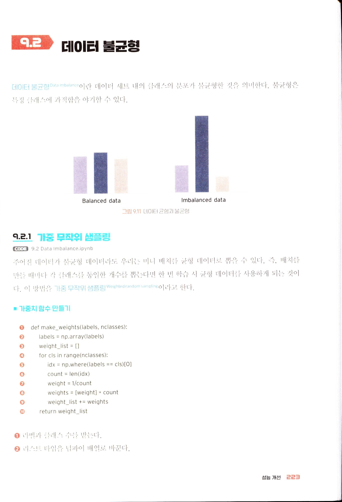

### 9.2.1 가중 무작위 샘플링
`CODE 9.2 Data Imbalance.ipynb`

주어진 데이터가 불균형 데이터라도 우리는 미니 배치를 균형 데이터로 뽑을 수 있다. 즉, 배치를 만들 때마다 각 클래스를 동일한 개수를 뽑는다면 한 번 학습 시 균형 데이터를 사용하게 되는 것이다. 이 방법을 가중 무작위 샘플링<sup>Weighted random sampling</sup>이라고 한다.

#### ■ 가중치 함수 만들기

```python
def make_weights(labels, nclasses):
    labels = np.array(labels)
    weight_list = []
    for cls in range(nclasses):
        idx = np.where(labels == cls)[0]
        count = len(idx)
        weight = 1/count
        weights = [weight] * count
        weight_list += weights
    return weight_list
```

- ❶ 라벨과 클래스 수를 받는다.
- ❷ 리스트 타입을 넘파이 배열로 바꾼다.

- ❹ ~ ❻ 각 클래스마다 라벨의 개수를 센다.
- ❼, ❽ 라벨이 뽑힐 가중치를 1/count로 동일하게 해당 라벨 전체에 할당한다.
- ❾ 데이터를 불러올 때 ImageFolder을 사용할 경우 라벨이 0부터 N까지 차례대로 나열이 되어있기 때문에 각 클래스의 가중치를 일렬로 이어준다.

#### ■ 이미지 데이터 불러오기
이번 예시에서 불러올 데이터는 클래스가 2개인 이미지 데이터다(각각 14, 4개).

```python
transf = tr.Compose([tr.Resize((16,16)),tr.ToTensor()])
trainset = torchvision.datasets.ImageFolder(root='./class', transform=transf)
```

#### ■ 가중치 생성하기

```python
weights = make_weights(trainset.targets, len(trainset.classes))
weights = torch.DoubleTensor(weights)
print(weights)
```

- ❶ ~ ❷ 가중치를 생성 후 텐서로 변환한다.

```
Output:
tensor([0.2500, 0.2500, 0.2500, 0.2500, 0.0714, 0.0714, 0.0714, 0.0714, 0.0714,
        0.0714, 0.0714, 0.0714, 0.0714, 0.0714, 0.0714, 0.0714, 0.0714],
       dtype=torch.float64)
```

가중치 텐서를 보면 모든 데이터에 대한 각각의 가중치가 있음을 알 수 있다. 또한 각 클래스의 가중치의 합이 1로 같다. 즉, 하나의 클래스를 뽑을 확률이 같다는 의미다(파이토치에서는 weights의 전체 합이 1일 필요는 없다).

#### ■ 데이터로더 생성하기

```python
sampler = torch.utils.data.sampler.WeightedRandomSampler(weights, len(weights))
trainloader_wrs = DataLoader(trainset, batch_size=6, sampler=sampler)
trainloader_rs = DataLoader(trainset, batch_size=6, shuffle=True)
```

- ❶ 파이토치에서 제공하는 WeightedRandomSampler를 사용하여 배치를 불러올 때 자동으로 클래스에 대한 균일 분포를 갖는 배치를 만들 수 있다.
- ❷ DataLoader에 sampler를 추가하여 데이터 준비를 완료한다.

- ❸ 가중 무작위 샘플링과 무작위 샘플링의 비교를 위해 무작위 샘플링을 하는 DataLoader를 추가적으로 만든다.

#### ■ 가중 무작위 샘플링 vs 무작위 샘플링
배치 사이즈를 6개로 한 경우 2개의 클래스가 각각 3개로 들어오는 것이 이상적일 것이다. 하지만 확률적으로 데이터를 뽑기 때문에 반드시 3개씩 뽑히지 않을 수 있지만, 무작위 샘플링 보다는 균형 잡힌 데이터가 만들어진다.

```python
for epoch in range(5):
    for data in trainloader_wrs:
        print(data[1])
```

```
Output:
tensor([0, 1, 1, 0, 1, 0])
tensor([1, 0, 1, 0, 1, 0])
tensor([0, 1, 0, 1, 0, 1])
... 중략 ...
tensor([1, 1, 0, 0, 0, 1])
tensor([1, 0, 0, 0, 0, 0])
tensor([1, 0, 1, 1, 1, 1])
```

현재 데이터는 클래스 1이 클래스 0보다 3.5배 많다. 따라서 다음과 같이 무작위로 뽑았을 경우 클래스 1이 배치 전체를 차지하고 있는 것을 알 수 있다.

```python
for epoch in range(5):
    for data in trainloader_rs:
        print(data[1])
```

```
Output:
tensor([0, 0, 1, 1, 1, 1])
tensor([1, 1, 1, 1, 1, 1])
tensor([0, 1, 1, 1, 1, 0])
... 중략 ...
tensor([1, 1, 1, 1, 1, 1])
tensor([0, 1, 1, 0, 1, 1])
tensor([0, 0, 1, 1, 1, 1])
```

### 9.2.2 가중 손실 함수
`CODE 9.2 Data Imbalance.ipynb`

파이토치의 nn.CrossEntropyLoss는 가중 손실 함수를 제공한다. 따라서 미리 정의된 weight를 입력하면 쉽게 구현이 가능하다.

```python
device = torch.device("cuda:0" if torch.cuda.is_available() else "cpu")
num_ins = [40,45,30,62,70,153,395,46,75,194]
weights = [1-(x/sum(num_ins)) for x in num_ins]
class_weights = torch.FloatTensor(weights).to(device)
criterion = nn.CrossEntropyLoss(weight=class_weights)
```

- ❷ 예를 들어 10개의 클래스 별 이미지 개수를 알고 있다고 하자. 가중 손실 함수는 데이터가 적은 클래스에 대해서 큰 가중치를 부여함으로써 업데이트 균형을 맞추려는 의도를 가지고 있다.
- ❸ 이 예시에서는 각 클래스의 확률 x/sum(num_ins)을 구한 뒤 1에서 뺀 값을 가중치로 사용한다.
- ❹, ❺ 다음 텐서로 변환된 가중치를 nn.CrossEntropyLoss에 넣어준다.

### 9.2.3 혼동 행렬
`CODE 9.2 Data Imbalance.ipynb`

혼동 행렬<sup>Confusion matrix</sup>은 데이터 불균형의 직접적인 해결책은 될 수 없지만 결과를 행렬화하여 각 클래스의 분포와 정확도를 확인하여 불균형 데이터로 예측 쏠림 현상을 인지할 수 있으며 다양한 결과 해석에서 사용된다.

```python
from sklearn.metrics import confusion_matrix
import seaborn as sns
import matplotlib.pyplot as plt
actual = [1,1,1,0,0,0,0,0,2,2,2,2,2,2,2,2]
prediction = [1,2,2,0,2,2,1,2,0,1,0,2,2,2,2,2]
c_mat = confusion_matrix(actual, prediction)
plt.figure(figsize = (8,6))
sns.heatmap(c_mat, annot=True, fmt="d", cmap='Blues',linewidths=.5)
b, t = plt.ylim()
b += 0.5
t -= 0.5
plt.ylim(b, t)
plt.savefig('confusion_matrix.png')
plt.show()
```

- ❶ ~ ❸ 관련 라이브러리를 불러온다.

- ❹, ❺ 실제값과 예측값을 알고 있다고 가정하자.
- ❻ ~ ⑭ 혼동 행렬 틀을 만들어 플로팅을 한다.
- ❾ ~ ⓬ 이때 그냥 plt.ylim()을 사용할 경우 버전에 따라 위 아래가 잘려서 그래프가 출력될 수 있다. 따라서 위 아래 범위를 0.5씩 더 확보한다.

결과를 확인하면 클래스0, 1이 클래스2로 많이 예측됐다는 것을 확인할 수 있다. 즉, 모델 변수가 데이터가 가장 많은 클래스2로 치우쳐 있다는 의미로 해석할 수 있다.

<그림 9.12 클래스가 3개인 혼동 행렬>
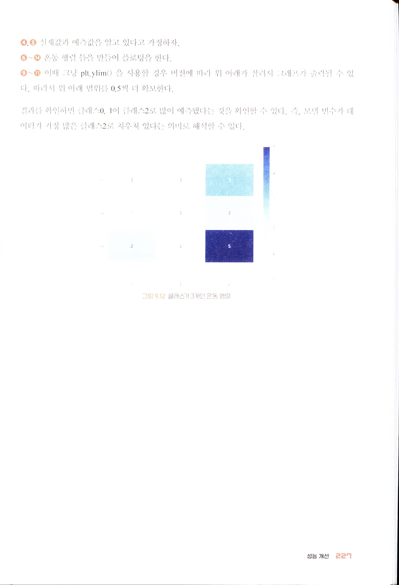

# 9.3 전이 학습

전이 학습<sup>Transfer learning</sup>이란 기존의 지식을 우리가 풀고자 하는 문제에 적용하여 학습하는 방법을 의미한다. 즉, 다른 데이터를 가지고 와서 사용하는 것과 다른 업무에서 학습된 모델을 적용하는 것 모두 전이 학습에 속하며 다양한 방법들이 존재한다. 이렇듯 우리가 다루는 문제에 대한 데이터나 지식의 부족을 사전 지식을 통해 해결할 수 있으며 인공지능 분야에서 매우 중요한 연구 중 하나다.

### 9.3.1 사전 학습 모델
`CODE 9.3 Transfer Learning.ipynb`

6.4절에서 언급했듯이 torchvision.models as models을 이용해 ImageNet 데이터로 학습된 사전 학습 모델<sup>pretrained model</sup>을 쉽게 사용할 수 있다. 또한 5.6절에서 배운 내용을 바탕으로 모델 내부의 변수명을 확인하고 모델 일부를 수정할 수 있다.

```python
import torchvision.models as models
alexnet = models.alexnet().to(device)
resnet18 = models.resnet18().to(device)
vgg16 = models.vgg16().to(device)
densenet = models.densenet161().to(device)
inception = models.inception_v3().to(device)
googlenet = models.googlenet().to(device)
shufflenet = models.shufflenet_v2_x1_0().to(device)
mobilenet_v2 = models.mobilenet_v2().to(device)
resnext50_32x4d = models.resnext50_32x4d().to(device)
wide_resnet50_2 = models.wide_resnet50_2().to(device)
mnasnet = models.mnasnet1_0().to(device)
```

#### ■ CIFAR10을 위한 ResNet18 불러오기

```python
model = torchvision.models.resnet18(pretrained=True)
model.conv1 = nn.Conv2d(3, 64, kernel_size=3, stride=1, padding=1)
num_ftrs = model.fc.in_features
model.fc = nn.Linear(num_ftrs, 10)
model = model.to(device)
```

- ❷ 불러온 모델은 사이즈가 CIFAR10보다 큰 ImageNet 데이터에 맞춰진 모델이다. 따라서 원래 첫 번째 합성곱 층의 필터 사이즈가 7×7인데 CIFAR10 데이터에는 큰 사이즈다. 따라서 3×3 필터로 변경한다.
- ❸, ❹ 원래 모델의 마지막 출력 노드가 1000이기 때문에 우리 데이터에 맞춰 10개로 변경해야 한다.

### 9.3.2 모델 프리징
`CODE 9.3 Model Freezing.ipynb`

모델 프리징<sup>Model freezing</sup>은 기존의 일부 모델 변수들을 그대로 사용하기 위해 업데이트가 되지 않도록 하는 방법이다. 따라서 사전 학습된 변수를 그대로 유지할 수 있어 학습 속도와 정확도를 향상시킬 수 있고, 다른 모델과 붙여 다른 구조를 만들 수도 있다. CNN에서는 피처 추출 부분은 프리징을 시키고 분류 파트만 학습을 진행하기도 한다. 하지만 모델을 튜닝하고 프리징하는데 정답은 없으므로 다양한 시도가 중요하다.

#### ■ 모델 불러오기

```python
model = torchvision.models.alexnet(pretrained=True)
num_ftrs = model.classifier[6].in_features
model.classifier[6] = nn.Linear(num_ftrs, 10)
model = model.to(device)
```

- ❶ ~ ❸ 모델을 불러온 후 출력 레이어의 노드를 클래스 수와 맞춰준다.

#### ■ 모델 파라미터명 확인하기

```python
for i, (name, param) in enumerate(model.named_parameters()):
    print(i,name)
```

```
Output:
0 features.0.weight
1 features.0.bias
2 features.3.weight
.... 중략 ....
10 classifier.1.weight
11 classifier.1.bias
.... 이하 생략 ....
```

- ❶ model.named_parameters()를 이용하여 가중치와 편향 목록을 출력할 수 있다.
- ❷ 리스트의 차례를 알 수 있도록 i와 같이 출력한다. 출력 결과를 보면 0~9번째는 합성곱 층에 대한 가중치와 편향이고 10번 이후는 분류기의 가중치와 편향임을 알 수 있다.

#### ■ 변수 프리징하기

```python
for i, (name, param) in enumerate(model.named_parameters()):
    param.requires_grad = False
    if i == 9:
        print('end')
        break
```

```
Output: end
```

- ❷ 파라미터의 requires_grad를 False로 하여 학습 시 업데이트가 되지 않게 한다.
- ❸ ~ ❺ if문을 통해 합성곱 층에 대한 가중치와 편향(9번까지)만 프리징이 되면 for문을 멈춘다.

#### ■ Requires_grad 확인하기

```python
f_list = [0, 3, 6, 8, 10]
c_list = [1, 4, 6]
for i in f_list:
    print(model.features[i].weight.requires_grad)
    print(model.features[i].bias.requires_grad)
for j in c_list:
    print(model.classifier[j].weight.requires_grad)
    print(model.classifier[j].bias.requires_grad)
```

```
Output:
False
False
False
False
.... 중략 ....
True
True
True
```

# 9.4 준지도 학습

지도 학습이 정답이 있는 데이터를 사용하여 모델을 학습했다면, 준지도 학습<sup>Semi-supervised learning</sup>은 정답이 있는 데이터와 정답이 없는 데이터를 함께 사용하여 모델을 학습시키는 방법으로써 더 많은 데이터를 확보하여 성능 향상에 도움을 줄 수 있다.

### 9.4.1 의사 라벨링
`CODE 9.4 Semi-supervised Learning.ipynb`

의사 라벨링<sup>Pseudo labeling</sup>은 준지도 학습 중 가장 기본적으로 사용되는 방법이다. 우리가 라벨이 없는 데이터를 지도 학습에 사용하려면 라벨을 달아 주어야 한다. 따라서 이미 학습된 모델을 이용하여 라벨링이 되지 않은 데이터를 예측한 후, 그 예측값을 기준으로 라벨링을 하여 기존의 학습 데이터와 함께 학습에 사용하는 방법이 의사 라벨링이다. 여기서 주의할 점은 예측값을 라벨로 이용하기 때문에 라벨에 대한 불확실성이 존재한다. 따라서 무분별한 사용은 자제해야 하며, 다양한 형태로 모델을 구현할 수 있다. 우리는 2가지 의사 라벨링 방법을 정의하여 성능 향상을 달성한다.

#### ■ 라이브러리 불러오기

```python
import torch
import torchvision
import torchvision.transforms as transforms
from torch.utils.data import DataLoader, Dataset
import numpy as np
import torch.nn as nn
import torch.optim as optim
from tqdm import tqdm
```

- ❶ ~ ❼ 넘파이 및 파이토치 라이브러리를 불러온다.
- ❽ for문의 진행 상황을 알려주는 라이브러리다.

#### ■ GPU 연산 정의

```python
device = torch.device("cuda:0" if torch.cuda.is_available() else "cpu")
print(device)
```

```
Output: cuda:0
```

#### ■ 데이터 세트 정의하기

```python
class MyDataset(Dataset):
    def __init__(self, x_data, y_data, transform=None):
        self.x_data = x_data
        self.y_data = y_data
        self.transform = transform
        self.len = len(y_data)

    def __getitem__(self, index):
        sample = self.x_data[index], self.y_data[index]
        if self.transform:
            sample = self.transform(sample)
        return sample

    def __len__(self):
        return self.len
```

- ❶ ~ ⓯ 4.3절에서 배운 내용을 바탕으로 데이터 세트 클래스를 정의한다.

#### ■ 데이터 전처리 정의하기

```python
class TrainTransform:
    def __call__(self, sample):
        inputs, labels = sample
        transf = transforms.Compose([transforms.ToPILImage(),
                 transforms.RandomHorizontalFlip(), transforms.ToTensor()])
        final_output = transf(inputs)
        return final_output, labels
```

- ❶ ~ ❼ 4.3절에서 배운 내용을 바탕으로 학습 데이터에 대한 전처리를 정의한다.

#### ■ 데이터 세트 나누기
실험을 위해 각 클래스의 이미지 개수가 같도록 데이터를 나눈다.

```python
def balanced_subset(data, labels, num_cls, num_data): # numpy
    num_data_per_class = num_data // num_cls
    data1 = torch.tensor([],dtype=torch.float)
    data2 = torch.tensor([],dtype=torch.float)
    labels1 = torch.tensor([],dtype=torch.long)
    labels2 = torch.tensor([],dtype=torch.long)
    for cls in range(num_cls):
        idx = np.where(labels.numpy() == cls)[0]
        shuffled_idx = np.random.choice(len(idx), len(idx), replace=False)
        data1 = torch.cat([data1, data[shuffled_idx[:num_data_per_class]]], dim=0)
        data2 = torch.cat([data2, data[shuffled_idx[num_data_per_class:]]], dim=0)
        labels1 = torch.cat([labels1, labels[shuffled_idx[:num_data_per_class]]], dim=0)
        labels2 = torch.cat([labels2, labels[shuffled_idx[num_data_per_class:]]], dim=0)
    return data1, data2, labels1, labels2
```

- ❶ 데이터, 라벨, 클래스 수, 나눠지는 목표 데이터 개수를 받는다.
- ❷ 각 클래스의 데이터 개수를 정의한다.
- ❸ ~ ❻ 나눠지는 두 개의 세트를 저장하기 위해 데이터와 라벨 텐서를 각각 2개씩 정의한다.
- ❼ ~ ⓮ 각 클래스마다 정의된 데이터 개수만큼 무작위로 뽑아 저장한다.
- ❽ 이때 np.where를 사용하기 위해 labels 텐서를 넘파이 배열로 바꿔 사용한다.

#### ■ 데이터 불러오기

```python
trainset = torchvision.datasets.MNIST(root='./data', train=True, download=True)
labeled_data, unlabeled_data, labels, unlabels = balanced_subset(trainset.data,
trainset.targets, num_cls=10, num_data=2000)
train_images, val_images, train_labels, val_labels = balanced_subset(labeled_data, labels,
num_cls=10, num_data=1000)
```

- ❶ 숫자 판별 MNIST 데이터를 불러온다.
- ❷, ❸ 이번 실험에서는 라벨링된 데이터가 2000개만 있다고 가정하고 학습 데이터, 검증 데이터를 각각 1000개씩 사용하며 나머지 데이터는 라벨링이 안 된 데이터라고 가정한다.

#### ■ 데이터로더 정의하기

```python
train_images = train_images.unsqueeze(1)
val_images = val_images.unsqueeze(1)
trainset = MyDataset(train_images, train_labels, transform=TrainTransform())
trainloader = torch.utils.data.DataLoader(trainset, batch_size=128, shuffle=True)
validationset = MyDataset(val_images, val_labels)
valloader = torch.utils.data.DataLoader(validationset, batch_size=128, shuffle=False)
unlabeled_images = unlabeled_data.unsqueeze(1)
unlabeledset = MyDataset(unlabeled_images, unlabels)
unlabeledloader = torch.utils.data.DataLoader(unlabeledset, batch_size=256, shuffle=True)
```

- ❶, ❷, ❼ CNN은 4차원 입력 이미지가 필요하다. 하지만 1채널인 MNIST 데이터는 (배치사이즈, 이미지 너비, 이미지 높이) 형태인 3차원으로 되어 있기 때문에 unsqueeze(1)를 통해 3차원 텐서를 4차원 텐서 (배치사이즈, 1, 이미지 너비, 이미지 높이)로 변환한다.
- ❸ 학습 데이터에는 TrainTransform()을 적용하고 ❺, ❽ 나머지 세트에 대해서는 적용하지 않는다.

```python
transform = transforms.Compose([transforms.ToTensor()])
testset = torchvision.datasets.MNIST(root='./data', train=False, download=True,
transform=transform)
testloader = torch.utils.data.DataLoader(testset, batch_size=100,shuffle=False)
```

- ❿ ~ ⓬ 평가 데이터를 불러온다.

#### ■ 모델 정의하기

```python
class Net(nn.Module):
    def __init__(self):
        super(Net, self).__init__()
        self.features = nn.Sequential(
            nn.Conv2d(1, 64, 3), nn.ReLU(),
            nn.MaxPool2d(2, 2),
            nn.Conv2d(64, 192, 3, padding=1), nn.ReLU(),
            nn.MaxPool2d(2, 2))
        self.classifier = nn.Sequential(
            nn.Dropout(0.5),
            nn.Linear(192*6*6, 1024), nn.ReLU(),
            nn.Dropout(0.5),
            nn.Linear(1024, 512), nn.ReLU(),
            nn.Linear(512, 10))
    def forward(self, x):
        x = self.features(x)
        x = x.view(-1, 192*6*6)
        x = self.classifier(x)
        return x

model = Net().to(device)
```

- ❶ ~ ⓳ 임의의 모델을 정의한다.

#### ■ 손실 함수 및 최적화 기법 정의하기

```python
criterion = nn.CrossEntropyLoss()
optimizer = optim.Adam(model.parameters(), lr=1e-3)
```

#### ■ 정확도 평가 함수 정의하기

```python
def accuracy(dataloader):
    correct = 0
    total = 0
    with torch.no_grad():
        model.eval()
        for data in dataloader:
            images, labels = data[0].to(device), data[1].to(device)
            outputs = model(images)
            _, predicted = torch.max(outputs.data, 1)
            total += labels.size(0)
            correct += (predicted == labels).sum().item()
    acc = 100*correct/total
    model.train()
    return acc
```

#### ■ 지도 학습 수행하기
기준 성능을 알아보기 위해 1000개의 라벨링된 데이터로만 학습을 진행한다.

```python
best_acc = 0
for epoch in range(501):
    correct = 0
    total = 0
    for traindata in trainloader:
        inputs, labels = traindata[0].to(device), traindata[1].to(device)
        optimizer.zero_grad()
        outputs = model(inputs)
        loss = criterion(outputs, labels)
        loss.backward()
        optimizer.step()
        _, predicted = torch.max(outputs.detach(), 1)
        total += labels.size(0)
        correct += (predicted == labels).sum().item()
```

- ❶ 검증 정확도를 기준으로 모델을 저장하기 위해 변수를 선언한다.
- ❷ ~ ⓮ 학습 데이터를 이용해 학습을 하고 학습 정확도를 계산한다.

```python
    val_acc = accuracy(valloader)
    if val_acc >= best_acc:
        best_acc = val_acc
        torch.save(model.state_dict(), './models/cifar_model_for_pseudo_baseline.pth')
        print('[%d] train acc: %.2f, validation acc: %.2f - Saved the best model' %(epoch,
        100*correct/total, val_acc))
    elif epoch % 10 == 0:
        print('[%d] train acc: %.2f, validation acc: %.2f' %(epoch, 100*correct/total, val_acc))
```

- ⓯ ~ ⓳ 검증 정확도를 계산하여 가장 높은 검증 정확도를 기준으로 모델 파라미터를 저장한다.
- ⓴ ~ ⓴ 학습 상황을 알 수 있도록 epoch 10마다 학습 정확도와 검증 정확도를 출력한다.

```
Output:
[0] train acc: 13.90, validation acc: 14.50 - Saved the best model
[1] train acc: 29.60, validation acc: 54.10 - Saved the best model
.... 중략 ....
[444] train acc: 100.00, validation acc: 78.40 - Saved the best model
.... 중략 ....
[500] train acc: 100.00, validation acc: 78.00
```

#### ■ 지도 학습 성능 평가하기

```python
model.load_state_dict(torch.load('./models/cifar_model_for_pseudo_baseline.pth'))
accuracy(testloader)
```

```
Output: 73.8
```

- ❶, ❷ 저장된 베스트 모델을 가지고 와서 평가 정확도를 측정한다. 이때 지도 학습의 정확도는 73.8%를 달성한다.

#### ■ 준지도 학습1을 위한 모델을 재정의하기

```python
model = Net().to(device)
criterion = nn.CrossEntropyLoss()
optimizer = optim.Adam(model.parameters(), lr=1e-3)
```

- ❶ ~ ❸ 모델 파라미터를 초기화하고 준지도 학습을 진행한다.

#### ■ 준지도 학습1 수행하기
의사 라벨링은 정확한 라벨과 부정확한 라벨이 섞여있다. 따라서 훈련 데이터와 동일하게 모델 최적화에 사용하게 된다면 오히려 좋지 않은 결과를 초래할 수 있다. 따라서 훈련 라벨과 의사 라벨을 구분하여 따로 손실 함수($L_t$와 $L_p$)를 계산한 뒤 둘을 더해 전체 손실 함수 $L(= L_t + \text{alpha} * L_p)$을 정의한다. 이때 의사 라벨을 이용하는 손실 함수 부분에 가중치 alpha를 주어 학습 개입을 조절할 수 있다. 즉, alpha=0이면 학습 데이터로만 모델을 최적화한다는 의미이고, alpha가 커질수록 의사 라벨의 영향도가 커진다는 의미다. 따라서 연구마다 영향도의 차이가 다를 수 있으니 적절한 alpha를 정의하는 것이 중요하다.

```python
alpha = 0
alpha_t = 1e-4
T1 = 100
T2 = 450
best_acc = 0
```

이 예시에서는 처음 ❸ epoch 100번째까지는 alpha=0으로 학습을 진행하고 ❹ 이후 epoch이 450이 될 때까지 일정하게 alpha를 높여 학습을 시행한다. 450회가 지나면 alpha를 ❷ alpha_t로 고정하여 학습을 진행하여 마무리 한다. 즉, alpha를 0부터 1e-4까지 점차 높여 학습을 진행하는 것이다.

```python
for epoch in range(501):
    correct = 0
    total = 0
    for traindata, pseudodata in zip(trainloader, unlabeledloader):
        inputs, labels = traindata[0].to(device), traindata[1].to(device)
        pinputs = pseudodata[0].to(device)
        optimizer.zero_grad()
        outputs = model(inputs)
        if alpha > 0:
            poutputs = model(pinputs)
            _, plabels = torch.max(poutputs.detach(), 1)
            loss = criterion(outputs, labels) + alpha*criterion(poutputs, plabels)
        else:
            loss = criterion(outputs, labels)
        loss.backward()
        optimizer.step()
        _, predicted = torch.max(outputs.detach(), 1)
        total += labels.size(0)
        correct += (predicted == labels).sum().item()
```

- ❾ zip을 이용하여 두 개의 데이터로더를 동시에 이용할 수 있다.
- ⓮ ~ ⓳ alpha=0이면 학습 데이터만 이용하여 손실 함수를 계산하고 ⓮ ~ ⑰ 0보다 크면 의사 라벨도 함께 이용하여 손실 함수를 계산한다. 첫 번째 의사 라벨 방법에서는 모델의 출력 벡터와 출력 벡터로 만든 예측 라벨과의 손실 함수를 계산하는 것이다. 예를 들어 (0.1, 0.6, 0.3)이라는 출력 벡터가 나왔다면 예측 라벨은 (0, 1, 0)이 되고 이 둘을 손실 함수에 넣어 계산을 하게 된다.
- ⓴ 다음으로는 조건에 맞는 손실 함수를 기준으로 모델을 최적화한다.
- ⓯ ~ ⓴ 학습 정확도 계산을 위해 정답 개수와 총 라벨 개수를 누적한다.

```python
    if (epoch > T1) and (epoch < T2):
        alpha = alpha_t*(epoch - T1)/(T2 - T1)
    elif epoch >= T2:
        alpha = alpha_t
    val_acc = accuracy(valloader)
    if val_acc >= best_acc:
        best_acc = val_acc
        torch.save(model.state_dict(), './models/cifar_model_for_pseudo_label.pth')
        print('[%d] train acc: %.2f, validation acc: %.2f - Saved the best model' %(epoch,
        100*correct/total, val_acc))
    elif epoch % 10 == 0:
        print('[%d] train acc: %.2f, validation acc: %.2f' %(epoch, 100*correct/total, val_acc))
```

- ⓯ ~ ⓴ 학습이 1회 완료되면 epoch을 확인하여 alpha를 업데이트 한다.
- ⓯ ~ ⓴ 검증 정확도를 계산하여 가장 높은 검증 정확도를 기준으로 모델 파라미터를 저장한다.
- ⓴ ~ ⓴ 학습 상황을 알 수 있도록 epoch 10마다 학습 정확도와 검증 정확도를 출력한다.

```
Output:
[0] train acc: 14.30, validation acc: 17.80 - Saved the best model
[1] train acc: 33.90, validation acc: 47.30 - Saved the best model
.... 중략 ....
[453] train acc: 100.00, validation acc: 80.20 - Saved the best model
.... 중략 ....
[500] train acc: 100.00, validation acc: 72.90
```

#### ■ 준지도 학습1 성능 평가하기
평가 정확도가 기준 대비 2.4% 증가한 76.2%이다(기준 73.8%).

```python
model.load_state_dict(torch.load('./models/cifar_model_for_pseudo_label.pth'))
accuracy(testloader)
```

```
Output: 76.2
```

#### ■ 준지도 학습2를 위한 모델을 재정의하기

```python
model = Net().to(device)
model.load_state_dict(torch.load('./models/cifar_model_for_pseudo_baseline.pth'))
criterion = nn.CrossEntropyLoss()
optimizer = optim.Adam(model.parameters(), lr=1e-3)
```

- ❷ 이번 방법에서는 학습 데이터로 학습된 사전 훈련 모델을 가지고 의사 라벨을 생성한 뒤 이를 실제 라벨처럼 사용해 본다.
- ❶, ❸, ❹ 손실 함수와 최적화 방법을 정의한다.

#### ■ 의사 라벨 생성하기

```python
pseudo_threshold = 0.99
pseudo_images = torch.tensor([], dtype=torch.float)
pseudo_labels = torch.tensor([], dtype=torch.long)
with torch.no_grad():
    for data in tqdm(unlabeledloader):
        model.eval()
        images = data[0].to(device)
        outputs = model(images)
        outputs = torch.nn.functional.softmax(outputs, dim=1)
        max_val, predicted = torch.max(outputs.detach(), 1)
        idx = np.where(max_val.cpu().numpy() >= pseudo_threshold)[0]
        if len(idx) > 0:
            pseudo_images = torch.cat((pseudo_images, images.cpu()[idx]), 0)
            pseudo_labels = torch.cat((pseudo_labels, predicted.cpu()[idx]), 0)
```

- ❶ 사전 학습 모델로 예측된 출력 벡터의 가장 큰 원소가 0.99가 넘으면 의사 라벨로 사용한다.
- ❷, ❸ 데이터를 모을 빈 텐서를 정의한다.
- ❾ 출력 벡터의 원소는 0과 1 사이의 값이 아닐 수 있다. 따라서 값을 0부터 1까지로 만들어 주기 위해 softmax 함수를 사용한다.
- ⓫, ⓬ 만약 현재 배치에 0.99 이상을 만족하는 데이터가 1개 이상 있다면 ⓭, ⓮ 그 데이터를 누적한다.

```
Output: 100%|██████████| 227/227 [00:07<00:00, 30.13it/s]
```

#### ■ 준지도 학습2를 위한 데이터로더 정의하기

```python
pseudo_dataset = MyDataset(pseudo_images, pseudo_labels)
pseudoloader = torch.utils.data.DataLoader(pseudo_dataset, batch_size=256, shuffle=True)
```

#### ■ 준지도 학습2 수행하기

```python
alpha = 0
alpha_t = 1e-4
T1 = 20
T2 = 450
best_acc = 0
```

- ❷ 의사 라벨링 개입에 대한 alpha를 정의한다.

```python
for epoch in range(501):
    correct = 0
    total = 0
    for traindata, pseudodata in zip(trainloader, pseudoloader):
        inputs, labels = traindata[0].to(device), traindata[1].to(device)
        pinputs, plabels = pseudodata[0].to(device), pseudodata[1].to(device)
        optimizer.zero_grad()
        outputs = model(inputs)
        poutputs = model(pinputs)
        loss = criterion(outputs, labels) + alpha*criterion(poutputs, plabels)
        loss.backward()
        optimizer.step()
        _, predicted = torch.max(outputs.detach(), 1)
        total += labels.size(0)
        correct += (predicted == labels).sum().item()
```

- ❹ zip을 이용하여 두 개의 데이터로더를 동시에 이용할 수 있다.
- ❺ 학습 데이터를 불러온다.
- ❻ 의사 라벨 데이터를 불러온다.
- ❽ ~ ❿ 모델을 통해 예측값을 산출하여 손실 함수를 계산한다.
- ⓭ ~ ⓯ 학습 정확도 계산을 위해 정답 개수와 총 라벨 개수를 누적한다.

```python
    if (epoch > T1) and (epoch < T2):
        alpha = alpha_t*(epoch - T1)/(T2 - T1)
    elif epoch >= T2:
        alpha = alpha_t
    val_acc = accuracy(valloader)
    if val_acc >= best_acc:
        best_acc = val_acc
        torch.save(model.state_dict(), './models/cifar_model_for_pseudo_label2.pth')
        print('[%d] train acc: %.2f, validation acc: %.2f - Saved the best model' %(epoch,
        100*correct/total, val_acc))
    elif epoch % 10 == 0:
        print('[%d] train acc: %.2f, validation acc: %.2f' %(epoch, 100*correct/total, val_acc))
```

- ⓰ ~ ⓳ 학습이 1회 완료되면 epoch을 확인하여 alpha를 업데이트 한다.
- ⓴ ~ ⓴ 검증 정확도를 계산하여 가장 높은 검증 정확도를 기준으로 모델 파라미터를 저장한다.
- ⓴, ⓴ 학습 상황을 알 수 있도록 epoch 10마다 학습 정확도와 검증 정확도를 출력한다.

```
Output:
[0] train acc: 87.80, validation acc: 66.60 - Saved the best model
[1] train acc: 96.50, validation acc: 73.30 - Saved the best model
.... 중략 ....
[302] train acc: 100.00, validation acc: 80.70 - Saved the best model
.... 중략 ....
[500] train acc: 100.00, validation acc: 78.40
```

#### ■ 준지도 학습2 성능 평가하기

```python
model.load_state_dict(torch.load('./models/cifar_model_for_pseudo_label2.pth'))
accuracy(testloader)
```

```
Output: 78.68
```

평가 정확도가 기준 대비 4.88% 증가한 78.68%이다(기준 73.8%).

> "미래 예측은 마술이 아닙니다. 인공지능입니다."
>
> — 데이브 워터스
