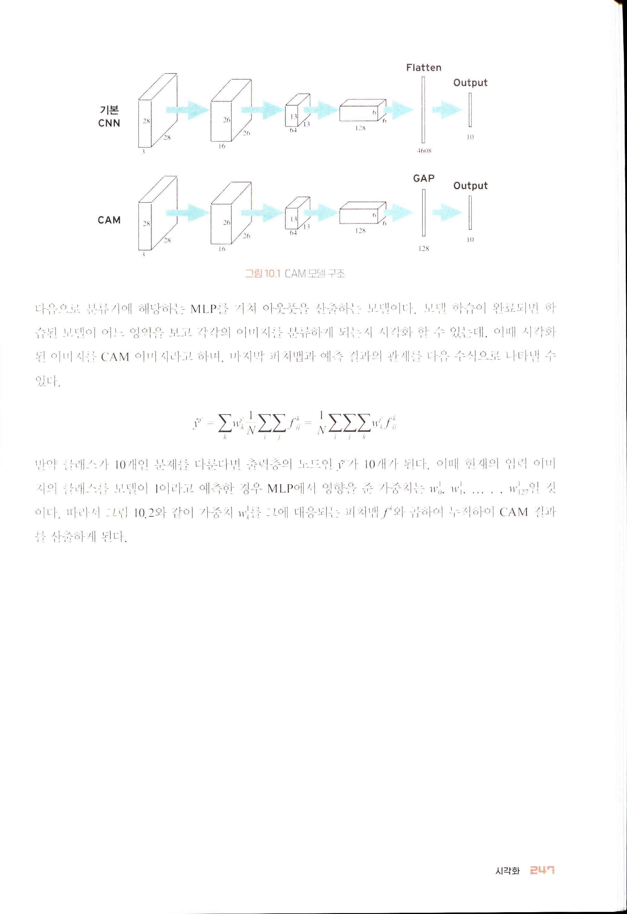
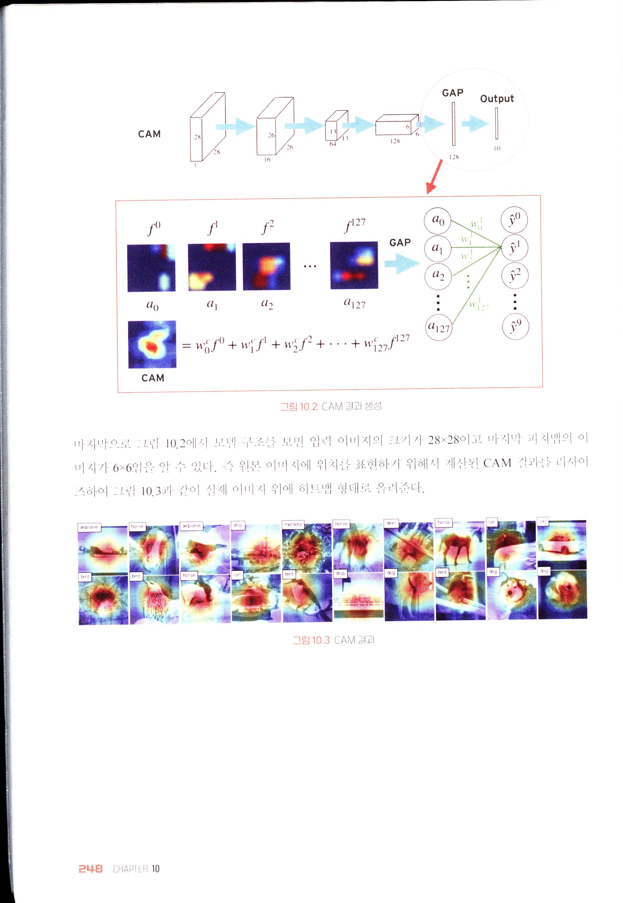
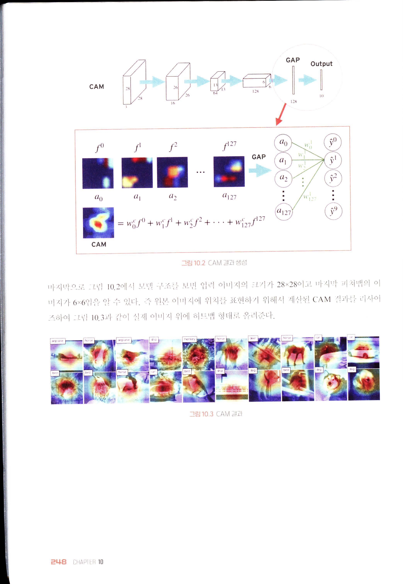
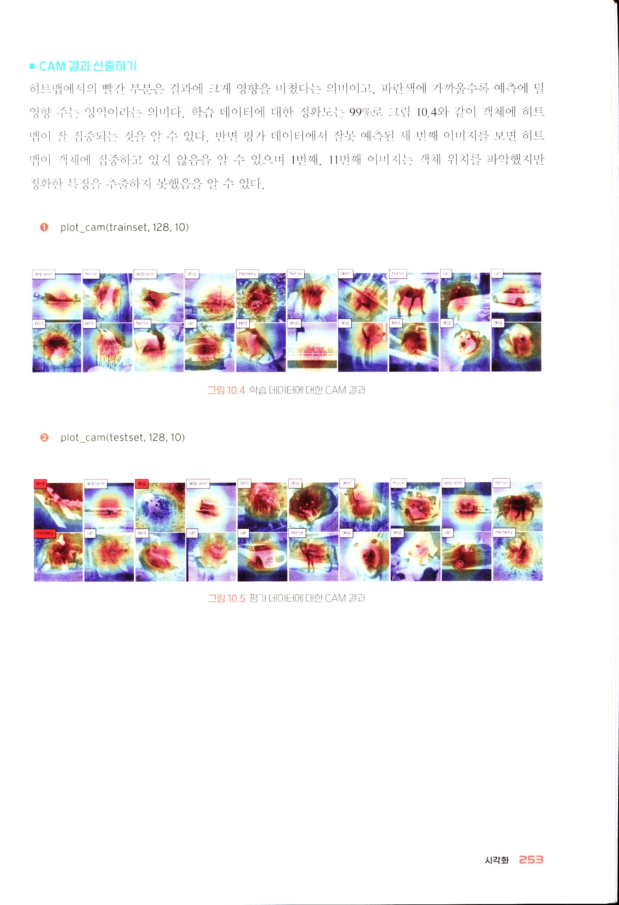
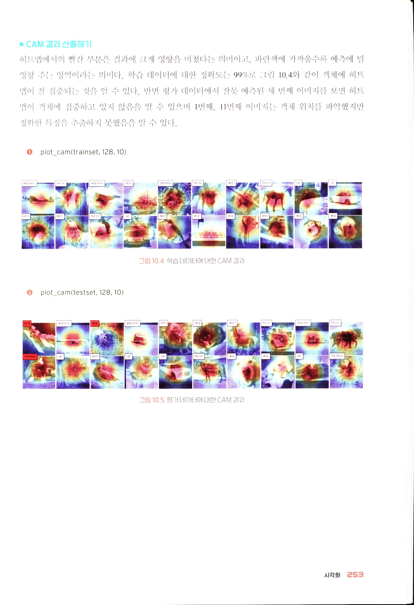
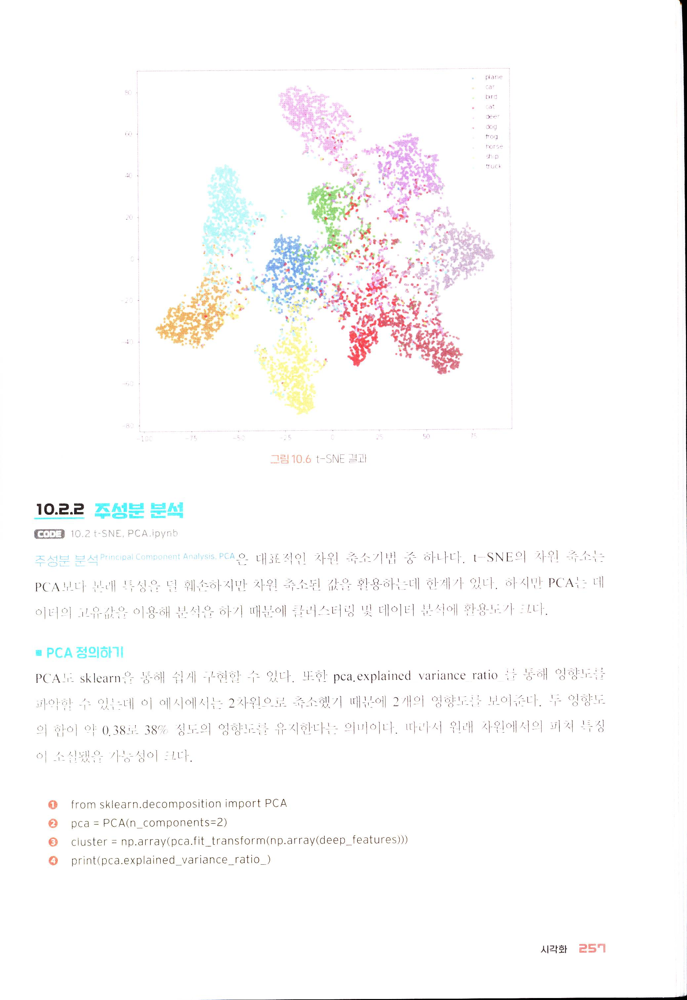
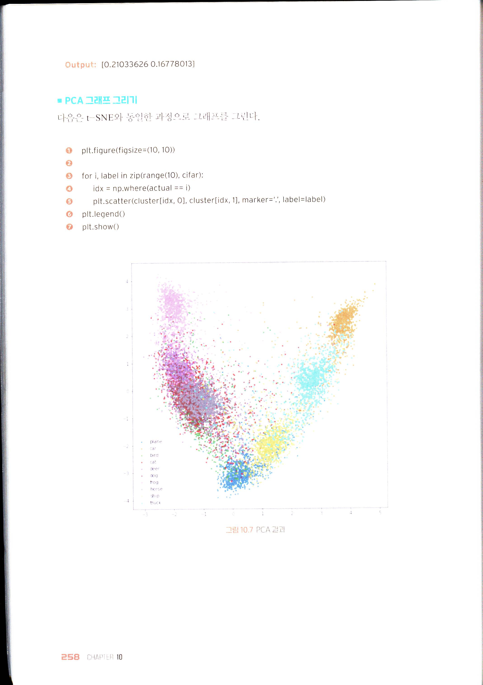

# 10 CHAPTER

## 시각화

시각화는 모델을 평가하고 결론을 해석하는데 필수적인 부분이다. 10장에서는 모델 자체를 설명하려는 설명 가능한 인공지능에 대해서 이야기하고 대표적인 모델인 CAM를 구현한다. 추가적으로 고차원 형태의 데이터를 시각화할 수 있도록 도와주는 차원 축소 기법에 대해서 알아본다.

- 설명 가능한 인공지능
- 차원 축소 기법

# 10.1 설명 가능한 인공지능

인공지능의 발전과 함께 다양한 기술들이 급속도로 발전하고 있다. 이에 따라 인공지능의 의사결정과 메커니즘을 이해하고 해석하는 일이 요구되고 있지만 기계 학습에 대한 해석은 매우 어렵다. 특히, 인공 신경망은 실험적 경험을 통해 발전되어 왔으며 보다 엄밀한 검증은 뒤늦게 나오는 상황이다. 이렇듯, 인공지능을 설명하기 위한 연구를 **설명 가능한 인공지능**<sup>Explainable AI, XAI</sup>이라고 하며 해석 없는 인공지능의 사용은 잠재적인 위험을 가지고 있을 수 있다. 다음은 문제에 대한 예시다.

1. A회사에서 인사고과를 인공지능 모델로 산정을 한다. 이 모델은 K씨에게 낮은 고과를 주었지만 실제 K씨는 성과를 내고 동료들에게 좋은 평가를 받고 있었다. 하지만 모델이 정확히 어떤 근거에 의해서 낮은 점수를 주었는지는 알 수 없다.
2. 신용 평가 모델을 통해 고객의 등급을 판단할 경우 정확한 근거를 알 수 없으며 편향된 데이터를 사용할 경우 공정성을 저해할 수 있다.
3. 인공지능 모델을 통해 불량품 검사를 시행한다. 이를 통해 90% 이상의 분류 정확도를 달성했지만 정확히 어디가 불량이며 왜 불량인지 알 수 없다.

따라서 위 언급된 문제를 해결하기 위해 다양한 기법들이 개발되고 있으며, 이번 장에서는 이미지 분류 결과를 해석할 수 있는 Class Activation Map에 대해서 구현한다.

### 10.1.1 Class Activation Map
Class Activation Map<sup>CAM</sup>은 이미지 분류 문제에서 이미지 내에서 어느 영역을 보고 클래스 분류를 결정했는지를 설명하는 시각화 방법이다. CAM은 합성곱 신경망의 마지막 층에서 나온 피처맵과 분류기의 가중치를 이용해 영역을 찾아 내는 방식이다.

먼저 CAM을 구현하기 위해서는 특정 조건 하나를 만족시켜야 한다. 기본 CNN같은 경우는 합성곱 신경망의 마지막 층에서 나온 피처맵을 분류기에 넣기 위해 일렬로 펴는 Flatten을 해주는데 이때 객체 위치에 대한 정보가 소실된다. 따라서 CAM을 사용하기 위해서는 합성곱 신경망의 마지막 층에서의 각각의 피처맵의 평균값을 사용하는 **글로벌 평균 풀링**<sup>Global Average Pooling, GAP</sup>을 사용한다. 즉, 그림 10.1과 같이 마지막 피처맵이 $6 \times 6$ 크기가 128개가 있다면 Flatten을 사용할 경우 노드가 $4608(6 \times 6 \times 128)$개가 되고 GAP를 사용할 경우 각 피처맵의 평균이 노드값이 되므로 128개의 노드를 갖는다.

그림 10.1 CAM 모델 구조


다음으로 분류기에 해당하는 MLP를 거쳐 아웃풋을 산출하는 모델이다. 모델 학습이 완료되면 학습된 모델이 어느 영역을 보고 각각의 이미지를 분류하게 되는지 시각화 할 수 있는데, 이때 시각화된 이미지를 CAM 이미지라고 하며, 마지막 피처맵과 예측 결과의 관계를 다음 수식으로 나타낼 수 있다.

$$\hat{y}^c = \sum_k w_k^c \frac{1}{N}\sum_i\sum_j f_{ij}^k = \frac{1}{N}\sum_i\sum_j\sum_k w_k^c f_{ij}^k$$

만약 클래스가 10개인 문제를 다룬다면 출력층의 노드인 $\hat{y}^c$가 10개가 된다. 이때 현재의 입력 이미지의 클래스를 모델이 1이라고 예측한 경우 MLP에서 영향을 준 가중치는 $w_0^1, w_1^1, \dots, w_{127}^1$일 것이다. 따라서 그림 10.2와 같이 가중치 $w_k^1$를 그에 대응되는 피처맵 $f^k$와 곱하여 누적하여 CAM 결과를 산출하게 된다.

그림 10.2 CAM 결과 생성


마지막으로 그림 10.2에서 모델 구조를 보면 입력 이미지의 크기가 $28 \times 28$이고 마지막 피처맵의 이미지가 $6 \times 6$임을 알 수 있다. 즉 원본 이미지에 위치를 표현하기 위해서 계산된 CAM 결과를 리사이즈하여 그림 10.3과 같이 실제 이미지 위에 히트맵 형태로 올려준다.

그림 10.3 CAM 결과


#### ■ 라이브러리 불러오기
`CODE 10.1 CAM.ipynb`

CIFAR10 이미지보다 사이즈가 큰 STL10 데이터를 사용한다. CAM의 가독성을 확보하기 위해 $96 \times 96$ 크기 이미지를 $128 \times 128$로 늘려 데이터를 활용한다. STL10은 비행기, 새, 자동차, 고양이, 사슴, 개, 말, 원숭이, 배, 트럭을 클래스로 갖는다.

```python
import numpy as np
from matplotlib import pyplot as plt
import cv2
import torch
import torchvision
import torchvision.transforms as transforms
from torch.utils.data import DataLoader
import torch.nn as nn
import torch.optim as optim
```

#### ■ 데이터 불러오기

```python
transform = transforms.Compose([transforms.Resize(128), transforms.ToTensor()])
trainset = torchvision.datasets.STL10(root='./data', split='train', download=True,
transform=transform) # 96x96
trainloader = torch.utils.data.DataLoader(trainset, batch_size=40, shuffle=True)
testset = torchvision.datasets.STL10(root='./data', split='test', download=True,
transform=transform) # 96x96
testloader = torch.utils.data.DataLoader(testset, batch_size=40, shuffle=True)
```

#### ■ 모델 불러오기
CAM은 모델 결과에 대한 이미지를 설명하는 것이므로 이미 학습된 모델이 있어야 한다.

```python
device = torch.device("cuda:0" if torch.cuda.is_available() else "cpu")
model = torchvision.models.resnet18(pretrained=True)
num_ftrs = model.fc.in_features
model.fc = nn.Linear(num_ftrs, 10)
model = model.to(device)
model.load_state_dict(torch.load('./models/stl10_resnet18.pth'))
```

#### ■ 정확도 확인하기
학습 정확도가 99%, 평가 정확도가 86%인 모델을 이용하여 CAM 결과를 산출한다.

```python
def acc(dataloader):
    correct = 0
    total = 0
    model.eval()
    with torch.no_grad():
        for data in dataloader:
            images, labels = data[0].to(device), data[1].to(device)
            outputs = model(images)
            _, predicted = torch.max(outputs.detach(), 1)
            total += labels.size(0)
            correct += (predicted == labels).sum().item()
    print('Accuracy: %d %%' % (100 * correct / total))
acc(trainloader)
acc(testloader)
```

```
Output:
Accuracy: 99 %
Accuracy: 86 %
```

#### ■ CAM 구축하기

```python
activation = {}
def get_activation(name):
    def hook(model, input, output):
        activation[name] = output.detach()
    return hook
```

위에서 정의된 hook을 포함한 함수 get_activation은 register_forward_hook과 함께 사용하여 모델의 특정 레이어에서의 피처맵을 추출할 수 있도록 도와주는 역할을 한다.

```python
def cam(dataset, img_sample, img_size):
    model.eval()
    with torch.no_grad():
        model.layer4[1].bn2.register_forward_hook(get_activation('final'))
        data, label = dataset[img_sample]
        data.unsqueeze_(0)
        output = model(data.to(device))
        _, prediction = torch.max(output, 1)
        act = activation['final'].squeeze()
        w = model.fc.weight
        for idx in range(act.size(0)):
            if idx == 0:
                tmp = act[idx] * w[prediction.item()][idx]
            else:
                tmp += act[idx] * w[prediction.item()][idx]
        normalized_cam = tmp.cpu().numpy()
        normalized_cam = (normalized_cam - np.min(normalized_cam)) / (np.max(normalized_cam) - np.min(normalized_cam))
        original_img = np.uint8((data[0][0] / 2 + 0.5) * 255)
        cam_img = cv2.resize(np.uint8(normalized_cam * 255), dsize=(img_size, img_size))
    return cam_img, original_img, prediction, label
```

- ❶ 데이터 세트, 이미지 번호, 사이즈를 불러온다.
- ❹ 파이토치에서 제공하는 ResNet18의 마지막 합성곱 층 이름은 model.layer4[1].bn2이다. 따라서 register_forward_hook을 이용하여 마지막 합성곱 층의 피처맵을 불러올 수 있도록 지정한다. 마지막 합성곱 층을 final이라고 이름을 짓는다.
- ❺ CAM은 이미지를 하나씩 받아 클래스 별로 가중치와 피처맵을 곱하기 때문에 이미지 하나를 불러오도록 한다.
- ❻ 이미지 한 장은 3차원 이미지이고 모델의 입력 데이터는 배치사이즈를 포함하여 4차원을 요구한다. 따라서 unsqueeze_(0)를 통해 0번째 차원을 하나 늘려준다(즉, [피처 수, 너비, 높이] $\rightarrow$ [1, 피처 수, 너비, 높이]). 여기서 `_`인 인플레이스 방식으로 data에 data.unsqueeze(0)를 하여 업데이트하는 것을 의미한다.
- ❼, ❽ 모델의 예측값을 구한다.
- ❾, ❿ 마지막 합성곱 층의 피처맵을 불러오고 분류기의 가중치를 불러온다.
- ⓫ ~ ⓯ 피처맵 act[idx]와 해당 예측 클래스와 관련된 가중치 w[prediction.item()][idx]를 곱하여 누적한다.
- ⓰ ~ ⑰ 계산된 CAM 이미지를 0~255의 값으로 변환한다.
- ⓲ 원본 이미지를 불러온다.

- ⓳ CAM 이미지를 원본 이미지와 동일한 크기로 리사이즈한다.
- ⓴ 원본 이미지, CAM 이미지, 예측 라벨, 실제 라벨을 반환한다.

#### ■ CAM 결과 산출 함수 정의하기

```python
def plot_cam(dataset, img_size, start):
    end = start + 20
    fig, axs = plt.subplots(2, (end - start + 1) // 2, figsize=(20, 4))
    fig.subplots_adjust(hspace=.01, wspace=.01)
    axs = axs.ravel()
    cls = ['airplane', 'bird', 'car', 'cat', 'deer', 'dog', 'horse', 'monkey', 'ship', 'truck']
    for i in range(start, end):
        cam_img, original_img, prediction, label = cam(dataset, i, img_size)
        if prediction == label:
            color = 'white'
        else:
            color = 'red'
        axs[i - start].imshow(original_img, cmap='gray')
        axs[i - start].imshow(cam_img, cmap='jet', alpha=.4)
        axs[i - start].text(5, 5, cls[prediction], bbox={'facecolor': color, 'pad': 5})
        axs[i - start].axis('off')
    plt.show()
```

- ❶ 데이터 세트와 이미지 크기, 이미지 시작 번호를 받는다.
- ❷ 시작 번호로부터 20장의 CAM을 출력한다.
- ❸ ~ ❺ 전체 표 및 부분 그래프에 대한 크기와 설정 및 부분 그래프 간의 공백을 조절한다.
- ❻ STL10의 클래스 명을 정의한다.
- ❼ 이미지를 하나씩 불러온다.
- ❽ cam 함수를 작동시킨다.
- ❾ ~ ⓬ 이미지의 클래스를 표현할 때 정확한 예측은 라벨의 배경이 흰색이고, 잘못된 예측에 대해서는 빨간색으로 지정한다.
- ⓭, ⓮ 원본 이미지는 흑백으로 바꾸고 CAM 결과는 jet을 이용해 히트맵으로 표현한다. 이때 alpha는 히트맵의 밝기 값이다.
- ⓯, ⓰ 라벨 주석을 달아주고 좌표 표시는 모두 없앤다.

#### ■ CAM 결과 산출하기
히트맵에서의 빨간 부분은 결과에 크게 영향을 미쳤다는 의미이고, 파란색에 가까울수록 예측에 덜 영향 주는 영역이라는 의미다. 학습 데이터에 대한 정확도는 99%로 그림 10.4와 같이 객체에 히트맵이 잘 집중되는 것을 알 수 있다. 반면 평가 데이터에서 잘못 예측된 세 번째 이미지를 보면 히트맵이 객체에 집중하고 있지 않음을 알 수 있으며 1번째, 11번째 이미지는 객체 위치를 파악했지만 정확한 특징을 추출하지 못했음을 알 수 있다.

```python
plot_cam(trainset, 128, 10)
```

그림 10.4 학습 데이터에 대한 CAM 결과


```python
plot_cam(testset, 128, 10)
```

그림 10.5 평가 데이터에 대한 CAM 결과


# 10.2 차원 축소 기법

실험이 완료되면 결과를 시각화하는 것이 매우 중요하다. 하지만 이미지나 추출된 피처들은 차원이 높기 때문에 각 피처들이 어떤 분포를 가지고 있는지 표현하기 어렵다. 다시 말해서, 우리가 시각적으로 표현할 수 있는 차원은 3차원 이하이므로 고차원의 벡터들을 3차원 이하의 저차원으로 바꿔야만 한다.

### 10.2.1 t-distributed Stochastic Neighbor Embedding
`CODE 10.2 t-SNE, PCA.ipynb`

합성곱 신경망을 거쳐 나온 고차원의 피처맵을 분석하기 위해 사용되는 차원 축소 기법 중 하나인 t-SNE<sup>t-distributed Stochastic Neighbor Embedding</sup>를 살펴본다.

#### ■ 라이브러리 불러오기

```python
from sklearn.manifold import TSNE
import numpy as np
from matplotlib import pyplot as plt
import torch
import torchvision
import torchvision.transforms as transforms
from torch.utils.data import DataLoader
import torch.nn as nn
```

- ❶ sklearn에서 제공하는 TSNE를 불러온다.

#### ■ 데이터 불러오기

```python
transform = transforms.Compose([transforms.ToTensor(), transforms.Normalize((0.5, 0.5, 0.5), (0.5, 0.5, 0.5))])
testset = torchvision.datasets.CIFAR10(root='./data', train=False, download=True, transform=transform)
testloader = torch.utils.data.DataLoader(testset, batch_size=16)
```

#### ■ 모델 불러오기
합성곱 신경망이 추출한 피처맵들이 어떠한 분포를 가지고 있는지 어떤 이미지들이 클래스의 경계 부분들이 있는지를 파악하는 것은 중요하기 때문에 일반적으로 마지막 합성곱 층에서 추출된 피처맵을 가지고 분포를 그린다. 따라서 CAM 코드에서 사용했던 hook을 사용하여 피처맵을 추출할 수도 있지만 코드를 간소화하기 위해 분류기 자체를 항등 함수 f(x)=x로 변경하여 모델에서의 출력값을 피처맵으로 뽑아낼 수 있다.

```python
class Identity(nn.Module):
    def __init__(self):
        super(Identity, self).__init__()
    def forward(self, x):
        return x

model = torchvision.models.resnet18(pretrained=False)
model.conv1 = nn.Conv2d(3, 64, kernel_size=3, stride=1, padding=1)
num_ftrs = model.fc.in_features
model.fc = nn.Linear(num_ftrs, 10)
model = model.to(device)
model.load_state_dict(torch.load('./models/cifar10_resnet18.pth'))
model.fc = Identity()
```

- ❶ ~ ❺ 항등 함수에 해당하는 Identity()를 정의한다.
- ❻ ~ ⓬ t-SNE는 평가 결과의 일부다. 따라서 이미 학습된 모델을 가지고 진행한다. 따라서 저장된 사전 학습된 모델 변수를 적용하기 위해 모델을 먼저 불러온 뒤 model.fc를 항등 함수로 변경한다(물론 매 학습 epoch 마다 t-SNE 좌표를 산출하여 좌표의 변화를 확인할 수도 있다).

#### ■ 피처맵과 예측값 저장하기

```python
actual = []
deep_features = []
model.eval()
with torch.no_grad():
    for data in testloader:
        images, labels = data[0].to(device), data[1].to(device)
        features = model(images)
        deep_features += features.cpu().tolist()
        actual += labels.cpu().tolist()
```

- ❼ 모델의 분류기<sup>classifier</sup>를 제거했기 때문에 분류기 이전 값인 전역 평균풀링<sup>Global Average Pooling</sup> 값이 features가 된다. 따라서 model로부터 나온 각 이미지의 피처 크기는 512이므로 512차원인 벡터가 된다(만약 전역 평균풀링을 사용하지 않고 사각형 혹은 육면체 형태의 피처맵을 얻었다면 일렬로 펴 벡터 형태로 deep_features를 저장한다).
- ❽, ❾ 각 이미지의 deep_features와 라벨을 저장한다.

#### ■ t-SNE 정의하기
t-SNE는 sklearn에서 제공하는 라이브러리를 사용하여 매우 간단하게 구현할 수 있다.

```python
tsne = TSNE(n_components=2, random_state=0)
cluster = np.array(tsne.fit_transform(np.array(deep_features)))
actual = np.array(actual)
```

- ❶ 먼저 차원 축소의 차원 수를 정하는데, 우리는 그래프를 그려야 하기 때문에 n_components를 3 이하로 지정한다. 즉, n_components=2는 512차원의 모든 deep_features 값들을 2차원 좌표로 차원 축소한다는 의미다. 또한 t-SNE는 차원 축소 시 임의의 점을 기준으로 잡고 저차원 임베딩을 한다. 따라서 random_state를 임의로 정해주며 random_state에 따라 좌표값이 달라질 수 있지만 분포의 경향성을 보는데 큰 지장은 없다. 다만 기준에 따라 차원 축소 좌표가 달라지기 때문에 값 자체를 사용하여 다른 데이터의 분포들과 비교하는 것은 무리가 있다.
- ❷ tsne.fit_transform을 통해 차원 축소 데이터를 만든다. 따라서 cluster는 각 이미지에 대응하는 2차원 벡터들의 모임이고 cluster의 0열은 x좌표, 1열은 y좌표가 된다.
- ❸ actual을 넘파이 배열로 바꿔준다.

#### ■ t-SNE 그래프 그리기

```python
plt.figure(figsize=(10, 10))
cifar = ['plane', 'car', 'bird', 'cat', 'deer', 'dog', 'frog', 'horse', 'ship', 'truck']
for i, label in zip(range(10), cifar):
    idx = np.where(actual == i)
    plt.scatter(cluster[idx, 0], cluster[idx, 1], marker='.', label=label)
plt.legend()
plt.show()
```

- ❸ ~ ❼ 각 클래스를 하나씩 불러와서 scatter 함수로 좌표를 찍어준다. 즉, 실제값 actual을 0부터 9까지 차례대로 받아 for문이 한 번 돌 때마다 클래스 하나에 대한 데이터를 그린다.
- ❺ scatter 함수로 좌표를 cluster 좌표를 넣어주고 legend를 위해 label을 넣어준다.

그림 10.6 t-SNE 결과


### 10.2.2 주성분 분석
`CODE 10.2 t-SNE, PCA.ipynb`

주성분 분석<sup>Principal Component Analysis, PCA</sup>은 대표적인 차원 축소기법 중 하나다. t-SNE의 차원 축소는 PCA보다 본래 특성을 덜 훼손하지만 차원 축소된 값을 활용하는데 한계가 있다. 하지만 PCA는 데이터의 고유값을 이용해 분석을 하기 때문에 클러스터링 및 데이터 분석에 활용도가 크다.

#### ■ PCA 정의하기
PCA도 sklearn을 통해 쉽게 구현할 수 있다. 또한 pca.explained_variance_ratio_를 통해 영향도를 파악할 수 있는데 이 예시에서는 2차원으로 축소했기 때문에 2개의 영향도를 보여준다. 두 영향도의 합이 약 0.38로 38% 정도의 영향도를 유지한다는 의미이다. 따라서 원래 차원에서의 피처 특징이 소실됐을 가능성이 크다.

```python
from sklearn.decomposition import PCA
pca = PCA(n_components=2)
cluster = np.array(pca.fit_transform(np.array(deep_features)))
print(pca.explained_variance_ratio_)
```

```
Output: [0.21033626 0.16778013]
```

#### ■ PCA 그래프 그리기
다음은 t-SNE와 동일한 과정으로 그래프를 그린다.

```python
plt.figure(figsize=(10, 10))
for i, label in zip(range(10), cifar):
    idx = np.where(actual == i)
    plt.scatter(cluster[idx, 0], cluster[idx, 1], marker='.', label=label)
plt.legend()
plt.show()
```

그림 10.7 PCA 결과


> 여전히 뇌가
> 실제로 어떻게 작동하는지
> 배울 것이 많지만
> 우리는 발전하고 있습니다.
> 
> 제프리 힌튼
