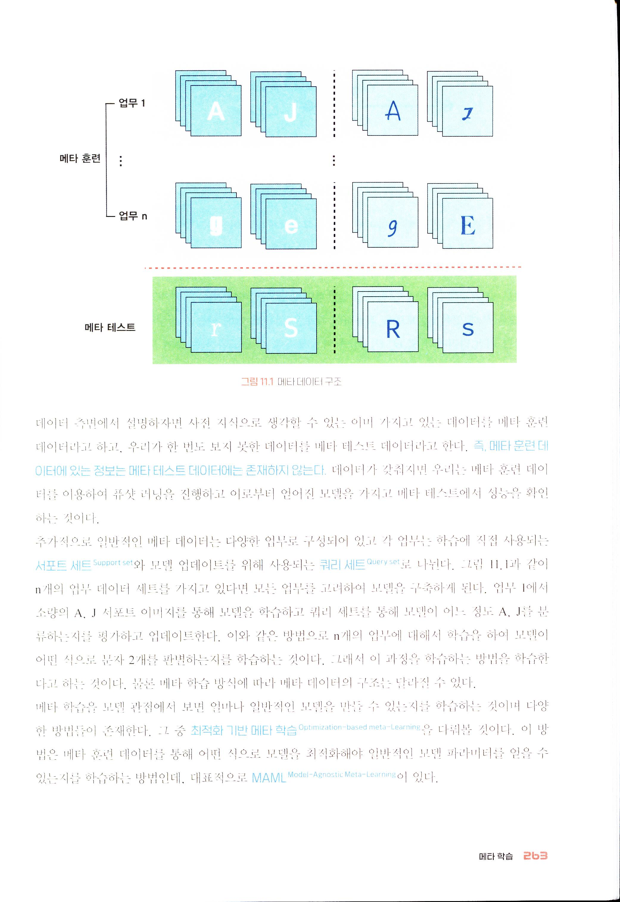
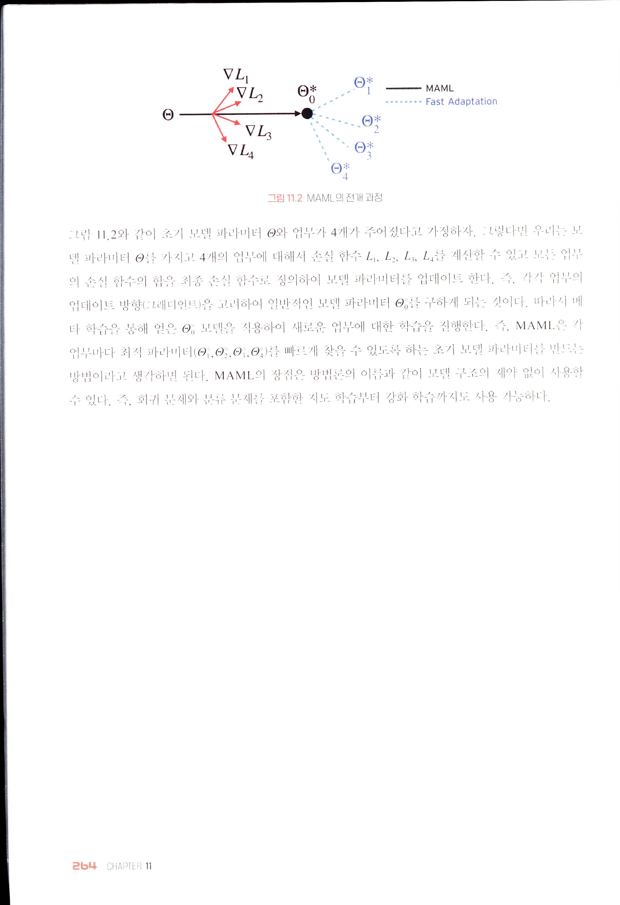
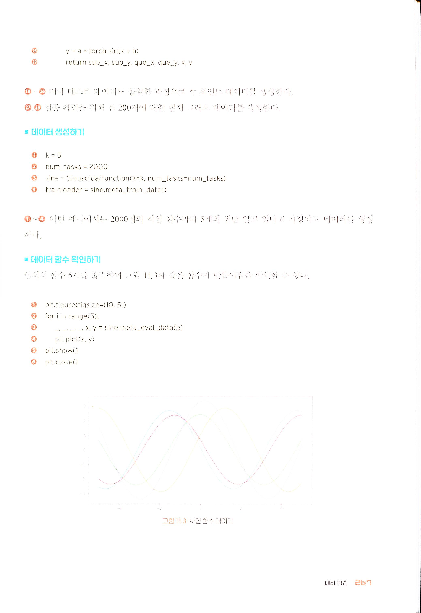
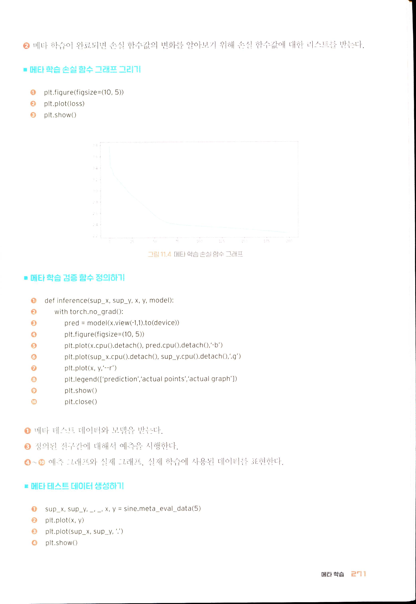
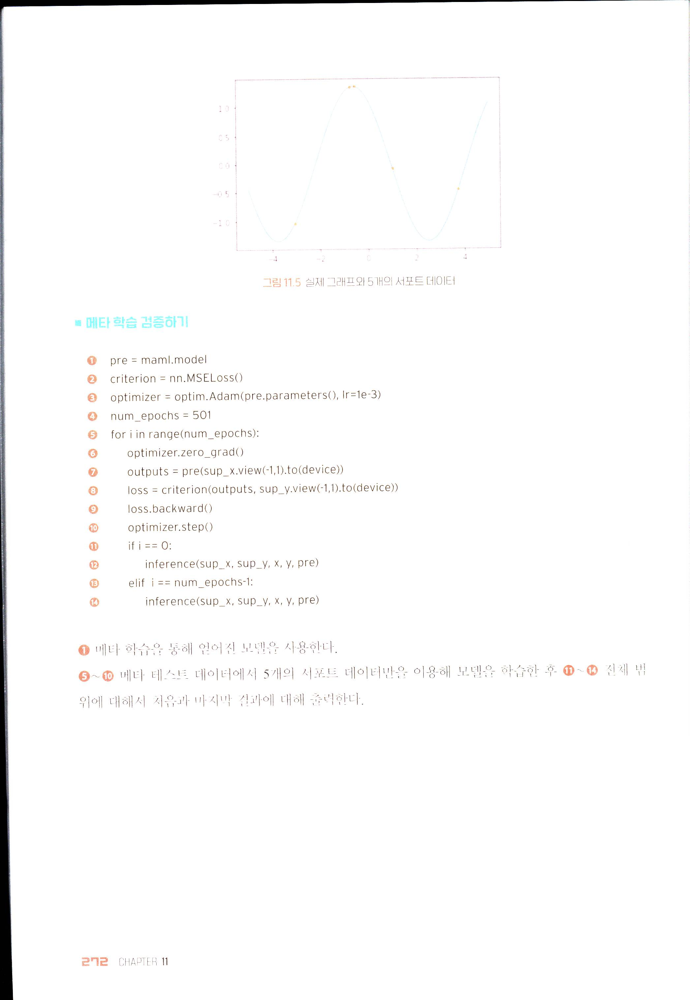
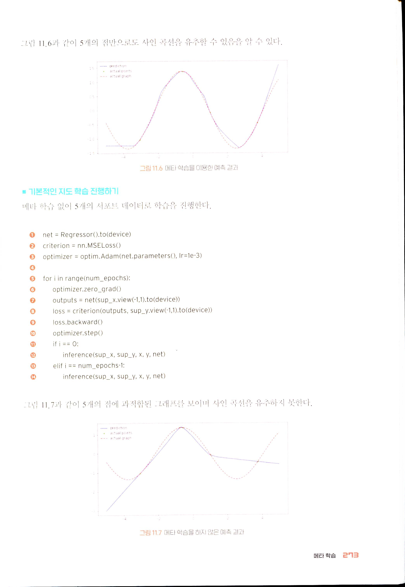
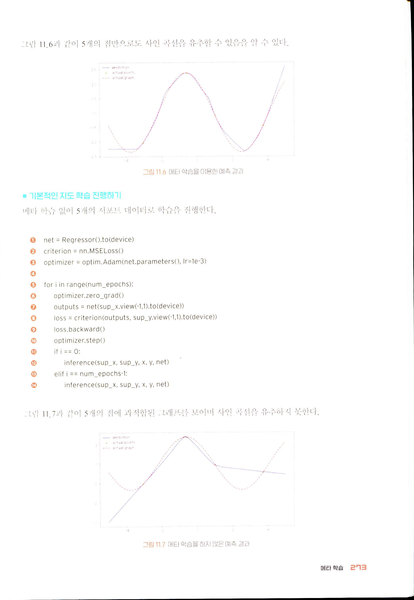

# 11 메타 학습

메타 학습은 메타 데이터라고 불리는 방대한 데이터를 이용해 학습하는 방법을 학습하여 적은 데이터로도 새로운 문제를 빠르게 풀 수 있게 하는 방법론이다. 그중 단 몇 장만으로 학습하는 방법을 퓨샷 러닝이라고 한다. 11장에서는 퓨샷 러닝 방법 중 하나인 MAML을 이용하여 회귀 문제와 분류 문제를 다뤄본다.

- 메타 러닝과 퓨샷 러닝
- MAML - 회귀문제
- MAML - 분류문제

# 11.1 메타 러닝과 퓨샷 러닝

사람은 살면서 다양한 경험을 통해 노하우를 터득한다. 그 노하우를 바탕으로 기존의 실력을 향상시킬 수도 있고 새로운 업무를 보다 빠르게 배울 수도 있다. 예를 들어, 한국어, 영어, 스페인어를 할 수 있고 3개의 언어를 공부하면서 효율적으로 언어를 공부하는 방법을 익혔다면 또 다른 언어에 대해서도 학습 능력이 좋을 것이다. 또한 인지 능력면에서도 기존의 지식을 통해 새로운 것을 유추할 수도 있다. 예를 들어, 우리가 지금까지 1,000여 종의 동물을 봤고 지금 눈앞에 처음 본 동물이 있다고 가정하자. 이때 우리는 기존 지식을 바탕으로 처음 본 동물은 어느 과에 속하겠다라는 것을 유추할 수 있다. 이렇듯, 인간은 수 많은 지식을 습득하고 그 지식을 바탕으로 새로운 사건에 대해서 빠르게 학습하고 판단할 수 있는 능력이 있다.

추가적으로 인간은 어떤 물체를 한 번만 보고 똑같은 물체에 대해서 분류를 할 수 있다. 예를 들어, 지나가는 강아지 한 마리를 봤다면 이후 다른 강아지에 대해서도 강아지라고 판단을 할 수 있다. 즉 이미지 한 장으로도 강아지의 특성을 파악할 수 있다는 의미다. 앞서 언급한 인간의 능력을 기계가 가질 수 없을까라는 생각으로부터 출발한 것이 **메타 학습**<sup>Meta-learning</sup>이다. 메타 학습은 메타 데이터라고 불리는 방대한 데이터를 이용해 학습하는 방법을 학습하여 적은 데이터로도 새로운 문제를 빠르게 풀 수 있게 하는 방법론이다.

일반적인 지도 학습은 방대한 라벨이 있는 데이터가 요구된다. 예를 들어, 기계가 강아지를 분류하기 위해서는 강아지의 앞, 옆, 뒤 등의 다양한 각도의 이미지와 다양한 종에 대한 이미지를 보여줘야만 비로소 기계는 제대로 된 학습을 할 수 있고 예측할 수 있다. 이를 극복하기 위해 9장에서 배운 전이 학습을 적용할 수도 있지만 적은 데이터를 다루는 문제에 대해서는 효과가 없을 수도 있다. 이때 우리는 메타 러닝을 적용해 볼 수 있다.

예를 들어, 어떤 제품에 표시되어 있는 문자 R과 S를 판별하는 신경망을 만들어 보자. 가장 먼저 해야 할 일은 R과 S글씨체의 이미지 데이터를 수집하는 것이다. 안타깝게도 우리가 모은 이미지는 R문자 5장, S문자 5장 뿐이다. 그런데 우리가 다른 문자에 대해서도 데이터가 있다면 비록 적은 양의 데이터라도 우리는 이 데이터를 **퓨샷 러닝**<sup>Few-shot learning</sup>에 사용하여 R, S 판별 모델을 만들 수 있다. 퓨샷 러닝이란 적은 양의 데이터를 가진 여러 가지 **업무**<sup>Task</sup> 세트가 존재할 때 그 업무 세트를 가지고 학습하는 방법을 학습하여 새로운 업무에 대해서 적은 양의 데이터라도 빠르게 학습할 수 있는 메타 학습 방법 중 하나다.

그림 11.1 메타 데이터 구조


데이터 측면에서 설명하자면 사전 지식으로 생각할 수 있는 이미 가지고 있는 데이터를 메타 훈련 데이터라고 하고, 우리가 한 번도 보지 못한 데이터를 메타 테스트 데이터라고 한다. 즉, 메타 훈련 데이터에 있는 정보는 메타 테스트 데이터에는 존재하지 않는다. 데이터가 갖춰지면 우리는 메타 훈련 데이터를 이용하여 퓨샷 러닝을 진행하고 이로부터 얻어진 모델을 가지고 메타 테스트에서 성능을 확인하는 것이다.

추가적으로 일반적인 메타 데이터는 다양한 업무로 구성되어 있고 각 업무는 학습에 직접 사용되는 **서포트 세트**<sup>Support set</sup>와 모델 업데이트를 위해 사용되는 **쿼리 세트**<sup>Query set</sup>로 나뉜다. 그림 11.1과 같이 n개의 업무 데이터 세트를 가지고 있다면 모든 업무를 고려하여 모델을 구축하게 된다. 업무 1에서 소량의 A, J 서포트 이미지를 통해 모델을 학습하고 쿼리 세트를 통해 모델이 어느 정도 A, J를 분류하는지를 평가하고 업데이트한다. 이와 같은 방법으로 n개의 업무에 대해서 학습을 하여 모델이 어떤 식으로 문자 2개를 판별하는지를 학습하는 것이다. 그래서 이 과정을 학습하는 방법을 학습한다고 하는 것이다. 물론 메타 학습 방식에 따라 메타 데이터의 구조는 달라질 수 있다.

메타 학습을 모델 관점에서 보면 얼마나 일반적인 모델을 만들 수 있는지를 학습하는 것이며 다양한 방법들이 존재한다. 그 중 **최적화 기반 메타 학습**<sup>Optimization-based meta-Learning</sup>을 다뤄볼 것이다. 이 방법은 메타 훈련 데이터를 통해 어떤 식으로 모델을 최적화해야 일반적인 모델 파라미터를 얻을 수 있는지를 학습하는 방법인데, 대표적으로 MAML<sup>Model-Agnostic Meta-Learning</sup>이 있다.

그림 11.2 MAML의 전개 과정


그림 11.2와 같이 초기 모델 파라미터 $\Theta$와 업무가 4개가 주어졌다고 가정하자. 그렇다면 우리는 모델 파라미터 $\Theta$를 가지고 4개의 업무에 대해서 손실 함수 $L_1, L_2, L_3, L_4$를 계산할 수 있고 모든 업무의 손실 함수의 합을 최종 손실 함수로 정의하여 모델 파라미터를 업데이트 한다. 즉, 각각 업무의 업데이트 방향(그래디언트)을 고려하여 일반적인 모델 파라미터 $\Theta_0^*$를 구하게 되는 것이다. 따라서 메타 학습을 통해 얻은 $\Theta_0^*$ 모델을 적용하여 새로운 업무에 대한 학습을 진행한다. 즉, MAML은 각 업무마다 최적 파라미터($\Theta_1^*, \Theta_2^*, \Theta_3^*, \Theta_4^*$)를 빠르게 찾을 수 있도록 하는 초기 모델 파라미터를 만드는 방법이라고 생각하면 된다. MAML의 장점은 방법론의 이름과 같이 모델 구조의 제약 없이 사용할 수 있다. 즉, 회귀 문제와 분류 문제를 포함한 지도 학습부터 강화 학습까지도 사용 가능하다.

# 11.2 MAML - 회귀 문제

임의의 사인 함수 위의 몇 개의 점만 주어졌을 때 사인 그래프에 대해 예측을 한다.

#### ■ 라이브러리 불러오기
`CODE 11.2 MAML regression.ipynb`

```python
import torch
from torch import nn, optim
import torch.nn.functional as F
from torch.utils.data import DataLoader, Dataset
from matplotlib import pyplot as plt
```

#### ■ GPU 연산 확인하기

```python
device = torch.device("cuda:0" if torch.cuda.is_available() else "cpu")
```

#### ■ 데이터 생성 클래스 정의하기
배치 데이터 형태로 만들기 위해 텐서 데이터 세트를 정의한다. 입력값은 텐서이므로 별도의 텐서 변환은 진행하지 않는다.

```python
class TensorData(Dataset):
    def __init__(self, x_data, y_data):
        self.x_data = x_data
        self.y_data = y_data
        self.len = self.y_data.shape[0]
    def __getitem__(self, index):
        return self.x_data[index], self.y_data[index]
    def __len__(self):
        return self.len
```

데이터는 사인 함수 y=a*sin(x+b) 데이터를 이용한다.

```python
class SinusoidalFunction:
    def __init__(self, x_range=5, k=5, num_tasks=4):
        self.x_range = x_range #[-x_range, x_range]
        self.pi = torch.acos(torch.zeros(1)).item() * 2
```

```python
        self.k = k
        self.num_tasks = num_tasks
```

- ❶, ❷ 클래스를 정의하고 x정의역의 범위 x_range, 각 함수의 데이터 포인트 개수 k, 함수 개수에 해당하는 업무 수 num_tasks를 입력값으로 받는다.
- ❸ ~ ❻ 클래스 내에서 변수가 활용될 수 있도록 self.를 붙여준다.

```python
    def meta_train_data(self):
        x_points = 2 * self.x_range * (torch.rand((self.num_tasks, 2 * self.k)) - 0.5) # S and Q
        y_points = torch.tensor([], dtype=torch.float)
        for x in x_points:
            a = 4 * (torch.rand(1) + 0.1)
            b = self.pi * torch.rand(1) # [0, pi]
            y = a * torch.sin(x.view(1, -1) + b)
            y_points = torch.cat((y_points, y), 0)
        taskset = TensorData(x_points, y_points)
        trainloader = torch.utils.data.DataLoader(taskset, batch_size=1)
        return trainloader
```

- ❼ 메타 학습 데이터를 만드는 함수를 정의한다.
- ❽ 구간 [-5, 5] 내에서 데이터를 $2 * \text{self.k}$만큼 무작위로 업무 수만큼 뽑는다. 그 이유는 서포트 세트에 k개, 쿼리 세트에 k개를 할당하기 위함이다. 만약 각 함수마다 5개씩 데이터를 갖는 100개의 업무가 있다면 x_points의 크기는 (100, 10)이 되며 10개의 포인트 중 5개는 서포트 세트의 원소이고 나머지 5개는 쿼리 세트의 원소가 된다.
- ❾ ~ ⓮ 각 함수값을 저장하기 위해 빈 텐서를 만들고 각 업무마다 10개의 데이터를 받아 임의의 함수값을 구한다.
- ⓯ ~ ⑰ 생성된 메타 학습 데이터를 하나씩 보내기 위해 DataLoader를 정의한다.

```python
    def meta_eval_data(self, k):
        x_points = 2 * self.x_range * (torch.rand(2 * k) - 0.5)
        a = 4 * (torch.rand(1) + 0.1)
        b = self.pi * torch.rand(1) # [0, pi]
        y_points = a * torch.sin(x_points + b)
        sup_x = x_points[:k]
        sup_y = y_points[:k]
        que_x = x_points[k:]
        que_y = y_points[k:]
        x = torch.linspace(-self.x_range, self.x_range, 200)
```

```python
        y = a * torch.sin(x + b)
        return sup_x, sup_y, que_x, que_y, x, y
```

- ⓲ ~ ㉖ 메타 테스트 데이터도 동일한 과정으로 각 포인트 데이터를 생성한다.
- ⓗ, ⓘ 검증 확인을 위해 점 200개에 대한 실제 그래프 데이터를 생성한다.

#### ■ 데이터 생성하기

```python
k = 5
num_tasks = 2000
sine = SinusoidalFunction(k=k, num_tasks=num_tasks)
trainloader = sine.meta_train_data()
```

- ❶ ~ ❹ 이번 예시에서는 2000개의 사인 함수마다 5개의 점만 알고 있다고 가정하고 데이터를 생성한다.

#### ■ 데이터 함수 확인하기
임의의 함수 5개를 출력하여 그림 11.3과 같은 함수가 만들어짐을 확인할 수 있다.

```python
plt.figure(figsize=(10, 5))
for i in range(5):
    _, _, _, _, x, y = sine.meta_eval_data(5)
    plt.plot(x, y)
plt.show()
plt.close()
```

그림 11.3 사인 함수 데이터


#### ■ 모델 구축하기

```python
class Regressor(nn.Module):
    def __init__(self):
        super().__init__()
        self.fc1 = nn.Linear(1, 40)
        self.fc2 = nn.Linear(40, 40)
        self.fc3 = nn.Linear(40, 1)

    def forward(self, x):
        x = F.relu(self.fc1(x))
        x = F.relu(self.fc2(x))
        x = self.fc3(x)
        return x

    def parameterised(self, x, weights):
        x = F.relu(F.linear(x, weights[0], weights[1]))
        x = F.relu(F.linear(x, weights[2], weights[3]))
        x = F.linear(x, weights[4], weights[5])
        return x
```

- ❶ ~ ❻ 모델은 입력층, 2개의 은닉층, 출력층으로 구성된 MLP로 정의한다. 여기서 중요한 것은 MAML은 각 업무마다 모델 업데이트가 일어나고, 모든 업무에서 구해진 손실 함수를 바탕으로 모델 업데이트가 별도로 일어난다.
- ⓮ ~ ⓲ 중복 계산을 방지하고 모델의 파라미터를 직접 받아 계산할 수 있도록 위에서 정의한 모델 구조와 동일하게 parameterised 함수 내에서 모델을 구축한다. 이때 F로 정의한 torch.nn.functional을 통해 직접 모델 파라미터를 받아서 사용할 수 있다. 예를 들어 앞서 정의된 모델의 파라미터는 self.fc1.weight, self.fc1.bias, self.fc2.weight, self.fc2.bias, self.fc3.weight, self.fc3.bias 순으로 저장되어 있고 이를 weights에 담는다면 그 변수는 차례대로 weights[0], weights[1], weights[2], weights[3], weights[4], weights[5] 형태로 사용할 수 있다.

#### ■ 메타 학습 모델 구축하기

```python
class MAML:
    def __init__(self, trainloader, k, alpha = 1e-2, beta = 1e-3):
        self.device = torch.device("cuda:0" if torch.cuda.is_available() else "cpu")
        self.k = k
        self.model = Regressor().to(device)
        self.weights = list(self.model.parameters())
        self.trainloader = trainloader
```

```python
        self.beta = beta
        self.criterion = nn.MSELoss()
        self.optimizer = optim.Adam(self.model.parameters(), lr=alpha)
```

- ❶, ❷ 각 업무마다 서포트 데이터로 내부적으로 모델을 업데이트하여 쿼리 데이터를 예측한다. 이때 사용되는 학습률 beta를 정하고 각 업무의 쿼리 데이터로부터 얻어진 손실 함수값의 합으로 정의된 손실 함수값을 기준으로 모델을 업데이트하여 실제 일반적인 파라미터를 구하게 되는데, 이때 사용되는 학습률 alpha를 불러온다.
- ❸ GPU 연산을 위해 self.device를 설정한다.
- ❹ 각 업무의 데이터 개수를 정의한다.
- ❺, ❻ 모델을 정의하고 모델 파라미터를 별도로 사용할 수 있도록 self.weights에 모델 파라미터를 지정한다.
- ❾ 함수를 예측하는 회귀 문제로 MSE 손실 함수를 사용한다.
- ❿ 메타 학습을 위해 Adam을 사용한다. 여기서 중요한 것은 메타 학습의 최종 업데이트에는 self.model.parameters()를 이용하고 각 업무별 업데이트는 self.weights를 이용한다. 즉, 각 업무마다 업데이트되는 self.weights는 최종 업데이트되는 변수와는 별도로 운영되며 업무 내에서만 사용되는 변수다.

```python
    def inner_loop(self, data):
        temp_weights = [w.clone() for w in self.weights]
        inputs, values = data[0].to(device), data[1].to(device)
        support_x = inputs[:, :self.k].T
        support_y = values[:, :self.k].T
        query_x = inputs[:, self.k:].T
        query_y = values[:, self.k:].T

        outputs = self.model.parameterised(support_x, temp_weights)
        loss = self.criterion(outputs, support_y)
        grad = torch.autograd.grad(loss, temp_weights)
        tmp = [w - self.beta * g for w, g in zip(temp_weights, grad)]
        outputs = self.model.parameterised(query_x, tmp)
        inner_loss = self.criterion(outputs, query_y)
        return inner_loss
```

- ⓫ inner loop 함수를 통해 각 업무를 수행한다.
- ⓬ 앞서 언급했듯이 self.weights를 이용한 모델을 사용한다.
- ⓭ 데이터를 받는다.

- ⓮ ~ ⑰ 우리가 구성한 data는 서포트 세트와 쿼리 세트가 모두 포함된 형태다. 따라서 각각을 나눠준다.
- ⓳ ~ ⓲ 정해진 학습 횟수만큼 서포트 데이터를 이용하여 temp_weights를 업데이트한다.
- ⓳, ⓴ 업데이트된 모델을 바탕으로 쿼리 데이터를 예측하고 손실 함수를 구한다.
- ⓴ 각 업무의 계산된 손실 함수를 반환한다.

```python
    def meta_train(self, num_epochs):
        n = len(self.trainloader)
        loss_list = []
        for epoch in range(num_epochs):
            self.optimizer.zero_grad()
            outer_loss = 0

            for data in self.trainloader:
                outer_loss += self.inner_loop(data)

            avg_loss = outer_loss/n
            avg_loss.backward()
            self.optimizer.step()
            ll = avg_loss.item()
            loss_list.append(ll)
            if epoch % 10 == 0:
                print(epoch, ll)
        return loss_list
```

- ㉖ 메타 학습 함수를 정의한다.
- ㉗ 각 업무를 불러온다.
- ㉘ 각 업무마다 손실 함수를 계산하여 모두 합한다.
- ㉙ ~ ㉛ 평균을 낸 손실 함수를 목적 함수로 정의하고 모델을 업데이트한다.

#### ■ 메타 학습 수행하기

```python
maml = MAML(trainloader, k=k)
loss = maml.meta_train(201)
```

```
Output:
0 3.3741304874420166
.... 중략 ....
200 2.019240379333496
```

- ❷ 메타 학습이 완료되면 손실 함수값의 변화를 알아보기 위해 손실 함수값에 대한 리스트를 받는다.

#### ■ 메타 학습 손실 함수 그래프 그리기

```python
plt.figure(figsize=(10, 5))
plt.plot(loss)
plt.show()
```

그림 11.4 메타 학습 손실 함수 그래프


#### ■ 메타 학습 검증 함수 정의하기

```python
def inference(sup_x, sup_y, x, y, model):
    with torch.no_grad():
        pred = model(x.view(-1,1).to(device))
        plt.figure(figsize=(10, 5))
        plt.plot(x.cpu().detach(), pred.cpu().detach(),'-b')
        plt.plot(sup_x.cpu().detach(), sup_y.cpu().detach(),'.g')
        plt.plot(x, y,'--r')
        plt.legend(['prediction','actual points','actual graph'])
        plt.show()
        plt.close()
```

- ❶ 메타 테스트 데이터와 모델을 받는다.
- ❸ 정의된 전구간에 대해서 예측을 시행한다.
- ❹ ~ ❿ 예측 그래프와 실제 그래프, 실제 학습에 사용된 데이터를 표현한다.

#### ■ 메타 테스트 데이터 생성하기

```python
sup_x, sup_y, _, _, x, y = sine.meta_eval_data(5)
plt.plot(x, y)
plt.plot(sup_x, sup_y, '.')
plt.show()
```

그림 11.5 실제 그래프와 5개의 서포트 데이터


#### ■ 메타 학습 검증하기

```python
pre = maml.model
criterion = nn.MSELoss()
optimizer = optim.Adam(pre.parameters(), lr=1e-3)
num_epochs = 501
for i in range(num_epochs):
    optimizer.zero_grad()
    outputs = pre(sup_x.view(-1,1).to(device))
    loss = criterion(outputs, sup_y.view(-1,1).to(device))
    loss.backward()
    optimizer.step()
    if i == 0:
        inference(sup_x, sup_y, x, y, pre)
    elif i == num_epochs-1:
        inference(sup_x, sup_y, x, y, pre)
```

- ❶ 메타 학습을 통해 얻어진 모델을 사용한다.
- ❺ ~ ❿ 메타 테스트 데이터에서 5개의 서포트 데이터만을 이용해 모델을 학습한 후 ⓫ ~ ⓮ 전체 범위에 대해서 처음과 마지막 결과에 대해 출력한다.

그림 11.6과 같이 5개의 점만으로도 사인 곡선을 유추할 수 있음을 알 수 있다.

그림 11.6 메타 학습을 이용한 예측 결과


#### ■ 기본적인 지도 학습 진행하기
메타 학습 없이 5개의 서포트 데이터로 학습을 진행한다.

```python
net = Regressor().to(device)
criterion = nn.MSELoss()
optimizer = optim.Adam(net.parameters(), lr=1e-3)

for i in range(num_epochs):
    optimizer.zero_grad()
    outputs = net(sup_x.view(-1,1).to(device))
    loss = criterion(outputs, sup_y.view(-1,1).to(device))
    loss.backward()
    optimizer.step()
    if i == 0:
        inference(sup_x, sup_y, x, y, net)
    elif i == num_epochs-1:
        inference(sup_x, sup_y, x, y, net)
```

그림 11.7과 같이 5개의 점에 과적합된 그래프를 보이며 사인 곡선을 유추하지 못한다.

그림 11.7 메타 학습을 하지 않은 예측 결과


# 11.3 MAML - 분류 문제

CIFAR100 이미지를 이용하여 퓨샷 러닝을 구현한다.

#### ■ 라이브러리 불러오기
`CODE 11.3 MAML classification.ipynb`

```python
import torch
from torch import nn, optim
import torch.nn.functional as F
import torchvision
import torchvision.transforms as tr
from torch.utils.data import DataLoader, Dataset
from matplotlib import pyplot as plt
import numpy as np
import copy
```

#### ■ GPU 연산 확인하기

```python
device = torch.device("cuda:0" if torch.cuda.is_available() else "cpu")
```

#### ■ 데이터 전처리 클래스 정의하기

```python
class MyTransform:
    def __call__(self, sample, mode):
        inputs1, inputs2, labels = sample
        if mode == "train":
            transf = tr.RandomHorizontalFlip()
            output1 = transf(inputs1)
        else:
            output1 = inputs1
        return output1, inputs2, labels
```

- ❶ 전처리 작업의 확장 및 관리를 용이하게 하기 위해 전처리 클래스를 별도로 정의한다.
- ❷, ❸ 데이터의 서포트 이미지(inputs1), 쿼리 이미지(inputs2), 해당 라벨(labels)을 불러온다.
- ❹ ~ ❻ 만약 데이터가 메타 훈련 세트에 있다면 서포트 이미지에 대해서 전처리를 시행한다.
- ❼ 그렇지 않으면 전처리를 시행하지 않는다.

#### ■ 텐서 데이터 클래스 정의하기

```python
class TensorData(Dataset):
    def __init__(self, support_set, query_set, labels, mode="train"):
        self.support_set = torch.FloatTensor(support_set).permute(0,3,1,2)
        self.query_set = torch.FloatTensor(query_set).permute(0,3,1,2)
        self.labels = torch.LongTensor(labels)
        self.len = self.labels.shape[0]
        self.transform = MyTransform()
        self.mode = mode
    def __getitem__(self, index):
        sample = self.support_set[index], self.query_set[index], self.labels[index]
        sample = self.transform(sample, self.mode)
        return sample
    def __len__(self):
        return self.len
```

- ❶ 넘파이 이미지 데이터를 텐서 데이터로 변환하기 위한 클래스를 정의한다.
- ❷ ~ ❹ 서포트 세트와 쿼리 세트는 크기를 (배치 크기, 채널 수, 이미지 너비, 이미지 높이)로 변환하기 위해 permute(0, 3, 1, 2)을 적용한다.
- ❼ 데이터 전처리는 미리 만든 MyTransform()을 기본으로 한다.
- ❿ ~ ⓬ mode에 따라 전처리를 시행하고 배치 크기 만큼 데이터를 반환한다.

#### ■ CIFAR100 데이터 클래스 정의하기

```python
class CIFAR100DataSet:
    def __init__(self, Nway=5, fewshot=5):
        self.cifar = torchvision.datasets.CIFAR100(root='./data', train=True, download=True)
        self.Nway = Nway
        self.fewshot = fewshot
```

- ❶ CIFAR100 데이터를 메타 데이터로 활용한다.
- ❷ 메타 학습에 대한 문제 정의를 한다. 기본적으로 클래스가 5개이고 각 클래스마다 이미지가 5장이 있는 5way-5shot 문제를 다룬다.
- ❸ CIFAR100 데이터를 불러온다.

```python
    def task_generator(self, cls, mode="train"):
        labels = np.array(self.cifar.targets)
        data = self.cifar.data / 255
        support_set = []
        query_set = []
        targets = []
```

- ❻ 업무 하나를 생성하는 함수를 정의한다. 클래스 정보를 받아서 각 클래스마다 미리 설정한 이미지 개수를 생성하는 함수다.
- ❼ 전체 라벨 정보를 정의한다.
- ❽ 전체 이미지 데이터를 받는다.
- ❾ ~ ⓫ 해당 업무 내의 서포트 세트, 쿼리 세트와 그에 대응하는 라벨을 저장하기 위한 리스트를 만든다.

```python
        for i, c in enumerate(cls):
            idx = np.where(labels == c)[0]
            rand = np.random.choice(len(idx), 2*self.fewshot, replace=False)
            for shot in range(2*self.fewshot):
                img = data[idx[rand[shot]]]
                if shot < self.fewshot:
                    support_set.append(img)
                    targets.append(i)
                else:
                    query_set.append(img)
        support_set = np.stack(support_set)
        query_set = np.stack(query_set)
        targets = np.array(targets)
        taskset = TensorData(support_set, query_set, targets, mode=mode)
        dataloader = torch.utils.data.DataLoader(taskset, batch_size=self.Nway*self.fewshot, shuffle=False)
        return dataloader
```

- ⓬ ~ ⓮ 클래스를 하나씩 할당하여 세트를 구성한다. 이미지는 서포트 세트와 쿼리 세트마다 self.fewshot개만큼 들어가기 때문에 $2 * \text{self.fewshot}$개만큼 이미지 인덱스를 무작위로 뽑는다.
- ⓯ ~ ⓴ 뽑은 인덱스를 바탕으로 서포트 세트와 쿼리 세트에 각각 self.fewshot개의 이미지를 할당한다.
- ㉒ ~ ㉕ 리스트로 구성된 세트와 라벨을 넘파이 배열로 바꾸고 텐서 데이터로 변환한다.
- ㉖ 마지막으로 배치 형태의 데이터를 구성하도록 DataLoader를 사용한다.

```python
    def task_set(self, num_tasks, cls, mode="train"):
        task_collection = []
        for i in range(num_tasks):
            task_collection.append(self.task_generator(cls, mode=mode))
        return task_collection
```

- ㉘ 메타 데이터 세트를 구성하기 위해 다수의 업무를 만드는 함수를 정의한다.
- ㉙ 업무 모음을 위한 리스트를 정의한다.
- ㉚, ㉛ for문을 이용하여 하나의 업무를 만드는 self.task_generator를 반복하여 원하는 개수의 업무를 만들어 저장하며 mode에 따라 전처리를 수행하게 한다.

#### ■ CIFAR100 샘플 이미지 확인하기

```python
cifar100 = CIFAR100DataSet(Nway=5, fewshot=5)
trainloader = cifar100.task_generator(cls=[0,10,20,50,70])
data1, data2, label = iter(trainloader).next()
print(data1.size(), data2.size(), label.size())
```

```
Output:
torch.Size([25, 3, 32, 32]) torch.Size([25, 3, 32, 32]) torch.Size([25])
```

- ❶ CIFAR100 데이터를 불러온다.
- ❷ 임의로 클래스 5개를 뽑아 업무 하나를 생성한다.
- ❸ 데이터를 불러온다.
- ❹ 5way-5shot 문제이므로 각 세트마다 25장의 32x32 이미지가 들어 있는지 확인한다.

```python
oneshot1 = data1[0].permute(1,2,0).numpy()
oneshot2 = data2[10].permute(1,2,0).numpy()
plt.figure(figsize=(12, 4))
plt.subplot(131)
plt.imshow(oneshot1)
plt.axis("off")
plt.subplot(132)
plt.imshow(oneshot2)
plt.axis("off")
plt.show()
```

그림 11.8 임의의 이미지 파일 결과


#### ■ 모델 정의하기

```python
class CNN(nn.Module):
    def __init__(self, Nway):
        super(CNN, self).__init__()
        self.features = nn.Sequential(
            nn.Conv2d(3, 64, 3), nn.ReLU(),
            nn.MaxPool2d(2, 2),
            nn.Conv2d(64, 128, 3, stride=1, padding=1), nn.ReLU(),
            nn.MaxPool2d(2, 2),
            nn.Conv2d(128, 256, 3, stride=1, padding=1), nn.ReLU(),
            nn.Conv2d(256, 256, 3, stride=1), nn.ReLU(),
            nn.Conv2d(256, 256, 3, stride=1), nn.ReLU())
        self.classifier = nn.Sequential(nn.Linear(256, 128), nn.ReLU(), nn.Linear(128, Nway))

    def forward(self, x):
        x = self.features(x)
        x = torch.mean(x, [2,3])
        x = self.classifier(x)
        return x
```

- ❶ ~ ⓲ MAML의 학습 시간을 줄이고 이해를 돕기 위해 간단한 합성곱 신경망을 구성한다.

```python
    def parameterised(self, x, weights):
        x = F.relu(F.conv2d(x, weight=weights[0], bias=weights[1], stride=1))
        x = F.max_pool2d(x, kernel_size=2, stride=2)
        x = F.relu(F.conv2d(x, weight=weights[2], bias=weights[3], stride=1, padding=1))
        x = F.max_pool2d(x, kernel_size=2, stride=2)
        x = F.relu(F.conv2d(x, weight=weights[4], bias=weights[5], stride=1, padding=1))
        x = F.relu(F.conv2d(x, weight=weights[6], bias=weights[7], stride=1))
        x = F.relu(F.conv2d(x, weight=weights[8], bias=weights[9], stride=1))
        x = torch.mean(x, [2,3])
        x = F.relu(F.linear(x, weights[10], weights[11]))
        x = F.linear(x, weights[12], weights[13])
        return x
```

- ⓳ ~ ㉚ 위에서 정의한 모델 구조와 동일하게 parameterized 함수 내에서 모델을 구축한다. 이때 F로 정의한 torch.nn.functional을 통해 직접 모델 파라미터를 받아서 사용할 수 있다.

#### ■ MAML 클래스 선언하기

```python
class MAML:
    def __init__(self, num_tasks=300, Nway=5, alpha = 1e-3, beta = 1e-3, inner_steps=1, cls=None):
        self.device = torch.device("cuda:0" if torch.cuda.is_available() else "cpu")
        self.num_tasks = num_tasks
        self.model = CNN(Nway).to(device)
        self.weights = list(self.model.parameters())
        self.beta = beta
        self.cifar100 = CIFAR100DataSet()
        self.task_collection = self.cifar100.task_set(num_tasks=self.num_tasks, cls=cls[:60], mode="train")
        self.meta_val_set = self.cifar100.task_set(num_tasks=30, cls=cls[60:], mode="val")
        self.criterion = nn.CrossEntropyLoss()
        self.optimizer = optim.Adam(self.model.parameters(), lr=alpha, weight_decay=1e-4)
        self.inner_steps = inner_steps
```

- ❺ 클래스 수에 맞게 모델을 구축한다.
- ❻ 모델 변수를 별도로 self.weights로 정의한다.
- ❼ 업무별 업데이트에 활용되는 학습률 beta를 정의한다.
- ❽, ❾ 무작위로 선택된 클래스 60개를 바탕으로 메타 훈련 데이터의 업무를 생성한다.
- ❿ 검증 데이터를 생성한다.
- ⓫, ⓬ 손실 함수와 학습률이 alpha인 최적화 기법을 정의한다.
- ⓭ 업무별 내부 학습을 몇 번 반복할 지 정한다.

```python
    def inner_loop(self, dataloader):
        temp_weights = [w.clone() for w in self.weights]
        data = iter(dataloader).next()
        support, query, label = data[0].to(device), data[1].to(device), data[2].to(device)
        for i in range(self.inner_steps):
            outputs = self.model.parameterised(support, temp_weights)
            loss = self.criterion(outputs, label)
            grad = torch.autograd.grad(loss, temp_weights)
            temp_weights = [w - self.beta * g for w, g in zip(temp_weights, grad)]
        outputs = self.model.parameterised(query, temp_weights)
        inner_loss = self.criterion(outputs, label)
        return inner_loss
```

- ⓯ 모델 변수를 받아 각 업무를 계산할 준비를 한다.
- ⓰ 하나의 업무를 불러온다.
- ⓲ ~ ㉒ 서포트 이미지를 반복 횟수만큼 학습에 이용한다.
- ㉓ ~ ㉕ 내부적으로 업데이트된 모델을 가지고 쿼리 이미지에 대한 손실 함수를 계산하여 반환한다.

```python
    def meta_train(self, num_epochs):
        loss_list = []
        acc = 0
        for epoch in range(num_epochs):
            self.optimizer.zero_grad()
            outer_loss = 0
            for i in range(self.num_tasks):
                outer_loss += self.inner_loop(self.task_collection[i])
            avg_loss = outer_loss/self.num_tasks
            avg_loss.backward()
            self.optimizer.step()
            ll = avg_loss.item()
            loss_list.append(ll)
            val_acc = self.meta_val()
            if epoch % 10 == 0:
                print('[%d] Train loss: %.3f, Validation accuracy: %.2f %%' %(epoch, ll, val_acc))
            if val_acc >= acc:
                acc = val_acc
                print('Saved the model - Validation accuracy: %.2f %%' % (val_acc))
                torch.save(self.model.state_dict(), './models/cifar_maml.pth')
        return loss_list
```

- ㉖ 메타 학습을 위해 함수를 정의한다.
- ㉙ 학습 횟수에 맞게 메타 학습을 진행한다.
- ㉜ ~ ㉝ 업무당 손실 함수를 계산하여 합산한다.
- ㉞ ~ ㉟ 평균 손실 함수를 정의하고 이를 목적 함수로 하여 최적화를 진행한다.
- ㊱, ㊲ 메타 학습의 손실 함수값을 저장한다.
- ㊳ 검증 데이터의 평균 정확도를 계산한다.
- ㊴, ㊵ 학습 10회마다 훈련 손실값과 검증 정확도를 출력한다.
- ㊶ ~ ㊷ 검증 정확도를 기준으로 모델을 저장한다.

```python
    def meta_val(self):
        acc_list = []
        for i in range(len(self.meta_val_set)):
            cnn = copy.deepcopy(self.model)
            criterion = nn.CrossEntropyLoss()
            opt = optim.Adam(cnn.parameters(), lr=1e-2)
            num_epochs = 101
            testloader = self.meta_val_set[i]
            data1, data2, label = iter(testloader).next()
            cnn.train()
            for j in range(num_epochs):
                opt.zero_grad()
                outputs = cnn(data1.to(device))
                loss = criterion(outputs, label.to(device))
                loss.backward()
                opt.step()
            correct = 0
            total = 0
            with torch.no_grad():
                cnn.eval()
                outputs = cnn(data2.to(device))
                _, predicted = torch.max(outputs.data, 1)
                total += label.size(0)
                correct += (predicted == label.to(device)).sum().item()
            acc_list.append(100 * correct / total)
        acc_info = np.array(acc_list)
        avg_acc = np.mean(acc_info)
        return avg_acc
```

- ㊽ 업무 수만큼 평가를 진행한다.
- ㊾ ~ ㊿ 각 업무마다 새로운 모델과 손실 함수 및 최적화를 선언하고 업무를 하나씩 불러온다.
- 58 ~ 71 서포트 세트를 이용하여 학습을 진행하고 쿼리 세트를 이용하여 모델을 평가한다.
- 72 ~ 74 계산된 모든 업무당 검증 정확도를 저장하여 평균 정확도로 반환한다.

#### ■ 메타 학습 진행하기

```python
cls = np.random.choice(range(0, 100), 100, replace=False)
maml = MAML(num_tasks=300, Nway=Nway, cls=cls[:80])
loss = maml.meta_train(501)
```

```
Output:
Files already downloaded and verified
[0] Train loss: 2.976, Validation accuracy: 32.27 %
.... 이하 생략 ....
```

- ❶, ❷ 클래스 100개를 무작위로 섞어 80개를 MAML 클래스에 넣는다. 이 중 60개는 훈련 데이터로 사용되고, 나머지 20개는 검증 데이터로 사용한다. 메타 훈련 데이터의 업무는 300개를 생성한다.
- ❸ 메타 학습은 501번 수행한다.

#### ■ 메타 평가 함수 정의하기

```python
def meta_test(task_collection, pretrained=None):
    acc_list = []
    for i in range(len(task_collection)):
        cnn = CNN(Nway).to(device)
        if pretrained == 'meta':
            cnn.load_state_dict(torch.load('./models/cifar_maml.pth'))
        criterion = nn.CrossEntropyLoss()
        optimizer = optim.Adam(cnn.parameters(), lr=1e-2)
        num_epochs = 101
        testloader = task_collection[i]
        data1, data2, label = iter(testloader).next()
```

- ❶ 일반적으로 성능을 평가하기 위해 전이학습이나 다른 메타 러닝 모델들과 비교하지만, 우리는 간단하게 메타 학습과 단일 지도 학습의 성능 차이를 확인할 수 있는 함수를 정의한다.
- ❸ 업무 수만큼 평가를 진행한다.
- ❺ 메타 학습을 통해 얻은 파라미터를 사용할 경우 저장된 모델 파라미터를 불러온다.
- ❼, ❽ 업무마다 손실 함수와 최적화 방법을 선언한다.
- ❿, ⓫ 각 업무에 대한 데이터를 불러온다.

```python
        cnn.train()
        for j in range(num_epochs):
            optimizer.zero_grad()
            outputs = cnn(data1.to(device))
            loss = criterion(outputs, label.to(device))
            loss.backward()
            optimizer.step()
```

- ⓬ ~ ⓲ 서포트 세트를 이용하여 모델을 업데이트한다.

```python
        correct = 0
        total = 0
        with torch.no_grad():
            cnn.eval()
            outputs = cnn(data2.to(device))
            _, predicted = torch.max(outputs.data, 1)
            total += label.size(0)
            correct += (predicted == label.to(device)).sum().item()
        acc_list.append(100 * correct / total)
    acc_info = np.array(acc_list)
    print('Avg. Test accuracy: %.2f %% ± %.2f' % (np.mean(acc_info), 1.96*np.std(acc_info)/np.sqrt(len(acc_info))))
```

- ⓳ ~ ㉖ 쿼리 세트를 이용하여 모델을 평가한다.
- ㉗ ~ ㉙ 계산된 모든 업무당 검증 정확도를 저장하여 평균 정확도와 95% 신뢰구간을 반환한다.

#### ■ 메타 학습 평가하기

```python
meta_test_set = cifar100.task_set(num_tasks=100, cls=cls[80:])
meta_test(meta_test_set, 'meta')
```

```
Output: Avg. Test accuracy: 42.28 % ± 1.97
```

- ❶ 훈련과 검증에서 사용하지 않은 20개의 클래스에 대해서 100개의 평가 업무를 만든다.
- ❷ 만들어진 업무와 메타 학습에서 얻어진 모델을 바탕으로 평균 정확도와 그에 대한 95% 신뢰구간을 산출한다.

```python
meta_test(meta_test_set)
```

```
Output: Avg. Test accuracy: 35.84 % ± 2.32
```

- ❶ 비교를 위해 메타 학습을 사용하지 않은 경우의 평균 정확도와 그에 대한 95% 신뢰구간을 산출한다. 두 결과를 비교하면 소량(5장)의 이미지로 학습을 시행하는 경우 메타 학습을 통해 얻은 정확도가 6.44% 높다.

> 인공지능에 대한 수요가 매우 많습니다.
>
> — 유리 밀너
