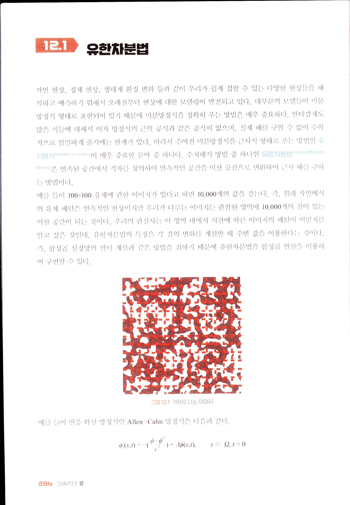
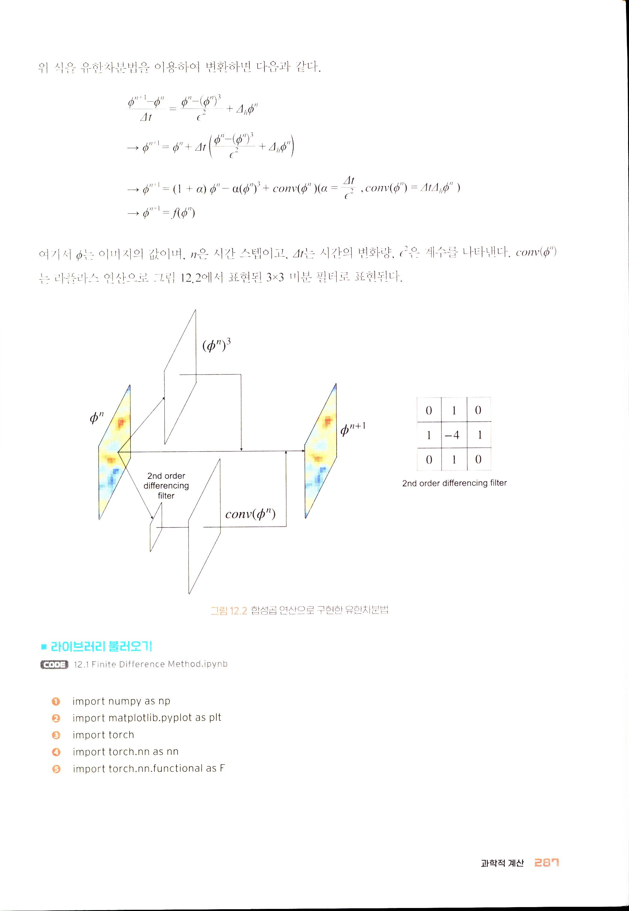
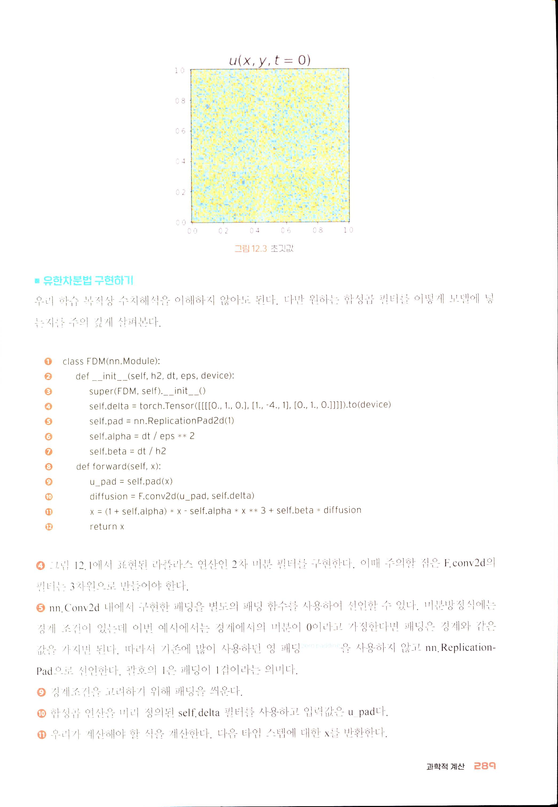
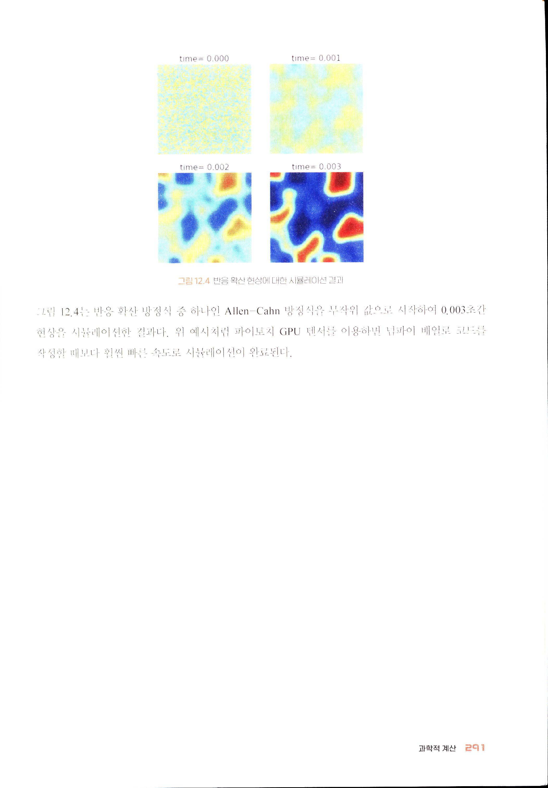
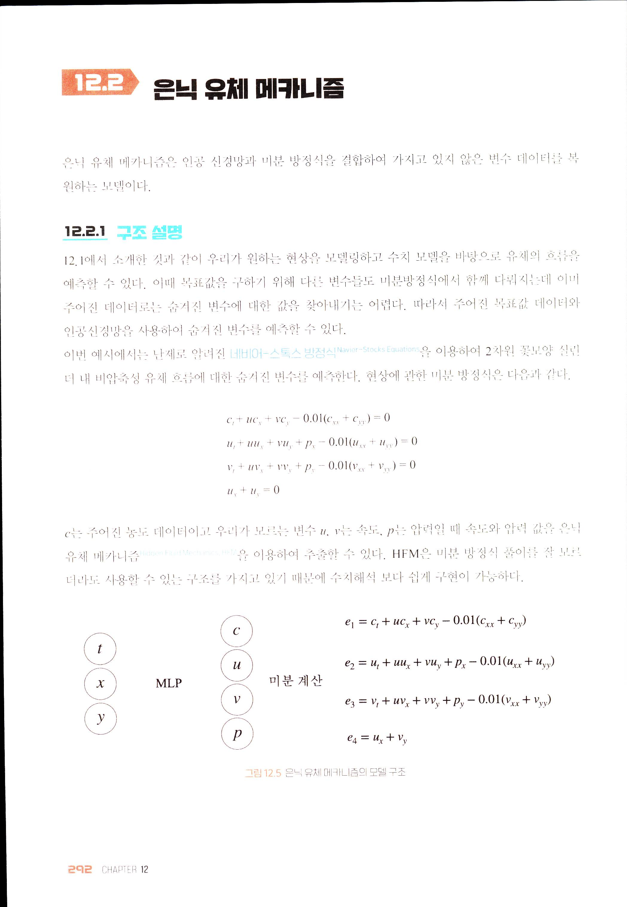
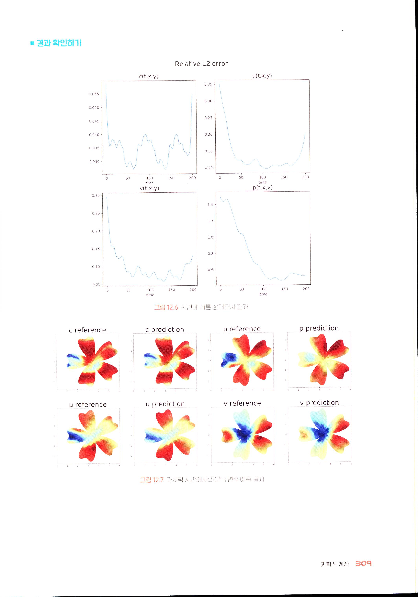
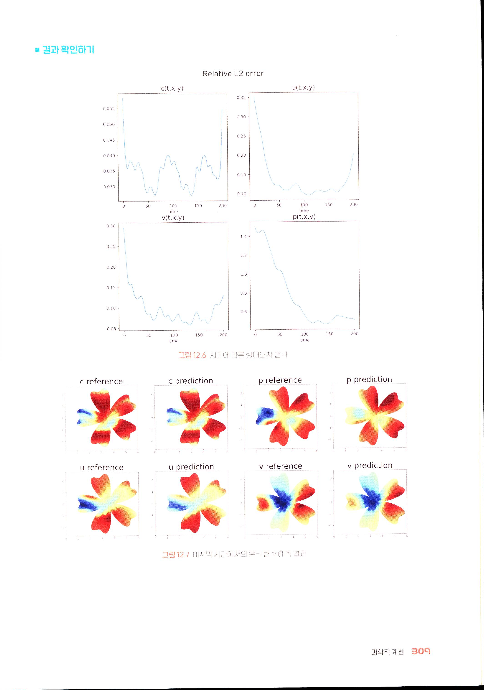

# 12 과학적 계산

자연 현상, 경제 현상, 생태계 환경 변화 등과 같이 우리가 쉽게 접할 수 있는 다양한 현상들을 예측하기 위해 수학적 모델이 많이 개발되고 있고 수치해석 또한 함께 발전되어 왔다. 최근에는 보다 정확한 예측과 실제 데이터를 적용하여 모델을 구축하기 위해 데이터 기반의 머신러닝 방법론들이 적용되기 시작했고 인공 신경망 또한 적용 사례가 늘어나는 추세다. 12장에서는 물리 현상을 표현하는 미분 방정식 풀이를 위한 인공 신경망 예시를 살펴본다.

- 유한차분법
- 은닉 유체 메카니즘

# 12.1 유한차분법

자연 현상, 경제 현상, 생태계 환경 변화 등과 같이 우리가 쉽게 접할 수 있는 다양한 현상들을 해석하고 예측하기 위해서 오래전부터 현상에 대한 모델링이 발전되고 있다. 대부분의 모델들이 미분 방정식 형태로 표현되어 있기 때문에 미분방정식을 정확히 푸는 방법은 매우 중요하다. 안타깝게도 많은 식들에 대해서 이차 방정식의 근의 공식과 같은 공식이 없으며, 실제 해를 구할 수 없어 수학적으로 엄밀하게 풀기에는 한계가 있다. 따라서 주어진 미분방정식을 근사식 형태로 푸는 방법인 수치해석<sup>Numerical analysis</sup>이 매우 중요한 분야 중 하나다. 수치해석 방법 중 하나인 유한차분법<sup>Finite Difference Method</sup>은 연속된 공간에서 격자를 정의하여 연속적인 공간을 이산 공간으로 변환하여 근사 해를 구하는 방법이다.

예를 들어 100×100 유체에 관한 이미지가 있다고 하면 10,000개의 값을 갖는다. 즉, 원래 자연에서의 유체 패턴은 연속적인 현상이지만 우리가 다루는 이미지는 관찰된 영역에 10,000개의 점이 있는 이산 공간이 되는 것이다. 우리의 관심사는 이 영역 내에서 시간에 따른 이미지의 패턴이 어떤지를 알고 싶은 것인데, 유한차분법의 특징은 각 점의 변화를 계산할 때 주변 값을 이용한다는 것이다. 즉, 합성곱 신경망의 필터 계산과 같은 방법을 취하기 때문에 유한차분법을 합성곱 연산을 이용하여 구현할 수 있다.

그림 12.1 격자로 나눈 이미지


예를 들어 반응 확산 방정식인 Allen-Cahn 방정식은 다음과 같다.

$$\phi_t(x,t) = -(\frac{\phi - \phi^3}{\epsilon^2}) + \Delta\phi(x,t), \quad x \in \Omega, t > 0$$

위 식을 유한차분법을 이용하여 변환하면 다음과 같다.

$$\frac{\phi^{n+1} - \phi^n}{\Delta t} = \frac{\phi^n - (\phi^n)^3}{\epsilon^2} + \Delta_h \phi^n$$
$$\rightarrow \phi^{n+1} = \phi^n + \Delta t \left( \frac{\phi^n - (\phi^n)^3}{\epsilon^2} + \Delta_h \phi^n \right)$$
$$\rightarrow \phi^{n+1} = (1 + \alpha)\phi^n - \alpha (\phi^n)^3 + \text{conv}(\phi^n) (\alpha = \frac{\Delta t}{\epsilon^2}, \text{conv}(\phi^n) = \Delta t \Delta_h \phi^n)$$
$$\rightarrow \phi^{n+1} = f(\phi^n)$$

여기서 $\phi$는 이미지의 값이며, $n$은 시간 스텝이고, $\Delta t$는 시간의 변화량, $\epsilon^2$은 계수를 나타낸다. $\text{conv}(\phi^n)$는 라플라스 연산으로 그림 12.2에서 표현된 3×3 미분 필터로 표현된다.

그림 12.2 합성곱 연산으로 구현한 유한차분법


#### ■ 라이브러리 불러오기
`CODE 12.1 Finite Difference Method.ipynb`

```python
import numpy as np
import matplotlib.pyplot as plt
import torch
import torch.nn as nn
import torch.nn.functional as F
```

#### ■ 초깃값 설정하기

```python
def initial_value(nx, ny):
    h = 1 / nx
    x = np.linspace(-0.5 * h, h * (nx + 0.5), nx)
    y = np.linspace(-0.5 * h, h * (ny + 0.5), ny)
    pn = 0.5 * (2 * np.random.rand(nx, ny) - 1)
    plt.figure(figsize=(4, 4))
    plt.imshow(pn, interpolation='nearest', cmap='jet', extent=[x.min(), x.max(), y.min(), y.max()], origin='lower', aspect='auto')
    plt.title('$u(x,y,t=0)$', fontsize=20)
    plt.clim(-1, 1)
    plt.show()
    return x, y, pn
```

- ❶ 초기 이미지를 정해 주기 위해 이미지 사이즈 nx, ny를 정한다.
- ❷ ~ ❹ 이미지의 x, y 격자 수를 정의한다.
- ❺ 정해진 크기에 무작위로 값을 생성한다.
- ❻ ~ ❿ 생성한 초기 이미지를 출력하여 나타낸다.
- ⓫ x, y값과 초깃값을 반환한다.

```python
nx = ny = 100
h = 1/nx
h2 = h**2
dt = .1*h**2
eps = 10 * h / (2 * np.sqrt(2) * np.arctanh(0.9))
maxiter = 301
maxtime = dt * maxiter
x, y, pn = initial_value(nx, ny)
```

- ❶ 이미지 사이즈를 100×100으로 정한다.
- ❷ ~ ❺ 수식에 사용되는 계수를 정의하고
- ❻ 최대 타임 스텝을 301로 정하면
- ❼ 실제 마지막 시간은 maxtime이 된다.
- ❽ 초기 이미지를 생성한다.

그림 12.3 초깃값


#### ■ 유한차분법 구현하기

우리 학습 목적상 수치해석을 이해하지 않아도 된다. 다만 원하는 합성곱 필터를 어떻게 모델에 넣는지를 주의 깊게 살펴본다.

```python
class FDM(nn.Module):
    def __init__(self, h2, dt, eps, device):
        super(FDM, self).__init__()
        self.delta = torch.Tensor([[[[0., 1., 0.], [1., -4., 1], [0., 1., 0.]]]]).to(device)
        self.pad = nn.ReplicationPad2d(1)
        self.alpha = dt / eps ** 2
        self.beta = dt / h2
    def forward(self, x):
        u_pad = self.pad(x)
        diffusion = F.conv2d(u_pad, self.delta)
        x = (1 + self.alpha) * x - self.alpha * x ** 3 + self.beta * diffusion
        return x
```

- ❹ 그림 12.1에서 표현된 라플라스 연산인 2차 미분 필터를 구현한다. 이때 주의할 점은 F.conv2d의 필터는 3차원으로 만들어야 한다.
- ❺ nn.Conv2d 내에서 구현한 패딩을 별도의 패딩 함수를 사용하여 선언할 수 있다. 미분방정식에는 경계 조건이 있는데 이번 예시에서는 경계에서의 미분이 0이라고 가정한다면 패딩은 경계와 같은 값을 가지면 된다. 따라서 기존에 많이 사용하던 영 패딩<sup>zero padding</sup>을 사용하지 않고 nn.ReplicationPad2d로 선언한다. 괄호의 1은 패딩이 1겹이라는 의미다.
- ❾ 경계조건을 고려하기 위해 패딩을 씌운다.
- ❿ 합성곱 연산은 미리 정의된 self.delta 필터를 사용하고 입력값은 u_pad다.
- ⓫ 우리가 계산해야 할 식을 계산한다. 다음 타임 스텝에 대한 x를 반환한다.

#### ■ 유한차분법 클래스 선언하기

```python
device = torch.device("cuda:0" if torch.cuda.is_available() else "cpu")
model = FDM(h2, dt, eps, device).to(device)
img = torch.FloatTensor(pn).view(-1, 1, nx, ny).to(device)
```

- ❷ 유한차분법 클래스를 선언한다.
- ❸ 초기 이미지를 모델에 넣기 위해 4차원 텐서로 변환한다.

#### ■ 유한차분법 시행하기

```python
solutions = []
with torch.no_grad():
    for step in range(maxiter):
        u = model(img)
        img = u # phi^(n+1) <- f(phi^n)
        solutions.append(img.view(nx, ny).cpu().numpy())
```

- ❶ 모든 타임 스텝을 저장할 수 있는 리스트를 만든다.
- ❹, ❺ 유한차분법 모델로 이전 스텝의 이미지를 이용하여 다음 스텝의 이미지를 구한다.
- ❻ 모든 결과 이미지를 넘파이 배열로 저장한다.

#### ■ 결과 확인하기

```python
fig = plt.figure(figsize=(7,7))
d = range(221, 225)
timeslot = np.linspace(0, len(solutions)-1, 4)
for i, subp in enumerate(d):
    plt.subplot(subp)
    plt.imshow(solutions[int(timeslot[i])], interpolation='nearest', cmap='jet', extent=[x.min(), x.max(), y.min(), y.max()], origin='lower', aspect='auto')
    plt.clim(-1,1)
    plt.axis('off')
    plt.title('time= %.3f' %(dt*timeslot[i]), fontsize=15)
plt.show()
```

- ❶ 그래프 전체 사이즈를 정한다.
- ❷ 2행2열 형태의 그래프를 그릴 수 있도록 값을 지정한다.
- ❸ 0초부터 마지막까지 4등분한 시간을 계산한다.
- ❹ ~ ❿ 부분 그래프를 하나씩 만들어 전체를 출력한다.

그림 12.4 반응 확산 현상에 대한 시뮬레이션 결과


그림 12.4는 반응 확산 방정식 중 하나인 Allen-Cahn 방정식을 무작위 값으로 시작하여 0.003초간 현상을 시뮬레이션한 결과다. 위 예시처럼 파이토치 GPU 텐서를 이용하면 넘파이 배열로 코드를 작성할 때보다 훨씬 빠른 속도로 시뮬레이션이 완료된다.

# 12.2 은닉 유체 메카니즘

은닉 유체 메카니즘은 인공 신경망과 미분 방정식을 결합하여 가지고 있지 않은 변수 데이터를 복원하는 모델이다.

### 12.2.1 구조 설명

12.1에서 소개한 것과 같이 우리가 원하는 현상을 모델링하고 수치 모델을 바탕으로 유체의 흐름을 예측할 수 있다. 이때 목표값을 구하기 위해 다른 변수들도 미분방정식에서 함께 다뤄지는데 이미 주어진 데이터로는 숨겨진 변수에 대한 값을 찾아내기는 어렵다. 따라서 주어진 목표값 데이터와 인공신경망을 사용하여 숨겨진 변수를 예측할 수 있다.

이번 예시에서는 난제로 알려진 네비어-스톡스 방정식<sup>Navier-Stocks Equations</sup>을 이용하여 2차원 꽃모양 실린더 내 비압축성 유체 흐름에 대한 숨겨진 변수를 예측한다. 현상에 관한 미분 방정식은 다음과 같다.

$$c_t + u c_x + v c_y - 0.01(c_{xx} + c_{yy}) = 0$$
$$u_t + u u_x + v u_y + p_x - 0.01(u_{xx} + u_{yy}) = 0$$
$$v_t + u v_x + v v_y + p_y - 0.01(v_{xx} + v_{yy}) = 0$$
$$u_x + u_y = 0$$

$c$는 주어진 농도 데이터이고 우리가 모르는 변수 $u, v$는 속도, $p$는 압력일 때 속도와 압력 값을 은닉 유체 메카니즘<sup>Hidden Fluid Mechanics, HFM</sup>을 이용하여 추출할 수 있다. HFM은 미분 방정식 풀이를 잘 모르더라도 사용할 수 있는 구조를 가지고 있기 때문에 수치해석 보다 쉽게 구현이 가능하다.

그림 12.5 은닉 유체 메카니즘의 모델 구조


그림 12.5와 같이 앞 부분은 다층 퍼셉트론으로 구성되어 있으며 입력층의 노드가 3개, 출력층의 노드가 4개인 신경망이다. 입력층에서는 좌표값 $x, y$와 현재 시간 $t$를 받고 다수의 은닉층을 거친 뒤 $c, u, v, p$를 출력한다. 즉, 각 좌표마다 $c, u, v, p$를 예측하는 모델이다. 다음으로 파이토치에서 제공하는 자동 미분을 사용해 수식에 있는 미분항($c_t, v_x$ 등)을 계산한다. 마지막으로 예측한 값을 위 방정식 4개에 대입했을 때 위 등식을 만족해야 하고, $c$에 대해서는 데이터를 가지고 있기 때문에 각 식의 좌변을 $e_1, e_2, e_3, e_4$을 손실 함수로 정의하고 $c$의 예측값과 실제값을 비교를 하는 $c$에 대한 손실 함수를 만들 수 있다. 최종적으로 위 손실 함수 5개를 더해서 전체 손실이 0이 되게 하는 최적화 구조를 만들 수 있으며, 아래와 같이 손실 함수 $L$을 정의할 수 있다.

$$L = \frac{1}{N} \sum_{n=1}^N (c^n - \hat{c}^n)^2 + \sum_{i=1}^4 \frac{1}{M} \sum_{m=1}^M (e_i^m - 0)^2$$

### 12.2.2 모듈 구성하기(HFM 폴더)

코드의 가독성을 위해 각 알고리즘의 목적에 따라 모듈을 구성한다. 이 예시에서는 학습(train.py), 데이터로드(mat_to_numpy.py), 평가(evaluation.py), 모델 및 연산(utils.py)으로 파일을 나눈다.

### 12.2.3 데이터 불러오기
`CODE mat_to_numpy.py`

#### ■ 라이브러리 불러오기

```python
import scipy.io
import numpy as np
import torch
```

- ❶ mat 파일을 넘파이 배열로 변환하는 함수를 제공한다.

#### ■ 데이터 처리 함수 정의하기

```python
def load_data(path, num_samples):
    data = scipy.io.loadmat(path)
    t_star = data['t_star'] # T x 1
    x_star = data['x_star'] # N x 1
    y_star = data['y_star'] # N x 1
    T = t_star.shape[0]
    N = x_star.shape[0]
    U_star = data['U_star'] # N x T
    V_star = data['V_star'] # N x T
    P_star = data['P_star'] # N x T
```

```python
    C_star = data['C_star'] # N x T
    T_star = np.tile(t_star, (1, N)).T # N x T
    X_star = np.tile(x_star, (1, T)) # N x T
    Y_star = np.tile(y_star, (1, T)) # N x T
```

- ❶ 데이터 경로와 뽑을 샘플 수를 입력한다.
- ❷ mat 파일을 넘파이 배열이 있는 딕셔너리 타입으로 불러온다.
- ❸ ~ ⓫ 각 키를 통해서 t, x, y, U, V, P, C 데이터를 불러온다.
- ⓬ ~ ⓮ x, y는 좌표값이므로 모든 타임 스텝에 동일한 값으로 존재한다. 따라서 tile을 통해 반복 배열을 생성한다. 그에 따른 시간 t도 동일 크기로 배열을 생성한다.

다음으로 우리 모델은 MLP에 x, y, t값이 들어가기 때문에 데이터의 크기는 (배치 사이즈×3)으로 구성되어야 한다.

```python
    # For Training
    idx_t = np.concatenate([np.array([0]), np.random.choice(T - 2, T - 2, replace=False) + 1, np.array([T - 1])])
    idx_x = np.random.choice(N, num_samples, replace=False)
    t_data = T_star[:, idx_t][idx_x, :].flatten()[:, None] # ST x 1
    x_data = X_star[:, idx_t][idx_x, :].flatten()[:, None] # ST x 1
    y_data = Y_star[:, idx_t][idx_x, :].flatten()[:, None] # ST x 1
    c_data = C_star[:, idx_t][idx_x, :].flatten()[:, None] # ST x 1
    c_tensor_data = torch.FloatTensor(c_data)
    idx_t = np.concatenate([np.array([0]), np.random.choice(T - 2, T - 2, replace=False) + 1, np.array([T - 1])])
    idx_x = np.random.choice(N, num_samples, replace=False)
    t_eqns = T_star[:, idx_t][idx_x, :].flatten()[:, None] # ST x 1
    x_eqns = X_star[:, idx_t][idx_x, :].flatten()[:, None] # ST x 1
    y_eqns = Y_star[:, idx_t][idx_x, :].flatten()[:, None] # ST x 1
    variables = torch.FloatTensor(np.concatenate((t_data, x_data, y_data), 1)) # ST x 3
    eqns = torch.FloatTensor(np.concatenate((t_eqns, x_eqns, y_eqns), 1)) # ST x 3
    print(f"Number of Time Steps: {T}, Number of sample points: {num_samples} out of {N}")
    return variables, c_tensor_data, eqns, T_star, X_star, Y_star, C_star, U_star, V_star, P_star
```

- ⓰ ~ ㉛ 이를 위해 각 변수를 일렬로 펴서 (배치 사이즈×1)로 만든 뒤 세 변수를 합쳐 (배치 사이즈×3) 크기의 데이터를 확보한다.
- ⓰ idx_t는 시간에 따라 데이터를 섞어주는 인덱스이고 idx_x는 각 좌표를 무작위로 샘플 수만큼 뽑는 인덱스다.
- ⓲ ~ ⓴ 각 변수의 일렬 데이터를 얻는다.

- ㉓ ~ ㉗ 차후 별도로 모델을 활성화하기 위해 바로 앞에서 했던 작업을 한 번 더 한다.
- ㉘, ㉙ (전체 데이터 크기×3) 형태로 텐서로 변환한다.
- ㉛ 학습을 위한 variables, c_tensor_data, eqns와 평가를 위한 T_star, X_star, Y_star, C_star, U_star, V_star, P_star를 반환한다.

### 12.2.4 모델 및 연산(utils.py)

#### ■ 라이브러리 불러오기

```python
import torch
import torch.nn as nn
import numpy as np
```

#### ■ 은닉층 정의하기

은닉층 하나를 LinearBlock으로 만들어 설계한다.

```python
class LinearBlock(nn.Module):
    def __init__(self, in_nodes, out_nodes):
        super(LinearBlock, self).__init__()
        self.layer = nn.utils.weight_norm(nn.Linear(in_nodes, out_nodes), dim=0)
    def forward(self, x):
        x = self.layer(x)
        x = x * torch.sigmoid(x)
        return x
```

- ❹ nn.Linear을 통해 층을 하나 만들고 nn.utils.weight_norm을 이용해 정규화된 가중치를 사용하도록 한다.
- ❼ 은닉층에서는 활성화 함수인 SiLU 함수 $x \cdot \text{sigmoid}(x)$을 적용한다.

#### ■ 모델 정의하기

```python
class PINN(nn.Module):
    def __init__(self, data, layer_list):
        super(PINN, self).__init__()
        device = torch.device("cuda:0" if torch.cuda.is_available() else "cpu")
        self.input_layer = nn.utils.weight_norm(nn.Linear(layer_list[0], layer_list[1]), dim=0)
        self.hidden_layers = self._make_layer(layer_list[1:-1])
        self.output_layer = nn.utils.weight_norm(nn.Linear(layer_list[-2], layer_list[-1]), dim=0)
        self.data = data
        self.mean = self.data.mean(dim=0).to(device)
        self.sig = torch.sqrt(self.data.var(dim=0)).to(device)
    def _make_layer(self, layer_list):
        layers = []
        for i in range(len(layer_list) - 1):
            block = LinearBlock(layer_list[i], layer_list[i + 1])
            layers.append(block)
        return nn.Sequential(*layers)
    def forward(self, x):
        x = (x - self.mean) / self.sig
        x = self.input_layer(x)
        x = x * torch.sigmoid(x)
        x = self.hidden_layers(x)
        x = self.output_layer(x)
        return x
```

- ❺ 입력층을 정의한다.
- ❻ 은닉층을 정의한다.
- ❼ 출력층을 정의한다.
- ❽ ~ ❿ 데이터를 받아 평균과 표준편차를 계산한다.
- ⓫ 은닉층의 노드 정보가 담긴 리스트 layer_list를 받는다.
- ⓬ 은닉층을 쌓을 빈 리스트를 생성한다.
- ⓭ ~ ⓰ 미리 정의한 LinearBlock을 불러와 차례대로 쌓아 은닉층을 nn.Sequential로 반환한다.
- ❷ ~ ⓰ 줄은 모델 구축에 관한 함수이고 forward 함수에서 실제 연산이 일어난다.
- ⓲ 미리 구한 데이터의 평균과 표준편차를 이용해 입력 x, y, t 데이터를 정규화한다.
- ⓳, ⓴ 입력층을 계산한다.
- ㉑ 그 다음 은닉층을 계산한다.
- ㉒, ㉓ 출력층을 계산하여 c, u, v, p를 출력한다.

#### ■ 초기 모델 변수 설정하기

nn.Linear에 대해서 torch.nn.init.xavier_normal를 이용하여 초기 모델 변수를 정규화한 값으로 설정한다.

```python
def weights_init(m):
    if isinstance(m, nn.Linear):
        torch.nn.init.xavier_normal_(m.weight)
```

#### ■ 모델 불러오기

```python
def pinn(data, layer_list):
    device = torch.device("cuda:0" if torch.cuda.is_available() else "cpu")
    model = PINN(data, layer_list).to(device)
    model.apply(weights_init)
    print("Operation mode: ", device)
    return model
```

- ❶ 모델의 각 층의 노드 수를 받아 ❸ 모델을 불러온 뒤 ❹ 초기 모델 변수를 설정한 후 ❻ 모델을 반환한다.

#### ■ 자동 미분 함수 구현하기

```python
def fwd_gradients(obj, x):
    dummy = torch.ones_like(obj)
    derivative = torch.autograd.grad(obj, x, dummy, create_graph= True)[0]
    return derivative
```

- ❸ torch.autograd.grad를 이용하여 미분값을 구한다. 만약 $u$의 $x$에 대한 미분 $u_x$를 계산한다면 코드 내 obj에 미분하고자 하는 함수 u를 입력하고 x에는 미분의 기준이 되는 변수 x를 입력한다. 출력할 미분값을 위한 출력 벡터와 크기가 같은 벡터 dummy를 넣어주고 create_graph를 활성화하여 미분 그래프를 생성한다.

#### ■ 네비어-스톡스 방정식 계산하기

```python
def Navier_Stokes_2D(c, u, v, p, txy, Pec, Rey):
    c_txy = fwd_gradients(c, txy)
    u_txy = fwd_gradients(u, txy)
    v_txy = fwd_gradients(v, txy)
    p_txy = fwd_gradients(p, txy)
```

- ❶ 예측값 c, u, v, p와 t, x, y좌표 데이터인 txy를 불러온다(Pec=100, Rey=100).
- ❷ ~ ❺ 각 변수 c, u, v, p를 t, x, y에 대해 미분한다. 이때 t, x, y에 대한 미분값이 반환된다.

```python
    c_t = c_txy[:, 0:1]
    c_x = c_txy[:, 1:2]
    c_y = c_txy[:, 2:3]
    u_t = u_txy[:, 0:1]
    u_x = u_txy[:, 1:2]
    u_y = u_txy[:, 2:3]
    v_t = v_txy[:, 0:1]
    v_x = v_txy[:, 1:2]
    v_y = v_txy[:, 2:3]
    p_x = p_txy[:, 1:2]
    p_y = p_txy[:, 2:3]
    c_xx = fwd_gradients(c_x, txy)[:, 1:2]
    c_yy = fwd_gradients(c_y, txy)[:, 2:3]
    u_xx = fwd_gradients(u_x, txy)[:, 1:2]
    u_yy = fwd_gradients(u_y, txy)[:, 2:3]
    v_xx = fwd_gradients(v_x, txy)[:, 1:2]
    v_yy = fwd_gradients(v_y, txy)[:, 2:3]
    e1 = c_t + (u * c_x + v * c_y) - (1.0 / Pec) * (c_xx + c_yy)
    e2 = u_t + (u * u_x + v * u_y) + p_x - (1.0 / Rey) * (u_xx + u_yy)
    e3 = v_t + (u * v_x + v * v_y) + p_y - (1.0 / Rey) * (v_xx + v_yy)
    e4 = u_x + v_y
    return e1, e2, e3, e4
```

- ❻ ~ ⓰ 다음 계산된 t, x, y에 대한 미분을 각각 나누어 정의하며 0열은 t에 대한 미분, 1열은 x에 대한 미분, 2열은 y에 대한 미분이다. 이때 2차원을 유지하기 위해서 [:, 0]이 아닌 [:, 0:1]이라고 표현한다.
- ⓱ ~ ㉒ $u_{xx}$와 같이 두 번 미분한 값을 구하기 위해 fwd_gradients를 미분한 것들에 대해 한 번 더 미분한다.
- ㉓ ~ ㉗ 마지막으로 우리가 원하는 e1, e2, e3, e4를 만들어 반환한다.

#### ■ 평가 데이터 추출하기

```python
def test_data(T_star, X_star, Y_star, C_star, U_star, V_star, P_star):
    snap = np.random.randint(0, 200)
    t_star = T_star[:, snap:snap+1]
    x_star = X_star[:, snap:snap+1]
    y_star = Y_star[:, snap:snap+1]
    c_star = C_star[:, snap:snap+1]
    u_star = U_star[:, snap:snap+1]
    v_star = V_star[:, snap:snap+1]
    p_star = P_star[:, snap:snap+1]
    variables_star = torch.FloatTensor(np.concatenate((t_star, x_star, y_star), 1)) # N x 3
    target_star = torch.FloatTensor(np.concatenate((c_star, u_star, v_star, p_star), 1)) # N x 4
    return variables_star, target_star
```

- ❷ ~ ❾ 모든 시점에 대해 평가를 하면 시간이 매우 오래 걸린다. 따라서 간단한 평가를 위해 특정 시간에 대한 데이터만 뽑아 반환한다.
- ❿ 입력 데이터를 만든다.
- ⓫, ⓬ 예측값과 비교를 위해 실제값을 만들어 반환한다.

#### ■ 상대오차 정의하기

실제값 target과 예측값 pred를 받아 L2 상대오차를 통해 성능을 확인한다.

```python
def relative_error(pred, target):
    return torch.sqrt(torch.mean((pred - target)**2)/torch.mean((target - torch.mean(target))**2))
```

$$Relative\ L2\ error = \sqrt{\frac{\sum_{i=1}^N (y_i - \hat{y}_i)^2}{\sum_{i=1}^N (y_i - \mu)^2}} \quad (\mu = \frac{1}{N}\sum_{i=1}^N y_i)$$

### 12.2.5 모델 학습하기(train.py)

#### ■ 라이브러리 불러오기

```python
import argparse
from mat_to_numpy import load_data
import utils
import torch
import numpy as np
from time import time
```

- ❶ argparse를 이용하여 파이썬을 열지 않고 터미널에서 실행하도록 한다.
- ❷, ❸ 미리 만들어 놓은 모듈을 불러온다.
- ❻ 시간 확인용 time 함수를 불러온다.

#### ■ 기본값 설정하기

```python
if __name__ == "__main__":
    parser = argparse.ArgumentParser(description='Hidden Fluid Mechanics - Training')
    parser.add_argument('--version_name', default='0', type=str, help='version name')
    parser.add_argument('--datapath', default='./data/Cylinder2D_flower.mat', type=str, help='data path')
    parser.add_argument('--modelpath', default=None, type=str, help='pretrained model path')
    parser.add_argument('--num_samples', default=157879, type=int, help='number of samples: N out of 157879')
    parser.add_argument('--batch_size', default=10000, type=int, help='batch size')
    parser.add_argument('--total_time', default=40, type=int, help='runtime')
    parser.add_argument('--lr', default=1e-4, type=float, help='learning rate')
    args = parser.parse_args()
    print(args)
```

- ❶ 모든 코드는 main 조건 내부에서 작성한다.
- ❷ parser를 선언하고 간단한 코드 설명을 기입한다.
- ❸ ~ ❾ 학습에 필요한 기본값을 설정한다.
- ❸ version_name은 파일 저장 시 버전에 따라 파일명을 다르게 하기 위한 문자열이다.
- ❽ total_time에서의 40은 40시간을 의미한다.

#### ■ 데이터 불러오기

mat to numpy 모듈에 있는 load_data를 이용해 데이터를 불러온다.

```python
    data, c_data, eqns, T_star, X_star, Y_star, C_star, U_star, V_star, P_star = load_data(args.datapath, args.num_samples)
```

#### ■ 모델 불러오기

```python
    device = torch.device("cuda:0" if torch.cuda.is_available() else "cpu")
    layer_list = [3] + 10 * [200] + [4]
    model = utils.pinn(data, layer_list)
    if args.modelpath != None:
        model.load_state_dict(torch.load(args.modelpath))
```

- ❷ 레이어의 노드 수를 가지고 있는 리스트를 생성한다. 이 예시에서는 [3, 200, 200, ..., 200, 4]으로 구성되어 있으며 모델 생성시 (입력노드, 출력노드) = (3,200), (200,200), ..., (200,200), (200,4)로 정보가 들어가 입력층 1개, 은닉층 8개, 출력층 1개를 갖는 다층 신경망을 구축한다.
- ❸ 데이터 정규화를 위해 데이터를 입력하고 모델 구조를 결정 짓는 layer_list를 입력하여 모델을 생성한다.
- ❹, ❺ 만약 학습된 모델을 사용하기 위해 모델 파일 경로 args.modelpath를 입력했다면 학습된 모델 파라미터를 불러온다.

#### ■ 최적화 정의하기

최적화 방법은 Adam을 사용하고 주어진 학습률 args.lr을 적용한다.

```python
    optimizer = torch.optim.Adam(model.parameters(), lr=args.lr)
```

#### ■ 학습 준비하기

```python
    start_time = time()
    running_time = 0
    it = 0
    min_loss = 1
```

- ❶ 학습 직전의 시간을 체크한다.
- ❷ 학습 누적 시간을 정의한다.
- ❸ 학습 반복 수를 정의한다.

- ❹ 모델 저장을 위해 최소 손실값을 정의한다.

#### ■ 모델 학습하기

```python
    while running_time < args.total_time:
        optimizer.zero_grad()
        idx_data = np.random.choice(args.num_samples, args.batch_size)
        idx_eqns = np.random.choice(args.num_samples, args.batch_size)
        data_batch = data[idx_data, :].to(device)
        c_data_batch = c_data[idx_data, :].to(device)
        eqns_batch = data[idx_eqns, :].to(device)
        data_batch.requires_grad = True
        c_data_batch.requires_grad = True
        eqns_batch.requires_grad = True
        data_outputs = model(data_batch)
        c_data_pred = data_outputs[:, 0:1]
        eqns_outputs = model(eqns_batch)
        c_eqns_pred = eqns_outputs[:, 0:1]
        u_eqns_pred = eqns_outputs[:, 1:2]
        v_eqns_pred = eqns_outputs[:, 2:3]
        p_eqns_pred = eqns_outputs[:, 3:4]
        e1, e2, e3, e4 = utils.Navier_Stokes_2D(c_eqns_pred, u_eqns_pred, v_eqns_pred, p_eqns_pred, eqns_batch, 100, 100)
```

- ❶ 설정한 최대 시간 args.total_time까지 학습을 진행한다.
- ❸ ~ ❼ 배치 학습을 위해 데이터 샘플을 뽑는다.
- ❽ ~ ❿ 자동 미분을 위해 해당 데이터의 requires_grad를 활성화시킨다.
- ⓫ 모델을 통해 c, u, v, p값을 출력한다.
- ⓬ 따라서 data_outputs의 0번째 열은 c, 1번째 열은 u, 2번째 열은 v, 마지막 열은 p이다. 따라서 c_data_pred는 data_outputs[:, 0:1]이다. 여기서 data_outputs[:, 0]으로 작성을 하면 1차원 텐서가 되는데 우리는 2차원 형태로 텐서를 만들기 위해 data_outputs[:, 0:1]로 작성한다.
- ⓭ ~ ⓲ 동일한 방법으로 c, u, v, p값을 예측한 후 목적 함수 e1, e2, e3, e4를 계산한다.

```python
        loss_c = torch.mean((c_data_pred - c_data_batch) ** 2)
        loss_e = torch.mean(e1 ** 2) + torch.mean(e2 ** 2) + torch.mean(e3 ** 2) + torch.mean(e4 ** 2)
        loss = loss_c + loss_e
        loss.backward()
        optimizer.step()

        if loss.item() < min_loss:
```

```python
            min_loss = loss.item()
            torch.save(model.state_dict(), './hfm_' + args.version_name + '.pth')

        if it % 100 == 0:
            elapsed = time() - start_time
            running_time += elapsed / 3600.0
            print('Iteration: %d, Loss: %.3e, Time: %.2fs, Running Time: %.2fh' % (it, loss, elapsed, running_time))
            start_time = time()
```

- ⓳ 첫 번째 예측에서 나온 c를 이용해 손실 함수 loss_c를 정의한다.
- ⓴ 두 번째 예측에서 얻어진 e1, e2, e3, e4의 손실 함수의 합을 loss_e라고 정의한다.
- ㉑ 최종적으로 두 손실 함수를 더해 최적화의 기준이 되는 loss를 정의한다.
- ㉒, ㉓ 다음 최적화를 진행한다.
- ㉕ ~ ㉗ 첫 번째 if문에서는 손실값을 기준으로 모델 파라미터를 저장한다.
- ㉙ ~ ㉝ 100회 학습마다 런타임을 확인하고 진행 상황을 출력한다.

```python
        if (it % 1000 == 0) and (it != 0):
            # Prediction
            with torch.no_grad():
                variables_star, target_star = utils.test_data(T_star, X_star, Y_star, C_star, U_star, V_star, P_star)
                data_star_outputs = model(variables_star.to(device))
                c_star_pred = data_star_outputs[:, 0:1]
                u_star_pred = data_star_outputs[:, 1:2]
                v_star_pred = data_star_outputs[:, 2:3]
                p_star_pred = data_star_outputs[:, 3:4]
                c_target = target_star[:, 0:1].to(device)
                u_target = target_star[:, 1:2].to(device)
                v_target = target_star[:, 2:3].to(device)
                p_target = target_star[:, 3:4].to(device)
                c_error = utils.relative_error(c_star_pred, c_target)
                u_error = utils.relative_error(u_star_pred, u_target)
                v_error = utils.relative_error(v_star_pred, v_target)
                p_error = utils.relative_error(p_star_pred, p_target)
                print('Error: c: %.3f, u: %.3f, v: %.3f, p: %.3f' % (c_error, u_error, v_error, p_error))
        it += 1
        torch.save(model.state_dict(), './hfm_' + args.version_name + '_last.pth')
```

- ㉞ ~ ㊳ 학습 1000회 마다 임의로 특정 시간의 데이터를 뽑아 예측값을 뽑아낸다.
- ㊴ ~ ㊷ 각 변수로 나눠 데이터를 정리한다.

- ㊸ ~ ㊻ 마찬가지로 이에 대응되는 실제값을 정의한다.
- ㊼ ~ 51 이후 각 변수들의 상대오차를 구해 평가를 진행한다.
- 52, 53 마지막으로 매 학습마다 학습 횟수를 세고 만일에 대비하여 매 학습마다 모델을 저장한다.

### 12.2.6 모델 평가하기(evaluation.py)

#### ■ 라이브러리 불러오기 및 기본값 설정하기

관련 라이브러리들을 불러오고 main 조건에 기본값을 설정한다.

```python
import argparse
from mat_to_numpy import load_data
import utils
import torch
import numpy as np
import matplotlib.pyplot as plt
from matplotlib import cm

if __name__ == "__main__":
    parser = argparse.ArgumentParser(description='Hidden Fluid Mechanics - Evaluation')
    parser.add_argument('--datapath', default='./data/Cylinder2D_flower.mat', type=str, help='data path')
    parser.add_argument('--modelpath', default='./hfm_0.pth', type=str, help='pretrained model path')
    args = parser.parse_args()
    print(args)
```

#### ■ 데이터 불러오기

모든 시간에 대해 평가를 진행하지만 평가 속도를 위해 좌표의 일부만 사용해 평가를 진행한다.

```python
    data, _, _, T_star, X_star, Y_star, C_star, U_star, V_star, P_star = load_data(args.datapath, 30000)
```

#### ■ 학습된 모델 불러오기

학습 모델과 동일한 구조를 불러온 후 학습된 파라미터를 불러온다.

```python
    device = torch.device("cuda:0" if torch.cuda.is_available() else "cpu")
    layer_list = [3] + 10 * [200] + [4]
    model = utils.pinn(data, layer_list)
    model.load_state_dict(torch.load(args.modelpath))
```

#### ■ 모델 평가하기

```python
    with torch.no_grad():
        # Prediction
        c_error_list = []
        u_error_list = []
        v_error_list = []
        p_error_list = []
        for snap in range(T_star.shape[1]):
            t_star = T_star[:, snap:snap + 1] # N x 1
            x_star = X_star[:, snap:snap + 1]
            y_star = Y_star[:, snap:snap + 1]
            c_star = C_star[:, snap:snap + 1]
            u_star = U_star[:, snap:snap + 1]
            v_star = V_star[:, snap:snap + 1]
            p_star = P_star[:, snap:snap + 1]
            variables_star = torch.FloatTensor(np.concatenate((t_star, x_star, y_star), 1))
            target_star = torch.FloatTensor(np.concatenate((c_star, u_star, v_star, p_star), 1))
```

- ❸ ~ ❻ 매 시간 상대오차를 저장하기 위해 각 변수마다 리스트를 만든다.
- ❼ 각 시간마다 예측을 진행한다.
- ❽ ~ ⓰ 입력값과 실제값 데이터를 구축한다.

```python
            data_star_outputs = model(variables_star.to(device))
            c_star_pred = data_star_outputs[:, 0:1]
            u_star_pred = data_star_outputs[:, 1:2]
            v_star_pred = data_star_outputs[:, 2:3]
            p_star_pred = data_star_outputs[:, 3:4]
            c_target = target_star[:, 0:1].to(device)
            u_target = target_star[:, 1:2].to(device)
            v_target = target_star[:, 2:3].to(device)
            p_target = target_star[:, 3:4].to(device)
            c_error = utils.relative_error(c_star_pred, c_target)
            u_error = utils.relative_error(u_star_pred, u_target)
            v_error = utils.relative_error(v_star_pred, v_target)
            p_error = utils.relative_error(p_star_pred, p_target)
            c_error_list.append(c_error)
            u_error_list.append(u_error)
            v_error_list.append(v_error)
            p_error_list.append(p_error)
            print('[%d] Error: c: %.3f, u: %.3f, v: %.3f, p: %.3f' % (snap, c_error, u_error, v_error, p_error))
```

- ⓱ ~ ㉙ 학습 때 진행했던 평가 방식과 동일하게 각 예측값을 변수로 나눠 데이터를 만들고 각각 상대오차를 계산한다.
- ㉚ ~ ㉝ 계산된 오차를 저장한다.

#### ■ 상대오차 그래프 저장하기

$2 \times 2$ 부분 그래프 형식으로 c, u, v, p에 대한 상대오차를 그리고 이를 저장한다.

```python
    fig = plt.figure(figsize=(10, 10))
    fig.suptitle('Relative L2 Error', fontsize=15)
    plt.subplot(221)
    plt.plot(c_error_list)
    plt.title('c(t,x,y)', fontsize=15)
    plt.xlabel('time')
    plt.subplot(222)
    plt.plot(u_error_list)
    plt.title('u(t,x,y)', fontsize=15)
    plt.xlabel('time')
    plt.subplot(223)
    plt.plot(v_error_list)
    plt.title('v(t,x,y)', fontsize=15)
    plt.xlabel('time')
    plt.subplot(224)
    plt.plot(p_error_list)
    plt.title('p(t,x,y)', fontsize=15)
    plt.xlabel('time')
    #plt.legend(['c', 'u', 'v', 'p'])
    plt.savefig('./results/error_graph.png')
```

#### ■ 은닉 변수 예측 그래프 저장하기

```python
    ct = c_target.cpu().numpy()
    pt = p_target.cpu().numpy()
    ut = u_target.cpu().numpy()
    vt = v_target.cpu().numpy()

    fig = plt.figure(figsize=(20, 10))
    plt.subplot(241)
    plt.scatter(x_star, y_star, c=ct, cmap=cm.jet)
    plt.clim(np.min(ct), np.max(ct))
    plt.xlim(0, 6)
    plt.title('c reference', fontsize=30)
    plt.subplot(242)
```

```python
    plt.scatter(x_star, y_star, c=c_star_pred.cpu().numpy(), cmap=cm.jet)
    plt.clim(np.min(ct), np.max(ct))
    plt.xlim(0, 6)
    plt.title('c prediction', fontsize=30)
    plt.subplot(243)
    plt.scatter(x_star, y_star, c=pt, cmap=cm.jet)
    plt.clim(np.min(pt), np.max(pt))
    plt.xlim(0, 6)
    plt.title('p reference', fontsize=30)
    plt.subplot(244)
    plt.scatter(x_star, y_star, c=p_star_pred.cpu().numpy(), cmap=cm.jet)
    plt.clim(np.min(pt), np.max(pt))
    plt.xlim(0, 6)
    plt.title('p prediction', fontsize=30)
    plt.subplot(245)
    plt.scatter(x_star, y_star, c=ut, cmap=cm.jet)
    plt.clim(np.min(ut), np.max(ut))
    plt.xlim(0, 6)
    plt.title('u reference', fontsize=30)
    plt.subplot(246)
    plt.scatter(x_star, y_star, c=u_star_pred.cpu().numpy(), cmap=cm.jet)
    plt.clim(np.min(ut), np.max(ut))
    plt.xlim(0, 6)
    plt.title('u prediction', fontsize=30)
    plt.subplot(247)
    plt.scatter(x_star, y_star, c=vt, cmap=cm.jet)
    plt.clim(np.min(vt), np.max(vt))
    plt.xlim(0, 6)
    plt.title('v reference', fontsize=30)
    plt.subplot(248)
    plt.scatter(x_star, y_star, c=v_star_pred.cpu().numpy(), cmap=cm.jet)
    plt.clim(np.min(vt), np.max(vt))
    plt.xlim(0, 6)
    plt.title('v prediction', fontsize=30)
    fig.tight_layout(pad=4.0)
    plt.savefig('./results/last_time_prediction.png')
    plt.close()
```

- ❻ ~ 46 비교를 위해 예측값<sup>prediction</sup>과 실제값<sup>reference</sup>으로 그래프를 나눈 부분 그래프를 활용한다.
- 47 부분 그래프 간의 간격을 조정하고
- 48 그래프를 저장한다.

### 12.2.7 코랩에서 파일 실행하기

#### ■ 모델 학습 진행하기

```bash
!python train.py
```

**Output:**
```
Namespace(batch_size=10000, datapath='./data/Cylinder2D_flower.mat', lr=0.0001, modelpath=None, num_samples=157879, total_time=40)
Number of Time Steps: 201, Number of sample N: 157879 out of 157879
Generated 10000 data
Operation mode: cuda:0
Start training the model..
It: 0, Loss: 3.189e-04, Time: 0.67s, Running Time: 0.00h
Error: c: 0.680, u: 0.563, v: 0.369, p: 4.130
It: 10, Loss: 5.395e-03, Time: 5.91s, Running Time: 0.00h
.... 이하 생략 ....
```

#### ■ 모델 평가 진행하기

학습된 모델을 이용해 결과를 출력한다.

```bash
!python evaluation.py
```

**Output:**
```
Namespace(datapath='./data/Cylinder2D_flower.mat', modelpath='./hfm_0.pth')
Number of Time Steps: 201, Number of sample points: 30000 out of 157879
Operation mode: cuda:0
[0] Error: c: 0.058, u: 0.350, v: 0.295, p: 1.503
.... 이하 생략 ....
```

#### ■ 결과 확인하기

**그림 12.6** 시간에 따른 상대오차 결과


**그림 12.7** 마지막 시간에서의 은닉 변수 예측 결과

