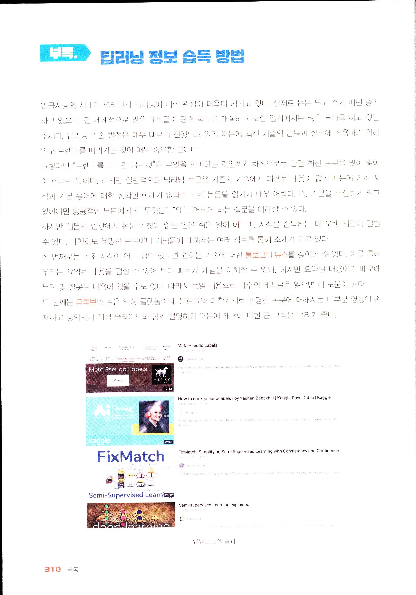
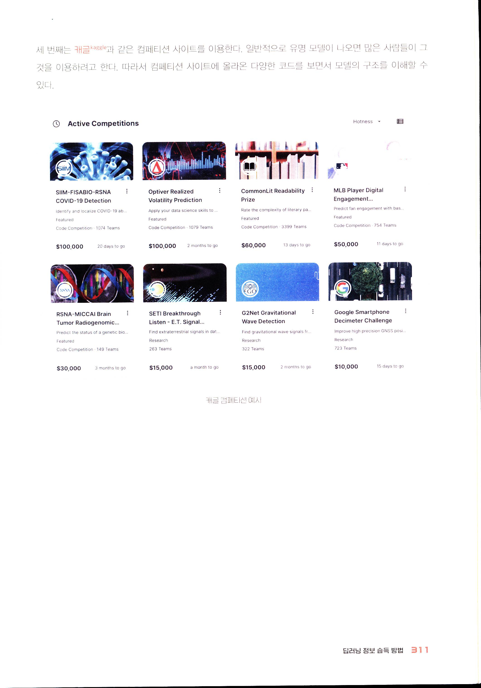
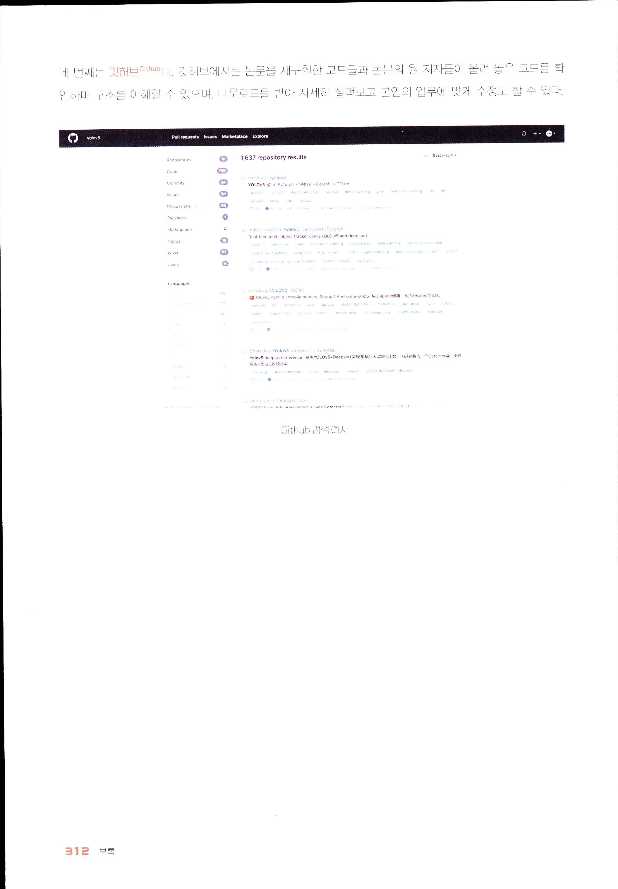
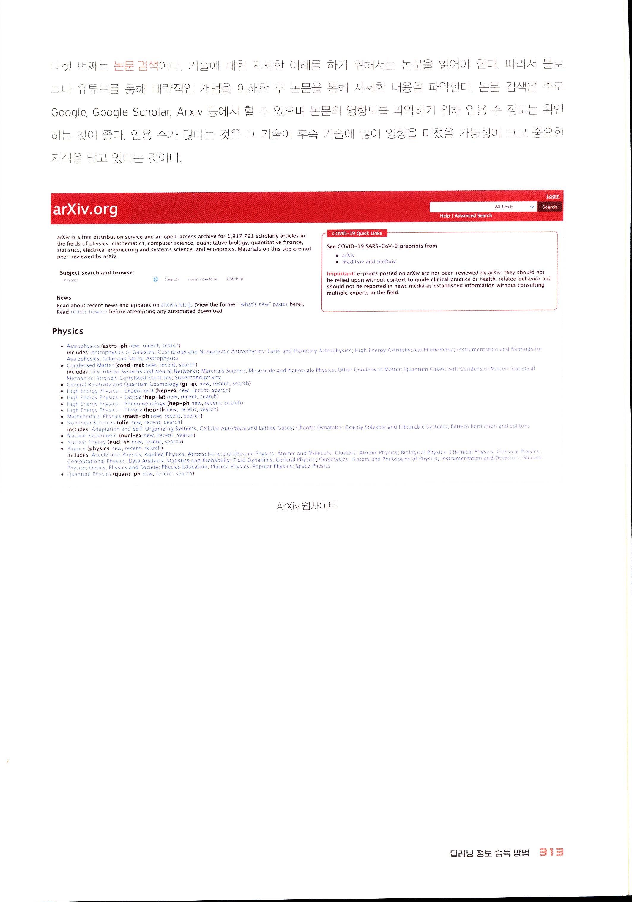
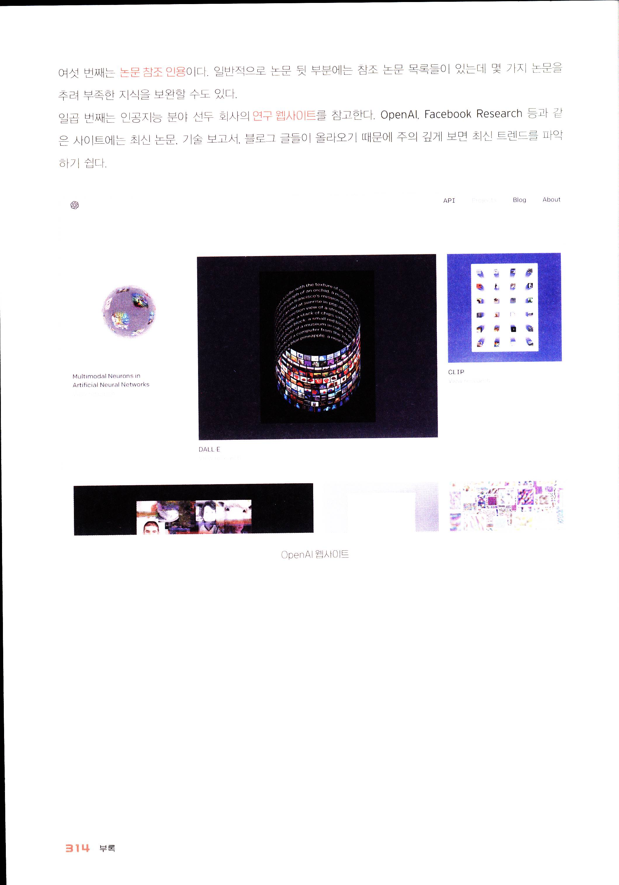
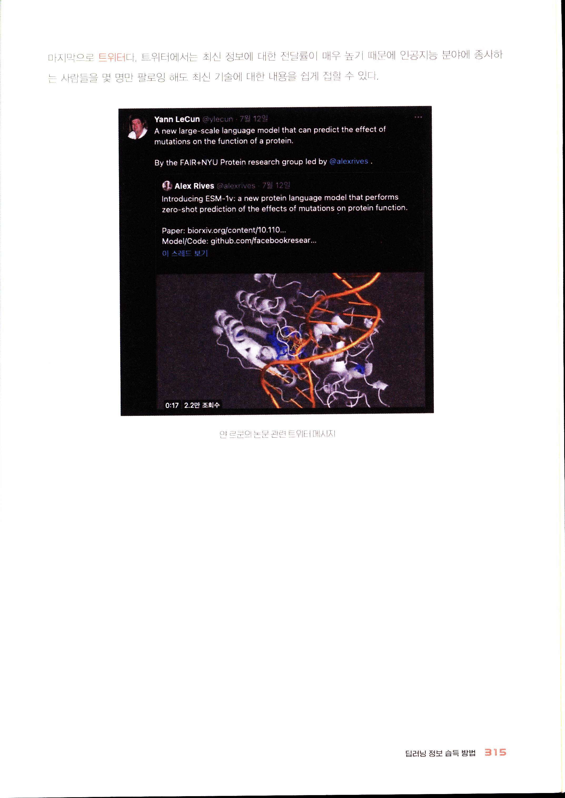

# 부록. 딥러닝 정보 습득 방법

인공지능의 시대가 열리면서 딥러닝에 대한 관심이 더욱더 커지고 있다. 실제로 논문 투고 수가 매년 증가하고 있으며, 전 세계적으로 많은 대학들이 관련 학과를 개설하고 또한 업계에서는 많은 투자를 하고 있는 추세다. 딥러닝 기술 발전은 매우 빠르게 진행되고 있기 때문에 최신 기술의 습득과 실무에 적용하기 위해 연구 트렌드를 따라가는 것이 매우 중요한 분야다.

그렇다면 "트렌드를 따라간다는 것"은 무엇을 의미하는 것일까? 1차적으로는 관련 최신 논문을 많이 읽어야 한다는 뜻이다. 하지만 일반적으로 딥러닝 논문은 기존의 기술에서 파생된 내용이 많기 때문에 기초 지식과 기본 용어에 대한 정확한 이해가 없다면 관련 논문을 읽기가 매우 어렵다. 즉, 기본을 확실하게 알고 있어야만 응용적인 부분에서의 "무엇을", "왜", "어떻게"라는 질문을 이해할 수 있다.

하지만 입문자 입장에서 논문만 찾아 읽는 일은 쉬운 일이 아니며, 지식을 습득하는 데 오랜 시간이 걸릴 수 있다. 다행히도 유명한 논문이나 개념들에 대해서는 여러 경로를 통해 소개가 되고 있다.

첫 번째로는 기초 지식이 어느 정도 있다면 원하는 기술에 대한 블로그나 뉴스를 찾아볼 수 있다. 이를 통해 우리는 요약된 내용을 접할 수 있어 보다 빠르게 개념을 이해할 수 있다. 하지만 요약된 내용이기 때문에 누락 및 잘못된 내용이 있을 수도 있다. 따라서 동일 내용으로 다수의 게시글을 읽으면 더 도움이 된다.

두 번째는 유튜브와 같은 영상 플랫폼이다. 블로그와 마찬가지로 유명한 논문에 대해서는 대부분 영상이 존재하고 강의자가 직접 슬라이드와 함께 설명하기 때문에 개념에 대한 큰 그림을 그리기 좋다.

*유튜브 검색 결과
*

세 번째는 캐글kaggle과 같은 컴페티션 사이트를 이용한다. 일반적으로 유명 모델이 나오면 많은 사람들이 그것을 이용하려고 한다. 따라서 컴페티션 사이트에 올라온 다양한 코드를 보면서 모델의 구조를 이해할 수 있다.

*캐글 컴페티션 예시
*

네 번째는 깃허브Github다. 깃허브에서는 논문을 재구현한 코드들과 논문의 원 저자들이 올려 놓은 코드를 확인하며 구조를 이해할 수 있으며, 다운로드를 받아 자세히 살펴보고 본인의 업무에 맞게 수정도 할 수 있다.

*Github 검색 예시
*

다섯 번째는 논문 검색이다. 기술에 대한 자세한 이해를 하기 위해서는 논문을 읽어야 한다. 따라서 블로그나 유튜브를 통해 대략적인 개념을 이해한 후 논문을 통해 자세한 내용을 파악한다. 논문 검색은 주로 Google, Google Scholar, Arxiv 등에서 할 수 있으며 논문의 영향도를 파악하기 위해 인용 수 정도는 확인하는 것이 좋다. 인용 수가 많다는 것은 그 기술이 후속 기술에 많이 영향을 미쳤을 가능성이 크고 중요한 지식을 담고 있다는 것이다.

*ArXiv 웹사이트
*

여섯 번째는 논문 참조 인용이다. 일반적으로 논문 뒷 부분에는 참조 논문 목록들이 있는데 몇 가지 논문을 추려 부족한 지식을 보완할 수도 있다.

일곱 번째는 인공지능 분야 선두 회사의 연구 웹사이트를 참고한다. OpenAI, Facebook Research 등과 같은 사이트에는 최신 논문, 기술 보고서, 블로그 글들이 올라오기 때문에 주의 깊게 보면 최신 트렌드를 파악하기 쉽다.

*OpenAI 웹사이트
*

마지막으로 트위터다. 트위터에서는 최신 정보에 대한 전달률이 매우 높기 때문에 인공지능 분야에 종사하는 사람들을 몇 명만 팔로잉 해도 최신 기술에 대한 내용을 쉽게 접할 수 있다.

*얀 르쿤의 논문 관련 트위터 메시지
*

# 참고 문헌

- Stanford University, HAI, "2021 AI Index Report"
- Yongho Kim et al. (2021). "Fast and Accurate Numerical Solution of Allen-Cahn Equation"
- Aaron Defazio and Samy Jelassi (2021). "A Momentumized, Adaptive, Dual Averaged Gradient Method for Stochastic Optimization"
- Yongho Kim et al. (2021). "Disturbing Target Values for Neural Network Regularization"
- Stanford University, HAI, "2020 AI Index Report"
- Maziar Raissi et al. (2020). "Hidden fluid mechanics: Learning velocity and pressure fields from flow visualizations"
- C. Shorten and T. M. Khoshgoftaar (2019). "A survey on Image Data Augmentation for Deep Learning"
- Chuanqi Tan et al. (2018). "A Survey on Deep Transfer Learning"
- Moradi Fard et al. (2018) "Deep k-Means: Jointly Clustering with k-Means and Learning Representations"
- Chelsea Finn et al. (2017). "Model-Agnostic Meta-Learning for Fast Adaptation of Deep Networks"
- Terrance DeVries and Graham W. Taylor (2017). "Improved Regularization of Convolutional Neural Networks with Cutout"
- Loshchilov et al. (2016). "SGDR: Stochastic Gradient Descent with Warm Restarts"
- Leon A. Gatys et al. (2016). "Image Style Transfer Using Convolutional Neural Networks"
- Ian Goodfellow et al. (2016). "Deep Learning"
- Alec Radford et al. (2016). "Unsupervised Representation Learning with Deep Convolutional Generative Adversarial Networks"
- Lingxi Xie et al. (2016). "Disturblabel: Regularizing CNN on the loss layer"
- Christian Szegedy (2015). "Rethinking the Inception Architecture for Computer Vision"
- Sergey Ioffe and Christian Szegedy (2015). "Batch Normalization: Accelerating Deep Network Training by Reducing Internal Covariate Shift"
- Bolei Zhou et al. (2015). "Learning Deep Features for Discriminative Localization"
- Diederik P. Kingma and Jimmy Ba (2015). "Adam: A Method for Stochastic Optimization"
- Kaiming He et al. (2015). "Deep Residual Learning for Image Recognition"
- Ian Goodfellow et al. (2014). "Generative Adversarial Networks"
- Nitish Srivastava et al. (2014). "Dropout: a simple way to prevent neural networks from overfitting"
- Dong-Hyun Lee (2013). "Pseudo-Label : The Simple and Efficient Semi-Supervised Learning Method for Deep Neural Networks"

- Alex Krizhevsky et al. (2012) "ImageNet Classification with Deep Convolutional Neural Networks"
- Jonathan Masci et al. (2011). "Stacked Convolutional Auto-Encoders for Hierarchical Feature Extraction"
- Pascal Vincent et al. (2010). "Stacked Denoising Autoencoders: Learning Useful Representations in a Deep Network with a Local Denoising Criterion"
- A. Krizhevsky (2009). "Learning Multiple Layers of Features from Tiny Images"
- L. van der Maaten and G. Hinton (2008). "Visualizing Data using t-SNE"
- M. Schuster and K. K. Paliwal (1997) "Bidirectional recurrent neural networks"
- Yann LeCun et al. (1990). "Handwritten Digit Recognition with a Back-Propagation Network"
- Pytorch documentation, https://pytorch.org/docs/stable/index.html
- scikit-learn Machine Learning in Python, https://scikit-learn.org/stable/

# INDEX

| 영문 | 페이지 | ㄹ | 페이지 | ㅈ | 페이지 |
| :--- | :--- | :--- | :--- | :--- | :--- |
| AlexNet | 131 | 라벨 스무딩 | 221 | 전이 학습 | 228 |
| Bi-LSTM | 160 | 라벨링 | 068 | 정규화 | 210 |
| Class Activation Map | 246 | 라이브러리 | 032 | 조기 종료 | 211 |
| DCGAN | 189 | 리스트 | 034 | 주성분 분석 | 257 |
| GRU | 158 | | | 준지도 학습 | 231 |
| k겹 교차 검증 | 117 | **ㅁ** | | 지도 학습 | 068 |
| K-평균 알고리즘 | 169 | 머신러닝 | 010 | | |
| LSTM | 156 | 메타 학습 | 262 | **ㅊ** | |
| MADGRAD | 115 | 모델 프리징 | 229 | 채널 | 128 |
| ReLU 함수 | 110 | 모듈 | 055 | 최적화 | 069 |
| ResNet | 137 | | | | |
| Softmax 함수 | 111 | **ㅂ** | | **ㅋ** | |
| than 함수 | 110 | 배치 정규화 | 217 | 커널 | 129 |
| t-SNE | 254 | 보폭 | 129 | 클래스 | 056 |
| Vanilla GAN | 182 | 비지도학습 | 167 | | |
| | | | | **ㅌ** | |
| **ㄱ** | | **ㅅ** | | 텐서 | 076 |
| 가중 무작위 샘플링 | 223 | 생성적 적대 신경망 | 181 | 튜플 | 038 |
| 경사하강법 | 083 | 선형 함수 | 109 | | |
| 과적합 | 210 | 손실 함수 | 112 | **ㅍ** | |
| 교란 값 | 220 | 순환 신경망 | 147 | 파이썬 | 013 |
| 교란 라벨 | 218 | 시계열 데이터 | 146 | 파이토치 | 013 |
| 교차 검증 | 117 | 시그모이드 함수 | 109 | 패딩 | 129 |
| 구글 코랩 | 013 | | | 패치 데이터 | 070 |
| 그래디언트 | 081 | **ㅇ** | | 풀링 | 129 |
| | | 양방향 LSTM | 160 | 퓨샷 러닝 | 262 |
| **ㄴ** | | 역전파 | 081 | 필터 | 129 |
| 넘파이 | 041 | 오토인코더 | 172 | | |
| | | 유한차분법 | 286 | **ㅎ** | |
| **ㄷ** | | 의사 라벨링 | 231 | 하이퍼 파라미터 | 113 |
| 다층 퍼셉트론 | 098 | 이미지 스타일 변이 | 192 | 함수 | 054 |
| 단층 퍼셉트론 | 098 | 이미지 처리 | 128 | 합성곱 | 129 |
| 데이터 불균형 | 223 | 인공 신경망 | 011 | 합성곱 오토인코더 | 177 |
| 데이터 증식 | 210 | | | 혼동 행렬 | 226 |
| 드롭아웃 | 216 | | | 확률적 경사하강법 | 114 |
| 디노이징 오토인코더 | 175 | | | 활성화 함수 | 108 |
| 딕셔너리 | 038 | | | | |
| 딥러닝 | 010 | | | | |

# PYTORCH BASIC

지도, 비지도, 준지도, 전이, 메타 학습까지
**딥러닝을 위한 파이토치 입문**

1판 1쇄 발행 2022년 1월 20일

- **저자**: 딥러닝호형
- **발행인**: 김길수
- **발행처**: (주)영진닷컴
- **주소**: (우)08507 서울특별시 금천구 가산디지털1로 128 STX-V 타워 4층 401호
- **등록**: 2007. 4. 27. 제16-4189

©2022. (주)영진닷컴

**ISBN** 978-89-314-6591-4

이 책에 실린 내용의 무단 전재 및 무단 복제를 금합니다.  
파본이나 잘못된 도서는 구입하신 곳에서 교환해 드립니다.

YoungJin.com 영진닷컴

# 영진닷컴 프로그래밍 도서

영진닷컴에서 출간된 프로그래밍 분야의 다양한 도서들을 소개합니다.  
파이썬, 인공지능, 알고리즘, 안드로이드 앱 제작, 개발 관련 도서 등 초보자를 위한 입문서부터 활용도 높은 고급서까지 독자 여러분께 도움이 될만한 다양한 분야, 난이도의 도서들이 있습니다.

- **플러터 프로젝트** | 시모네 알레산드리아 저 | 520쪽 | 30,000원
- **Node.js 디자인 패턴 바이블** | Mario Casciaro, Luciano Mammino 저 | 668쪽 | 32,000원
- **나쁜 프로그래밍 습관** | 칼 비쳐 저 | 256쪽 | 18,000원
- **다재다능 코틀린 프로그래밍** | 벤컷 수브라마니암 저 / 우민식 역 | 488쪽 | 30,000원
- **유니티를 이용한 VR 앱 개발** | 코노 노부히로, 마츠시마 히로키, 오오시마 타케나오 저 | 452쪽 | 32,000원
- **유니티를 몰라도 만들 수 있는 유니티 2D 게임 제작** | Martin Erwig 저 | 336쪽 | 18,000원
- **돈 되는 안드로이드 앱 만들기** | 조상철 저 | 512쪽 | 29,000원
- **친절한 R with 스포츠 데이터** | 황규인 저 | 416쪽 | 26,000원
- **게임으로 배우는 파이썬** | 다나카 겐이치로 저 | 288쪽 | 17,000원
- **바닥부터 배우는 강화 학습** | 노승은 저 | 304쪽 | 22,000원
- **도커 실전 가이드** | 사쿠라이 요이치로, 무라사키 다이스케 저 | 352쪽 | 24,000원
- **단숨에 배우는 타입스크립트** | 야코프 페인, 안톤 모이세예프 저 / 이수진 역 | 536쪽 | 32,000원

# 영진닷컴의 친절한 도서 소개

## 그림으로 배우는 양자 컴퓨터
- 미나토 유이치로 저 | 이승훈 역 | 192쪽 | 18,000원
- 수학이나 물리학, 프로그래밍에 관한 사전 지식이 없어도 양자 컴퓨터의 원리와 구조를 이해할 수 있다. 양자의 기본적인 성질과 계산 기초 원리부터 자세하게 설명하여 양자 컴퓨터 이론을 알기 쉽게 전달한다. 다양한 그림을 통해 양자 컴퓨터의 구조와 알고리즘 작동 방식을 배우고 난 후 간단한 PC 시뮬레이터로 앞에서 배운 내용을 실습해볼 수 있다.

## AWS로 시작하는 AI 서비스 with 파이썬
- 이노우에 켄이치 저 | 양성건 역 | 248쪽 | 22,000원
- AWS에서 제공하는 AI 서비스를 따라하며 실제 실무에 적용해 본다. 인공지능 개념과 역사부터 선형회귀, 딥러닝 등 대표적인 기계학습 알고리즘, 기계학습을 사용하기 위한 SageMaker, EC2, AMI 등의 구현 경험과 Amazon Recognition, Amazon Comprehend, Amazon Textract, Amazon Translate 등의 서비스를 소개한다.

# PYTORCH

## 파이토치로 시작하는 딥러닝 입문

파이썬 기초부터 파이토치 활용 방법까지 필수 지식을 담고 있는 딥러닝 입문서입니다. 인공 신경망에서 쓰이는 필수 개념들과 응용 방법들이 어떻게 구현되는지 쉽게 이해할 수 있도록 코드 라인별로 설명합니다. 지도 학습, 비지도 학습, 준지도 학습, 전이 학습, 메타 학습, 과학적 계산 등 포괄적인 내용을 다루고 있으며, 딥러닝 최신 기술에 대한 정보를 얻는 방법도 소개하고 있습니다.

### CONTENTS
- 01. 딥러닝 시작
- 02. 파이썬
- 03. 지도 학습
- 04. 파이토치 기본
- 05. 인공 신경망
- 06. 합성곱 신경망
- 07. 순환 신경망
- 08. 비지도 학습
- 09. 성능 개선
- 10. 시각화
- 11. 메타 학습
- 12. 과학적 계산

**예제 소스 다운로드**
영진닷컴 홈페이지(www.youngjin.com) - 고객센터 - 부록 CD 다운로드

프로그래밍 | 25,000원  
ISBN 978-89-314-6591-4  
YoungJin.com 영진닷컴
